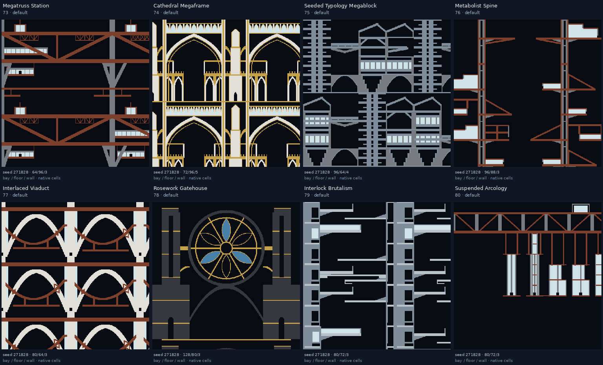
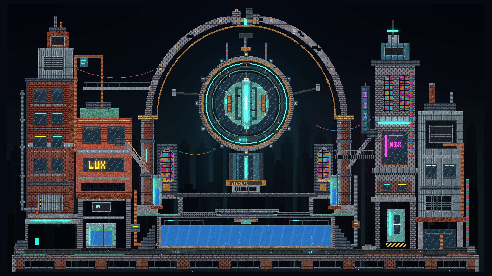
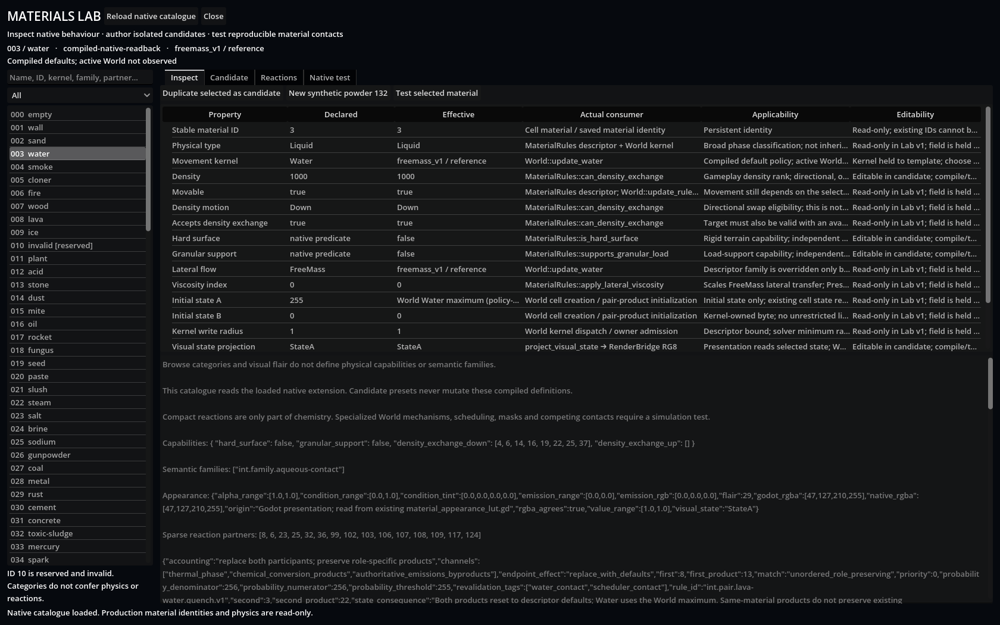

# CyberSand

**Build a world from materials. Set it in motion. Keep experimenting.**

CyberSand is a native C++20 cellular simulation hosted by Godot: an interactive
Workbench for painting, generating and exploring material worlds, with physical
actors, configurable Water solvers and tools for authoring playable scenes.
It is also a growing foundation for cyberpunk exploration and RPG gameplay.



*Eight of the 80 Genteks available in the Architectural Generator. These are
native material maps. The [gallery](docs/images/gentek80-integration/README.md)
retains its original render source and runtime identity.*

[Get started](docs/operations/getting-started.md) ·
[First Workbench session](docs/operations/workbench-first-session.md) ·
[Documentation](docs/README.md) ·
[Current state and roadmap](docs/reference/status-and-roadmap.md)

## Make, play and inspect

| Start with… | What you can do |
| --- | --- |
| **Shared Workbench** | Paint a blank canvas or install a generated map, place independent actors, switch the pilot, run the simulation and save an authored starting scene. |
| **Painting and history** | Brush, erase, draw lines and shapes, select, fill, copy and paste materials. Paused edits share native-confirmed Undo/Redo with Art drawing. |
| **Architectural Generator** | Combine up to five style slots, choose Genteks and presets, adjust geometry, materials and apertures, inspect a native preview, then explicitly install it. |
| **Water Lab** | Compare Wave Flow, FreeMass, PressureFlow and Inertial; inspect applied settings, tune Wave motion, and experiment with Water transport and equipment. |
| **Actors and equipment** | Compose flyers, articulated machines and reference bodies; try human, scripted and admitted external-policy control in the same material scene. |
| **Materials Lab** | Inspect declared and effective material properties, edit candidate copies, and compare them in isolated native tests without changing production material definitions. |
| **Art Workbench** | Draw structured JSON or connect a configured local/cloud model provider. Work areas, protection, Stop and native result receipts keep drawing explicit. |

These are accepted-source capabilities. Their limits matter: saved starts
reconstruct authored scenes; they do not resume every temperature, velocity or
simulation tick. Materials Lab candidates stay isolated. Hosted tests and
screenshots do not establish physical GPU performance or human playfeel.

## A few places to explore



*Neon Reliquary is an existing standalone showcase, with three connected
district destinations below it. This retained application capture illustrates
that showcase; it is not a screenshot of the current Workbench interface.*



*Materials Lab's retained inspection capture. The [Lab guide](docs/operations/materials-lab-authoring.md)
explains which properties are effective, which candidates can be tested and
which changes are not applied to the running Workbench.*

For more, visit [Deepworks](docs/operations/deepworks-exhibition.md),
[Blacksite Nine](docs/operations/blacksite-nine-demo.md),
[the Gentek catalogue](docs/images/gentek80-integration/README.md),
[Player playground](docs/systems/player-control-playground.md), or the
[showcase guide](docs/operations/showcase-guide.md). Standalone Strata Theatre,
Semantic depth and World Art have their own workflows; their presence does not
imply four-plane authoring in the ordinary Workbench.

## Start on desktop

Use a complete source checkout with Git LFS and the exact pinned
**Godot 4.7.stable.official.5b4e0cb0f**. Retained native libraries must match the
checkout's recorded native inputs. A complete, source-identified evaluator is
another route; keep its bundled files together and use its supplied launcher.

```sh
git clone https://github.com/techrote/cybersand.git
cd cybersand
git lfs install
git lfs pull
```

On Windows, run the repository launcher with your pinned Godot executable:

```powershell
.\launch-desktop.cmd -Godot "C:\Tools\Godot\Godot_v4.7-stable_win64.exe"
```

Choose **Development workbench** in the feature launcher. The
[getting-started guide](docs/operations/getting-started.md) covers Linux,
runtime checks, evaluator packages and first-launch problems. The
[build guide](docs/operations/local-build-and-validation.md) covers compiling
the native engine and GDExtension. The companion workspace's `dev.cmd` is not a
command supplied by this source repository.

Desktop is the primary authoring path. Web execution and the GDScript fallback
have distinct ownership, tooling and material limits; do not assume desktop
parity. **F2 returns to the launcher and closes the current session**—save an
authored start before leaving work you want to keep.

## Learn by doing

| Goal | Guide |
| --- | --- |
| Build a small material experiment and reopen it | [First Workbench session](docs/operations/workbench-first-session.md) |
| Use shapes, Fill, Copy/Paste and shared history | [Painting and history](docs/operations/workbench-painting-and-history.md) |
| Generate architecture and vary its construction | [Architectural Generator](docs/operations/architectural-generator-playtest.md) |
| Understand Save, Restore and Flatten | [Saving authored worlds](docs/operations/workbench-saving.md) |
| Use local-model or direct drawing | [Art Workbench](docs/operations/workbench-art.md) |
| Compose actors and switch control | [Mixed Actor Workshop](docs/operations/workbench-actor-composition.md) |
| Compare Water laws in one window | [Water Lab](docs/operations/workbench-water-lab.md) |

## Inside the engine

C++ owns authoritative cells, material rules and native simulation work. Godot
owns presentation, input and application interfaces; Rapier supplies physical
body simulation behind the engine's integration boundary. The desktop simulation
owner and main-thread scene/physics objects exchange bounded requests and copied
results. Rendered colours are not a substitute for native stored material IDs.

Start with the [architecture overview](docs/architecture/overview.md),
[ownership and lifetimes](docs/architecture/data-ownership-and-lifetimes.md),
[material rules](docs/systems/materials-and-rule-kernels.md) and
[authoring contract](docs/architecture/shared-workbench-authoring-data.md).
Developers should read [AGENTS.md](AGENTS.md), the
[current handover](docs/operations/cybersand-codex-development-handover.md),
[build and validation](docs/operations/local-build-and-validation.md), and
[contribution guidance](CONTRIBUTING.md).

## Where the project is heading

The direction is a reusable authoring and simulation foundation for expressive,
playable cyberpunk worlds. Work on presentation responsiveness, destructible
structures, persistent areas, richer actor control, staged agent construction
and integrated layered scenes continues in separate candidates. The
[roadmap](docs/reference/status-and-roadmap.md) distinguishes accepted behavior,
approved intent and unmerged work. CyberSand is not a finished RPG.

Historical experiments remain available through the deliberately separate
[engineering history](docs/history/engineering/README.md). Their original
findings and restrictions retain their dated scope.

## License and acknowledgements

No public license has been selected for original CyberSand source, assets or
documentation. See [license status](LICENSE_STATUS.md) before redistribution.
[Third-party notices](THIRD_PARTY_NOTICES.md) preserve the terms and provenance
of Godot, Rapier and other dependencies and references.
