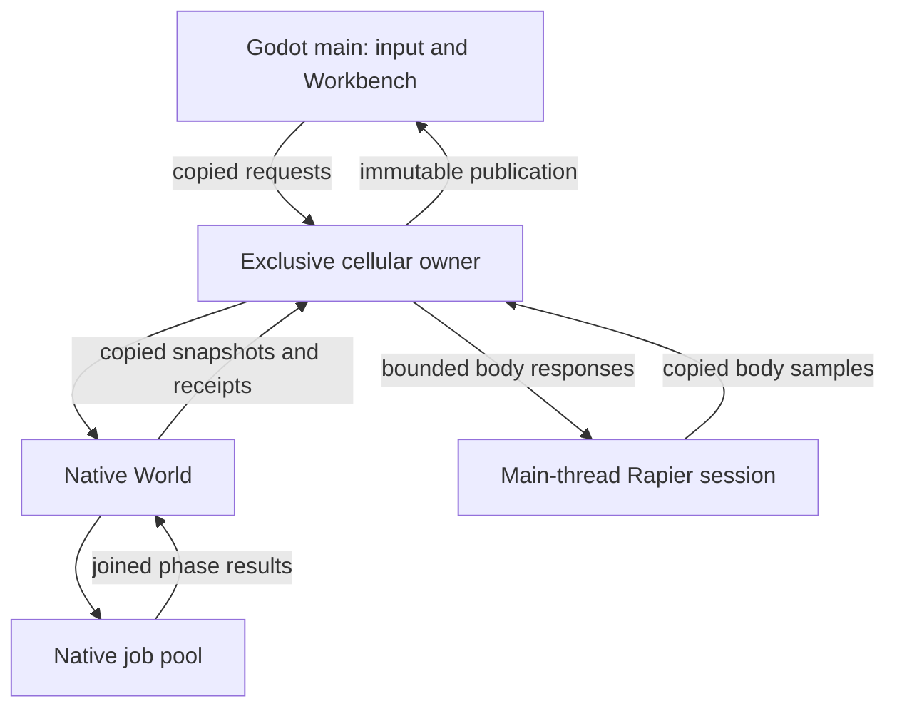

# Architecture overview

CyberSand combines a native cellular World, a Godot authoring and presentation
host, and main-thread Rapier actors. The ordinary Shared Workbench brings those
owners together; each still has a distinct mutation and lifetime boundary.
This overview is source-inspected against accepted main `00cdb02f` on
24 November 2026. Runtime qualification remains a separate
[evidence record](../reference/validation-evidence.md).

## Which simulation actually runs?

**Current:** `cybersand::World` owns native cells, material state, activity,
liquid policies and authoritative simulation. `CyberNativeCellWorld` adapts that
World to Godot. The ordinary desktop worker selects this adapter when its class
is available and otherwise selects the older `CyberCellWorld` GDScript solver.
Web requires the native extension and reports load failure instead of falling
back. Native-only Workbench operations check their own capabilities; the fallback
does not provide native authoring, material chemistry or solver parity.

Sources: [World](../../native/include/cybersand/world.hpp),
[desktop `_create_world`](../../godot/scripts/simulation_worker.gd),
[native adapter](../../godot/native_extension/cyber_native_cell_world.cpp), and
[Web controller](../../godot/scripts/web_demo_controller.gd).

Fresh native sandbox and Shared Workbench sessions select the
[Wave gameplay Water profile](wave-flow-v1.md). The plain C++ `WorldConfig`
default remains FreeMass with Wave and ballistic Water disabled. A constructor
default, a user-selected applied law and an application's gameplay preset are
different facts. The [configuration reference](../reference/configuration-reference.md#water-constructor-defaults-and-player-profile)
records this distinction and its exact source.

The [player playground](../systems/player-control-playground.md) uses its own
exclusive synchronous owner. Mechanical presets reuse the physical arena;
Sand/Water presets invoke a bounded native material field before normal ticks.
That standalone scene does not attach another owner to the sandbox World.

## Who owns each kind of truth?

| State | Current owner | What crosses the boundary |
|---|---|---|
| Cells, compact material state, temperature, activity and liquid accounting | Native World | Copied observations, stored-material captures and render publications |
| Body poses, joints, velocity and contacts | Main-thread physical session and Rapier through Godot | Value-only body samples and bounded cellular responses |
| Authored start, ordered edits and history | Workbench authoring controller, coordinated with the exclusive native worker | Validated requests, completion receipts and durable authored data |
| Actor control authority | Main-thread physical session | Issued observations and bounded action leases, retired on handoff/reset |
| Provider conversation and proposed drawing | Art controller/provider adapter | Proposed bounded commands; native completion is still required |
| Images, textures, camera and UI | Godot main thread | Immutable copied RG8 material/condition data |

The fallback, where selected, owns its own alternate cell arrays; it is never
synchronized as a second authoritative copy of a native World. Rapier is the
current rigid-body backend behind engine-owned adapters. Native pool workers
call neither Godot nor Rapier. The GDScript pacing thread may call the adapter
it exclusively owns, but it may not access live scene-tree or Rapier objects.

The diagram shows ownership and message direction, not concurrent permission to
call World. Exact leases, prepared replacements and failure windows belong to
[data ownership](data-ownership-and-lifetimes.md).

## How does data move on desktop and Web?

Desktop has two scheduling levels: a dedicated Godot pacing Thread serializes
World calls, and World's native pool parallelizes eligible jobs inside a tick.
Rapier and presentation run on the main thread. Their copied observations can
have different ages; high render FPS or a new status counter alone does not
prove that native or physical progression is healthy.

Web runs its controller and waits for native ticks on the main thread.
Compatibility Web uses one cellular worker. Threaded Web may dispatch native
pool work while the main thread waits; that is not asynchronous Web ownership.
The [tick contract](simulation-tick-and-threading.md) records actual ordering,
failure and pause behavior for each host.

Native dirty RG8 patches update a persistent CPU image. Accepted main still uses
`ImageTexture.update` on the full backing image; patch bytes are not GPU upload
bytes. Palette, motion, relief and glow shaders derive appearance without
changing stored material. The [render contract](rendering-and-gameplay-bridges.md)
owns acknowledgements, dirty retention and this limitation. PUBPRES publication
and presentation successors must be assessed through the
[current roadmap](../reference/status-and-roadmap.md), rather than assumed to be
present because their experimental documentation exists.

## How does authoring become a running scene?

A setup, native generator proposal or material-only baseline supplies the
starting terrain. Workbench validates the complete authored document, prepares
native and physical candidates, and adopts them through the existing owner
transaction. Refusal preserves the valid running session. Painting uses its
own bounded owner requests and completion/history checks; an accepted queue
entry does not prove that pixels changed or that Save contains them.

[Ordinary Save start](../reference/level-saves-and-replay.md#workbench-starting-constructions)
records reconstruction data. [Flatten](shared-workbench-authoring-data.md#flatten-and-storage-compatibility)
captures stored material identities, replaces the authored baseline and discards
previous construction/Undo history. It leaves the live World and Rapier state
unchanged and does not save automatically. Neither operation is complete physical
continuation. Wave Worlds explicitly refuse exact physical save/restore.

## Are the named production modules already separate classes?

**Approved:** SimulationCore, SimulationScheduler, WorldStorage, TileJob,
MaterialRules, RenderBridge and GameplayBridge name intended responsibilities.
**Current:** World still combines much of core, storage and scheduling.
Material descriptors, prepared ownership and native snapshot exchange have
separate interfaces; a universal gameplay command/replay service does not exist.
The [module boundary map](module-boundaries.md) distinguishes actual symbols from
future extraction. Naming a responsibility does not establish that extraction.

## Which contract should foundational work load next?

- Ownership/concurrency: [lifetimes](data-ownership-and-lifetimes.md),
  [tick order](simulation-tick-and-threading.md), [spatial geometry](chunk-tile-and-buffer-model.md).
- Materials and Water: [kernels](../systems/materials-and-rule-kernels.md),
  [solver distinctions](../systems/water-design.md), [native policy](liquid-solver-family-policy.md).
- Authoring: [shared data](shared-workbench-authoring-data.md),
  [save boundaries](../reference/level-saves-and-replay.md),
  [actor composition](../systems/workbench-actor-composition.md).
- Physics/presentation: [coupling](rigid-body-and-cellular-coupling.md),
  [render bridge](rendering-and-gameplay-bridges.md),
  [standalone Strata Theatre](../systems/depth-layers-and-parallax.md).
- Evidence and decisions: [invariants](../reference/invariants.md),
  [roadmap](../reference/status-and-roadmap.md), [ADRs](../decisions/).

**Approved direction, not accepted implementation at this source:** persistent
areas with bounded catch-up, ordinary Workbench four-plane authoring, live-scene
material audition and further physical-structure integration. Follow their
programme records before claiming availability. **Planned:** complete application
replay, safe live capacity reconfiguration and broader typed command contracts.
**Deferred:** asynchronous Web ownership and GPU field experiments.
**Rejected in the current architecture:** shared mutable rendering reads,
per-cell locks and full-world double buffering as the ordinary model.
