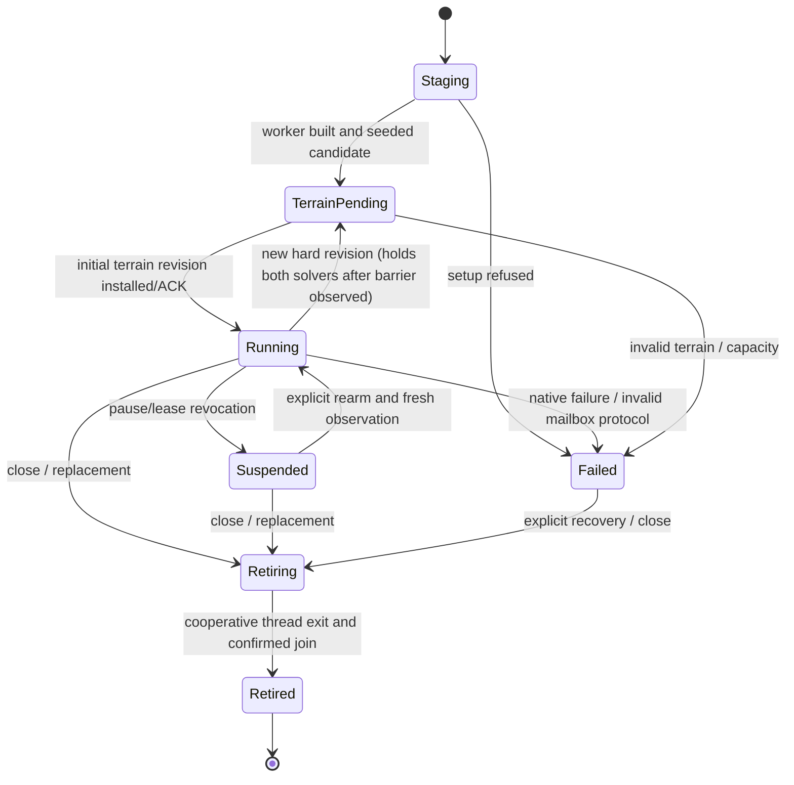

# Player Playground asynchronous execution and ownership contract

**Approved design; not implemented.** This is the binding protocol for
[#265](https://github.com/techrote/cybersand/issues/265),
[#266](https://github.com/techrote/cybersand/issues/266) and downstream
[#267–#270](https://github.com/techrote/cybersand/issues/263).
[ADR-015](../decisions/ADR-015-player-playground-asynchronous-owner.md)
selects a narrow owner rather than cloning the sandbox worker. Existing
`player_playground_runtime.gd` and `physical_actor_arena.gd` remain
synchronous at main `9e53a5b1`; do not label these contracts Current.

## Ownership, identities and immutable payload rules

| Authority | Exclusive owner | No cross-thread alias |
|---|---|---|
| Input events, gamepad/focus, accepted command/lease and quick-button edges | Main `player_playground.gd` + `CyberPhysicalActorSession` | No live `InputEvent`, scene/Control or controller object |
| Five articulated rigs, equipment chassis, Rapier bodies/RIDs/joints, physical tick/observations | Main physical Session + `CyberRapierPhysicsBridge` | No Node, RID, `PhysicsServer2D`, SubViewport or direct-space query |
| Native `CyberNativeCellWorld`, hard/material layout, mask/sweep and native results, `CyberPhysicalActorEffects`, `CyberPhysicalUsableRuntime` and mutable tool/projectile state | One dedicated `CyberPlayerCellOwner` Godot Thread after startup handoff | No World adapter call from main after handoff |
| Native phase jobs, scratch and statistics | World coordinator's **existing** persistent native pool, within an exclusive tick | Pool jobs call no Godot API |
| Static colliders and installation queue | Main Rapier bridge | Worker publishes only copied packed chunk rectangles |
| Render upload, shader/camera, overlay, course checkpoints and lap clock | Main scene, using completed immutable copied packets and completed physical steps | Never borrow mutable World arrays |

Main may instantiate an **inert** `CyberNativeCellWorld` via `ClassDB` before
the Thread starts; transfer its sole active reference/access **one-way**. The
worker alone performs `diagnostic_reset`, seeding, all tick/mutation/snapshot
API calls and teardown. Main holds only an opaque owner handle and mailbox, not
a callable live World reference. `diagnostic_reset({})` **defaults to one
worker**, so #266 must resolve an explicit count before worker-side reset; it
must not mutate global ProjectSettings. Constructing a new candidate must not
retire active bodies/world until successfully admitted. On thread termination,
join only after confirmed completion, then drop the last adapter reference.

Every crossing value carries:
- `run_id`: fresh random ID on accepted preset replacement;
- `epoch`: monotonically increasing physical owner incarnation, never reused;
- `control_generation`: per-actor cancellation/suspension generation;
- `physics_tick`: **completed** main `session.tick` when the pre-step
  body sample was taken; `body_sample_serial`: actual
  `bridge.pack_body_states()` serial (modulo 1,000,000);
- `cell_tick`: native **completed** tick associated with a publication, distinct
  from attempted tick on failure; `publication_serial`: monotonically
  increasing within owner lifetime; `terrain_revision`: native hard-surface
  revision **qualified by run/epoch**, not globally unique;
- `captured_usec` and `published_usec`: monotonic timestamps for age.

Versions of messages are explicit (`version: 1`). Reject missing, nonfinite,
out-of-range or mismatched identity/shape before mutation; deep-copy packed
arrays/dictionaries at enqueue and at publication. Published objects are
conventionally read-only; never mutate a shared `Packed*Array` backing store.
Retain buffers through last consumer/ACK, not just last producer reference.

## Concrete owner protocol and bounded queues

| Message (direction) | Required value fields beyond common identity | Capacity and overload disposition |
|---|---|---|
| `PoseSample` main→worker | `physics_tick, body_sample_serial, captured_usec, body_states` packed 11-float input records, optional copied equipment identities | **One latest-value slot**. Replace older *event-free* pose; count coalesces. Never replace an event-bearing batch's pinned pose |
| `FrameEvents` main→worker | Same frozen pose/source IDs, `actor_id, sequence, control_generation`, `effects[]`, `usable_requests[]`, copied `equipment_frame`, captured suspension | FIFO **eight frames**, globally at most **eight pending effects** and **eight pending usable requests including extracted/in-flight**. Atomically accept all or refuse entire event batch with typed receipt; do not silently drop/coalesce or update main accounting as consumed |
| `Control` main→worker | `kind = suspend\|resume\|cancel_actor\|retire\|reset`, `control_serial`, target epoch/generation | One high-priority state slot plus sticky retire flag; consecutive same-epoch pause states may supersede, but retire/cancel never loses priority. Reset/replace: one pending candidate, second unadmitted request explicitly refuses |
| `Result` worker→main | `cell_tick, source_physics_tick, source_body_serial, body_results` packed 9-float rows, bounded effect/usable receipts and accounting | Latest completed **cellular feedback slot** plus **16-item independent receipt ledger**. Feedback may be superseded only after accounting disposition; receipt ledger must not silently lose entries. Full ledger suspends event admission/native progression until ACK or explicit failure |
| `Terrain` worker→main | `cell_tick, terrain_revision, chunk_count, packed_chunk_rectangles`, `initial` | **Exactly one unacknowledged complete terrain packet** per epoch; no overwrite. Hold further native ticks/terrain mutation awaiting main `TerrainInstalled` ACK |
| `RenderPacket` worker→main | `cell_tick, publication_serial, source_generation, channels, patch rectangles and bytes, full_refresh, generated_usec` | One published immutable latest snapshot; retain/merge unacknowledged dirty patches, max **256 patch records / 2 MiB payload** before forced full refresh. Never ACK a skipped/failed upload. On continued capacity pressure count refusal and retain dirty state, not unbounded memory |
| `TerrainInstalled` / `RenderConsumed` / `ReceiptConsumed` main→worker | Matching `epoch`, exact revision or serial; success disposition | Constant-size ACK state/monotonic watermarks; foreign epoch, future serial, stale ACK refused, never clearing newer payload |
| `Terminal` worker→main | `status = failed\|retired`, `reason`, attempted/completed tick, last healthy serial | Sticky single terminal status retained until readback; no partial-tick output as success |

These are **protocol limits to implement/test**, not descriptions of existing
`CyberSimulationWorker` capacity. Use one short-held mailbox Mutex for
enqueue/dequeue/ACK and immutable publication-pointer swaps. Do not hold it
while performing `World::tick`, native result copy, `PhysicsServer2D`,
terrain collider installation, image upload, a join, logging or a callback.
A mailbox cannot invoke scene callbacks from its worker; main polls copied
status. Producer-accepted event batches are one-use. The independent receipt
watermark/ledger cannot disappear when the render/feedback latest slot advances.
Protect queued and already-extracted work by **rechecking cancellation
generation and epoch immediately before native application**, with the
same mutex/owner-side admission boundary as its cancellation fence.
An ACK is not evidence of effects actually applied; receipts distinguish
`queued`, `consumed`, `refused`, `cancelled` and `failed`, with exact
`request_id` and `changed_cells`. A lost reply must not replay a consumed
request. Already committed projectiles/devices persist until owner replacement.

**Main input rule:** retain `CyberPhysicalActorSession.submit`'s issued
observation/lease, `MAX_BUTTON_EDGES=24` per actor, per-button ordered edge
replay and `cancel_input` on focus/pause/takeover/expiry. The async queue
does **not** carry raw button samples as its event authority; Session advances
them on main, and only copied effects/equipment requests cross. A press/release
inside one physics interval must reach the physical Session in order.
When mailbox event admission refuses, call
`session.reject_equipment_requests(requests, reason)` as appropriate, expose
refused effects explicitly and **never commit charge, recoil, changed-cell
counts or a timed action as successful**. Issue #267 may choose finer
client-side presentation of that refusal, not a new execution semantic.
Tool source poses and native body masks must share the exact pinned frame.

## Two clocks and coupling/terrain sequence

```mermaid
sequenceDiagram
    participant M as Main input/Rapier
    participant Q as Bounded mailbox
    participant W as Exclusive player World
    M->>Q: PoseSample P0, FrameEvents(P0, effects, usables)
    W->>Q: Claim newest admissible pose or oldest event-frame
    W->>W: Native mask(P0) → effects/usables → cell tick C1
    W->>Q: Publish Result(C1,P0) and immutable Render(C1)
    opt Hard terrain revision changed
      W->>Q: Terrain(C1,epoch,revision), hold next tick
      M->>M: Budgeted collider installation; no Rapier step
      M->>Q: TerrainInstalled(epoch,revision)
    end
    M->>Q: Poll latest result/receipts, check epoch/sample age
    M->>M: Apply admissible feedback, Session.advance(1/60)
    M->>M: Rapier.step() → Session.complete_step() => P1
    M->>Q: PoseSample P1, corresponding new events
    M->>M: Upload completed immutable render, ACK after success
```

One worker iteration, while Running and with no terrain barrier, drains at most
one admitted `FrameEvents` (FIFO) using **that frame's immutable pose**;
otherwise it may use the newest `PoseSample`. It prepares the native body
mask with that pose, applies at most one batch of admitted effects/usables under
existing capacities, calls one `World::simulation_tick`, reads only completed
native results, then prepares immutable publications. Effects/usable processor
autonomous updates still execute once per successful owner tick even with no
new user request. No callback waits for a corresponding Rapier step. Never use
`session.tick+1` as if it were the native completed tick: record both identities.

The main physics callback first consumes only matching-epoch completed results
and receipts, and tests terrain readiness. If ready, it processes actual human
leases/actuation via `session.advance(1/60)`, snapshots the **pre-integration**
actual Rapier state once using `pack_body_states()`, submits the pose plus
same-source events, calls `bridge.step()`, then
`session.complete_step()` once. If submission is refused the physical
integration may continue with refused tools neutralized; never block in a native
tick or synchronously wait for its completion. 4LY's actual manual-step
counter remains the authority: no `advance` without one matching
`step/complete_step`, including pause/suspend and resource failures.

**Snapshot age policy:** at each main step, compute physical sample age using
the **bridge's existing modulo-1,000,000 serial semantics**. Discard cellular
feedback older than eight body samples, suppress positional correction older
than one, preserve existing attenuated impulses and duplicate guards; never
relabel an older sample with today's serial. Track snapshot wall age separately
from sample age and from cell-vs-physical tick difference. At owner intake,
refuse event batches tied to a pose already more than eight *completed physics
samples* behind the newest admitted pose; preserve an explicit expired receipt.
Do not advance more than **eight cellular ticks on one unchanged physical
sample**, or more than eight consecutive 60-Hz pacing intervals with no fresh
main sample, even if wall-clock pacing has capacity: enter an observable
`pose_starved` hold until fresh pose arrives. These are conservative
PLAY-ASYNC bounds, not changes to the existing Rapier ABI. Native tick
determinism is claimed only for an identical accepted ordered
pose/event/tick schedule, not the old synchronous physical trajectory.

**Hard terrain:** the worker publishes a complete 256-unit 64×64 packet
whenever the source revision changes, including the initial seeded World, and
does not call another mutating tick until that packet's exact
`TerrainInstalled` acknowledgement. Main installs at most **32 chunks or
750 microseconds per iteration** using the existing bridge; it must not call
`queue_hard_surface_chunk_snapshot` for a second packet while the first
remains pending. Initial P0 body sampling is allowed before readiness, but
**no first Rapier step, input actuation or lap tick** may occur until complete
initial collider installation. For later revisions, no *newly scheduled*
Rapier step may begin **after main observes a pending terrain barrier**;
main holds physics (not rendering) until the exact revision is installed.
Because async native hard state can change during an already-running
main physics callback, at most the *already-in-flight* physical step may
observe the previous collider set; this is an explicitly accepted bounded
asynchronous skew, **not** strict simultaneous-contact equivalence. Record
the overlap as a diagnostic; fail the qualification if more than one new
physical step occurs after a published barrier was observed. Malformed or
superseded terrain data is fail-closed; a stale generation can never satisfy
initial readiness. A backlog must never be handled by overwriting a pending
bridge packet.

**Pacing:** worker targets one 1/60-second simulated tick on an independently
maintained monotonic 16,667-µs deadline, not one tick per render/physics
callback. Inherit the sandbox's `MAX_BACKLOG_TICKS=3` late-deadline reset;
count overruns, drop *wall-clock catch-up*, do not skip World indices or run
unbounded burst ticks. Render publication is separate, with a deadline-based
rate and acknowledged dirty accumulation; do not use the known unstable
`now-last >= 16667` gate from [#149](https://github.com/techrote/cybersand/issues/149)
as a proof of regular display cadence. One native tick's measured duration
must be separated from snapshot preparation, texture upload and Rapier cost.
UI, camera and completed-frame rendering never wait for native work.
The **lap timer counts completed main physical ticks**, not potentially
faster/slower native `cell_tick` or rendered frames; no catch-up award and
no tick through pause/terrain holds.

## Lifecycle, cancellation and fault states



`pause`, focus cancellation and human takeover fence actor
`control_generation` immediately on main, fence the mailbox and invalidate
already-extracted unconsumed requests before owner application. Pause stops
both admitted physical steps and native ticks. Focus loss without pause
cancels input but permits passive motion/native settling; these are separate
controls. Resuming requires release-to-rearm and a new issued observation.
A valid new preset/reset is first staged as a *candidate* with a new identity;
unadmitted failure retains old owner/scene. An accepted replacement revokes
old commands/receipts and parks the old physical session; only after old
thread completion and generation-safe retirement may its World references and
associated Rapier graph be freed. Old snapshot/ACKs never target the new owner.

On native failure, publish a sticky `Terminal(failed)` and last valid
immutable rendering, **never** partial cell/body/terrain results.
Freeze both solvers when failure is observed; reject new commands until
an explicitly accepted fresh World replacement. No retry of a partially
applied event and no rollback claim. On close set sticky retire intent and
clear admissions; the worker cooperatively finishes its current tick/phase,
retires resources then publishes `retired`. **Do not call blocking
`Thread.wait_to_finish` from the main callback unless completion has already
been observed**. A non-exiting native call cannot be killed safely: on a
bounded watchdog deadline quarantine the entire owner, retain its resources,
report a terminal timeout, and refuse unsafe replacement/close rather than
freeing a World still in use. This preserves rendering/UI responsiveness,
but a process-level watchdog is required for guaranteed termination of a
truly hung native runtime. Never silently detach a worker using a freed
scene/script reference. The physical test harness keeps #234's existing
45-s idle and 180-s outer timeout policy (at most 240-s policy ceiling,
no retries or skip masking); integration must prove repeated clean shutdown
on Windows/Linux.

## Observable diagnostics and admission tests

Publish `requested_workers`, `actual_workers`, reported logical cores,
native eligible jobs/parallel phases, `cell_tick` and completed tick rate;
`native_tick_ms`, worker end-to-end (including copy) and
`render_prepare_ms`; overrun/deadline-reset count; published/consumed render
serials and `render_age_ms`; latest sample serial/age, cell–physical tick
skew and `pose_starved` ticks; mailbox effect/usable depths and
admitted/refused/expired/cancelled/consumed counts; receipt ledger pressure;
pending/installed terrain revision, pending chunk count,
collider-install time and hold count; main Rapier step/flush time, frame
p50/p95/p99, input-to-applied-physical-step lag and camera-to-visible-packet
lag; restart/stop/join/timeout and quarantine counts. Rate metrics use a
real elapsed window; a settled/clean scene producing no new dirty packets
must not be called a publication failure.

Required adversarial cases: same-frame press/release; two equipment requests
at capacity and cancellation after extraction; duplicate/lost receipt;
generation replacement while an old tick and old ACK are in flight; reused
terrain revision after reset; terrain update during an in-flight Rapier
step; long-running native tick while main still renders; stale pose older
than eight; max pending patch/receipt pressure; failures halfway through
native edit; repeated focus/pause/replace/close; idle and overloaded
1/Auto worker profiles. Check equal native cell results for identical
**accepted** tick/pose/event streams under eligible 1/2/4/6 worker counts,
not blanket identical real-time trajectories. Actual platform qualification
and gaps are owned by the [baseline/evidence record](../audits/2026-10-26-play-async-001-baseline.md).
