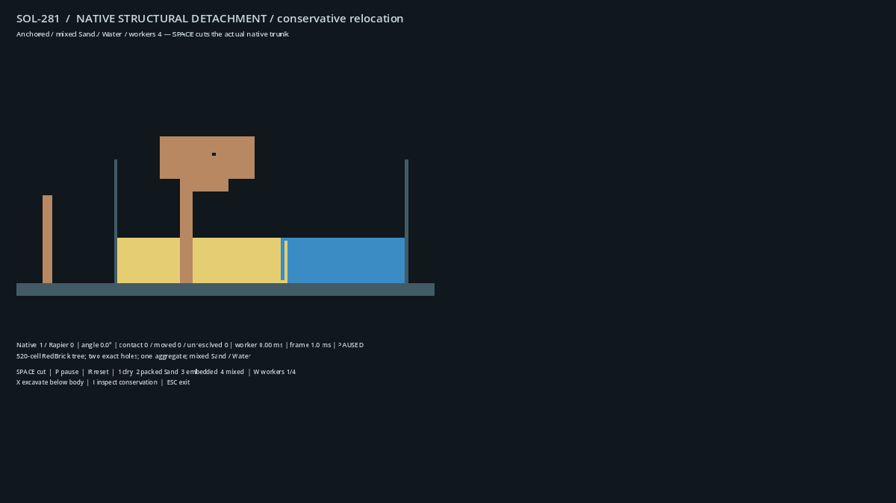
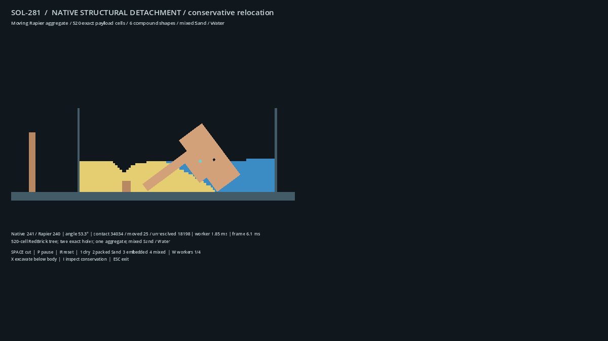

# SOL-DETACH-001 current-main increment

**Delivered as [draft PR #347](https://github.com/techrote/cybersand/pull/347):**
the bounded native-tree detachment and conservative local displacement path is
implemented, independently reviewed and qualified on actual Linux/Windows
Godot/Rapier hosts. Dense granular physical quality remains **unpassed**. This
increment does not complete #281 or #12 and is not approved for merge.

## Source selection and unchanged streams

The branch `sol-detach-001-current-main` was created from accepted
`809fd30dfac0c5e127302997075be9c4b279e5aa`, tree
`863db60c767bf00a215b9e4064d6bccb71eb69ab`. Before its first implementation commit
it fast-forwarded to newly accepted `a8f08a67fea3c58f6df7473cbae1831334fcc04e`,
tree `4bfc2fbdda3704dfbf386235e54d2fe525ca32bc`, after PLAY shader #331 merged.
Production render-copy #344 and the accepted PLAY shader are retained.
Frozen #283 remains `254235ec4c3d58782bba44b478caca86bf57c856`; documentation-only
#282 remains `c087ca8569f1df394d67cdc4dbe1c6b46c2bcfb2`. Neither is modified.

The native kernel is selectively recovered from #283's ownership/shape/lifecycle
paths. The Godot session starts from the already compound-capable `41dc25ca`
checkpoint, retaining the later generation repairs without its unrelated render
arms. The native body protocol remains current main's 11/9 floats. No whole-stack
cherry-pick, radius experiment, coalescing or retained-baseline exemption is used.

At intake, PLAY #331/#332/#334, GCR #339/#341/#342/#343 and E #345 were independent
open streams. This branch neither edits their branches nor waits for GCR to
implement detachment. A later accepted GCR candidate needs separate integration
qualification; current-main contact behavior is the initial control. Reinspection
confirms #343 is still draft/unmerged at
`2aff460c60f36c0f209b67fe682d0f8b9e5e0f83`. Its owner preference for Y1 is retained,
but its registered technical failures and absent production promotion remain.
No GCR integration qualification is claimed by this branch.

## Preserved negative evidence and selected mechanism

The historical B=289 expansion remains **NO-GO**. The strict-route census's
8,084 classified events, including 7,892 without an empty/unmasked four-connected
route, remain attributed to their original source. They do not authorize matter
to travel through Sand or Water without relocating those intermediate parcels.

The subsequent [#336](https://github.com/techrote/cybersand/pull/336) and
[#338](https://github.com/techrote/cybersand/pull/338) chain investigations are also
retained. #338 source `8203d2d1bae2151c1a2d4909df5b08ab5b5012eb`, archived at
`61f0398e5a6d63432be681dc4a4d32da769f2b20`, recovered only two of 1,231 no-target
contacts (0.16247%); both were one-parcel adjacent moves, not demonstrated chains.
The source-pinned population SHA-256 is
`d3c8bfeb19355e7bf20518bb7d6afd4b03e1f3790644a09414c4d8ea0955d33c`.

Independent four-axis square/rectangle SAT additionally finds both historical
adjacent targets still overlap the actual rotated body: their maximum axis gaps
are approximately −0.491859 and −0.527756 cells. This stronger oracle does not
rewrite the original center-mask result. Eight intact captures are retained in
[`conservative_contacts.json`](../../godot/tests/fixtures/sol281/conservative_contacts.json)
alongside explicitly new analytical boundary fixtures.

The implemented candidate is therefore a **bounded local submechanism**:
at most four occupied Sand/Water parcels move one cardinal cell each into a
preflighted vacancy. Every destination square must fully clear all body proxies.
It replaces every direct ejection only in the opt-in detachment host. Blocked
contacts keep their matter. It is not claimed to solve packed-bed penetration,
replace GCR's bearing/force response or conserve calibrated mechanical energy.

## Independent review and repairs

The principal implementer integrated separate native-core, host and physical
review work. Significant findings resolved in source include:

- Populated source structures formerly refused every adjacent Sand/Water cell.
  Narrow ambient noncohesive contact admission now leaves those tuples native.
- Compound shape reservations could exceed the 64 proxy-ID interval. The native
  acknowledgement now rejects that interval before ownership transfer.
- A continuation after awaited mask priming could access a replacement session.
  It now checks exact generation/worker; lifecycle regression covers that await.
- The historical session duplicated cellular response reduction. Shared Rapier
  bridge helpers now own ordinary and compound response, including one weighted
  correction, ordinary correction-age/velocity policy and off-centre impulses.
- First-writer center masks could conceal foreign geometry at a source. Full
  source-square checks now refuse that ambiguity; destinations use full SAT too.
- Lazy thermal allocation in `move_cell` could occur after the first material
  write. The native chain preflights all thermal fields and resident chunks.
- Every accepted path coordinate remains reserved across repeated preparations
  of one compound sample, preventing intermediate parcels from moving twice.
- Numeric narrowing and exceptional replay setup fail closed; quarantined
  partial progress is distinct from a mutation-free refusal.
- Active-owner world replacement, failed-native publication and nonconsecutive
  compound sample replay were identified in the independent host review. All three are repaired and have focused actual-host regression controls;
  their final-source execution disposition is recorded with the hosted results.
- A quarantined transaction previously could reach a later healthy-only mask
  mutation and throw across the adapter. It now stops before further masks or
  forces; this exceptional path is source-reviewed, not directly fault-injected.

## Validation ledger

The final [GitHub-hosted run 41331369142, attempt 1](https://github.com/techrote/cybersand/actions/runs/41331369142)
passed both builds, all six actual-host cohorts, the complete original-evidence
reducer and the runtime publication job. Its compiled/executed source is
`8e86ffd4eb2eb769178808a1012701076e3a4d19`, tree
`b1f965508b24f9b10658907fff26cf1165e2d520`. Each build and host authenticates all
1,064 tracked execution/build inputs and raw checkout bytes before and after.

Runtime publication commit
[`bdd751dcbac6c6226a81b2b4e49ac5c3854c631b`](https://github.com/techrote/cybersand/commit/bdd751dcbac6c6226a81b2b4e49ac5c3854c631b),
tree `ab50e88b62a88274f4f3348026625f8a699b5465`, is the sole child of that
qualified source. It changes only two LFS runtime pointers, two provenance files
and 162 original evidence files. It does not relabel its own metadata as a newly
executed physics source. The full
[Documentation/provenance dispatch](https://github.com/techrote/cybersand/actions/runs/41332307467)
passed on that publication commit; local `check_repository.py` also passed with
both exact native runtimes materialized.

| Actual host | Core | Contact, worker 1 | Contact, worker 4 | Result |
|---|---|---|---|---|
| Linux / Godot 4.7 / pinned Rapier | 11 scripts; 502 numbered assertions plus four ordinary controls | Nine scripts / 417 assertions | Nine scripts / 417 assertions | Passed; unchanged canonical and raw source inventories |
| Windows / Godot 4.7 / pinned Rapier | 11 scripts; 502 numbered assertions plus four ordinary controls | Nine scripts / 417 assertions | Nine scripts / 417 assertions | Passed; unchanged canonical and raw source inventories |

That is 29 test processes and 1,336 numbered assertions per OS, plus the four
ordinary regression scripts whose assertion counts are not exposed. Six fresh
editor imports and all 58 test processes completed naturally without skips.
Motion/failure tests cover workers 1 and 4; lifecycle covers 20 actual worker
replacements across ten await boundaries. Contact cohorts include coupling,
frozen replay, excavation and six populated baseline/candidate cases each.

| Additional gate | Source-qualified result and boundary |
|---|---|
| Native detachment | Nine groups / 19,338 checks, normal and ASan/UBSan, in the Linux build of the final source. |
| Native displacement | Six groups / 281 checks, normal and ASan/UBSan, in the same final-source build. |
| Deterministic replay | 17 cases / 292 checks per worker/platform: eight original captures plus nine new boundary controls; four accepted paths and thirteen mutation-free refusals. |
| Qualification/publication readers | Nine and eight adversarial regression tests pass. Actual publication reopens the original two build and six host artifacts before any write, then verifies exact staged bytes and LFS pointers. |
| Existing shared native/material suite | Earlier implementation iteration: 165 tests passed; original source/log retained. This is separate from final-source full ready-PR CI. |
| Graphical presentation | Actual dry/mixed software-OpenGL smoke passed at its separately recorded source below; representative GPU pacing is not tested. |
| Ready-PR full CI / merge | Deferred: the requested deliverable remains draft. Full applicable exact-head gates and owner approval remain required before merge. |

The original [six-cohort reducer](sol281-20261101/hosted/8e86ffd4eb2eb769178808a1012701076e3a4d19/qualification.json),
[publication receipt](sol281-20261101/final-qualification/publication-receipt.json),
[artifact identities](sol281-20261101/final-qualification/github-artifacts.json),
and [complete before/after analysis](sol281-20261101/final-qualification/hosted-analysis.md)
are retained with exact source/build/runtime provenance. Original build command
logs and receipts are retained under `final-qualification/build-commands/`.

### Published runtime identity

Both hosts use Godot `4.7.stable.official.5b4e0cb0f` and the existing Rapier lock.
Both native builds use godot-cpp `101ae38034304346a46ea9ea84ae156d3e860496`;
Linux uses GCC 13.3.0, Windows the pinned llvm-mingw 20260826 UCRT/Clang 23.1.0
cross-build, followed by actual Windows execution.

| Runtime | Bytes | SHA-256 |
|---|---:|---|
| Linux native `.so` | 4,302,552 | `d556a9d615840761f5c0a4a6a14c39fa62e154c95a11ae16014cdca09bfb7a63` |
| Windows native `.dll` | 4,892,672 | `c223da56fb43a04e60869c593e0d4fa97c963eb815c3466e4abdff68ae31902f` |
| Linux Rapier | 117,275,416 | `566e68ae53bfb2eb7018c8e7d0dd3727121bf696462039b780a33d6b8369c66a` |
| Windows Rapier | 9,987,072 | `b54e54bd1a03ae9094b788bf869212b5405b4a04793792d5a7cd81632cb10dd7` |

The platform manifests retain full compiler/bindings, engine executable/archive,
86 native-input and complete build-input hashes. Local graphical/qualification
runtime `7cd91126…` and first-attempt Windows runtime `c2757063…` remain distinct
artifacts; neither is silently substituted for the final published binaries.

The initial replay failure is preserved: no-op setters were mistakenly treated
as import refusal; an analytical Water coherence value 13 exceeded the default
maximum 12; and the replay's requested inclusion region had not yet been applied.
The corrected setup ticks the empty World once **before** importing any frozen
payload, uses valid new-fixture Water states, and verifies semantic readback.
Historical captured tuples remain unchanged. The malformed analytical fixture's
SHA-256 was `8c86e3d13d667b6b3f91dedd36e734bec00c4278c49c78e1f3c8d257456e64ca`.

Original iteration receipts, failure logs, source hashes and independent reports
are retained in [the prequalification inventory](sol281-20261101/prequalification/inventory.json).
They deliberately retain their original pre-commit source identity and do not
claim to be the later final-source hosted run.

The final [independent ownership review](sol281-20261101/review/host-review.md)
closes H1–H4 at source level and retains the initial findings. Actual hosted
execution and uninjected unexpected-exception coverage remain distinct.

The [independent final artifact review](sol281-20261101/review/final-artifacts/review.md)
authenticates all eight original build/host ZIPs against GitHub digests, reruns
unchanged readers from a detached `8e86ffd4` checkout and reproduces the published
strict reducer output byte for byte. All 17 complete replay case dictionaries,
including payload hashes, paths, outcomes and geometry, are identical across
both OSes and both worker settings. This deterministic equality is separate
from naturally different asynchronous populated-host trajectories.

The [gate review before final hosts](sol281-20261101/review/gate-review-before-final-hosts.md)
preserves its original cutoff and pending-platform assessment. The final matrix
above supersedes only those execution/publication rows, not its physical limits.
The shared bridge is independently adoptable as the two-file
[`02e8a09a` interface commit](https://github.com/techrote/cybersand/commit/02e8a09aa14646c168610438df965d2f3fb3ec7f)
on `sol-detach-001-compound-interface`, directly on accepted main. Its exact
bridge/test bytes match this implementation. An independent actual Linux
[33-check host run](sol281-20261101/review/compound-interface/host-receipt.json)
passed against the accepted-main native runtime, without requiring detachment's
new native APIs. No GCR implementation branch was edited.

### Preserved first hosted attempt

[Run 41329746261](https://github.com/techrote/cybersand/actions/runs/41329746261)
attempted qualification of source `c8c81a8b81677abd173de199a9d436f46de2268b`, tree
`214f927af0e9feeb65c664e981b32b7fbc15e39b`. Both pinned platform builds and all
three Linux host cohorts passed. All three Windows cohorts refused the checkout
before Godot or physics execution: `Checkout .gitattributes differs from Git`.
The evidence reducer failed and runtime publication was correctly skipped.
[Original reports, Windows job log and artifact-entry hashes](sol281-20261101/hosted/c8c81a8b81677abd173de199a9d436f46de2268b/first-attempt/inventory.json)
preserve this failed attempt without changing its source identity or raw bytes.

`core.autocrlf=false` alone retained Windows' native `core.eol` default, converting
automatic-text files to CRLF. The narrow repair sets `core.eol=lf` before checkout;
explicit committed `eol=crlf` files still use CRLF. A real-Git regression with the
repository's committed attributes reproduces the rejection and verifies the
repair. All nine qualification-reader tests pass. No attributes or validator
rules are relaxed. The corrected source passed the new complete platform run
above; the original attempt remains failed.

## Physical observations and measured limits

All four final dry motion cases (both OSes, both worker counts) retain 520 exact
aggregate tuples, six shapes, mass 520 and inertia 70,453.6493589743. Over 600
actual Rapier steps, maximum downward movement is 20.259220 cells, horizontal
movement 25.635159 cells, absolute rotation 1.075248 radians and angular speed
1.273856 radians/second. Impact and off-centre torque are real; the horizontal
motion check does not establish a calibrated no-slip rolling law.

All 24 populated baseline/candidate cases conserve the expected quantities:
packed Sand 1,176 cells, embedded Sand 2,016 cells, mixed Sand 658 cells plus
132,090 Water mass units. Every case compares the full aggregate payload and
exclusive ownership. The ordinary solvers continue evolving surrounding material;
this is not a claim that every surrounding state tuple remains constant over time.

Each of the twelve candidate cases admits genuine multi-parcel transactions:

| Platform / workers | Packed Sand transactions / parcels | Embedded Sand transactions / parcels | Mixed transactions / parcels |
|---|---:|---:|---:|
| Linux / 1 | 81 / 195 | 44 / 81 | 84 / 209 |
| Linux / 4 | 14 / 27 | 87 / 181 | 83 / 206 |
| Windows / 1 | 81 / 195 | 113 / 262 | 83 / 195 |
| Windows / 4 | 82 / 171 | 94 / 213 | 75 / 175 |

Across these candidate runs, 444,545 cumulative policy invocations yield 921
accepted transactions and 2,110 parcel moves. Refusals are 291,692 `Capacity`,
93,867 `ForeignOccupancy`, 57,360 `GeometryBlocked`, 447 `NoVacancy` and 258
`UnsupportedMaterial`. All other final categories, including quarantine and
native transaction refusal, are zero in these positive populated runs. Negative
fixtures independently exercise rejection paths; zero here is not universal proof.

These are invocation counts, not a unique-contact success rate. Capacity includes
the fixed 64-search budget per sample. `ForeignOccupancy` includes any destination
mask, including the aggregate's own/swept mask. Final categories apply a guard
priority; per-probe blockers are a different population. The small `NoVacancy`
total does not replace or overturn the historical strict-empty-route census.
Native cumulative counts and main-consumed feedback have different denominators.
Baseline strict counters are zero because the strict mechanism is disabled,
while the ordinary ejection path remains active.

The [paired raw motion/contact/timing tables](sol281-20261101/final-qualification/hosted-analysis.md)
show substantial asynchronous trajectory variation, including candidates that
move farther than their baseline. They establish no causal improvement in dense
bearing or penetration. **Live penetration depth and overlap area are not
measured.** Dense physical acceptance remains failed/unmet; the earlier rendered
mixed fixture visibly retains the penetration problem. Existing force/torque
policy, including the fixture's aggregate impulse cap, was not retuned here.

### Observed headless cost

These ranges cover the six candidate populated cases per OS. They are observations
on different hosted CPU models, not controlled performance comparisons or FPS.

| Platform | Mean worker step range; maximum | Mean native tick range; maximum | Mean main-sync segment range; maximum | Mean Rapier step range; maximum |
|---|---|---|---|---|
| Linux | 0.419–1.664 ms; 2.231 ms | 0.218–1.349 ms; 1.799 ms | 0.026–0.048 ms; 0.239 ms | 0.095–0.124 ms; 0.806 ms |
| Windows | 0.377–0.711 ms; 1.846 ms | 0.176–0.451 ms; 1.068 ms | 0.043–0.077 ms; 0.565 ms | 0.121–0.268 ms; 7.263 ms |

Worker/native means use consumed healthy same-epoch snapshots, not every native
tick. Main-sync segments measure response consumption and state publication,
not whole frames. Rapier means cover 360 actual bridge steps per case. Terrain
refresh totals are 1.216–1.687 ms on Linux and 2.002–2.128 ms on Windows over two
admitted revision events per case; no per-call mean is inferred. Original totals,
sample counts, direct-process resources and CPU identity remain in the reports.

Search/commit capacity is fixed and native preflight refuses unsupported thermal
allocation before mutation. Capacity behavior is exercised; a live allocation
count/profile is **not measured**. Mechanical energy/contact work, graphical GPU
timing and representative interactive frame pacing remain unmeasured.

## Issue #281 gate disposition

The broader owner requirement remains open. Dispositions are explicit;
successful later host runs update only their corresponding rows.

| Acceptance gate | Disposition and practical boundary |
|---|---|
| Reconcile current main / preserve frozen archive | Passed by source inspection and narrow port; accepted R retained. |
| Genuine native tree, intact anchors, actual cut | Passed on native tests and both actual OSes/workers; the command applies a real native edit before bounded discovery. General automatic gameplay fracture triggers are deferred. |
| Bounded discovery / unknown and capacity refusal | Passed in focused native scope; global structural solver deferred. |
| Exact payload and exclusive native/aggregate ownership | Passed in native and source-matched Linux/Windows actual-host motion/failure/lifecycle cases. |
| Static geometry retirement / inactive rollback | Passed; no Rapier step during handoff, activation follows collision receipt, and inactive rollback restores exact native authority. |
| Exact compound holes / COM / inertia | Passed for the bounded fixture: one body, six shapes, two holes, native mass/COM/inertia, exact compound proxy probes. |
| Real falling and toppling | Passed in all four dry motion cases; actual Rapier gravity, contact, translation and angular motion. |
| Off-centre torque / impact / rolling | Passed at compound-proxy resolution for actual angular response and post-contact horizontal movement. Calibrated no-slip rolling and dense physical plausibility are not tested/passed. |
| Ground, stump and unrelated structures | Passed in native and actual-host controls; noncohesive surrounding material stays native. |
| Conservative local Sand/Water displacement | Passed in bounded native/replay scope: four accepted boundary controls and thirteen mutation-free refusals; no dense-bed success claim. |
| Packed / embedded / mixed active surroundings | Passed for execution, exact quantities and aggregate payload in all 24 baseline/candidate runs; twelve candidate runs demonstrate multi-parcel admission. |
| Dense granular resistance / acceptable penetration | Failed/unmet acceptance. The current-main contact response is not repaired by this submechanism; penetration depth/area is not measured. |
| Multiple contacts / stale samples / replacement / reset | Passed in focused native/bridge cases and the complete hosted matrix, including 20 worker replacements and interrupted transitions. |
| Unexpected commit exception containment | Passed source review; direct native commit-exception fault injection is not tested. Existing actual failure-publication controls do not substitute for it. |
| Actual Linux and Windows, workers 1 and 4 | Passed at exact source `8e86ffd4`, with matching built runtimes and unchanged 1,064-input canonical/raw ledgers. |
| Excavation beneath resting aggregate | Passed on both OSes/workers: real native edit, new hard-surface revision, collision refresh and renewed Rapier fall. |
| Safe rest/desoliding/repeat lifecycle | Inactive rollback only; transformed active restoration explicitly deferred. |
| Reactive Wood/bark / heterogeneous cohesion | Explicitly deferred; narrow inert eligibility only. |
| Fracture / inherited fragment motion / persistence | Explicitly deferred; unsupported aggregate saves refuse. |
| GCR ownership and accepted-candidate integration | Independence passed by source/contract review; integration not tested. #343 remains separate and unmerged; the shared bridge has an isolated two-file commit. |
| Playable diagnostic / presentation | Passed as an opt-in diagnostic with real source/cut and actual rendered dry/mixed smoke at the separately recorded graphical source. |
| Normal gameplay and physical owner acceptance | Explicitly deferred; normal launcher/gameplay and human acceptance are not established by the lab. |
| Worker / main / collision costs and allocation | Headless sampled costs and fixed-capacity behavior measured; performance/scalability acceptance and live allocation counts are not tested. |
| Representative GPU pacing | Not tested; software OpenGL and headless CPU timings are insufficient. |
| Independent implementation review | Passed for stated source surfaces; significant H1–H4 findings repaired, with the explicit uninjected-exception limitation retained. |
| Source/runtime provenance and draft PR | Passed for the bounded increment: original artifacts, LFS runtimes, provenance, full publication documentation check and draft #347. |
| Full ready-for-review CI / merge / issue closure | Explicitly deferred. This remains draft and unmerged; #281 and #12 remain open. |

## Rendered scene inspection

[Original visual receipt](sol281-20261101/graphical-smoke/visual-review.json) and
[complete source/runtime record](sol281-20261101/graphical-smoke/report.json) retain
actual rendered dry and mixed captures at local freeze `dd18bca6`, whose exact
tree is also preserved by remote implementation commit `83a12466`. This is
software OpenGL (Mesa 25.2.8 / llvmpipe LLVM 20.1.2), not representative GPU
frame-pacing acceptance. Both scenes exited successfully. The mixed captures
also visibly retain the dense penetration limitation.

## Documentation change map

The runtime contract owns current capacities, controls and mechanism. The
soliding programme retains Track-A/Track-B separation; lifecycle and coupling
documents link the opt-in owner/response boundary. Interface/configuration,
build instructions, roadmap, handover, docs index and retrieval routing are
updated together. Historical evidence and dependency/runtime release locks
retain their original values. New runtime provenance must describe actual new
builds and qualified hosts rather than relabelling retained main binaries.
