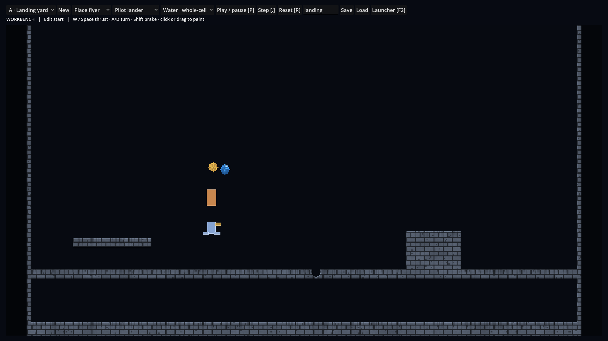

# WORKBENCH-001 mixed-world checkpoint — 4 November 2026

| Identity | Value |
| --- | --- |
| Branch / writer | `feat/workbench-001-shared-sandbox-20261104`, one implementation writer in an isolated worktree |
| Accepted base / tree | `0103de80d11304388868f89f7b26c672ad6100ad` / `0ba07dc799afca43716bbab966f48266fa924718` |
| Tested implementation / tree | `7b042527bb467fccd9ffc7dca9e52b694f613ab2` / `f7a2245a0808e932c18fca8e01bda82fe3b8f843` |
| Godot / Rapier | Godot `4.7.stable.official.5b4e0cb0f`, Rapier addon 0.35.2 / core 0.35.1 |
| CyberSand GDExtension | Published build `a7ee10f251f647a16dec8a1d7f18c4f299100cba`, 80 production source inputs |
| Windows native / Rapier SHA256 | `ee09f7ab485f817b5f58e767ddb26f2e430439bb3dd4f185019eda028f47199a` / `b54e54bd1a03ae9094b788bf869212b5405b4a04793792d5a7cd81632cb10dd7` |
| Linux native / Rapier SHA256 | `0f60213c7fc3f9a1b1d7ad5143fdb22d453a452cddefd3fe4d7a7cb4d7b6cf45` / `566e68ae53bfb2eb7018c8e7d0dd3727121bf696462039b780a33d6b8369c66a` |

The PR and issue record identify the final documentation head and tree separately.
The pinned ledger at `f6c72cd0` supplies the workstream registration. The source
checkout supplies the implementation. The test used the default native worker
configuration, one desktop simulation owner and the existing manually stepped
Rapier space. It made no worker-count sweep or performance measurement.

## Windows execution

From the branch root, run `launch-desktop.cmd` and choose **Shared development
workbench**, or launch directly with:

```powershell
& C:/Godot47/Godot_v4.7-stable_win64.exe --path godot -- --workbench
```

The automated run used a real Windows OpenGL Compatibility window on an NVIDIA
TITAN RTX, driver 581.80. `test_shared_workbench.gd` launches the normal menu
and Main, delivers GUI coordinates through its Viewport, and samples actual native
publications, physical observations and Rapier contacts. It uses the repository
300 s operation watchdog. These two invocations must be separate processes.

```powershell
$engine = 'C:/Godot47/Godot_v4.7-stable_win64_console.exe'
$env:CYBERSAND_WORKBENCH_TEST_NAME = 'wb391-accept'
& $engine --rendering-method gl_compatibility --audio-driver Dummy --path godot --script res://tests/test_shared_workbench.gd
& $engine --rendering-method gl_compatibility --audio-driver Dummy --path godot --script res://tests/test_shared_workbench.gd -- --read-setups
```

- Author/run process **200 assertions, 0 failures**. The same two actors and
  five physical parts shared a Rapier space and the native worker’s body epoch.
  On **both** maps W reached the lander, its colliders contacted the barrel,
  and the barrel moved upward by more than two cells. Maximum observed native
  contact counts for flyer parts and barrel were **23 / 53** on each map.
- The process painted Sand and Water, excavated the hard floor, moved both
  spawns and changed the Water family. Copied native material pixels survived
  each reconstruction. Holding a brush through a focus notification added no
  further stamp. Selection and pause revoked thrust, and a held key could not
  reacquire the lease. Rapid pause/step rejected a duplicate Step and Reset
  until the requested worker step completed.
- Reopen process **74 assertions, 0 failures**. Each named setup restored the
  saved actor positions `(160,176)` and `(160,150)`, the excavated floor and
  explicit material pixels at `(161,123)` and `(171,125)`. Water read back as
  CellularYield on A and FreeMass on B. Switching back to fresh A removed the
  edits. Malformed JSON, unsupported versions/maps/actors, occupied placement
  and an out-of-clearance brush were refused. Owner identity survived refusal.



The retained image is the automated Windows framebuffer at the authored start,
SHA256 `89bdfcaf1eb56d21b047bc82abdb7033b9aa4185cd0bb67a8b1eb1e1f9d730ea`.

## Linux execution and repository gates

An isolated Ubuntu 24.04 WSL stage checked all 732 non-binary Godot source
files against the tested Git checkpoint, materialized the pinned SOs and
completed a clean headless import. Godot executable SHA256 was
`f85bbc6b15e22416c7d797cd60b63286dd67b9cb13498847056c18520ae55a75`.
The test used a focused X11 window at 960 × 540 on Xvfb, Mesa llvmpipe
OpenGL Compatibility. Writer and reader ran in separate processes with the
same isolated XDG data directory and setup name. Each process exited zero.
The graphics driver reported unsupported VSync.

```sh
timeout 360 "$GODOT" --path godot --resolution 960x540 --rendering-method gl_compatibility \
  --display-driver x11 --audio-driver Dummy --script res://tests/test_shared_workbench.gd
timeout 360 "$GODOT" --path godot --resolution 960x540 --rendering-method gl_compatibility \
  --display-driver x11 --audio-driver Dummy --script res://tests/test_shared_workbench.gd -- --read-setups
```

- Linux author/run **200 assertions, 0 failures**, reader **74 assertions,
  0 failures**. Thrust, flyer contact and upward barrel displacement were
  observed on both maps. Maximum native contacts were **22 / 53** on Landing
  yard and **23 / 50** on Quarry.
- WSL `timeout 1200 make -j2 test` passed the C header, soliding and worldgen
  targets and **165 native tests** using GNU g++ 13.3.0 and make 4.3.
  Native sources and Makefile inputs match the accepted base.
- `check_docs.py`, `check_repository.py --require-materialized`,
  `check_m11_consistency.py`, the material compatibility/compiler checks,
  LCB capability matrix, `git lfs fsck` and `git diff --check` passed.
  The first documentation run lacked six companion-file references. The
  validation parent then received the CI-pinned companion contents at
  `6a58311982941b75f46e22109a0829e5acb83c7e`.
- Lexical retrieval found 32/32 frozen routes, 156/157 challenge routes
  and 11/11 scoped PLAY routes in the top five. The new workbench query
  ranked first. LCB03 also missed on the accepted base.

## Additional controls, failures and review

Seven existing Windows headless controls ran on implementation checkpoint
`104ec7c263ada6642f955c5d25c96fdb4a97ecca` (tree
`53a1a0969239051761c00c4ffb4d6a69ac418232`). Command per case was
`Godot_v4.7-stable_win64_console.exe --headless --path godot --script res://tests/test_<case>.gd`
with a 360 s outer timeout. Physical actor session passed 113 assertions,
prepared physical owner 85, MicroScenario workbench 38, MicroScenario
lifecycle 15, PLAY UI005 session selection 90 and feature launcher 43. The brush
owner command test reported zero failures. The later code change shares the
clearance calculation between setup authoring and load.

During development the initial map was refused because the presentation field
was entered with a noncanonical key type. Graphical inspection found legacy
Tower controls and three stale reference-body drawings. The corrected map
passes the existing schema, and the mixed test checks that only the toolbar
and viewport remain visible. An earlier Linux diagnostic timed out during
construction with a short 12 s test allowance. An unfocused WSLg window also
refused thrust. Production focus admission remained in place.

Independent read-only review found three core defects: a stale tick could
acknowledge a later Step, rapid live brush motion could outgrow the queue, and
a stamp grazing the lander's clearance area could save successfully but fail
to load. The implementation now acknowledges a specific Step serial, caps
queued distinct disc requests at eight and shares one spawn footprint for
both paint and reconstruction. The reviewer verified the final code checkpoint,
including the grazing brush at `(151,143)`, and reported no unresolved core
correctness findings. Owner approval and formal PR review remain pending.

## Remaining acceptance

The owner-selected LA-SA implementation belongs to the unmerged #389 review
fleet at `38d3059e40986c7f869e60cf2097169763129ecf`. Its owner-reviewed executable
source is `52f19b51a9e53d88802eceed917b935f96fe2b27`.
`PhysicalActorSession.configure`, `configure_gcr_rest` and
`gcr_rest_context_for_states` enforce single actor/body assumptions there.
The authored Scooper needs compound preparation/retirement and packet identity
absent on this base. **Mixed Scooper scoop/carry is pending.** The next bounded
integration is to admit that context per body, preserving one shared session,
then repeat the two-body trial with the actual Scooper. Human/device feel and
broader PLAY promotion remain separate. [Issue #391](https://github.com/techrote/cybersand/issues/391)
