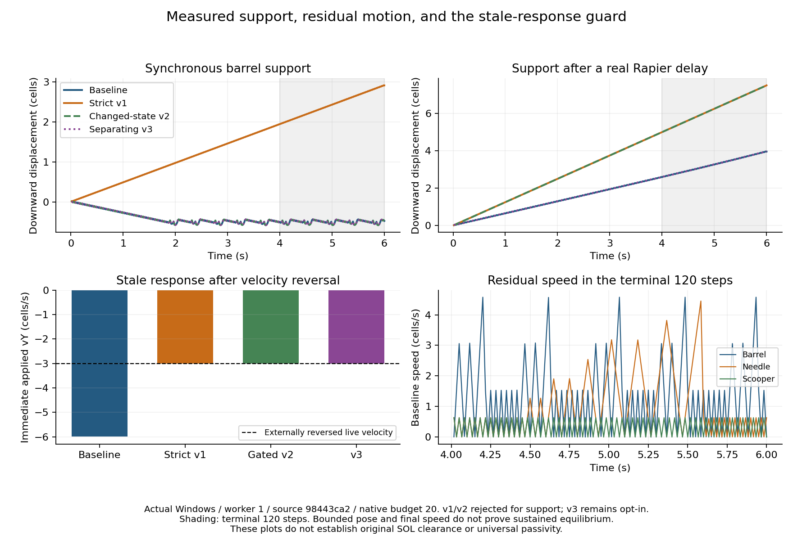

# LA-SELECTIVE authored-body qualification — 5 November 2026

## Physical objective and source custody

The owner's clarified objective is valid static equilibrium plus causal dynamic interaction. A genuinely constrained barrel may remain trapped. Material overlapping rigid-owned geometry is a separate validity problem. The old384episodes/9,216steps and their83-input source remain unchanged; their initially overlapping six-proxy burial surrogates establish response observations, neither valid entrapment nor a clearance failure. Original SOL failures and admission gates remain intact.

This continuation stays on Draft [PR400](https://github.com/techrote/cybersand/pull/400), branch `codex/experiment-la-selective-sol-feasibility-20261105`, owned worktree `C:/Users/_/.codex/worktrees/la-selective-sol/khybersand`. Root is the sole writer; agents review read-only. The source repository at `C:/khybersand` and upstream owned worktrees are preserved.

| Source/checkpoint | Meaning |
|---|---|
| `adc1e811dcf239a184997d062a4a26d077701579` | Previously published historical experiment; no competing remote400writer at continuation intake. |
| #394 `77c60b8e0f9b17192a4e04b20cd37ec55096c2c3` | Fresh upstream source, including84native inputs and five admitted protected-source transitions. |
| `8f6412da2004a5bfd4b68f40c854b564696637f7` | Ordinary merge into400, retaining both admission ancestries. Four documentation-only conflicts resolved additively. No SOL source imported. |
| main `ba9cbc89029be88b812af59b19e5c59829bbcd90` | #394 merged externally during this work; tree equals77c. This assignment did not merge it or change400's Draft state/base. |
| `99325b01a15225efe6de0258a3ff74f0a1f63aa8` | Prospective004registration before the first response prototype. |
| `3a55a93696ad177d3d985f9001b4a060d6a34686` | First strict passive-work prototype; support regression retained. |
| `9f950dc0` / `fa34f24c` | Registered005changed-state gate and its corrected safety fixture/execution. |
| `c940f233` / `a4950745` | Registered006narrow separating guard, pre-execution strict-sign review correction, then implementation. |
| `3d3b44a3` / `293443d7` | Registered007supported-arrival and separately bounded-workload cases; retained failed attempt instrumentation. |
| `98443ca2` | Close CYPS file before hashing; fresh authored matrix and full source-bound tuple reduction. |

All current84production native inputs match8f and77c exactly. No `world.cpp`, `world_pressure.inc`, `world_inertial.inc`, frozen guard, material identity, gain or budget is edited by this continuation. Guard validation retains27protected sources and all five admitted transitions. #3471598115c, #393e4c2649e and #386b661a6f3 remain separate sources, with the original conflict map in the historical dossier; no source equivalence or cross-owner capture/application is admitted.

## Runtime identity and reproduction

Both native extensions were freshly rebuilt from8f's exact native inputs using the pinned build scripts and SDK/compiler, without drift overrides. Builds write only to ignored `build/la-physical/runtimes`. Tracked canonical artifacts/manifests remain untouched.

| Actual executed runtime | SHA-256 |
|---|---|
| Fresh Linux SO | `a09a4a60cb54c8f1ca5c339d5ef8c3e230b53fc931b845690211ca33b5dac588` |
| Fresh Windows DLL | `b91066c66fe670912288e6ae01a6eda788ec34da4c11f20b5457dd4f875e3bef` |

Fresh Linux bytes equal upstream's selected runtime. Fresh Windows differs from tracked `cb675a4c…`: both COFF timestamps are zero; six export-name suffix bytes and seven RSDS/build-ID bytes differ. `.text` SHA is `57203490d27e97625eecf4cf87c7e2569d02704e97184cd9ac89913444562872` in both; other sections match. This is export-name/build-ID nondeterminism, not identical artifacts or a timestamp explanation. Each copied project records the actual fresh override and complete effective input map.

Linux extension uses GCC13.3/ld2.42 through the authenticated portability wrapper and godot-cpp101ae380. Windows extension uses pinned llvm-mingw20260826 and the matching SDK; this compiler is separate from actual Windows MSVC test execution. Actual hosts use Godot4.7 (`5b4e0cb0f`), Rapier addon0.35.2/core0.35.1 and the selected backport manifests. The runner independently authenticates engine/version/Windows launcher, Rapier bytes and source manifests, exact native inventory, source ancestry and all copied inputs. Windows is a real host; Linux execution is WSL Ubuntu24.04, not a Windows DLL cross-build. The supported Linux bundle ABI check passes: GLIBC2.34 bundle/native2.32, GLIBCXX3.4.30, CXXABI1.3.9.

Rebuild environments:

```text
Windows Git Bash: tools/build_native_extension_windows.sh
GODOT_CPP_ROOT=C:/Users/_/lcb-local-toolchain/env/godot-cpp-101ae38034304346a46ea9ea84ae156d3e860496
WINDOWS_CXX=C:/Users/_/lcb-local-toolchain/llvm-mingw-20260826/bin/x86_64-w64-mingw32-g++.exe
CYBERSAND_NATIVE_OUTPUT=<owned-root>/build/la-physical/runtimes/cybersand_native.windows.x86_64.dll
PATH prefix=C:/Users/_/lcb-local-toolchain/shims

WSL Ubuntu-24.04: bash tools/build_native_extension.sh
GODOT_CPP_ROOT=/home/i/render-publication-abc-tools/godot-cpp-101ae38034304346a46ea9ea84ae156d3e860496
LINUX_CXX=/home/i/render-publication-abc-tools/driver/tools/toolchains/g++
CYBERSAND_NATIVE_OUTPUT=/mnt/c/Users/_/.codex/worktrees/la-selective-sol/khybersand/build/la-physical/runtimes/libcybersand_native.linux.x86_64.so
```

The runner's required rebuild receipt records8f, both exact output hashes, build command/exit/bounds/raw-log hashes. The evidence inventory records the environment, SDK and compiler identities separately. No original compatibility inventory is refreshed. See the [build route](../operations/local-build-and-validation.md#opt-in-la-selective-comparison) for campaign/reduction commands. A different toolchain/host requires its own receipt and cannot inherit these outcomes.

## Mechanism and registered iterations

Native LA-SELECTIVE selects the one-use arrival event wrench rather than LA's all-event wrench. It retains legacy terms, bounded passive bearing/contact, existing correction and application. Events off removes only events; RFT is the fixed-budget reference. Water/unsupported materials remain excluded from the arrival channel. Other modes do not enable the arrival sidecar, so their zero arrival counters do not establish absence of granular transport.

The new response variants are Godot-side, opt-in, construction-time application policies. Native mode still reads LA-SELECTIVE. A nonwrapping first-successful-sample lock prevents mid-trajectory mode changes, including sample-serial wrap. Main-thread/owner/body/sample/epoch/age/geometry and duplicate fences remain; complete batches validate before any RID mutation. Ordinary sessions do not enable diagnostics or variants. Authenticated native gains/caps and budget20remain unchanged.

Write total wrench as nonpassive(event+legacy) plus passiveP. After existing correction velocity clipping, identical torque transport/currentCOM and age scaling, compute `b = v_base·Jp + omega_base*Tp`, `a = (|Jp|²/m + Tp²/I)/2`. The strict prototype chooses the largest `s∈[0,1]` with `b*s+a*s²≤0`. The opt-in action substitutes only `s*P`; all nonpassive terms remain algebraically present. Scaling passive can increase total-wrench magnitude when components oppose. The scalar polynomial is ideal float64 arithmetic; actual Vector2/RID rounding and observed kinetic changes are measured separately.

| Registration/variant | Outcome and physical interpretation |
|---|---|
| 004 `passive-live-v1` | **Rejected for general promotion.** Removes positive stale passive work but also suppresses discrete gravity support. Initial Windows prototype barrel terminal speed1.52896 vs baseline0.00768; terminal120stepYspan0.95399 vs0.14793. |
| 005 `passive-live-on-change-v2` | **Rejected for general promotion.** Synchronous unchanged-state paths match baseline because the gate is dormant. Actual-step-delayed support activates it every step and worsens span2.48231 vs baseline1.35698; finalY128.49525 vs124.95355. Near-zero final speed is not improved support. |
| 006 `passive-separating-v3` | Narrow hypothesis: require changed live state, sampled `b<0` and live `b>0`, with identical correction clipping/nonpassive framing. Then remove stale separatingP. Zero coefficients and ordinary negative-work support retain baseline. This does not constrain all overshoot or establish general passivity. |
| 007 | Keeps006mechanism; adds initially hard-supported Sand/Dust impacts and distinct16patch2048² workloads after the original64patchstream quarantine. Does not raise native capacity or relabel failed stress. |

All thresholds were declared before outcomes. No post-result gain/threshold tuning occurs. Pre-execution review changed the unexecuted006proposal from `b_live>=0` to strict positive before implementation, since zero after clipping can be legitimate support. Invalid/extreme policy inputs, energy sums/results and whole-batch refusal are tested. Original pure-helper, fixture typing and payload-hash defects remain in the process ledger.

## Real authored apparatus and observations

### Prospective008follow-up registration

Before implementing or observing008, register two additional180stepcases with the same seven arms, source/gains/budget/seed/1/60cadence and fresh1/4worker Windows/Linux sessions. `angular-Scooper-reversal` uses the authored Scooper on the unchanged bed, initialomega+0.3rad/s and zero linear velocity; immediately after native response atstep0apply the externally accounted torque impulse `-2*I*live_omega`. `near-Sand-reversal` uses the authored barrel/bed, initialvY+3, six Sand cells at `(125..130,112)` above the initial hulltop114, and the existing measured linear reversal atstep1. Do not move the challenge origin after observing arrivals. Zero arrivals or a dormant gate remain executed outcomes, not grounds to retime the fixture. Test angular sign reversal and preservation of genuine event+legacy components under the opt-in guard; reject a claim if no causal gate/event is observed or ownership/material/readback fails. This adds coverage; it changes no006law or earlier cohort.

The private Rapier World2D uses actual `PhysicalActorSession` rigs and their collision rectangles, not synthetic replacements. Authored barrel mass1/inertia21.6667, Needle0.065/0.31417, Kestrel0.1/0.975 and five-proxy concave Scooper0.18/24.7901are read back from the server. Authored gravity remains92.12(barrel) or38(flyers). Layer/mask1and native hard colliders are enabled except the separately labelled collision-disabled isolation.

Fresh World/session per arm; seed0,1/60cadence, budget20, matched native tuples/body geometry/pose/mass/inertia/gravity/actions/publication and observation windows. One neutral dynamic Rapier step with gravity temporarily zero occurs before native construction, with pose/velocity/omega invariance checked, then exact authored gravity restored. This is the registered warm-up, not a claim that old unprimed actions succeeded.

Static windows are360steps with the final120observed after240; ordinary cases180. The descriptive static screen is translation span≤0.5cell, rotation span≤0.05rad and final speed≤0.5cell/s, separate from initial geometry and original SOL thresholds. Generic test discovery uses its own144step smoke, which cannot qualify equilibrium.

Each step records sampled/live/immediate-applied/post-Rapier states, actual native mode and rows, selected event/passive/derived legacy wrench, correction, RID reconstruction, external impulses/controller/forces, kinetic/potential, native identities/mask reservations, worker/statistics and per-stage timings. Existing age/geometry refusals remain observations, not zero-force successes. Lifecycle probes cover wrong epoch/body, stale sample, duplicate consumption/owner roster, reset retirement and closed session; actual Main fixtures separately cover scene replacement and failed-owner reset.

Initial/final nonmutating CYPS2 captures cover all stored tuples including masks/halo. The independent parser verifies outer capture SHA/size, embedded checksum, unique chunks and full material/state/temperature multisets; epoch is excluded from physical quantity comparison. It retains the trailing quantity ledgers opaquely and does not claim a complete persistence/replay decoder. Actual successful emissions and support erasures have separate quantity ledgers. Geometry uses independent float64 clipping, actual float32 Rapier basis, cell-centre tests and maximum convex-proxy/cell separating-axis depth. These are diagnostic proxy measures, not the original SOL aggregate oracle. Large performance ROI sampling is every12steps plus final; full per-step geometric coverage is not claimed there.

Force work estimated from `F·integration displacement` remains distinct from exact direct-impulse work, propulsion-controller work, gravity, damping, hard-contact reactions and correction potential/clipping. The native model has no observed granular parcel velocity/kinetic-energy authority, so total mechanical-energy conservation is **unavailable**. Exact material conservation and independently reconstructed rigid response are separate admissible tests.

**Prospective force-API oracle:** before implementation/outcomes, register an isolated real authored barrel/Rapier test with native coupling absent, gravity zero and damping explicitly replaced by zero. After neutral initialization, apply centralforce(6,0) for one 1/60 step, then perform two steps without force; expectedvelocity0.1persists if the API clears per-step forces. Apply directimpulse(0.2,0) and independently verify momentum and `J·v+|J|²/(2m)` kinetic change. Compare endpoint `F·displacement` with measured kinetic change as a diagnostic, not an equality gate. Run both actual hosts and record exact fixture/source/engine/Rapier hashes. This oracle characterizes force lifetime; it cannot establish energy closure with native material, gravity, damping or collisions.

## Executed results and retained limits

### Complete real-body matrix and causal follow-up

The [complete summary](la-physical-20261105/summary.json), [episode ledger](la-physical-20261105/episodes.json), [selected causal per-step records](la-physical-20261105/causal-records.json), [complete support trajectories](la-physical-20261105/support-trajectories.json) and [raw capture inventory](la-physical-20261105/raw-inventory.json) bind all registered episodes, with local complete-window replay/reduction inputs retained. Raw generated logs/binaries/CYPS stay outside Git; their recoverable paths, sizes and SHA values remain available. [Process receipts](la-physical-20261105/process-receipts.json) include exact source/native/engine/Rapier/copied input identities and commands, exits, timeouts and raw-log hashes. A screenshot is not the observation authority.

| Cohort | Actual hosts/workers | Episodes / measured steps | Outcome |
|---|---|---|---|
| Authored matrix at98443ca2 | Windows/Linux, requested1/4,25cases×7arms | 700 /161,280 | Complete windows; no fixture failures. All700material-source ledgers close;644 closed nonempty material/state/temperature multisets match exactly, with56 emission/removal cases separately accounted. Maximum independent immediateRID residual1.946299365e-6, within unchanged registered1e-5. |
| Bounded/stress pilot at98443ca2 | Both hosts,1/4,4cases×7arms | 112 /17,780 | 84 bounded episodes finish180steps, with every requested4episode reaching4participants. All28original64patchstress episodes fail after95completedticks; finalcapture is unavailable. |
| Angular/near-arrival at1cde808e | Both hosts,1/4,2cases×7arms | 56 /10,080 | Complete windows, no fixture failures; all 56 closed tuple/source ledgers pass. MaxRID residual1.192092896e-7. |
| Shared-host timing atfd263092 | Both hosts sequentially,1/4,3cases×5arms×3repeats | 180 /32,400 | All complete;180 source ledgers and120 closed tuple ledgers pass. Worker 4 peak is 4 in every episode. Separate shared-host qualification; idle-host scaling remains unavailable. |

These four retained cohorts contain **1,048 attempted episodes and 221,540 observed steps**. Of these,1,020 episodes complete and28 stress episodes fail. All1,020available final material-source ledgers close;876 closed nonempty tuple multisets are identical. The8short smoke episodes/288steps and isolated force oracle are separate apparatus checks, not additions to the full campaign denominator. Earlier prototypes and interrupted runs remain separately indexed in [retained attempts](la-physical-20261105/retained-attempts.json).

The ordinary authored matrix has zero initial intersection area in every initially valid static case; invalidSand and invalidWall controls each start with16 cell² intersection,16 interior cell centres and maximum4 cell convex-proxy depth. They remain invalid controls, never entrapment/clearance successes.

The selective descriptive static screen passes12/28 episodes: barrel-rest, wall-and-Sand and Scooper-rest across both hosts and workers. Partial burial, constrained barrel, Needle and real-step-delayed support fail; the separating guard has the same12/28result. RFT additionally passes the constrained case (16/28). These are screen outcomes, not sustained equilibrium certificates. On Windows, worker 1, baseline barrel final speed0.00768contrasts with maximum4.57561over the last120steps; Needle reaches4.45035and Scooper0.63333. The same tail averages216 native moved cells/tick in each case. The bed remains active, and residual oscillation prevents a claim of settled static soil.

Supported impacts isolate the event mechanism: Sand/Dust each produce8genuine selective arrivals. Sum of accepted event-vector norms is0.32 for Sand / 0.084 for Dust under selective versus LA values 115.28/38.241. These are repeated-step response sums, not conserved parcel momentum. Hard support intentionally limits visible body motion. Dynamics are mixed: unsupported Dust final speed4.0656under selective versus0.31965under LA/RFT in the representative Windows, worker 1case. No universal dynamic superiority follows.

The force ladder gives approximately0.11/2.96/203.04cells horizontal displacement for weak/medium/strong selective forcing on Windows, worker 1. Native tuples remain conserved while Sand redistributes; strong forcing leaves local support. This is an externally driven force-response comparison, not measured packed-soil yield stress or static friction. Powered Needle uses actual authored controls and has its own work/pose records; it is not passive recovery.

The narrow guard's causal benefit is executed on both hosts. Live reversal actualvY remains−3instead of baseline−5.997362; age-one remains−3instead of−5.397890, eliminating ideal stale-passive positivework13.48418/10.06861at that challenge. Angular Scooper reversal retainsomega−0.300000012instead of−0.413601696and suppresses the stale linear response. Near-Sand reversal atstep1retains6arrivals and event impulse `[0,0.239999994635582]`, with actualvY−1.29158914instead of−3.06162071. Independent nonpassive-wrench preservation residuals across fresh008v3rows are ≤2.95e-15linear and8.10e-12transported torque. Within eachOS, requested1/4native rows, actual applied/poststep states and geometry match exactly over both008180stepcases; requested4actually reaches4participants. Each008v3episode has one substantive gate. Delayed-support74gate activations instead remove at most~3.30e-16linear/~2.13e-15torque: numerical sign crossings, not74physical repairs.



The fresh authored matrix, representative workload repeats and reductions are recorded in the companion evidence inventory. Each has its own source/runtime/input identity, commands, exits, windows and completeness status. Earlier pilot payloads internally validate but their recorded outer SHA was calculated before closing the file; they remain mechanism/prototype observations with that custody defect. Fresh98443captures close before hashing and pass both checks. The aborted293443matrix remains a failed/interrupted run, not a completed cohort.

The64patchSand/Dust stream on2048² reaches four actual native pool participants with workers4. It quarantines after95completedticks in every arm on both hosts. Final authoritative capture is unavailable after failure; no conservation/physical completion pass follows. Retain attempted work and refusal costs. The16patchcohort is separately registered bounded work, not a repaired64patchpass. Full-window quiet-contact timing includes initial settling; terminal60cost is separate and requires activity evidence before a quiet claim. Neither workload applies the historical SOL2msCPU gate.

The original007otherwise-idle timing attempt was interrupted after another owner's Godot qualification was observed on the shared physical host. It is retained as an incomplete, contaminated attempt. Separately preregistered009executes three repeats, platforms sequential, five live comparison arms (four controls plus v3), unchanged16patchcases, with ambient process snapshots and observer cost outside case timing. These are shared-host measurements, not controlled idle-host scaling; the007isolation qualification remains **UNAVAILABLE**. Do not stop or alter the other owner's process to manufacture isolation. [Performance ledger](la-physical-20261105/performance.json) retains unrounded repeat means, maxima and terminal60costs; no universal60HzorSOLCPU-gate claim follows.

The following shows the worst of three unrounded mean instrumented simulation costs, displayed in milliseconds with rounding only for this table. Complete controls, per-stage, terminal60and observation/control costs remain in the ledger. The comparison apparatus explicitly enables audits in both baseline and variant; ordinary workbench sessions leave those audits disabled.

| Host/workers | Workload | LA-SELECTIVE worst mean ms | v3 worst mean ms |
|---|---|---:|---:|
| Windows, worker 1 | Quiet/contact including settling | 1.594 | 1.800 |
| Windows, worker 4 | Quiet/contact including settling | 1.009 | 0.980 |
| Linux, worker 1 | Quiet/contact including settling | 2.045 | 2.316 |
| Linux, worker 4 | Quiet/contact including settling | 1.396 | 1.390 |
| Windows, worker 1 | Sand/Dust stream | 3.705 | 3.646 |
| Windows, worker 4 | Sand/Dust stream | 1.892 | 1.988 |
| Linux, worker 1 | Sand/Dust stream | 3.891 | 4.257 |
| Linux, worker 4 | Sand/Dust stream | 2.781 | 3.016 |
| Windows, worker 1 | Dense collision/multiple bodies | 3.190 | 3.228 |
| Windows, worker 4 | Dense collision/multiple bodies | 1.795 | 2.387 |
| Linux, worker 1 | Dense collision/multiple bodies | 3.974 | 3.947 |
| Linux, worker 4 | Dense collision/multiple bodies | 2.205 | 2.309 |

The v3Windows, worker 4dense maximum single observed simulation step is22.409ms, even though its worst repeat mean is2.387ms. Observation/serialization/rendering/async publication costs are additional scopes. This rules out a universal60Hzclaim. Selective2048²arrival history is42,467,328bytes (42.47decimalMB); native resident cell storage separately reaches53,167,104bytes. Other modes do not allocate this arrival history. Neither number is total process memory; heap totals, per-worker time shares and full interactive latency remain unavailable. Tick-time chunk allocations are recorded separately from setup reservation and all other allocation classes.

The force-lifetime oracle passes 6 checks on each actual host at3e615326. A single force-6 step producesvX0.10000000894, which remains unchanged over two no-force steps: the force does not persist. Directimpulse0.2raisesvXto0.30000001192and adds measuredkinetic energy≈0.04000000097versus predicted0.04000000179. Endpoint force-work estimate0.0098876953125differs from measuredforce-step kinetic increase0.00500000082because finite integration/position rounding matters even in this isolated case. Accordingly the force ladder's endpoint work stays an estimate. The separate default smoke passes 517 checks per host over 144 steps; it cannot qualify the full equilibrium window.

Fresh native qualification:166core tests pass normally and under strict ASan/UBSan with leak detection/halt-on-error. Focused GCC optimized and strict sanitizer executions pass32 direction-probe,70 selective,196 arrival and827,303 pressure-head checks. Actual Windows MSVC19.38.33145/O2passes32/70/196; retain existing `world.cpp` C4333warning rather than editing protected source or suppressing it. These executions use the reconciled native84inputs; test-only Godot changes do not relabel historical native results.

The [qualification receipts](la-physical-20261105/qualification-receipts.json) retain exact fresh-build/native166/focused/MSVC commands and binary hashes, all 12 affected Main/workbench tests on both hosts, sourcecd56Linux, worker 118catalogue tests/native compiled-query parity/compiler/guard, and the final force/default-smoke oracles. Compiler/SDK hashes are explicitly a closure inventory, not invented contemporaneous attestations. [Source and raw patch custody](la-physical-20261105/source-and-patch.json) names a recoverable checkpoint, tree, native84inventory and local raw dependent patch; subsequent evidence-only children are separately checked.

The direction probe follows real vertical Sand/Dust transport, then uses an explicitly test-controlled attempted contact and clock. It observes rawSandaxis1600/Dust420and a diagonal component in bothaxes, even though prior transport was vertical. After adapter gain the single-axis values are0.04/0.0105; diagonal norm is√2larger. This is attempted-direction arithmetic plus prior-transport alignment/one-use proof, not a live body scheduler collision or physical parcel momentum measurement. No protected implementation is changed. A calibrated material-relative momentum/velocity model would require a separately admitted native transition.

## Separate acceptance and promotion decisions

The final episode ledger supplies ten separate decisions: static equilibrium, dynamic response, geometry, conservative displacement, actual Rapier application, numerical/energy behavior, actual multithreading, representative performance, gameplay suitability and source integration. A local fixture pass is not universal production acceptance. Baseline Needle final speed≈0.63338already misses the declared static speed screen; baseline delayed support span≈1.35698misses its span screen. Preserve those failures even if a new variant exactly matches baseline.

| Decision | Source-bound disposition |
|---|---|
| Static equilibrium correctness | **CONDITIONAL.** Initially valid geometry and bounded response in three selective cases;12/28descriptive screen passes, residual active-bed oscillation and four failing case types. Sustained settled equilibrium is unproved. |
| Dynamic granular response | **CONDITIONAL.** Sand/Dust one-use events and actual applied response demonstrated. Unsupported Dust and other dynamic outcomes are mixed; no calibrated parcel-momentum or universal superiority claim. |
| Contact/material geometry | **CONDITIONAL.** Independent initial/step geometry identifies valid starts and invalid16 cell²controls. Whole-cell sampled masks and later live poses differ; no invented clearance or originalSOLoracle pass. |
| Conservative displacement | **CONDITIONAL.** Completed-cohort nonempty tuple/source ledgers close exactly, including masked/halo material and explicit emissions/removal. Actual native relocation is observed; this does not prove a constitutive yield/friction law. Failed-world finalstate remains unknown. |
| Rapier application | **PASS within exercised scope.** Native mode, actual RID velocity/omega reconstruction and refusal/lifecycle fences pass at recorded fresh runtimes. Maximum authored residual1.9463e-6under the unchanged1e-5bound; no unprimed historical failure is relabelled. |
| Numerical/energy behavior | **CONDITIONAL.** Finite/atomic/cap guards and controlled stale linear/angular benefits pass. Combined passive suppression can remove useful components; correction, propulsion, gravity, damping and native parcel energy prevent a total-energy claim. |
| Multithreading | **PASS within exercised scope.** Actual native4participants observed in bounded workloads and008;008worker1/4response/state/geometry parity is exact within eachOS. This is not per-worker utilization or universal scheduling determinism. |
| Performance | **CONDITIONAL.** Separate repeat/stage/memory ledgers; original64patchstress28/28fails at unchanged capacity.009is shared-host measurement. Controlled idle-host scaling is **UNAVAILABLE**; no universal60HzororiginalSOL2msCPUgate pass. |
| Gameplay suitability | **CONDITIONAL.** Actual authored fleet bodies and Main/workbench fixtures exercised; physical-device and human-feel acceptance remain **UNAVAILABLE**. The guard stays opt-in. |
| Source integration readiness | **NO-GO for promotion/integration in this assignment.** Ordinary native-source reconciliation and guard preservation pass separately. Cross-SOL ownership/material admission and final production/platform acceptance are absent;400staysDraft. |

The original four owner decisions remain distinct: **(a) CONDITIONAL** intended primary granular gameplay candidate; **(b) UNAVAILABLE** as a new matched benefit claim for originalSOL-like aggregate collisions (the new benefit is stale real-body response, not SOLclearance); **(c) UNAVAILABLE** originalSOLphysical proof, with historicalNO-GOunchanged; **(d) NO-GO** cross-source ownership/MATintegration. Native source preservation on400does not admit that composition.

Original SOL physical clearance is **UNAVAILABLE as a new matched claim**; combined #394/#347/#393 ownership/MAT integration remains **NO-GO**. Preserve original84/84sustained-clearance failures,64/84depth failures,36/36async final overlaps,1,452/1,452fixed-orientation refusals, CPU failures, accepted frozen material guard and #365restoration block. No automatic escape criterion overrides valid entrapment, and no safe refusal counts as physical clearance.

No new originalSOL120+60evaluator or SOL364-Dclock is installed. Original numerical limits remain area≤1e-6cell², depth≤2e-5cells, embeddeddepth≤initial+0.25, nonembeddeddepth≤1cell, with complete recurrence coverage required for an original prospective success. The original inclusive24group/3repeat≤2msworst unrounded mean CPU gate remains its own source-bound historical contract, never the new workbench gate. Original9Sand+16Wall(ID1), tinyRedBrick1e-9filter, rotated-authority and cross-owner refusals remain in their historical source qualification; the present work does not execute originalSOLor relax those exclusions.

### Blocked contract and next bounded questions

1. Request separate independent adversarial review of400's final source/receipts, especially one-use arrivals, combined passive removal, residual oscillation and failed capacity. Internal read-only agent reviews are technical checks, not owner promotion approval.
2. Investigate support/settling and material-relative momentum with a new registration. The current native event witness validates prior transport but emits attempted-direction×density, with no measured parcel velocity. Any correction in protectedWorldconsumers requires an explicitly admitted source/material transition; keep the frozen guard and native84inventory intact until then.
3. A true SOL aggregate needs one native owner/capture identity, one actual Rapier aggregate, admitted COM/inertia/geometry/material map, provenance/epoch/mask handoff and refusal/capacity contract across #394/#347/#393. E1/E2cross-owner authority remains separate. The original composition map and original failures cannot be replaced by this barrel/flyer evidence.
4. Repeat controlled timing/latency and residual-motion tests on an exclusive host; qualify supported devices and human feel. Arrival sidecar42.47MBand failed heavy activity remain explicit. Sparse history or other native optimizations need their own protected-source admission and fair new comparison.

The smallest later promotion path is independent adversarial review of this exact source and raw accounting; admit any protected native/material changes separately; qualify remaining supported platform/device/interactive feel and capacity limits; then make a distinct owner decision about the supported desktop granular default. Preserve LA/events-off/RFT controls, authored fleet, powder/painting/save-load and Water/liquid policy. The stale-separation guard would require its own rollout decision and broader asynchronous support/contact qualification. This assignment keeps400Draft and stops before integration.

## Documentation checkpoint map

Player-control-playground owns mechanism/equilibrium semantics; owner intent, roadmap, handover, build/reproduction, docs/retrieval routes and an additive PLAY question are synchronized. This dated audit stays excluded from default retrieval. Native ownership/threading, material policy, public physics interfaces/capacities and ADRs are unchanged; no new architectural contract is implied. The adapter's once-selected opt-in method, diagnostics and nonwrapping lifetime fence are documented above. Historical dossiers and original registrations remain unchanged. Final checks record Documentation, materialized repository/native/Rapier identity, M11 historical integrity, frozen guard/compiler/catalogue/query oracles, retrieval, Python syntax and whitespace with their own source/local-delta identities.

The [internal review](la-physical-20261105/internal-review.json) finds no blocking misstatement for this bounded Draft publication while preserving the ten separate limitations. It is not the later independent admission review. The [reducer adversary](la-physical-20261105/reducer-adversary.json) records correct refusal of mismatched capture metadata and an incomplete smoke cohort presented as a full matrix; the expected nonzero exit is not a physical failure or a fabricated pass.

Closure validation is source-bound in [the check ledger](la-physical-20261105/closure-validation.json). An initial optional Make dry-run failed because WSL lacked `make`; the existing Windows LLVM-MinGW GNU Make supplies the later passing syntax check. Equivalent optimized/sanitized native commands were already executed independently. Historical M11 is checked against its own retained revision. Retrieval remains a lexical development metric, with frozen32/challenge157 objects unchanged and the new equilibrium question additive. Later evidence-only publication children receive their own local exact-head check receipts; they do not relabel runtime source identities.
