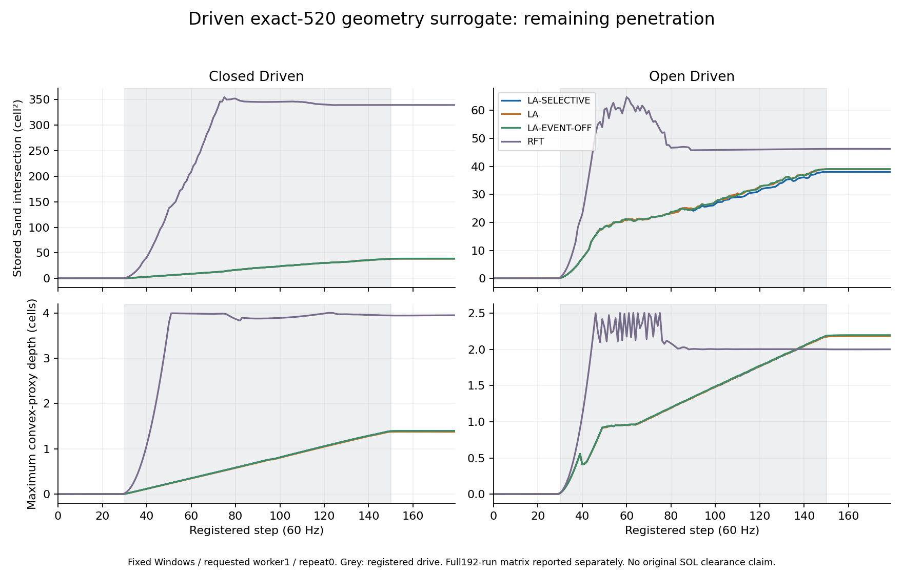
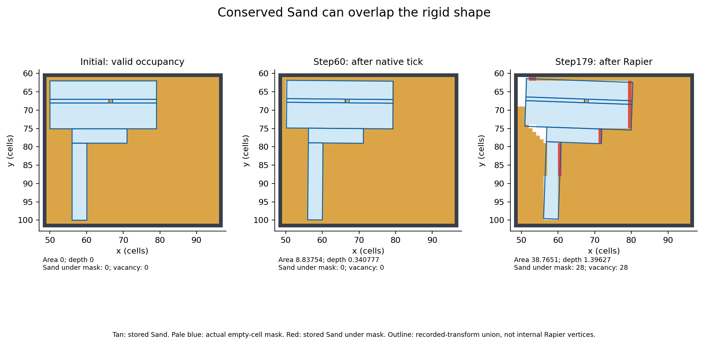
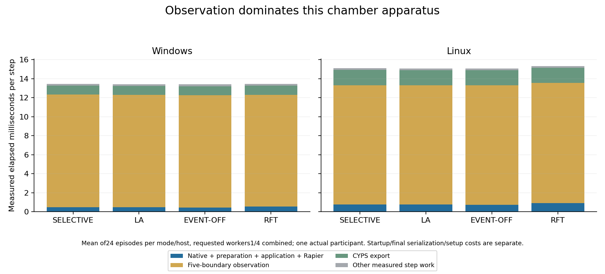

# Exact SOL geometry chamber — 5 November 2026

The owner prioritizes engine performance, physical behaviour and solving SOL.
After the separate [numerical energy repair Draft #407](https://github.com/techrote/cybersand/pull/407),
this isolated lane investigates whether the existing workbench coupling can
maintain valid compound occupancy while granular material yields under drive.

**Review status:** the full matrix is retained author evidence pending separate
independent raw-packet audit. The committed [manifest](sol-chamber-20261105/manifest.json),
[comparison](sol-chamber-20261105/comparison.json), per-episode ledgers and fixed
raw counterexample support source/quantitative review. The counterexample
includes seven distinct native CYPS captures and a portable audit command;
the remaining full raw matrix stays in the separately hashed local review
packet. Derived tables do not substitute for those bytes or grant acceptance.

Only root writes `codex/sol-chamber-yielding-20261105`, based on freshly verified
#400 `a38098b1a807fc3ac7b60166e75b217dd7bc629e`. #400 remains unchanged.
Main is separately observed at `ba9cbc89029be88b812af59b19e5c59829bbcd90`;
no current-main or historical SOL native implementation is merged here.

[SOL-CHAMBER-001](../../godot/tests/fixtures/sol_chamber/registration.json)
is committed before implementation and physical execution. The original retained
report and complete six-value member tuples must be authenticated directly.
One actual Rapier body carries six shapes. The 520 RedBrick members are evidence
of geometry/payload identity, never duplicate native cell authority.

Four modes (LA-SELECTIVE, LA, LA-EVENT-OFF, RFT) use pristine Worlds/sessions
under four open/closed and driven/unforced profiles. All keep baseline application,
budget 20, zero body gravity/damping, seed 0, fixed 60 Hz cadence, identical
publication schedule, no propulsion, workers 1/4, both actual hosts and three
repetitions: 192 attempted episodes. One fixed force is active on steps30–149 of
180; gains, map, geometry and thresholds cannot be tuned after outcomes.

The chamber initially excludes aggregate members from ambient Sand. Closed
has 1,360 Sand cells and no unmasked vacancy; open clears exactly 560 cells,
leaving 800. Independent full-square clipping/SAT must verify the initial
geometry. Invalid initialization, capacity and unknown eligibility remain
separate from valid entrapment. A constrained body need not spontaneously escape.

Five boundaries per step capture stored materials and actual native masks,
poses, responses and application/accounting. Full CYPS captures preserve hidden
tuple temperatures and expose initial/final conservation. Force lifetime,
candidate work, native work, physical stepping, census/export overhead and failed
attempts stay visible. Shared-host timing is not the original SOL CPU gate.
Endpoints do not certify continuous rotated sweeps or identify Sand parcel routes.

Original SOL physical failures, fixed-orientation refusals, hard exclusions,
frozen MAT guard and restoration block remain unchanged. This branch contains
no live native aggregate handoff, new Active hold, protected World edit or SOL
response port. Any PR stays Draft and dependent on #400. Independent adversarial
review must precede an owner integration decision.

## Executed construction and static control

The extractor authenticates all 520 six-value tuples, unique membership, six
rectangles, both voids, stored float32 COM and recomputed geometric inertia.
`78dfeb7a` constructs the chamber on both hosts, but a typed-array error
interrupts before step one. Both processes fail the logger despite their empty
failure footer. Retain them; they supply construction, not physical execution.
Outer coverage and overwrite checks are hardened before fresh execution.

`d44e09a3` replay completes 180 steps/390 checks on each actual host. Independent
exact-bit reduction finds zero Sand/hard intersection, 520 body centres and mask
cells, zero mask disagreement, no arrivals, no motion and no candidate kinetic
work in closed/unforced LA-SELECTIVE. Initial/final counts close. This is valid
static entrapment in the new chamber, not original SOL authority or clearance.

Native84 matches `8f6412da`; source-equivalent rebuilt runtimes are inherited,
not newly compiled here. Executed Windows SHA-256 is
`b91066c66fe670912288e6ae01a6eda788ec34da4c11f20b5457dd4f875e3bef`, Linux
`a09a4a60cb54c8f1ca5c339d5ef8c3e230b53fc931b845690211ca33b5dac588`.
Original compiler/build receipts, all copied Godot inputs, loaded overrides,
engine hashes and actual hosts are separately authenticated. Native sanitizer
and MSVC rebuilds are NOT RUN for this test-only adapter. Protected sources and
accepted material transitions remain unchanged.

## Force accounting correction

The `86cb97ad` matrix stops after 28 sealed Windows episodes and one interrupted
attempt: 16 unforced processes pass; twelve driven processes fail the observer's
readback check. Remaining 163 declared episodes are NOT RUN. Its mistaken
reference is pre-force velocity, although the sample already contains drive.
All original failures, interrupted work and raw outputs remain retained.

The pinned addon implements `apply_central_force()` as an immediate `F*dt`
impulse before native sampling. A source-only inference of later integration
is rejected by actual packets and the pinned implementation. See
[force API](https://github.com/appsinacup/godot-rapier-physics/blob/172c66f5a88bf1164c2b8cf2d775ed889edefd75/src/bodies/rapier_body.rs#L1178),
[impulse application](https://github.com/appsinacup/godot-rapier-physics/blob/172c66f5a88bf1164c2b8cf2d775ed889edefd75/src/rapier_wrapper/body.rs#L587),
and [configured timestep](https://github.com/appsinacup/godot-rapier-physics/blob/172c66f5a88bf1164c2b8cf2d775ed889edefd75/src/spaces/rapier_space.rs#L575).
Primary source bytes/hashes are retained in `build/sol-chamber/force-source`;
the authenticated runtime patch changes the cooperative BVH join, not force.

[APPARATUS-002](../../godot/tests/fixtures/sol_chamber/apparatus-002.json),
committed at `0d2cd379` before implementation, corrects observation/admission.
Force, geometry, map, modes, budget, cadence and publication are fixed.
Record the external API kinetic change separately; response prediction/work
starts from live preapplication state. Endpoint `F*dx` is a diagnostic estimate;
the hypothetical postresponse force increment is counterfactual, not applied.

`15705bf2` closed/driven LA-SELECTIVE completes 180 steps/391 checks on each
host. Counts and exact tuple multisets close. Maximum Sand intersection is
`38.76508869923395 cell²`, maximum convex-proxy depth `1.3963688876541198`
cells, with no hard intersection. Response kinetic change sums approximately
`-63127.597` units. Dissipation and conserved tuples do not prevent penetration.
The unchanged 192-episode matrix completes at this source: 194 child processes
(192 episodes and two imports) exit zero, 34,560 steps/172,800 phase observations,
391 checks per episode. All initial geometries, complete observation windows,
counts and exact tuple multisets pass independent audit. Expected coordinates
are complete without duplicates; copied-input checks find no unexpected changes.
No gain, map, force or threshold is tuned away from a negative physical result.

## Complete matched matrix

Each row below represents twelve executions: two actual hosts, requested workers
1/4 and three repeats. Values are maxima across all five phase boundaries.
Hard-step records count steps with any per-proxy/cell hard intersection above
the unchanged `1e-9` filter, out of 2,160 observed steps per row.

| Chamber/control | Mode | Sand area max, cell² | Depth max, cells | Hard-step records |
| --- | --- | ---: | ---: | ---: |
| Closed/unforced | LA-SELECTIVE | 0 | 0 | 0 |
| Closed/unforced | LA | 1.106277 | .038632 | 0 |
| Closed/unforced | LA-EVENT-OFF | 0 | 0 | 0 |
| Closed/unforced | RFT | .220325 | .007428 | 0 |
| Open/unforced | LA-SELECTIVE | 4.945e-6 | 2.19e-7 | 0 |
| Open/unforced | LA | .493939 | .022892 | 0 |
| Open/unforced | LA-EVENT-OFF | 0 | 0 | 0 |
| Open/unforced | RFT | .035919 | .001589 | 0 |
| Closed/driven | LA-SELECTIVE | 38.765089 | 1.396369 | 0 |
| Closed/driven | LA | 38.482204 | 1.379907 | 0 |
| Closed/driven | LA-EVENT-OFF | 38.765267 | 1.396408 | 0 |
| Closed/driven | RFT | 354.695503 | 4.003022 | 348 |
| Open/driven | LA-SELECTIVE | 38.066401 | 2.185799 | 216 |
| Open/driven | LA | 39.013435 | 2.183142 | 144 |
| Open/driven | LA-EVENT-OFF | 39.080336 | 2.197718 | 132 |
| Open/driven | RFT | 64.760073 | 2.505160 | 132 |

The selective-specific benefit is clearest in initially valid closed equilibrium.
The forced LA-family curves are close: selective arrivals do not repair the
dominant penetration mechanism, and relative area/depth/hard results are mixed.
The open/unforced selective case has one genuine arrival and a tiny nonzero
recorded-transform area above the old reference `1e-6` ceiling; it is not silently
rounded to a clearance pass. The native full SOL response is absent and remains
an external historical baseline, never a matched arm.





Figures use the same first Windows/worker1/repeat0 index for every condition,
not a selected best run. This deterministic plotting choice is post-execution,
not a separately preregistered or blinded selection. Geometry reconstructs the common transform in float64 from recorded
quantized basis/local rectangles; it does not capture internal Rapier vertices.
Tiny boundary results remain geometry-conditional. The hard filter is unchanged;
uncertainty/refusal is not physical clearance. Continuous rotated sweeps remain
uncertified. The large driven overlaps are not explained by tiny boundary error.

## Mechanism and measurement limits

Hard positives differ in phase and magnitude. In the fixed reference runs, open
LA and event-off positives occur only after application and clear after Rapier;
selective includes five post-Rapier positives, open RFT eight. Maximum recorded
hard areas/depths are respectively LA `6.96218e-5/.00328606`, off
`1.28288e-5/.00147974`, selective `4.99131e-5/.00278327`, RFT
`.00142789/.00113355` (cell²/cells). Closed RFT is larger:
`5.14670/.412681`, with 28 post-Rapier positives. Retain every original-filter
positive; aggregate counts alone do not express severity or persistence.

Body `external_drive`/gravity metadata are validated/read back, not used
directly by native solver arithmetic; supplied force-updated velocities matter.
Body gravity zero does not stop native Sand. LA-family response retains mass
scale520/body cap10400 here; RFT's scale1/cap20 and side-contact admission differ.
Selective event choice retains legacy/passive response and existing correction.

At first driven step30, events/legacy/correction are zero. Passive response
reduces kinetic energy260 to29.7179 but leaves horizontal velocity `.32206`.
An independently reconstructed source-arithmetic diagnostic finds 82 admitted
grains, 17 bins, 31 nodes and no normal-cap hits; four passes produce successive
vx `.74867,.56260,.42465,.32206`, matching runtime rounding. This is offline
reconstruction under stable packed cells, not fresh native bin-capture evidence.
Fixed bin/sample weights include separating/opposed contacts in the denominator;
weighted Jacobi batches run four passes without a convergence/nonpenetration
acceptance test. Available budget does not imply complete arrest.

After step30 Rapier motion, area `.196169 cell²` and depth `.006954` coexist
with zero Sand centres under mask. At step60 even after fresh reconciliation,
area `8.837539` and depth `.340777` coexist with zero covered Sand centres.
This is not merely an old-mask artifact. Final state contains 28 Sand cells
under the actual mask and 28 newly unmasked vacancies, with conserved tuples.
Later dynamics include 74 genuine arrivals, 27 event-wrench steps beginning77,
and one displacement at81. Attribute the first penetration to passive residual;
the whole late trajectory is not event-free. Small subtraction residues between
separately rounded row vectors do not prove a separate legacy force.

`find_ejection_target()`/`ejection_path_reachable()` search bounded empty
destinations, rejecting hard/foreign masks but allowing intervening movable
Sand and the source proxy. Siblings can block the path. This is bounded transfer,
not a demonstrated contiguous-empty parcel trajectory. `move_cell()` preserves
tuple/temperature and clears arrival stamps for out-of-tick BodyDisplacement:
reconciliation is not a new arrival. Public totals do not certify parcel routes.

Static Windows four measured stages average about `.471 ms`, Linux `.817 ms`; the
five-boundary census averages `11.80/12.76 ms` per step. Including observer and
export, recorded means are `13.39/15.39 ms`. These instrumented shared-host
observations are separate from the original inclusive24group/three-repeat/2ms
gate and prove no universal60Hz. The small scene so far claims one participant
per dispatch; requested workers4 cannot be relabelled as four participating
workers. The ledger retains every attempted process and recorded observer/export cost.
Child-process elapsed time includes startup, final serialization and teardown;
controller setup/hash/copy work and interrupted totals are not fully measured
and remain UNAVAILABLE. No complete inclusive CPU gate is qualified.

## Performance, decisions and next gate

Across 48 episodes per host/worker configuration, the ranges of per-episode
mean elapsed time are:

| Host / requested workers | Four timed coupling/physics stages, ms | Whole measured step, ms | Actual participants max |
| --- | ---: | ---: | ---: |
| Windows / 1 | .385183–.806294 | 13.198256–13.895033 | 1 |
| Windows / 4 | .384461–.838517 | 13.096822–14.590933 | 1 |
| Linux / 1 | .631744–1.492722 | 14.847122–15.849122 | 1 |
| Linux / 4 | .615861–2.048306 | 14.839750–19.072694 | 1 |

These are elapsed intervals, not per-thread CPU counters. All observer/export
work stays visible; no speedup is inferred from requested worker count. Arrival
history peaks at `2,097,152 bytes` (2MiB) in the256² selective profile. Native
`resident_cell_bytes` peaks `2,625,536`, with sixteen resident chunks. These are
reported components, not total heap. Native capacity failure is not exercised
here. Preserve #394's approximately42.47MB2048² arrival storage and heavy-active
capacity quarantine; this smaller profile does not repair or replace them.



| Separate decision | Source-bound disposition |
| --- | --- |
| LA-SELECTIVE intended primary granular gameplay response | **CONDITIONAL**; owner direction retained, valid closed equilibrium improves on LA/RFT here; supported gameplay/default promotion remains separately gated |
| Measured benefit for SOL-like collisions | **CONDITIONAL**; static causality benefit, mixed forced LA-family results; dominant passive penetration remains |
| Original SOL physical clearance | **NO-GO**, unchanged historical result; original source-native aggregate is not executable in this lane |
| Source/ownership/MAT-AUTH integration | **NO-GO**; no cross-SOL admission, complete eligibility/Active hold or restoration contract |
| Full performance qualification | **UNAVAILABLE**; one actual participant and incomplete inclusive/controller cost; this is not the original24group gate |
| Evidence review | **CONDITIONAL**; portable raw counterexample is committed, complete raw matrix review remains pending |

Preserve original84/84 sustained-clearance failures,64/84depth failures,
36/36async final overlaps,1452/1452 fixed-orientation refusals, old CPU failures,
hard Wall/RedBrick exclusions, accepted material guard and #365 block. The old
144,679,823-byte SOL source archive still exceeds unchanged134,217,728-byte cap.
No frozen hash or old evidence is refreshed or relabelled.

The next admissible physics question is the existing passive solve's finite-pass
residual, with fixed caps and work accounting. Any refinement requires a **new
prospective registration**, baseline controls and fresh compiled qualification;
changing native84 invalidates current runtime proof. There is no public live-bin
export or policy selector. Value-only replay can avoid protected World changes
but qualifies synthetic/reconstructed inputs only. Absence from the MAT lock
does not grant physics or integration approval. No alternative arithmetic or
threshold tuning is implemented in this branch.

Original live recovery additionally needs complete authoritative eligibility
capture and an admitted exclusive Active hold through main-thread RID action
and corrected-mask acknowledgement. Idle prepare or ordinary pause is not that
hold. Source equivalence across #394/#347/#393 is not automatic. Keep all PRs
Draft and request separate independent adversarial review before owner decision.

## Reproduction, custody and promotion boundary

```text
python tools/experiments/sol_chamber_campaign.py --run <fresh-name>
python tools/experiments/sol_chamber_reduce.py build/sol-chamber/<fresh-name>
python tools/experiments/test_sol_chamber_reduce.py
python tools/experiments/sol_chamber_review_reference.py docs/audits/sol-chamber-20261105
python tools/experiments/sol_chamber_make_packet.py build/sol-chamber-review
```

Existing run/derivative directories refuse overwrite. The portable final command
uses only Python and the committed raw reference/seven CYPS blobs. It adapts file
resolution through the SHA-bound index without rewriting original report bytes;
no live World/imported mask is created. The full local packet retains all227
attempted episodes (including the interrupted one), raw logs, CYPS, reports and
derivatives; its manifest distinguishes unavailable interrupted work from zero.
No raw console log, runtime binary, environment, cache or archive is committed.
The fixed raw report and CYPS are requested scientific data, not build output.

The ignored full packet contains the exact source snapshot/dependent patch,
all2,727 original local raw identities, validation commands and the two executed
native runtime overrides. It is a local audit handover, not a release. After
unpacking source and raw directories, `sol_chamber_review_packet.py raw
--verify-only` verifies all identities; omit that flag for fresh full reduction
through portable path resolution. The archive has its own checksum/CRC receipt.

Every one of the192 initial full CYPS payloads is byte-identical within its
matched case across modes/hosts/workers/repeats, independently checked after
checksum/tuple decoding. Per-episode scoped World/RID/session/epoch identities,
quantity ledgers, source/runtime/compiler inventories and raw hashes are in
[bindings](sol-chamber-20261105/bindings-and-quantities.json) and
[execution receipts](sol-chamber-20261105/execution.json). This binds the actual
map as well as the shape; counters alone would not. Full-matrix external raw
audit remains pending and must precede an owner acceptance decision.

The narrow later default-promotion plan remains separate: inventory supported
desktop single-body/compound routes, route them through the existing selective
arrival path only where ownership/provenance is available, retain all four
selectable controls and immutable material identities, and preserve Water/other
unsupported-material policy. Qualify actual platforms, native optimized/strict
sanitizers, real workers1/4 participation, memory/capacity/latency and authored
gameplay controls at exact source. Independent review and explicit owner
admission precede any Ready/default/merge operation. Workbench already defaults
to LA-SELECTIVE; that is not general desktop rollout or original SOL acceptance.

Documentation map: canonical force sequencing in rigid-body coupling; physical
interpretation in player playground; source recovery in handover; priorities in
roadmap; commands in build guide; navigation/corpus and post-result supplement
updated together. Production ownership/lifetime, API, configuration/capacity,
ADRs, material/liquid policy and user controls are unchanged: this branch adds
test apparatus and evidence only. Original source/guard/compiler/policy/query
and persistence oracles are not weakened; historical evidence remains immutable.

## Validation checkpoint

At `82e6f4c4`, clean source passes documentation, historical M11, repository/
runtime provenance, original material guard, 41 guard-adversary tests, fifteen
policy-oracle tests, six geometry/filter adversaries, portable raw-reference
audit and whitespace. Native production and Godot gameplay/controller paths
are byte-unchanged from #400; all84 compiled native inputs remain exact.
Frozen retrieval remains19/32rank1 and32/32rank5. The additive post-result
chamber supplement is2/3rank1 and3/3rank5; it is not rewritten to inflate that
score. Manual expected-fact review preserves source/ownership and cost limits.
The pinned companion files are separately materialized from `a15e06ca`; no
historical fixture, hash or companion branch is changed.

These are scoped validation results. Fresh native optimized/sanitized/MSVC,
other materials, full authored gameplay/painting/save-load, asynchronous stale
publication, capacity stress and actual four-participant work are not newly
qualified by this profile. Their prior #400 evidence stays source-qualified and
separate. No required missing observation is converted into a pass.


Full local packet checksum, source snapshot and handover path: [full-packet.json](sol-chamber-20261105/full-packet.json). The first cde1c6b2 packet is retained; subsequent path-resolution fixes support Linux without changing its bytes. The packet itself is ignored and unavailable from the PR. Later metadata-only commits remain outside its source snapshot.

Source-archive gate: **FAIL**. Snapshot cde1c6b2 is 177,331,113 bytes against the unchanged 134,217,728-byte cap. Parent a38098b1 already measures 175,335,782 bytes; the experiment adds 1,995,331 bytes. Both failures remain recorded, separately from historical SOL archive failure. The full packet is a local review handover, not product archive publication.

The four-stage subtotal excludes response generation: workbench_coupling_results invokes the passive solve after native_tick_us stops. That getter and serial response construction are included in whole measured step time and Other measured step work, not separately isolated here. This subtotal cannot qualify solver cost.
