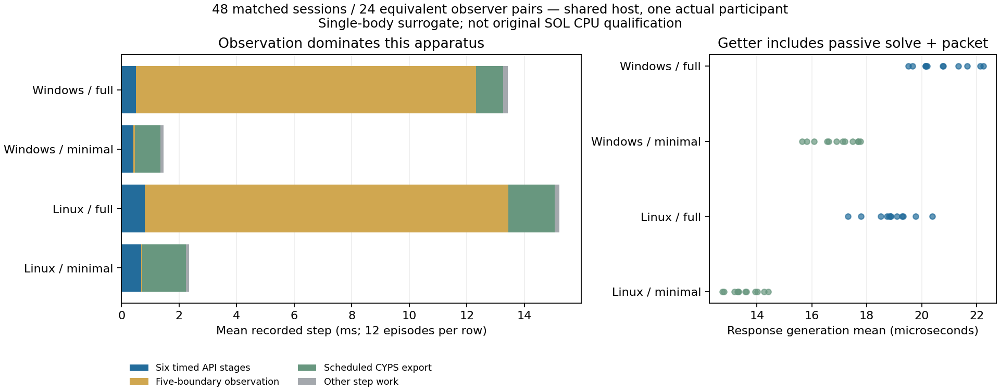

# SOL chamber response-generation cost — 5 November 2026

Root alone owns `codex/sol-response-cost-20261105`, based on Draft411
`b424032b925fd890421d3e94ed0524988445b5fb`; no upstream branch is edited.
The [prospective48episode profile](../../godot/tests/fixtures/sol_chamber/cost-001.json)
is committed before instrumentation or execution. It is a new timing experiment,
not a revision of the old192episode physics comparison or25case value diagnostic.

The original four-stage subtotal ends native timing before
`workbench_coupling_results()`. That getter includes the passive contact solve
and serial response construction. Whole-step time includes it, but the stage
subtotal cannot qualify its cost. The new test-only apparatus times this getter
and statistics capture explicitly. No native84 input or compiled binary changes.

The fixed matrix uses closed unforced/driven cases, LA-SELECTIVE, requested
workers1/4, actual Windows/Linux, three repeats and full/minimal observers.
All body, material, force, application, cadence and export inputs stay fixed.
Only intermediate per-cell census work is removed in the minimal observer.
Body/owner/revision/failed records remain at every boundary; full initial/final
census and the original CYPS export schedule remain. Minimal observations do
not replace the original complete geometry audit.

Matched observer trajectories and initial/final full payloads must agree before
their timing difference is interpreted. Shared-host timing, one-participant
results, mismatches and failed work remain explicit. No performance threshold,
original24group SOL CPU gate or universal60Hz claim is introduced. Source-archive,
material authority and original SOL ownership/clearance failures remain binding.

Linux/Windows runtime overrides are the existing authenticated source-equivalent
builds, separately materialized from the chamber lane with their original build
receipt; they are not newly compiled here. Four canonical Native/Rapier LFS
payloads are materialized. Five companion files retain pinned workspace source
`a15e06ca6f37750b66b89936424e0d018b203f7b`. Results and exact commands will be
recorded below only after execution. Keep any publication Draft and dependent on411;
independent adversarial review must precede owner admission.

The first Windows smoke at `b21d7727` imports cleanly but both full/minimal
episodes exit1 at coordinate validation, before body construction or any native
tick. The complete failed receipt/logs remain in `build/sol-response-cost/initial`.
An actual Godot type probe at the same source exits0 and records parsed numeric
type3, `Array.has(1)==false`, `Array.has(1.0)==true` for JSON workers `[1,4]`.
The [separately registered apparatus correction](../../godot/tests/fixtures/sol_chamber/cost-apparatus-002.json)
changes only membership validation's number type. It does not change requested
workers, physical inputs, observers, measurement windows or any threshold.

## Executed source, coverage and equivalence

Registration `6220fa4b` precedes instrumentation `b21d7727`; correction
registration `1b920ed4` precedes corrected apparatus `22f4adba`. The corrected
Windows smoke completes two180step episodes with393checks each. Its response,
application, exact body-state bits and all eight CYPS captures agree between
observers. It remains a separate partial cohort, not part of the full mean.

The complete registered matrix executes at
`a47be4e2d2a3208650cc4665fc83ca3c5acedaa5`, with unchanged HEAD and copied inputs
through completion:48episodes/8,640steps/24observer pairs. All50child processes,
including two imports, exit0 with clean logs. Each episode passes393checks.
All48initial/final material counts and full nonempty tuple multisets conserve.
All24pairs match every body-state bit pattern, native response, applied wrench,
scoped lifetime and eight exported payload hashes. All384captures are checked.
Full-observer geometry remains zero in closed unforced cases and reaches the
same38.76508869923395cell²/1.3963688876541198cell driven maxima as Draft411.
The minimal observer's intermediate geometry is **unavailable**, not zero.

[Execution and runtime identities](sol-response-cost-20261105/execution.json),
[unrounded48episode comparison](sol-response-cost-20261105/comparison.json),
[actual job/configuration readbacks](sol-response-cost-20261105/jobs.json) and
[custody manifest](sol-response-cost-20261105/manifest.json) retain commands,
exit statuses, source/native84 inventories, copied input maps, raw hashes and
failed attempts. Actual Godot process IDs and World/RID/session identities are
in each raw report. Signature comparison removes only scoped identity values
after binding session/epoch/proxy generation/serials throughout each lifetime.

The portable [paired raw audit](../../tools/experiments/test_sol_chamber_cost.py)
checks two committed full/minimal reports and seven reused, SHA-identical CYPS
blobs from411. These are byte reuse, not new imported World/mask authority.
Seven corrupted premises are refused, including omitted exports and changed
epoch/proxy/worker/drive metadata; a failed process cannot yield a latency
comparison. Original reports and receipt bytes are not rewritten by the portable
path adapter. Full external independent raw-matrix review remains pending.

The scope contains52attempted episode processes: two initial coordinate
refusals before physics, two corrected smoke episodes and48registered episodes.
There are9,000known physics steps. Including four imports and the separate
no-World type probe gives57Godot processes, two failed. All attempted/failed
work remains distinct and retained; it is not mixed into the registered means.

## Cost, memory and physical interpretation

The table shows the range of unrounded per-episode180step means, displayed at
reduced precision here. Each row covers12episodes (two cases, workers1/4,
three repeats). Exact means/maxima remain in the JSON. Six API stages include
preparation, native tick, response generation, application, Rapier and copied
statistics. They exclude observation, export and other caller work.

| Actual host / observer | Response generation mean, µs | Six API mean, ms | Whole recorded-step mean, ms | Worst recorded step, ms |
| --- | ---: | ---: | ---: | ---: |
| Windows / full | 19.511111–22.250000 | 0.478606–0.559622 | 13.208678–13.751944 | 54.121 |
| Windows / minimal | 15.650000–17.777778 | 0.390883–0.445950 | 1.413500–1.514089 | 32.788 |
| WSL Linux / full | 17.322222–20.388889 | 0.778494–0.865083 | 15.017989–15.407267 | 77.690 |
| WSL Linux / minimal | 12.738889–14.411111 | 0.646906–0.720006 | 2.243539–2.531356 | 57.499 |

Paired mean recorded-step differences are11.754011111–12.2938ms on Windows and
12.686672222–13.055911111ms on Linux. These measure **apparatus observation
overhead**, not a shipped engine speedup. The getter includes the passive solve
and response serialization; it is not an isolated solver-kernel timer. Full
observation also perturbs cache/scheduling costs inside other API intervals.
Minimal mode still records five body states, statistics and scheduled exports;
it is not an uninstrumented gameplay benchmark.



CYPS export contributes mean0.872–1.022ms on Windows and1.471–1.704ms on Linux,
amortized over all180steps; each episode exports six times inside this timer,
plus initial/final exports outside it. Individual exports reach38.695/60.287ms
in the full observers. This explains long recorded steps and prevents any
universal60Hz claim. Timing fields attached after the loop, initial/final
capture, setup, JSON serialization and teardown remain in episode/process cost.

All50registered child processes total214.8026229000534s; the entire campaign is
245.3720390999806s, including identity, copy/inventory, imports, refused-work
checks, ambient observations and final validation. Copy/inventory costs are
4.129253100021742s Windows and4.259803999972064s Linux. Component intervals are
not added again to the inclusive campaign time. Raw command/log checksums and
180/240second episode/import watchdogs remain in the receipt.

Both requested worker counts are read back from the native construction
receipt. There is at most one job in each of four native phases and one actual
claiming participant. Configured4 is **not** four-participant scaling evidence.
Arrival history peaks2,097,152bytes and resident native cells2,625,536bytes;
these are reported components, not total heap. Per-worker utilization/time share,
pending queue high-water and total heap allocations remain explicitly unavailable.
Preserve394's2048²42.47MB history and64patch active-capacity quarantine separately.

The shared physical host is an AMD Ryzen5 5600X, six cores/twelve logical CPUs;
Linux is actual Godot execution under WSL2, not a bare-metal Linux qualification
or a Windows cross-build. [Post-run host metadata](sol-response-cost-20261105/host.json)
does not measure frequency, load or isolation throughout the campaign.

| Separate decision | Source-bound disposition |
| --- | --- |
| Registered timing/equivalence apparatus | PASS for this48episode matrix; external independent acceptance pending |
| LA-SELECTIVE intended primary response | CONDITIONAL, inherited owner direction; no new response-superiority comparison in this cost profile |
| Response generation bottleneck in this small workload | NO-GO as an explanation of the old13–19ms recorded steps; observation/export dominate |
| Shipped engine improvement or general scaling | UNAVAILABLE; production unchanged, one actual participant |
| SOL-like physical improvement | UNAVAILABLE as a new improvement; physics is identical and driven overlap persists |
| Original SOL clearance / CPU gate | NO-GO physical history retained; source-comparable24group CPU qualification UNAVAILABLE |
| Cross-source/ownership/MAT integration | NO-GO; no new capture/Active hold or original SOL composition |

No production native/Godot script, material source, gain, cap, correction,
solver arithmetic, liquid policy, default, fleet or user control is changed.
Only test apparatus, offline tools, structured evidence and documentation change.
Fresh native builds/sanitizers/MSVC or broad authored gameplay are not claimed
by this timing lane; prior411/400source-qualified results remain separate.

The measured next physics question remains a separately registered bounded
normal-iteration refinement; the present residual is implemented arithmetic,
not an accidental missing selector. Original SOL additionally needs complete
eligibility and an admitted Active hold through RID action/mask acknowledgement.
Pause and Idle preparation do not supply that hold. Global vacancy count alone
cannot decide yielding: body motion creates space behind it, while remote empty
cells need not admit a material route. No new hold or solver is implemented here.

## Reproduction and review boundary

```text
python tools/experiments/sol_chamber_cost.py --run <fresh-name>
python tools/experiments/sol_chamber_cost_reduce.py build/sol-response-cost/<fresh-name>
python tools/experiments/test_sol_chamber_cost.py
```

Partial CLI selections remain partial; the reducer requires the exact registered
Cartesian coordinates for a full-matrix result. All captures, source/runtime
identities and same-lifetime bindings must pass before a pair yields a latency
difference. Output directories refuse reuse. Initial failures, old evaluator
drafts and earlier reductions remain retained. There is no threshold tuning,
source/hash refresh, Ready transition, merge or historical-evidence rewrite.

At `b040d7a4`, [validation](sol-response-cost-20261105/validation.json) passes
documentation, historical M11, repository/runtime provenance, original material
guard, portable cost/value audits, six geometry adversaries and whitespace.
Frozen retrieval remains19/32rank1 and32/32rank5; chamber2/3rank1 and3/3rank5;
passive1/1 and the two new post-result cost questions2/2rank1. These are routing
checks; manual source-fact review retains live-authority, cost and platform
qualifiers. Prior native optimized/sanitized/MSVC evidence is not relabelled.

**Source-archive gate: FAIL.** [Exact source artifacts](sol-response-cost-20261105/source-artifacts.json)
at `b040d7a4` record178,267,400bytes, SHA-256
`391b7805ea47e16c7e627f7c691350e4afe6731eb40abf4afd9d9c649015725c`,
above the unchanged134,217,728byte cap. Parent411 at `b424032b` already measured
177,362,696bytes; this lane increases the measured archive by904,704bytes.
The raw dependent patch is8,665,354bytes, SHA-256
`6290870e2c463020df5d4690b579be760f057b5bb66b9a182bbf78a58d61afc3`.
Both ignored artifacts are local handover files, not a product release.
Later metadata-only commits remain outside that recorded source snapshot.
No cap, frozen guard or historical source hash is changed to accommodate them.

Original84/84sustained-clearance failures,64/84depth failures,36/36async overlaps,
1452/1452fixed-orientation refusals, old CPU/archive failures and the365block
remain unchanged. Obtain separate independent adversarial review before an
owner acceptance or integration decision. Keep publication Draft.
