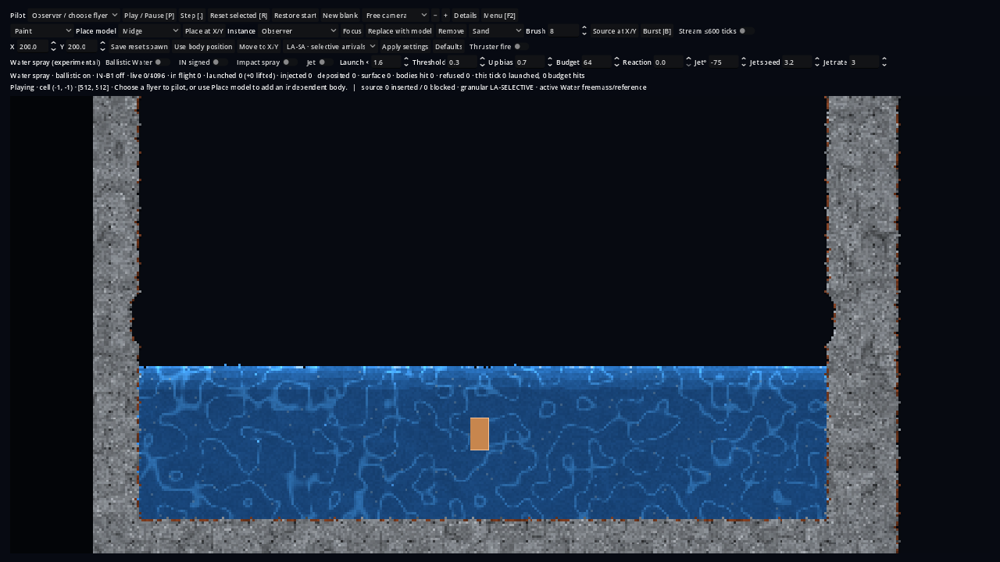
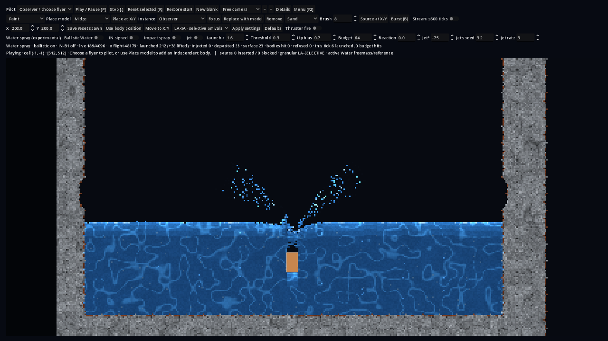
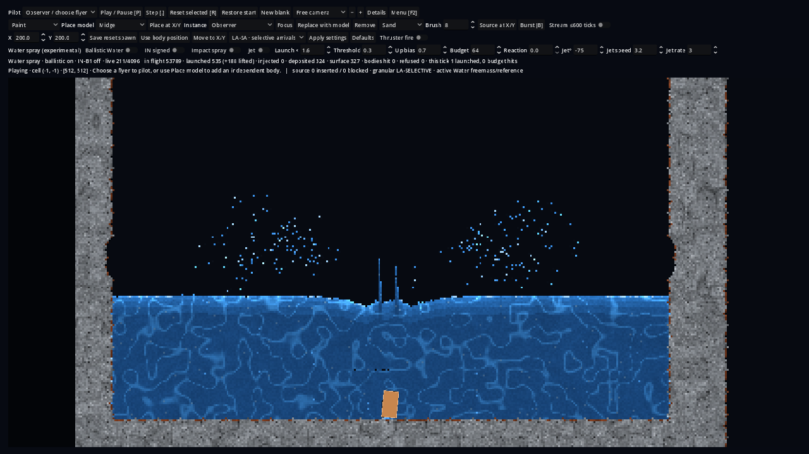
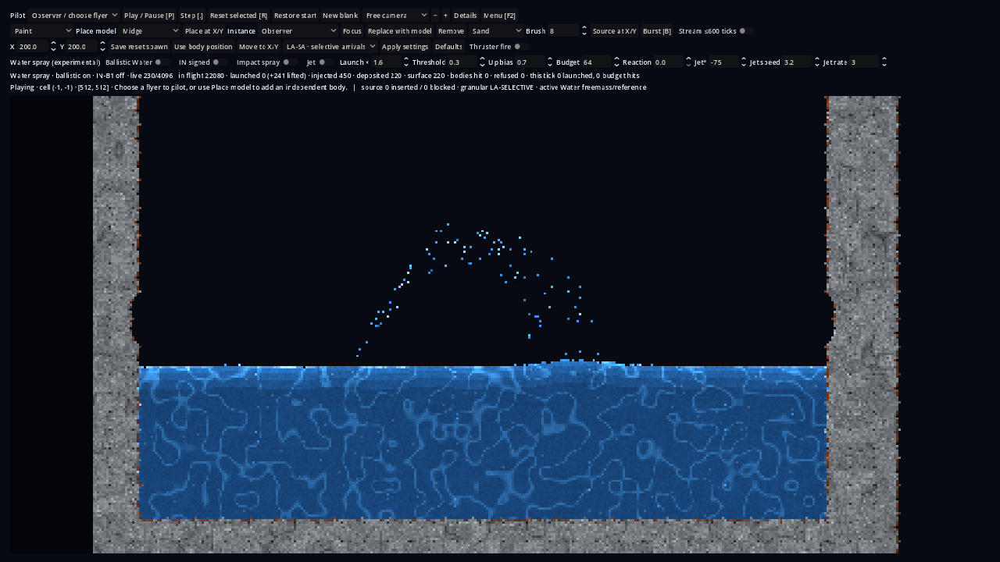

# WCX ballistic Water evidence — 5 November 2026

## Result

1. **Granular mode does not change Water mechanics.** In a pure-Water pool the
   four workbench responses (LA-SA, LA, events-off, RFT) give bit-identical
   barrel trajectories for 300 ticks in all four Water families. They differ only
   through powder contact: over a Sand bed, LA-SA equals events-off, while LA and
   RFT diverge at bed contact (tick 104) and end up to 26 cells deeper.
2. **Genuine ballistic Water works natively** in every family, with exact
   quantity and momentum accounting, signed upward flight with an apex,
   roof/wall/body contacts without tunnelling, deposition back into bulk,
   CYPS4 continuation and 1/4-worker identity. IN-B1 gives IN carriers a real
   rise and fall.
3. **A real workbench splash** comes from a body impact: a plunging barrel
   throws a crown of ≈570–630 parcels up to ≈52–55 rows above the surface in
   every family (≈89–91 rows for four staggered barrels). The exact closed-system
   Water total (grid + in flight) is constant on every observed tick in all 48
   matrix rows. Controls launch nothing.
4. **Cost:** the parcel pass is negligible (≈85–110 ns per parcel-tick). The
   splash cost is the receiving bulk waking; FreeMass and CellularYield pools keep
   re-levelling long after the parcels land.

Gameplay acceptance by a human has **not** been performed.

## Source, runtime and host identity

| Item | Value |
|---|---|
| Base | #394 head `38b9464efcfad8b0368418b1c2c6b96e4a5528b0`; later merged with accepted main `ba9cbc89029be88b812af59b19e5c59829bbcd90` (#394 merged) at `51e549f2` |
| Branch | `claude/water-ballistic-hybrid`: `5e46413c` (native BW-001/IN-B1), `4f36da97` (adapter spray, render, receipt), `4b9b2275` (retained-rebuild inheritance, apparatus), this record's commit |
| WCX-001 runtime | #394 published `cybersand_native.windows.x86_64.dll` `cb675a4c…19aae9d` (equal to its `runtime-provenance.json`) |
| WCX-002 runtimes (local, unpublished) | frames run `299ed4e8c396919b…53da0c3f`; matrix run `3e47fbfcdc0726ae…e35523` (source tree of `4b9b2275`), built with pinned LLVM-MinGW 20260826 (Clang 23.1.0) and godot-cpp `101ae380…`; not a published or CI artifact |
| Rapier | `libgodot_rapier.windows.x86_64-pc-windows-msvc.dll` `b54e54bd1a03ae90…` |
| Godot | 4.7 stable, Windows console binary |
| Windows host | Windows 11 Pro 10.0.26300, AMD64, 12 logical processors (shared with WSL runs; timings advisory) |
| Native host | WSL2 Ubuntu 24.04, kernel 6.18.54.1-microsoft-standard-WSL2, g++ 13.3.0 |

## WCX-001: LA-mode × Water discrimination

Apparatus `godot/tests/run_wcx_la_water.gd` (#394 Main host, worker, native World
and stepped Rapier unchanged). One passive reference barrel drops from row 250
onto a 512×512 canvas: a 292×60 Water basin (surface row 344), optionally over a
Sand bed (`sandbed`) or beside a Sand bank (`sandbank`). Rows differ only in the
response (and, separately, the Water family).

```bash
godot --headless --path <project-copy> --script res://tests/run_wcx_la_water.gd -- --ticks 300 --out wcx001-freemass.json
godot --headless --path <project-copy> --script res://tests/run_wcx_la_water.gd -- --ticks 300 --scenes pool,sandbed --families inertial_cellular_v1,cellular_yield_v1,pressure_flow_v1 --out wcx001-families.json
```

Traces were aligned by tick; "first divergence" compares body y/vy/rotation/x.

| Scene | Family | LA vs LA-SA | events-off vs LA-SA | RFT vs LA-SA |
|---|---|---|---|---|
| pool | FreeMass, CellularYield, PressureFlow, IN | identical (300 ticks) | identical | identical |
| sandbed | FreeMass | diverges t=104, max Δy 18.4 | identical | diverges t=104, max Δy 21.8 |
| sandbed | CellularYield | t=104, 13.1 | identical | t=104, 0.6 |
| sandbed | PressureFlow | t=104, 26.6 | identical | t=104, 26.7 |
| sandbed | IN | t=104, 0.9 | t=163, 0.01 (IN flow moves bed grains: 24 arrivals) | t=104, 0.4 |
| sandbank | FreeMass | t=55, 2.1 | t=59, 0.85 | t=55, 2.2 |

The coupling packet's `displaced` sums differ by a few cells between identical
pool trajectories. That is packet-sampling phase on the main thread, not physics.
This agrees with source: the LA modes change only powder-gated granular events,
arrivals and passive bins; Water contact uses the same legacy displacement,
boundary and contact path in every mode.

## BW-001 and IN-B1 native qualification

`make`-equivalent WSL build of the native test binary (debug `-O1 -g`), run from
the repository root:

- 12 BW-001 tests: defaults unchanged (hash 2, CYPS2, schema 1, disabled
  refusals); upward arc and return at 1/4 workers (≥5 rising ticks, apex ≥15 rows,
  full return, exact totals); roof and wall without tunnelling; surface merge,
  injection booking and 20 rounds of repeated launches with no phantom Water;
  CellularYield/PressureFlow/IN round trips (IN deposits keep momentum); refused
  pressurized PressureFlow source; capacity, mask and deferral; body momentum
  delivery equal to the parcel change; CYPS4 mid-flight continuation, corruption
  refusal and 1/4-worker identity; render overlay and snapshot publication; forced
  deposition; engulfed-parcel column deposition; run-receipt identity; retained
  rebuild inheritance (preserved or reported).
- 3 IN-B1 tests: control/identity (v1 still refuses `vy < 0`); signed arc with
  apex and fall, ceiling rebound, no roof tunnelling, CYPS4 restore and 1/4-worker
  identity; support does not destroy upward motion; ballistic → IN-B1 hybrid
  round trip.
- Full native suite (WSL g++ 13.3.0, `-O1 -g`, repository root): 175/175 at the
  first BW-001 checkpoint, 178/178 with IN-B1, 181/181 with receipt, column and
  inheritance tests, and **182/182** at this record's commit (WCX-FR face release
  and the Coulomb contact law).

## WCX-002: workbench splash characterization

Apparatus `godot/tests/run_wcx_splash.gd`: 512×512 canvas, the WCX-001 basin,
ballistic construction option on, response LA-SA. Scenes: `drop` (barrel from row
236), `jet` (fixed jet at (200,343), −62°, 3.4 cells/tick, 3×96-unit parcels/tick),
`roof` (low roof at row 268, barrel from 286), `multi` (four barrels at staggered
heights), `flyer` (unpowered Kestrel), `sandbank`. Control rows use the same
ballistic World with spray disabled and jet off; spray rows use launch 1.6,
threshold 0.3 cells/tick, upward bias 0.72. 260 ticks each, 4 configured workers.

```bash
godot --headless --path <project-copy> --script res://tests/run_wcx_splash.gd -- --ticks 260 --scenes drop,jet,roof,multi,flyer,sandbank --families freemass_v1,pressure_flow_v1,cellular_yield_v1,inertial_cellular_v1 --out wcx002-matrix2.json
```

Spray rows (all controls launched 0; ledger breaks 0 in all 48 rows):

| Scene | Family | Launched (+injected) | Apex rows above surface | Width (cells) | Ticks airborne | Deposited by t=259 | Native tick p50 ms control → spray |
|---|---|---:|---:|---:|---:|---:|---|
| drop | FreeMass | 588 | 53.2 | 272 | 164 | 584 | 3.0 → 5.6 |
| drop | PressureFlow | 517 | 52.1 | 269 | 165 | 514 | 12.3 → 13.4 |
| drop | CellularYield | 569 | 55.2 | 275 | 164 | 568 | 3.3 → 3.5 |
| drop | IN | 629 | 53.0 | 271 | 84 | 629 | 3.3 → 3.8 |
| multi | FreeMass | 2,113 | 91.0 | 297 | 203 | 2,103 | 4.8 → 5.8 |
| multi | IN | 2,278 | 90.8 | 297 | 201 | 2,277 | 4.6 → 4.7 |
| roof | FreeMass | 691 | 32.5 | 160 | 86 | 691 | 3.4 → 6.1 |
| jet | FreeMass | 777 injected | 65.5 | 121 | 259 | 554 | 0.06 → 4.3 |
| flyer | FreeMass | 24 | 33.4 | 151 | 61 | 24 | 2.1 → 3.2 |
| sandbank | FreeMass | 737 | 18.2 | 37 | 160 | 712 | 4.8 → 4.6 |

The complete per-row table and traces are in the run's JSON (not committed).
The apex of the drop is limited by the impact speed (≈1.8 cells/tick at entry);
the jet's quantity total grows by exactly its booked source.

### Graphical frames (Windows, rendered, 1280×720)

| | |
|---|---|
|  |  |
| Control, tick 114: relocation only | Spray, tick 114: two up-and-out plumes at entry |
|  |  |
| Spray, tick 138: droplet clouds arc outward; a column rises at the entry as the barrel reaches the floor | Jet, tick 150: fountain arc landing on the pool |

Visual assessment (automated capture, not human gameplay acceptance): the crown
splash reads clearly and returns to the pool; droplets are single cells, so dense
plumes look like spray rather than sheets; the default lateral spread carries
droplets across most of the 290-cell basin, which may be wider than desired.

**Contact-law change after this matrix.** The rows above ran before the parcel
contact law changed from multiplicative tangential retention (176/256 per contact)
to Coulomb friction (128/256 of the normal impulse) with impact-only contact
counting. Droplets now slide farther on floors and roofs. The matrix is evidence for
the earlier law and must be repeated on the final source.

## WCX-FR face release

`test_ballistic_water_face_release_dam_break`: a 10×48 Water wall in a 160-wide box,
36 ticks, period 1, minimum height 4, workers 1 and 4 (identical physical-state
hashes) with exact totals every tick. Front (furthest Water cell or parcel):

| Family | Bulk only | With face release | Releases |
|---|---:|---:|---:|
| FreeMass | 38 | 42 | 149 |
| CellularYield | 42 | 44 | 159 |
| PressureFlow | 35 | 41 | — |
| IN | 50 | 42 | 324 |

FreeMass first slumps diagonally, so few tall open faces remain; released parcels
land on the spreading film and merge without momentum. For IN the fixed-speed
launches interrupt momentum the bulk already carries. The option stays off by
default; letting fast grazing parcels skim over a thin film is the next variant to test.

## WCX-SURGE: gas-free PressureFlow assessment

`native/bench/wcx_surge_assessment.cpp` (`-O2`, 4 workers, 400 ticks): a 1024×192
basin, 40-row reservoir over the left third released into a 12-row pool. "Surface
motion" is the mean absolute change of the surface-height profile per tick.

| Arm | Tick p50 / p95 ms | Surface motion per tick (second half) |
|---|---|---|
| FreeMass | 8.03 / 9.70 | 33.0 (33.9) |
| CellularYield | 8.22 / 11.22 | 130.5 (165.9), mostly whole-cell flicker |
| IN | 3.06 / 6.30 | 43.8 (7.5) |
| PressureFlow reference, gas on | 12.69 / 15.95 | 70.2 (91.0) |
| PressureFlow reference, gas off | 9.86 / 11.77 | 70.2 (91.0) |
| PressureFlow cached_dormant, gas on | 12.04 / 15.41 | 70.2 (91.0) |
| PressureFlow cached_dormant, gas off | 8.09 / 10.13 | 70.2 (91.0) |

Gas on and off are physically identical here (vented basin). No arm's front reached
the far wall within 400 ticks. Visual comparison in the workbench and a sealed-room
control are still to be run.

## Defects found and corrected during the run

1. **Schema refusal:** run receipts refused quantity schema 2, so the workbench
   could not build a ballistic World. The receipt now accepts schema 2 with an
   explicit ballistic section; Current receipt bytes are unchanged (retained
   vectors pass).
2. **Stuck parcels:** bulk FreeMass flowed into cells occupied by parcels; with all
   neighbours full, 58 parcels deferred forever (5,900 deferrals, no Water lost).
   Engulfed parcels now displace upward through their Water column; the host run
   then redeposited 584 of 588 by tick 239 (the rest still airborne).
3. **Invisible parcels:** the workbench presents through
   `RenderSnapshotExchange::publish`, which copied stored cells only. Parcels now
   mark a render-only dirty rectangle and are overlaid in published patches.
4. **Retained rebuild loss:** reset/replace rebuilt the World without its parcels.
   They are now inherited or reported, and the conversion balance includes them.
5. **Apparatus contamination:** the first matrix left the jet enabled after its
   scene (settings persist across rebuilds). The apparatus now sends complete
   settings; the first matrix is superseded and not used above.

## Native cost attribution

`native/bench/bw001_splash_cost.cpp` (`-O2 -DNDEBUG`, one worker): 512×256 basin,
60-row pool settled asleep, then a 600-parcel crown burst or a 3-parcel/tick jet.

| Family | Control tick p50 | Burst tick p50 / p95 | Jet tick p50 | Parcel pass p95 | ns per parcel-tick |
|---|---:|---:|---:|---:|---:|
| FreeMass | 0.0002 ms | 33.5 / 43.3 ms | 13.0 ms | 0.060 ms | 85 |
| CellularYield | 0.0002 | 34.5 / 43.8 | 11.6 | 0.064 | 91 |
| PressureFlow | 4.06 | 33.7 / 40.4 | 19.1 | 0.069 | 100 |
| IN | 0.0002 | 16.2 / 33.9 | 13.2 | 0.070 | 94 |

The FreeMass burst wakes ≈48–54 activity blocks (≈30k visited cells, ≈370 moved
per tick) and the pool is still re-levelling 120 ticks after the last parcel has
landed. The parcel pass is under 0.3 % of that tick. Reducing the bulk response to
a splash (faster settling, or a cheaper surface solver) is the main performance
opportunity.

## Protected-source transitions (proposed)

Each protected consumer below keeps Current behaviour for every World that
does not opt in (Current hashes, CYPS2/3, quantity schema 1 and receipt bytes
are unchanged; the full native suite passes) and adds opt-in BW-001/IN-B1/WCX-FR
paths. They are proposed reviewed transitions for issue 362 and PR 406, pending
independent review and the owner's admission; they are not behaviour-neutral for
Worlds that enable the experiment. Source commit for every target:
`30419bdac24902b47bab3756d3116008bec8f0ca`.

| Path | From LF SHA-256 | To LF SHA-256 |
|---|---|---|
| `native/include/cybersand/quantity_ledger.hpp` | `4345032e718b601a33ac3ffb69a456cd91bcf05ee3ab503650dcb7c06a59c6ad` | `d8c6463c7cea7193e8257115f6eddee911cc85467d5f2ab9be830f6ee7756a79` |
| `native/src/world_quantity.inc` | `627936a33c9ed58b6841f04466bf83aefe83b451ceb0da22baa19269ed5ef074` | `d9e6835d092193e4976c728d90121c6dee4b421337e056b5fc3c74975491af6e` |
| `native/src/world.cpp` | `a47955f79ed5fbc8bc0ca8e2892ed4eb0ddbd728b841bc08ccee14a4c239e4a7` | `93ab7874e913bf696ffcdb85724d01f860bbd53c160dd9b7ea3f8daf28026b85` |
| `native/src/world_pressure.inc` | `7b28bf216bf70af7059267cae31117f1f01e88d0e5f276f61d67280ab5c6d2e5` | `21fade10be70387a41438586a3ca88c022af078e5ea11bc016ee20e7a9792573` |
| `native/src/world_inertial.inc` | `8a5d3680e96ca47a3f496be5a8b953084d2c6d2e0bd723c3214b87bdbc3580b5` | `51fa78b33df7ea5e7e468c670b348ae24a19fd41905e2e78d9e841fa99af1491` |

## Gaps

- No human gameplay acceptance; frame captures are automated.
- WCX-002 ran on Windows only; Linux Godot, sanitizer and MSVC native runs are not
  done. Local runtimes are not published or CI artifacts.
- Ready-state CI, source-matched runtime publication, reviewed MAT-AUTH transitions
  for the protected consumers and independent review remain required.
- The Scooper scene and an actively piloted flyer impact were not run.
