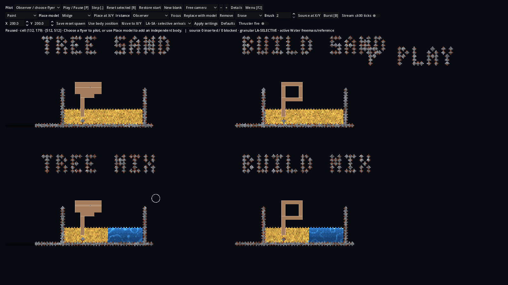

# Fresh passive structures in the ordinary workbench

The owner requested an ordinary loadable canvas, with several fresh Rapier
representations already placed in comparable material situations and ready to
unpause. The earlier inline replay did not meet that request. No dedicated
scene, test menu, flyer or automatic native-cut workflow is introduced here.

The installed name is `sol-fresh-structures-20261106`. Existing Details → Load
start reads it; P, Step, Restore start, paint/erase, selection, pan and zoom are
unchanged. A generic `--workbench --workbench-start=NAME` option loads an existing
named start. The ordinary workbench is left running for the owner; it must not
be closed or reset by follow-up verification while the owner is observing it.

## Demonstration and owner disposition

The [canvas](../../godot/canvases/sol-fresh-structures.json) has four independent
passive bodies: tree/Sand, building/Sand, tree/mixed and building/mixed. Each is
one real Rapier body with the original six/five rectangle union and unit-area
mass520/356. COM and inertia derive from the union. Default gravity scale0.094,
combined authored damping0.04/0.04, friction0.78, LA-SELECTIVE and budget20 are
retained. Native material terrain is a rough disc-authored analogue: Sand2,
Water3, hard wall58 and material-letter labels. Hard wall58 is distinct from
the original Wall1. There is no native source-cell ownership or cut provenance
for these fresh bodies and no newly admitted native capture/restoration.

The owner observed the live simulation and supplied two screenshots, judging
the visible behaviour acceptable in both. **Keep the current response.** The
owner did not identify the small residual movement as a gameplay defect. The
previous numerical rest-screen failure remains a historical experimental
result; it is not sufficient reason to change weights, caps or contact law.
No further settling-law tuning is authorized by this demonstration. The missing
gameplay contract remains deciding when a native structure is freed and
transferring it into a body. This fresh-body canvas deliberately needs no cut.

## Source-local implementation

Version3 saved starts add only a file-local passive `canvas_body` actor carrying
strict `{name,rectangles}` data. Existing version2 recipes and catalogue
admissions remain valid. At most eight nonoverlapping integer rectangles within
128 cells and total area4096 form a body. Unit mass and analytic inertia derive
from geometry; arbitrary mass fields are refused. Hashing canonicalizes JSON
integer-valued coordinates before comparing identity. Existing eight-body/
64-proxy native limits still apply.

The physical session derives an equipment-free definition, then the rig checks
exact equality with that derivation before using its scoped mass/compound
admission. Existing general actor mass20 and Fleet guards remain unchanged.
AUTO COM is used for these fresh compounds, preserving first-impulse readiness.
Direct commands, pilot takeover and usable equipment are refused for the new
passive type. Selecting a body stays observer-only; model-picker entries do not
change. Existing whole-owner preparation, immutable roster/sample fences and
retained reset/save/load paths provide the simulation. No native C++ source,
material guard, runtime binary, force cap, accepted default or solver changes.

## Executed qualification and limits

Both actual Windows and WSL Linux pass the new91-check full-workbench test:
strict bad geometry/hash/version/mass refusals, actual collider counts,
mass/inertia/AUTO COM/gravity/damping/friction, direct passive-command refusal,
four-body native LA-SELECTIVE readback, live physical motion, one-step control,
save/load and fresh paused restore. Existing fleet-session, canvas persistence
and pilot UI suites pass on both hosts, as does generic named-start loading.
The source files in both exercised projects match the final source hashes in
the [Windows](sol-fresh-canvas-20261106/windows.json) and
[Linux](sol-fresh-canvas-20261106/linux.json) ledgers.

Actual Windows graphical execution uses Godot4.7, Rapier0.35.2 and NVIDIA OpenGL
on the TITAN RTX. Its92 checks include a real viewport capture, followed by a
separate named-start graphical run confirming four paused bodies. Desktop
automation helpers could not initialize their kernel assets; no synthetic UI
or unperformed desktop-input test is claimed. Godot's actual rendered viewport
was captured and inspected. The persistent interactive process is left open.

Initial test iterations retain failures from raw JSON float/int array equality,
canonical saved-file comparison and checking a command refusal while suspended.
Those observer assertions were corrected. Independent source review also found
and corrected passive submit admission and reference friction before the final
successful runs. No physical outcome threshold or force was tuned. The raw
[artifact index](sol-fresh-canvas-20261106/artifacts.json) preserves attempts,
commands, timeouts, exits, logs, reports and hashes under `build/sol-fresh-canvas`.

Parent checkpoint is `b944f3cf8d15fdc11f5f605acc34ea3b6dbf0bb2`; the source
delta is authenticated by per-file hashes. Compiled native source remains P2
9a78d136, Windows DLL d8dc09c1 and Linux SO aa78df39, with all93 native inputs
unchanged. Existing Linux ABI-floor, original SOL clearance/depth/async/refusal/
CPU/#365 and material eligibility blockers remain historical/separate. This is
owner-accepted visible behaviour for these four demonstrations, not universal
physics or native freed-object integration acceptance. Keep #466 Draft.

Documentation routes cover user controls, format/admission, ownership,
coupling, build/tests, roadmap and handover. No ABI, native material source,
capacity/default change or new ADR is required. Additive retrieval preserves
all earlier question objects. Repository checks remain separate from the
owner's visual acceptance and the retained numerical experiment.
