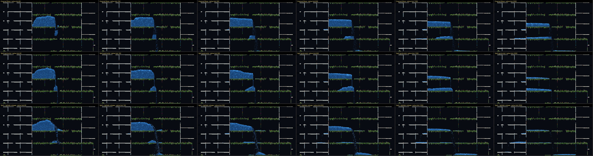
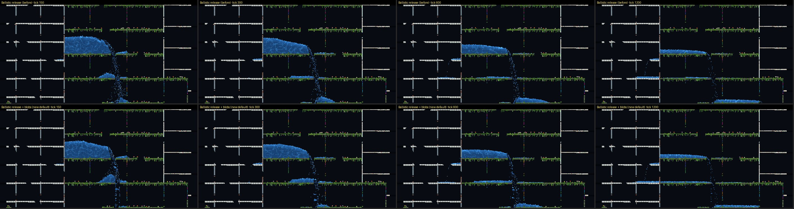

# WAVE-WATERWALL-001 evidence (2026-11-16/17)

This is a historical record. Results from runs made after this file was
published belong in the PR description, because this file is an input to the
branch runtime publisher.

## Source identity

| Item | Value |
|---|---|
| PR #631 head (Wave Flow) | `edf42998ab5cb55a3ce916ead270c9b696033ab0`, Draft, unchanged |
| PR #661 head (Water Lab, base of this branch) | `c7386cfb33721e9294d0ec82bbeed9b97bd12414`, Draft, unchanged, contains #631 |
| Branch | `claude/wave-waterwall-001` (Draft/HOLD) |
| Owner reproduction | `setup-water-wall.json`, SHA-256 `925096d1e9984b855b5465309ef12869a47e29052e0cabd5a25788a051b77107`. Format `cybersand-generated-start-v1`, 1024×1024, 166 Water rectangle stamps, no actors |
| Owner screenshot | `2026-11-16 20_55_15-CyberSand · Development workbench.png`, SHA-256 `4e708989a1129a2516dd9a16cebab050d715af4ed7ff77a047de67ba13f2d7cf` |

The map's terrain was regenerated with the native GEN-007 generator from its saved
recipe. The regenerated material bytes match the manifest's
`sha256 = 9b8b4ef6339c4d922c499dd3240198209a8a3cfcca9f9fd49cf1b6fa918f91f5`,
so the terrain is an **exact** reconstruction. Wave's evolved face flux, and any
tuning in the owner's live session, are not stored in the manifest. Every run
below therefore starts from the authored cells, with fresh Wave state and the
documented settings.

## Apparatus

- `native/bench/wave_waterwall.cpp` (`make wave-waterwall`) replays the exact
  terrain bytes plus the stamp list on the real native World, or one of the
  synthetic scenes: `reservoir`, `falls`, `basin`, `sealed`, `film`, `narrow`,
  `sparse`. It reports total drift (grid plus in-flight parcels), probe-box
  quantities, solved chunks, tick median/p95 and spill/parcel counters, and can
  write PPM frames and cell/flux dumps.
- `godot/tests/workbench_waterwall_capture.gd` is a graphical evidence driver,
  not a CI test. It runs the ordinary Shared Workbench: GEN-007 verify-and-install
  of the supplied manifest, Water Lab Wave and spill selection, Apply, then
  exact single-step native ticks. It saves framebuffer crops and copied native
  status.

## Diagnosis on the actual map (original Wave, defaults, 1 worker)

Probe: the raised reservoir at x 440–632, y 540–642 (the lower stamp group).
Units are full cells (mass / 255). Total drift was 0 in every run.

| Tick | Reservoir | Outside the reservoir |
|---|---|---|
| 0 | 5928 | 424 |
| 300 | 5180 | 782 |
| 600 | 4483 | 1114 |
| 1200 | 3258 | 1665 |

A cell dump at tick 300 showed what the face looks like. The face cells are full
from the platform up to the surface. The air column beside them holds a fan of
partial cells (≤ 130 units) one or two cells wide, and the lip discharges about
2.5 cells per tick. The Water is not physically blocked, and the column pass
does not replenish it. It drains slowly through three limits in the law:

1. Pouring into Empty is capped at ¼ of the donor cell, and the receiving Water
   then falls only one cell per round.
2. Bulk flow toward the face is capped by `coast` (16 units per round) or a
   depth-scaled share of the head, so the pool cannot supply the face. The
   retained flux behind the lip read 15–26 units per round in every row.
3. Unsupported cells are given stack heads and depth classes.

The 32-row active band adds to the second limit, but `active_rows = 8` made the
drain slower, not faster. The behaviour is the same at chunk seams and on open
platforms with no enclosing wall.

### Existing tuning ranges (reservoir cells remaining, 1200 ticks)

| Setting | t300 | t600 | t1200 | Median tick |
|---|---|---|---|---|
| defaults | 5180 | 4483 | 3258 | 23.8 ms |
| coast 64 | 3890 | 2353 | 1026 | 21.8 ms |
| coast 255 | 3531 | 1909 | 759 | 24.0 ms |
| empty pour ½ | 5175 | 4479 | 3248 | 23.9 ms |
| level shift 0 | 4930 | 4175 | 2895 | 22.4 ms |
| adhesion off | 5180 | 4484 | 3258 | 20.2 ms |
| gain 128 | 5178 | 4503 | 3287 | 25.2 ms |
| 3 substeps | 3824 | 2365 | 882 | 43.9 ms |
| 8 substeps | 1712 | 426 | 149 | 101.1 ms |

These ran 12 at a time, so absolute timings are contended; compare rows with each
other. Raising coast is the only cheap lever, and it leaves a straight curtain
two cells wide falling from a near-vertical face. Substeps scale cost linearly.
Neither was accepted as the fix.

## Candidates

| Candidate | Result | Outcome |
|---|---|---|
| D. Tuning only (coast/substeps) | See above. Coast 64 drained 4902 cells by t1200 against 2670, at equal cost; 8 substeps drained 5779 at about 4× the cost. The wall stays vertical and the fall stays a thin straight curtain | Rejected as the main fix. Pool feed (`draw`) keeps the useful part |
| A. Wave-native spill (falling marker, multi-cell fall, exposed-face share, pool feed) | Reservoir drained by t900: 2748 cells with the first rule set, then 3804 once pool feed applied to all non-adverse faces. Original Wave drained 2104. The fall stays a straight stream one cell wide | Kept as the base layer and as the spill-only mode |
| B. Hybrid release into the existing `ballistic_water_v1` owner | Reservoir drained by t900: 4343 cells, against 2104 for original Wave (2.1× the discharge; 1585 cells left against 3824). Water arcs outward, lands, spreads across lower ledges and rejoins pools. Conserved exactly (grid plus in flight) | **Selected** (spill + ballistic release) |
| B′. Parcels landing on falling Water | Parcels merged mid-air into the curtain and re-formed a straight column | Fixed: parcels pass through falling Wave Water |
| B″. Deposit ring crossing one-cell walls | Synthetic waterfall leaked 24 081 units through a one-cell wall (quantity conserved, wrong place) | Fixed for straight and diagonal walls, with regressions |
| C. A purpose-built falling-segment transport | Not built. B reuses an owner that already has exact accounting, deposition, body contacts, rendering and identity, at a measured few ms per tick | Not pursued |

## Implementation summary

See [wave-flow-v1 § Waterwall spill](../architecture/wave-flow-v1.md#waterwall-spill-experimental-wave-waterwall-001).
Native: `wave_flow.hpp`, `world_wave.inc`, `world_ballistic.inc`,
`world_pressure.inc` (physical hash), `world.cpp` (`clear()` only),
`ballistic_water.hpp` (`Paused` outcome). Godot: Workbench admission
(`cyber_prepared_liquid_world.hpp`), status (`cyber_native_cell_world.cpp`),
Water Lab controls (`workbench_water_spray_panel.gd`), host plumbing.

## Independent review

A five-dimension review (conservation, determinism, boundaries, performance,
compatibility) with two adversarial verifiers per finding ran on the change at
`f5b9f84f`. Reviewers built and ran their own repros: a 40-seed conservation and
worker-parity fuzz, ThreadSanitizer matrices for workers 1–8, and region and
capacity repros. They found no conservation, race or worker-parity defect. They
confirmed 13 findings (duplicates included), all repaired in `751c1a95` with
regressions:

| Finding | Severity | Repair |
|---|---|---|
| `clear()` kept the launch back-off flag | medium | Reset in `clear()`; cleared-vs-fresh regression |
| Spill read stale meta under paused rows | medium | Paused cells are solid to receiver and support tests (spill only); paused-floor-vs-wall regression |
| Launch gate needed room for the whole budget and silently disabled release | medium | Gate on one free slot, clamp to free slots, count `launch_capacity_skips` |
| Parcels crossed one-cell diagonal walls | medium | Second-hop check in the deposit ring; diagonal flight steps blocked (Wave only); regression |
| External spawns inside paused Wave cores | low | `Paused` launch outcome; regression |
| Falling counters stale on idle ticks; launch lists missing from `storage_bytes` | low | Fixed |
| Overfill-deposit test could not detect a missing guard; default-off test compared HEAD with itself | low | The test now deposits directly onto a 65 500-unit cell. Default-off is pinned to golden hashes computed from the unmodified #661 source (identical on all 12 configurations) |

Original Wave (spill disabled) keeps a pre-existing stale-support read of paused
floors (85 cells differed in the probe). It was deliberately not changed, to
preserve the qualified law, and is recorded here as a known gap.

## Workbench before/after (supplied map, exact terrain)

Each mode used the ordinary Shared Workbench on Windows 11 (Godot 4.7, ANGLE on
an NVIDIA TITAN RTX). The map went through GEN-007 verify-and-install, then the
Water Lab selected Wave Flow, 4 workers and the stated spill mode, then Apply,
then exact single native steps. The native DLL was built locally from `751c1a95`
(SHA-256 `a8371f08d6854b4722713b1c7f2509537be5f59e310215cb0a13fb1fd4dd7cc5`).
Native Water quantity read 3 052 350 units at every capture in all three modes,
counting grid and in-flight Water. This is automated graphical evidence, not
physical owner acceptance.

- [Animated lip close-up](wave-waterwall-001-2026-11-17/workbench-lip-closeup.gif)
- [Lower map](wave-waterwall-001-2026-11-17/workbench-lower-map.jpg)
- [Upper map](wave-waterwall-001-2026-11-17/workbench-upper-map.jpg)
- Native apparatus scenes: [open reservoir](wave-waterwall-001-2026-11-17/synthetic-open-reservoir.jpg),
  [platform waterfall](wave-waterwall-001-2026-11-17/synthetic-platform-waterfall.jpg),
  [contained basin](wave-waterwall-001-2026-11-17/synthetic-contained-basin.jpg)

Original Wave keeps an almost vertical face beside the open lip through tick
2000. Grid-only spill slumps the face and fills the ledge below. Ballistic
release turns the face into a sloped lip with an arcing fall: Water lands,
spreads across the lower ledges and rejoins their pools. The contained basin
still carries its wave and reaches exact rest (0 solved chunks) in every mode.
The sealed reservoir is unchanged and stays asleep.

## Owner follow-up: blobs and the vertical stream (2026-11-17)

The owner liked spill plus ballistic release. They asked whether the spill-only
vertical stream could remain, possibly as the "blobs" they had seen during
development. Those blobs came from an earlier hybrid build in which parcels
landed in falling Water. That behaviour returns as **Blobs**, on by default:
parcels merge into falling Water once they are past the 4-tick grace, so a
fresh throw is not swallowed by its own stream. **Stream share** is an optional
slider for a continuous vertical stream.

Reservoir cells remaining at tick 900 (supplied map, 6 workers, 7 runs in
parallel; drain only, no timing):

| Look | Remaining |
|---|---|
| Release without blobs (previous default) | 1557 |
| Blobs | 1466–1497 |
| Stream share 32 with blobs | 1638 |
| Stream share 64 / 128 with blobs | 1674 / 1683 |
| Stream share 96 / 160 before the spawn rule | 2594 / 2778 (throws refused) |

Blobs keep the sloped lip and the outward arcs, and add a beaded centre line.
Any stream share brings back a solid, nearly vertical column that hides most of
the arcs. Stream share therefore stays opt-in, at default 0.

Real Workbench on the supplied map with DLL `aad09be8…`. Water quantity read
3 052 350 at all 17 captures.

## Owner correction: generic Ballistic Water under Wave (2026-11-18)

The owner said generic Ballistic Water is vital to the game. #631 refused it
on every Wave World ("wave_flow does not support ballistic_water_v1"), #661's
Water Lab switched it off when Wave was chosen, and this branch had kept that
refusal outside its own release. That was not raised as an owner decision. The
refusal is now lifted. Spray, jets, nozzles, body launches and injected parcels
run under Wave with or without spill. Every parcel path already respects Wave
overfill, paused cores and one-cell walls. Spill's Ballistic release uses the
same pool. Without it, the Workbench sends a release budget of 0, so faces drain
through the grid only. WCX-FR face release is admitted under Wave only while
spill is off. No native World source outside `world_wave.inc` admission changed,
and the default-off golden hashes are unchanged.

| Check | Platform | Result |
|---|---|---|
| `make wave-spill-test` (22, incl. generic ballistic and face release under Wave, workers 1/4) and `wave-flow-test` (31) | WSL2 Ubuntu 24.04, g++ 13.3 | PASS |
| ASan/UBSan and TSan for both, and the full `make test` suite | same | PASS |
| `test_workbench_wave_spill.gd` (508 checks: native jet conservation, grid-only spill budget 0, Water Lab switches, real Workbench Apply with a jet) | Windows 11, Godot 4.7, local pinned DLL | PASS |
| `test_workbench_wave.gd`, `test_wave_flow.gd`, `test_workbench_canvas.gd`, `test_workbench_spray_rearm.gd`, `test_failed_world_status_survives.gd`, `test_workbench_failure_containment.gd` | same | PASS |
| `test_workbench_wave_render.gd` (graphical, ANGLE) | same | 180 assertions, 6 captures, PASS on rerun; the first run failed one pointer-focus check before any capture |

## Protected-source transitions

The material-catalogue compatibility table admits these reviewed steps (LF SHA-256):

| Path | From | To | Source commit |
|---|---|---|---|
| `native/src/world.cpp` | `911ac9df96c34f7bbc24e9de8b53099ba779ff6cc999c6ff349b61e4379ee143` | `80e05f673b3d6ba35daa7c741805aa272f149e7742d162c94c8c0bd9bdbc1e83` | `751c1a951a8f76c397dd3f903f378208119d29f1` |
| `native/src/world_pressure.inc` | `9ee31ffc4ea89b50f78e39eecc8f5c9be5944bcbc2f6ead48698c714564b7067` | `64c3afbe1e368d24d3ac4d484a78fa8cd3fc380c80fe54bfeb8661738048254f` | `26d032f14820d6d46272d487d56cacaee4544368` |
| `native/src/world_pressure.inc` (blobs/stream share) | `64c3afbe1e368d24d3ac4d484a78fa8cd3fc380c80fe54bfeb8661738048254f` | `df6558560b4bfe946a86826c83559138d279f94d77d0a7309a3551e671386fe8` | `1d71202a35a7945e496b0cb83a2d639b2ad2b5bc` |

`world.cpp` changes one line: `clear()` resets the spill back-off flag.
`world_pressure.inc` binds spill configuration into the Wave physical hash, and
only while spill is enabled. The golden pair shows the unchanged streams.

## Qualification run before publication (local)

| Gate | Platform | Result |
|---|---|---|
| `make wave-spill-test` (18 tests) | WSL2 Ubuntu 24.04, g++ 13.3 | PASS |
| `make wave-flow-test` (31 tests) | same | PASS |
| `wave-spill-sanitize`, `wave-flow-sanitize` (ASan+UBSan) | same | PASS |
| `wave-spill-thread-sanitize`, `wave-flow-thread-sanitize` | same, run under `setarch -R` (this kernel's ASLR aborts TSan otherwise) | PASS |
| `make test` (full native suite, 192 tests) | same | PASS |
| Default-off golden pair (base `c7386cfb` vs HEAD) | same | IDENTICAL |
| `test_workbench_wave.gd`, `test_wave_flow.gd` | Windows 11, Godot 4.7 headless, locally built DLL (LLVM-MinGW 20260826 / Clang 23.1.0, godot-cpp `101ae380`) | PASS |

GitHub-hosted exact-source results, the runtime publication and the Windows
evaluation package are recorded in the PR description.
