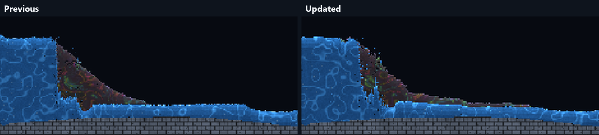
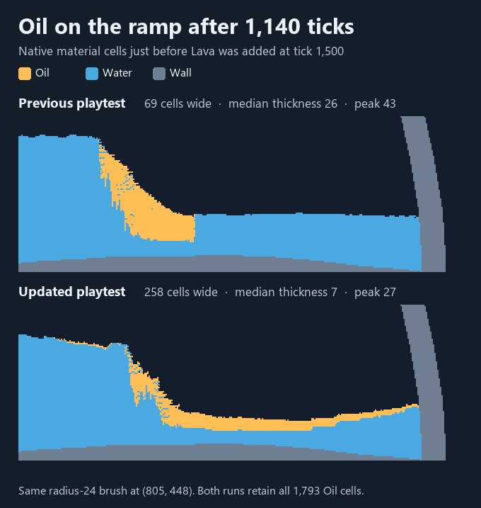

# Thick Oil and Lava in the Water ramp

The owner reported that a brushful of Oil remained in a blob and a subsequent Lava drop paused the Workbench. The previous [buried-strip test](wave-oil-buoyancy-2026-11-19/evaluation.md) used 48 Oil cells. A single radius-24 brush paints 1,793. The screenshot does not preserve the original edit coordinates or timing. The replay uses the original saved 2048 × 2048 ramp and a repeatable pair of brush strokes.

## Reproduction

In the previous Windows playtest, let the ramp run to tick 360 with six workers, Wave, full-face spill, Ballistic Water and fall speed 3. Paint Oil at (805, 448) with radius 24. At tick 721, just before adding Lava, the patch spanned 85 columns. Its most populated column held 47 Oil cells. Paint Lava at (826, 452) on tick 721. The next attempted tick failed. The ordinary spray readback reported `get_water_spray failed: quantity reaction input exceeds cell bound`. The last good snapshot was tick 721. OpenGL and headless playbacks produced the same four material-plane hashes through failure.

## Updated Windows Workbench

The final evaluation ZIP uses Godot 4.7 and the locally built DLL from `b5f2f95a34a574c9aa76f79bfdcd897eb66fa727`. Its SHA-256 is `84b32e84db847911d81432b260060369ac5dbd18fdeb44333da4ffa802dd3da1`. Two fresh extractions matched the recorded hashes for all 952 payload files. The packaged launcher opened the Shared Workbench. [ZIP verification, maps and acceptance tests](wave-oil-lava-2026-11-19/owner-windows.json)

| Oil on the 2048 × 2048 Water ramp, six workers | Previous Windows build | Updated Windows build |
|---|---:|---:|
| Width at tick 481 | 71 columns | 113 columns |
| Width at tick 721 | 85 columns | 174 columns |
| Median Oil cells per occupied column at tick 721 | 19 | 6 |
| Maximum Oil cells per column at tick 721 | 47 | 46 |
| Cells of Steam / Stone at tick 722 after Lava at tick 721 | Readback failed | 46 / 46 |
| Width at tick 1,500 with Lava delayed | 69 columns | 258 columns |
| Median / 90th percentile / maximum Oil thickness at tick 1,500 | 26 / 36 / 43 | 7 / 14 / 27 |
| Oil in the original brush disc at tick 1,500 | 145 cells | 0 cells |
| Oil cells present before the delayed Lava brush | 1,793 | 1,793 |

Widths span the outermost Oil cells. Thickness counts Oil cells in a column, including layers separated by Water. At tick 721 the 46 Oil cells in the candidate’s thickest column were split into four bands by thin layers of Water. That column held two Oil cells by tick 1,500. The updated standard replay continued through tick 841 and the delayed replay through tick 1,620. The previous build also survived the delayed Lava drop. The amount of Water in the cell contacted by Lava determines whether the old limit is crossed. [Standard previous](wave-oil-lava-2026-11-19/workbench-before.json) · [Standard updated](wave-oil-lava-2026-11-19/workbench-after.json) · [Delayed previous](wave-oil-lava-2026-11-19/workbench-before-t1500.json) · [Delayed updated](wave-oil-lava-2026-11-19/workbench-after-t1500.json)

The direct frame [after Lava](wave-oil-lava-2026-11-19/workbench-after-lava.png) shows Steam above the reaction. In the packaged Sand tank, all 48 Oil cells returned to the surface across 38 columns. The spill threw zero units between ticks 540 and 600. Opening the gate threw 62,604 Water units over the next 30 ticks. These are cumulative launches and may include Water released more than once.

## Lava reaction

The original quantity check allowed at most 510 Water units per reaction on this profile. A legal Wave cell holds up to 65,535. Commit `baa5699083f5f668f9c03309aceaccd0f1fb80d9` makes the validator use the Wave carrier limit. The quench replaces Lava with Stone and the Water cell with Steam. It charges the exact Water amount to the registered reaction. Existing production quanta, inventory checks, other Water laws and failed-World containment retain their validation paths.

A 256 × 256 Godot regression uses Wave to compress Water beneath a shelf. After two ticks the chosen cell holds 838 units. The brush seals the two-cell pocket and introduces Lava via the ordinary native adapter. The previous DLL failed during the third spray readback after painting. The test requires Steam, Stone, and a healthy quantity readback equal to the pre-quench total minus the whole compressed cell. The native quantity regression separately quenches cells holding 1, 510, 511 and 65,535 units across chunk boundaries with one and six workers.

The isolated quench-only Windows build reproduced the same four pre-Lava material planes as the control. Tick 722 produced 43 Steam cells and 43 Stone cells. Tick 841 contained 558 Steam and 503 Stone and the native quantity readback remained healthy. The Lava brush itself replaced 990 Oil cells where the discs overlapped. All 803 remaining Oil cells were present at tick 841. These are before-and-after measurements of a saved-start replay, with the same gameplay settings. [Previous build](wave-oil-lava-2026-11-19/workbench-before.json) · [Quench fix in isolation](wave-oil-lava-2026-11-19/workbench-quench-only.json)

The quench-only DLL was built from the source commit above using LLVM-MinGW 20260826, Clang 23.1.0, and tested in Godot 4.7. DLL SHA-256 was `c2f0928a29baa34ff055c80bbd203d20ca7bc533334faad43d1a658c72b72922` and its input fingerprint was `369787a8ee8c83e6b8b505d4da9083ee3afc145ef87e92356f61968e85b0b869`. The focused Workbench spill test passed all 809 assertions. Its previous-build run failed on the spray readback. The native quantity suite passed under GCC 13.3 with normal, ASan/UBSan, and TSan builds on WSL Ubuntu 24.04. TSan ran under `setarch x86_64 -R`.

## Oil transport and independent review

The selected implementation spreads an exposed top cell of Oil to a thinner part of the same Water-backed surface. A path across a wall, mask, paused core or a steep ledge is ineligible. Wave workers mark candidates during their existing final column pass. After the barriers the owner visits only marked half-strip row ranges and moves complete Oil tuples in a fixed order. Worlds with no candidates skip the owner pass. A step is bounded to 16 columns horizontally and 64 cells of inspected thickness. A Water-backed Oil shelf thicker than 64 cells everywhere needs a thinner edge before it can spread by this route. No new UI control is needed. [Solver contract](../architecture/wave-flow-v1.md#oil-floating-on-wave-water)

Neighbor-only prototypes spread too slowly or left ongoing spray in a settled tank. The chosen surface transfer carries an intact Oil cell across the pile without pushing the underlying Water. It preserves each cell’s state and temperature. Source commits `f2178bf79c48012fadedcd13943d0865e624c93d` and `b5f2f95a34a574c9aa76f79bfdcd897eb66fa727` implement and harden this behavior. Reverting these two source changes restores the prior thick-drop behavior independently of the Lava accounting fix. The Oil transport touches the Wave implementation and its private World declaration. The quantity validator has a separate protected-source entry below.

An independent native review found that relocating Oil beside a paused region could clear a stored Wave face carrying 4,800 units of fixed-point flux. The corrected owner defers movement at a selected-region boundary. A mirrored regression exercises both orientations with one and six workers. The destination temperature field for warm Oil is admitted before moving either cell. A cross-chunk test follows each of 16 tagged warm cells. For walls, body masks and paused cores, an independent 192-tick replay tracked all 412 tags and identical Water inventories and state traces at one and six workers. [Regressions](../../native/tests/test_wave_spill.cpp)

| Native radius-24 Oil deposit, 384-column tank | Previous | Candidate |
|---|---:|---:|
| Occupied columns, tick 300 | 91 | 212 |
| Maximum Oil cells per column, tick 300 | 34 | 17 |
| Occupied columns, tick 900 | 124 | 361 |
| Maximum Oil cells per column, tick 900 | 29 | 10 |

All 1,793 Oil cells reached the surface in the candidate. The tank conserved 9,067,545 Water units and produced no new spray between ticks 300 and 900. In the separate 48-cell Oil tank, Sand settled and the undisturbed surface stayed quiet. Opening the gate at tick 3,600 threw 53,436 Water units. The local Windows DLL for the combined fix has SHA-256 `ad96ac5ff048a040515af4aa12d34eb624fa755f4ec0213e31e087fbff616d3f` and input fingerprint `87e95f6bc25abd6f469461d52f0efc28fb028efd8b666bc32985afda95a32d6f`. [Workbench replay driver](wave-oil-lava-2026-11-19/workbench-ramp-replay.gd) · [Material census](wave-oil-lava-2026-11-19/workbench-ramp-metrics.py)

The local Windows headless matrix passed 809 spill checks, 1,272 Wave assertions, 77 Workbench containment checks and 215 failed-World status checks. All four test logs and the import log contained zero Godot `ERROR:` lines. Publication request sequence 24 is bound to commit `0d4209fa0ffbd96de2eb897b7d4cb84ff840f647`.

## Protected source review

The Lava change adjusts the admissible quantity per consumed Wave cell. It preserves the material catalogue, positional reaction ordinals, the exact mass charged to an event and validation of the Steam and Stone products. The previous-build regression reproduced the error and the corrected tests cover both sides of 510 units and the full carrier maximum. The source commit precedes the catalogue transition.

| Protected source | Previous LF SHA-256 | New LF SHA-256 | Source commit |
|---|---|---|---|
| `native/src/world_quantity.inc` | `75f9743ee614fd6e5ee6ae96d3f35445b3162e19c9f7686b9eefc29f97e52dae` | `4ff7dd56d93d389cb3451dae82619edf0934d2bed5703ce673e1a5d95310d489` | `baa5699083f5f668f9c03309aceaccd0f1fb80d9` |

## Performance comparison, 20 November

The previous Oil playtest (`551768ee9`) and the updated native code (`b5f2f95a3`) were built with GCC 13.3 on the same fresh GitHub-hosted Ubuntu 24.04 VM. The runner exposed four Intel Xeon Platinum 8573C vCPUs. Both builds used the requested six simulation workers. All compilation finished before timing. Each scene ran sequentially in the order previous, updated, updated, previous, previous, updated. The Waterwall replay used the original 1024² map, the selected gameplay settings and 1,500 ticks. The 384-column Oil tank used 900 ticks. Times below measure native simulation ticks. The median and p95 columns each report the median of the three run summaries for that build. [Dedicated timing job](https://github.com/techrote/cybersand/actions/runs/44646742624) · [Per-run times, toolchain, commands and runner hardware](wave-oil-lava-2026-11-19/hosted-performance.json) · [Oil fixture](wave-oil-lava-2026-11-19/oil-brush-cost.cpp)

| Six-worker scene on the dedicated runner | Previous median | Updated median | Change | Previous p95 | Updated p95 |
|---|---:|---:|---:|---:|---:|
| Waterwall map, full-face spill and spray, no Oil | 20.862 ms | 21.854 ms | +0.992 ms (+4.8%) | 24.413 ms | 25.316 ms |
| Thick floating Oil brush | 3.940 ms | 4.715 ms | +0.775 ms (+19.7%) | 4.282 ms | 5.068 ms |

The Waterwall produced the same final state hash (`1c409b94ab0e0bdd`) and the same 1,501-point Water discharge trace in all six runs. It launched 119,583 parcels carrying 8,549,523 units, peaked at 3,743 live parcels, deferred 6,031 launches and refused zero. All 3,052,350 Water units were accounted for at the sampled ticks. All six Oil tank runs retained 1,793 Oil cells and 9,067,545 Water units.

On the owner’s Ryzen 5 5600X under WSL, a separate set of six runs per scene overlapped with a live Godot process using roughly three logical cores. The Waterwall median was 12.745 → 12.654 ms and p95 was 15.433 → 15.037 ms. The Oil median was 2.280 → 2.644 ms and p95 was 3.394 → 3.650 ms. Firefox was active when a repeat was attempted, so the dedicated runner supplies the quiet comparison. These two hosts have different CPU allocations. The measurements cover native ticks and do not establish a Workbench frame rate. [Desktop timings and background load](wave-oil-lava-2026-11-19/performance.json)

## Runtime publication, 20 November

The [branch publisher](https://github.com/techrote/cybersand/actions/runs/44640629358) passed all nine jobs on the requested source. The bot published both libraries and their two manifests in `e4b7069feddf4df73c3fe90b39d5fa54e7e23983`. Verification compared the 967 shared source and build input files against Git, both manifests against the published artifact bytes, and the two library digests and sizes against their Git LFS pointers. All 27 Godot logs passed the error-line check. [Publisher receipts and runtime digests](wave-oil-lava-2026-11-19/published-runtimes.json)

The owner reported on 20 November that the updated Windows build felt good in playtesting.

The local broad native run passed all 192 tests. Documentation validation, historical M11 verification, the reviewed material catalogue transition, the publisher policy tests, Git LFS integrity and repository provenance with materialized libraries all passed. Retrieval found a canonical answer in the top five for 11 of 11 Wave questions and 30 of 32 general questions. The branch stays in draft for owner evaluation.
