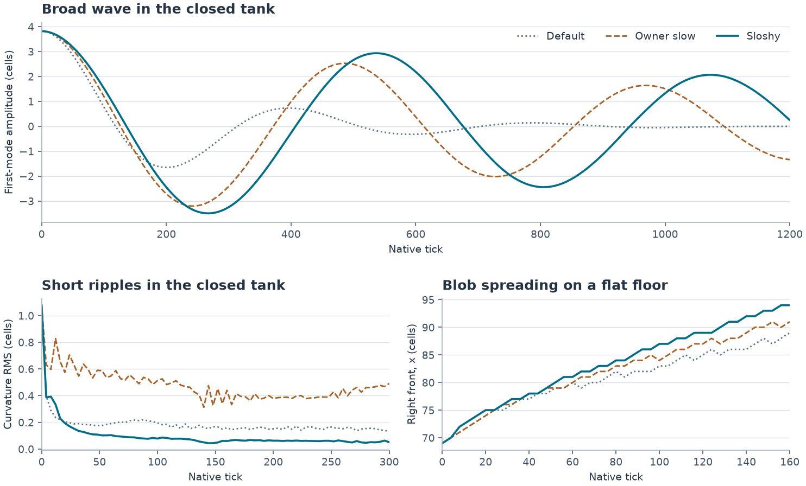

# Waterwall 002 evaluation, 19 November 2026

Draft/HOLD [PR 676](https://github.com/techrote/cybersand/pull/676) starts at
`5c415245b6ccf45168a60f0afb5e3626618795b7`, the final reviewed head of [PR 672](https://github.com/techrote/cybersand/pull/672).
The owner's 1024² generated start has SHA-256 `925096d1e9984b855b5465309ef12869a47e29052e0cabd5a25788a051b77107`.
The GEN-007 terrain has SHA-256 `9b8b4ef6339c4d922c499dd3240198209a8a3cfcca9f9fd49cf1b6fa918f91f5`.
The 166-stamp input used by the native harness has SHA-256 `c2dee3e3562b1369fdab0f3874716539704e5eae5a29951f262a0efc599b2a4e`.
Every map run starts with 3,052,350 units across all reservoirs. The historical lower-reservoir probe
is the half-open rectangle `440,540,192,102` and starts with 5,928 full-cell equivalents.

## Protected source review

The chunk constructor reserves a previous-flux field when smoothing is enabled.
The Wave physical hash incorporates the selected nonzero parameters and the live crest flight counters.
Neither change affects the material catalogue or an authored material transition.

| Protected source | Previous LF SHA-256 | Current LF SHA-256 | Source-first commit |
|---|---|---|---|
| `native/src/world.cpp` | `80e05f673b3d6ba35daa7c741805aa272f149e7742d162c94c8c0bd9bdbc1e83` | `fef05d7f0318f0a54948144ee22f30721555a567ac3963309c927b60fbfb0cf0` | `d876bd57897dd421b720e73d15d7c89a830b4896` |
| `native/src/world_pressure.inc` | `c5d639212290c9a4faee47f86a3cfe5bf664a5a51d241d4b5c9c1cdb985b6105` | `bce02406c837967e95206ea6f6e93145b2b327a1d42e3e6e29da9d3507603d03` | `d876bd57897dd421b720e73d15d7c89a830b4896` |
| `native/src/world_pressure.inc` (Workbench Apply) | `bce02406c837967e95206ea6f6e93145b2b327a1d42e3e6e29da9d3507603d03` | `0e012c7f2944cf8d5f9d8aa383e8635bbbd313d26fc5079160a02d5f4e1e3a0f` | `d4df71fc6bc1bf6267270a4c1445207a02716317` |

## Tank waves and spreading

The closed tank is 64 cells across, with 11 rows of Water on the right and 17 on
the left. The open version has a right lip one cell above the lower initial
surface and catches the overflow below. The blob starts twelve cells wide and
six tall, four cells above a flat floor. Each run used six workers and one
substep. Every sampled grid-plus-flight total matched its initial quantity.

| Fixture and measure | Default | Owner slow | Sloshy |
|---|---:|---:|---:|
| Closed tank, mean period (ticks) | 394 | 484 | 536 |
| Closed tank, amplitude after two periods (cells, starts at 3.82) | 0.14 | 1.64 | 2.07 |
| Closed tank, amplitude lost per period | 80.9% | 34.5% | 26.4% |
| Closed tank, short-ripple curvature (cells) | 0.169 | 0.460 | 0.075 |
| Open tank, mean period (ticks) | 404 | 500 | 582 |
| Open tank, amplitude after two periods (cells) | 0.13 | 0.25 | 0.42 |
| Open tank, amplitude lost per period, including overflow | 81.3% | 74.6% | 66.7% |
| Open tank, short-ripple curvature (cells) | 0.163 | 0.407 | 0.073 |
| Blob right edge at t20 / 40 / 80 / 120 / 160, starts at x69 | 74 / 77 / 82 / 85 / 89 | 74 / 78 / 83 / 87 / 91 | 75 / 78 / 84 / 89 / 94 |

Column depth is the exact grid quantity above the tank floor divided by 255.
The long wave is the signed first cosine mode of those depths. The reducer
finds a peak per signed excursion above 0.04 cells, uses the first two full
oscillations for the mean period and takes the geometric mean of their amplitude
ratios. Curvature is the RMS of the horizontal second difference, averaged over
samples from t20 to t300. A blob column must hold at least 32 units to count
toward its front. The owner's slower hand-tuning also outspread default on this
particular drop. The Sloshy preset went further at every reported checkpoint.



The gain split and smoothing work independently. Both remain zero in historical
profiles. During screening a four-row active band lengthened the first return
to 656 ticks, with only 1.29 cells of amplitude left. At deep gain 16, increasing
smoothing from 16 to 24 lowered curvature from 0.075 to 0.059 but also reduced
retention per period from 73.6% to 72.6%. The selected setting spends less of
the broad wave on smoothing. Sloshy sets ordinary gain 32, deep gain 16, flux
smoothing 16, damping shift 16, coast 64, level shift 3, calm damping shift 8,
calm flux and stick 128, and sleep after 90. Other Wave controls start from
their ordinary defaults.

### Crest flight at the open tank lip

With Sloshy and Max over-ledge together, a probe four cells beyond the lip
recorded the following through t560. The probe covers x85..116, y32..43, above
the top of the wall at x81, y44. The unit-tick integral measures the amount of
airborne Water at that height across successive ticks.

| Coyote ticks | First airborne Water in probe | Peak airborne units | Airborne unit-ticks | Parcels / units thrown | Peak live |
|---|---:|---:|---:|---:|---:|
| 0 | None | 0 | 0 | 570 / 46,236 | 92 |
| 4 | t146 | 597 | 90,259 | 553 / 44,537 | 99 |

Both runs launched from the lip by t140, conserved all Water, and recorded zero
launch refusals, capacity skips and deferrals. The ordinary closed-tank and
open-tank swing measurements above use spill off.

### Reproduction and source identity

These eleven runs and the normal Wave suite used a fresh archive of source
`d4df71fc6bc1bf6267270a4c1445207a02716317`. WSL2 Ubuntu 24.04 g++ 13.3.0 built
the apparatus with `-O3 -DNDEBUG -pthread` and the native Wave suite with
`-O2 -g -pthread`. Wave passed 33/33, including the independent alternating-ripple
energy test, shallow-front invariance, extreme tuning, paused-face and worker
parity cases. The apparatus SHA-256 was
`2784d7f099e7e78caf3597aa88c50f5a17bc2c4709f9259b0878f44fe11215b1` and the
test executable SHA-256 was
`7b8bd16b5e45ed49930b267ebc06cfa43b9817a3f40093ef4654eb421aac3963`.

```sh
make wave-waterwall wave-flow-test
# For each profile run tank, tank_open (2200 ticks) and blob (240 ticks).
# Append the selected profile's keys. Use no extra keys for default.
timeout 180 build/wave_waterwall tank size=128 ticks=2200 every=4 workers=6 > tank.log
python3 tools/wave_mt/reduce_slosh.py tank.log
# Owner slow
# gain=20 damp_shift=10 coast=48 level_shift=5 calm_damp_shift=6 calm=128 stick=128 sleep_after=90
# Sloshy
# gain=32 deep_gain=16 flux_smoothing=16 damp_shift=16 coast=64 level_shift=3 calm_damp_shift=8 calm=128 stick=128 sleep_after=90
# The lip pair uses tank_open, ticks=560, every=1, the Sloshy keys, and:
# spill=1 ballistic=1 sheet_rate=64 draw=127 draw_head=65535 fall=8 launch_budget=128 catch=1
# coyote_ticks=0 or 4 hydrograph=lip.csv source_box=85,32,32,12 stream_box=82,32,32,12
```

[Per-sample numerical profiles](wave-waterwall-002-2026-11-19/slosh-profiles.csv)
and [fixture results and output hashes](wave-waterwall-002-2026-11-19/slosh-results.json)
retain the numerical evidence. These runs measure simulated motion. The isolated
map timing campaign supplies the tick-cost comparison.
