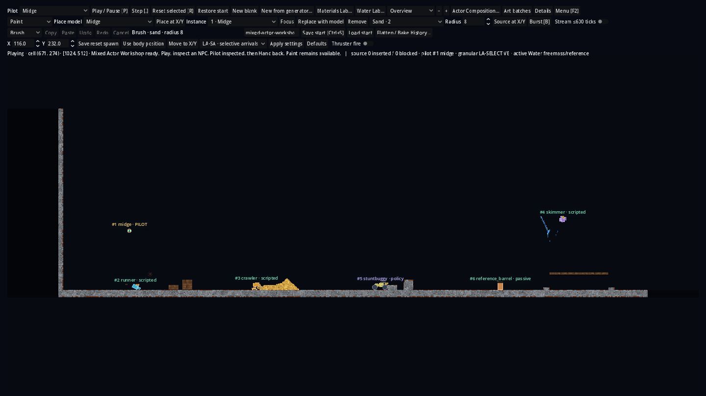
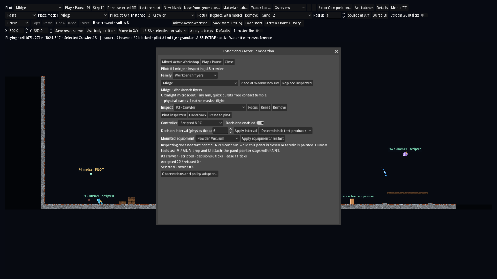
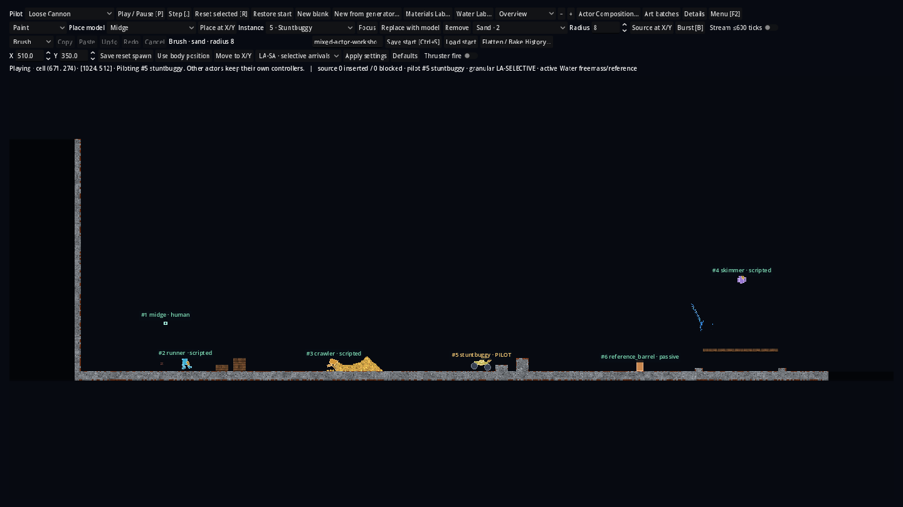
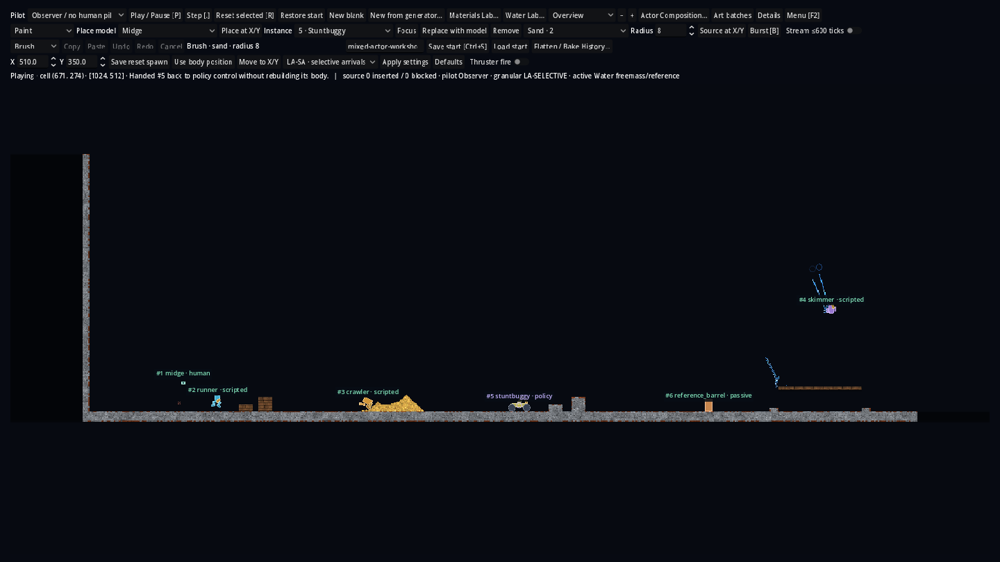
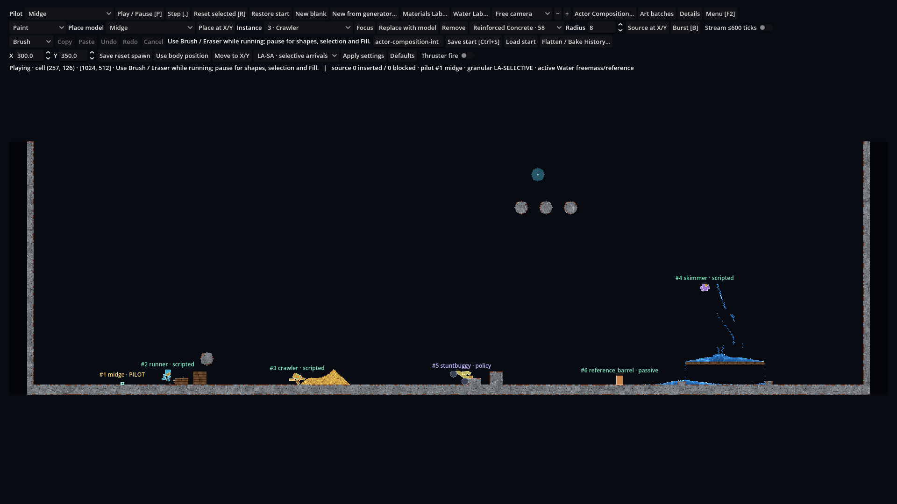
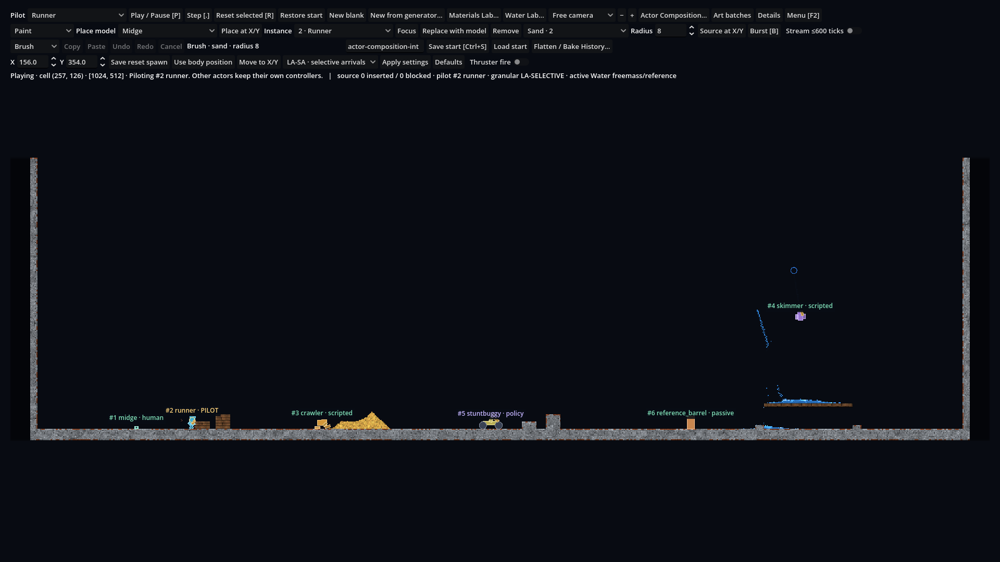
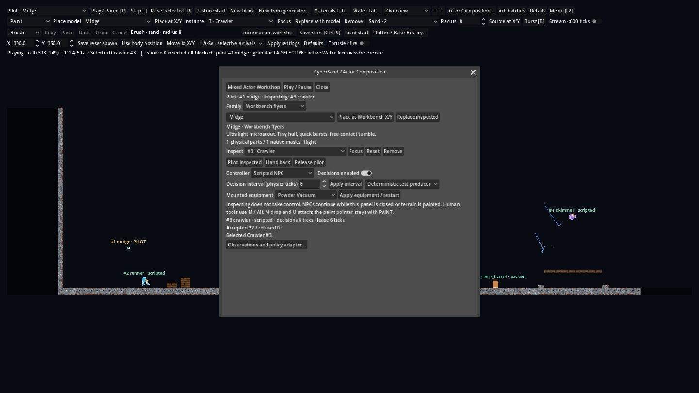

# WB-ACTOR-COMPOSE-001 source and qualification record

## Source and acceptance boundary

The owner explicitly authorized implementation beyond the original planning-only
boundary of [issue #589](https://github.com/techrote/cybersand/issues/589).
The branch is `feat/workbench-actor-composition-589`, created from freshly fetched
accepted main **`de109d0131641d6adc8d25bb9ced7ca3d4991105`**. No donor branch was
merged. Delivery remains **Draft/HOLD**; neither merge, Ready promotion nor
auto-merge is authorized. The system and owner guides describe the candidate,
not accepted-main availability or universal rig playfeel.

The held implementation is **`2e9bba9c2d1c3f5b0b8cb644c860d4ce0c463fa3`**
on [Draft/HOLD PR #683](https://github.com/techrote/cybersand/pull/683).
The completed hosted campaign and delivery identities are recorded at the end
of this audit. Intermediate successes do not stand in for final source-matched
platform qualification. Automated graphical operation is distinct from owner
playfeel acceptance.

## Current source and historical investigation

The current inventory covered sampled ACT-001/002, physical ACT-004/005,
Player Playground, the eight-flyer fleet, 4LY teacher/controller, physical
Thunderbowl, local Thunderbowl policies and issued-observation contracts.
The primary integration gap was capability admission plus one-body-per-actor
Workbench mapping. Existing producer takeover, resource, equipment and script
mechanisms were retained.

| Read-only donor | Inspected head | Independently reused or rejected |
|---|---|---|
| PR #402 | `80bae8847fc2428a213f8b0e5e1c8fcd7e1b80ff` | Catalogue/profile and bounded authored-option ideas; no broad merge or old acceptance claims |
| PR #409 | `6bdab8ef59e1d7b9771718ebe07dd799c1e06ed3` | Per-part custody, capability/presentation and prepared-transform mechanisms; current Setup-v2 and prepared-owner contracts take precedence |

The narrow `force_update_transform()` before freezing/capturing a prepared body
was requalified against an actual one-float32-ULP retained-angle failure. Exact
pose equality remains enforced. Native field players, old schema variants and
donor acceptance instructions were not imported. Nearby publication, presentation,
camera, Workbench and water branches remain independent; no renderer/camera
coordinator or material-law changes were introduced.

## Implemented ownership boundaries

The [canonical contract](../systems/workbench-actor-composition.md) owns the full
capability matrix and interface. This integration uses the existing native World,
main-thread Rapier session, prepared adoption, physical scripts/usable scripts,
fleet controller, player rigs, 4LY teacher and leased policy envelope. New adapters
are capability admission, copied local decisions, per-instance UI/schema and
multipart bridge indexing. The native change raises the bounded Workbench
response-body storage from eight to64 while logical actor slots remain eight
and occupancy proxies remain64.

The saved Mixed Actor Workshop contains Midge/human, Runner/scripted Brick
Stamper, Crawler/scripted Powder Vacuum, Skimmer/scripted Water Lance,
Stuntbuggy/policy fixture and a passive barrel: six actors,24 prepared bodies.
Live handoff preserves pose, momentum, resources and equipment. Authored
Reset/replacement/equipment Apply may restart state and are explicitly separate.

## Local execution and retained negative evidence

All reported Godot executions use **4.7.stable.official.5b4e0cb0f**. The host's
unrelated installed4.7.2 was not substituted. Linux and Windows Rapier retain the
accepted pinned patched0.35.2 addon /0.35.1 core. Native input ledgers cover all95
files. The pinned Linux build passes the retained ABI floor (bundle GLIBC2.34,
GLIBCXX3.4.30, CXXABI1.3.9). A preliminary GCC14 binary and a contaminated
GLIBC2.38 attempt were rejected for final publication; no pin was relaxed.

Intermediate actual-source results before the final campaign include:

| Execution | Observed result and scope |
|---|---|
| Actor catalogue author / fresh-process reopen |422/424 assertions, zero failures; old Setup-v2, generated and material-baseline round trips plus59-model admission |
| Session control |79 assertions, zero failures; independently issued actions, stale replies, takeover and pure steering reuse |
| Real native/Rapier composition |317 assertions, zero failures;300 native and Rapier ticks, real motion/tools,64-body admission and65-body refusal |
| Ordinary Workbench author / fresh-process reopen |98/14 assertions, zero failures; six-actor authored replay, human/script handoff, painting, paused Step and live replacement |
| Prepared owner |49 assertions, zero failures; retained rotated parts across real frames plus deliberate one-ULP mutation refusal |
| ACT-004 cancellation adversary |15 assertions, zero failures; a competing cancellation crosses the final native-write boundary safely |
| Existing session / script / fleet / input / Art native |113/57/88/26/146 assertions, zero failures in their respective local runs |

Counts above describe those intermediate runs, not a fabricated single suite.
The final platform runner records exact completion receipts independently.

Negative evidence was retained outside source in qualification logs. Initial
mixed replacement failed strict retained-pose equality until deferred transform
canonicalization was repaired. Full-catalogue toolbar popups caused bad click
selection; compact fleet/placed-model toolbar lists and a family-filtered detailed
browser repaired the interaction. An old pilot test assumed inspection/placement
must change control and was revised to explicitly exercise the intended independent
pilot behavior. Review also found deferred UI intent surviving failed preparation
and an ACT-004 admission/apply cancellation race; both receive focused regressions.

## Reproduction and platform campaign

Use the repository's pinned dependencies and source-provenance checks. Each
test has its own bounded process watchdog and retained original log. The
branch-scoped workflow
[`workbench-actor-composition.yml`](../../.github/workflows/workbench-actor-composition.yml)
builds both pinned native candidates, records source/input/byte custody, then
uses the same source in Linux and Windows Godot. Its
[`runner`](../../tools/ci/run_workbench_actor_qualification.py) executes focused
existing and new regressions, fresh-process authored reopen and actual graphical
framebuffer capture. A copied Windows package is then exercised outside Git.

Local commands use the pinned Godot executable with `--headless --path godot
--script res://tests/<fixture>.gd`, isolated `XDG_DATA_HOME`, and a240-second
outer bound for the larger integration campaign. New fixture names are
`test_workbench_actor_catalog`, `test_workbench_actor_composition_session`,
`test_workbench_actor_composition_native`, `test_workbench_actor_composition`,
and `test_physical_actor_effect_cancellation`. The integration fixture's reopen
mode runs in a distinct process against the preceding saved authored file.

The performance fixture `measure_workbench_actor_composition.gd` measures
1024×512 and2048×1024 material canvases: no actors, a human flyer, one script,
heterogeneous scripts, mixed producers and active equipment. It records actual
native/Rapier progression, frame quantiles, copied observation and decision costs,
publication times, static memory, paused editing and resumption. Baseline mode
uses the same geometry and no-actor/flyer cases on the untouched accepted-main
worktree. Final comparison values belong in the completed evidence section.

Local GUI attempts failed because no usable X11/Wayland display was available;
standard userland Xvfb could not establish listening sockets. Headless execution
is not graphical playfeel acceptance. Hosted actual framebuffer captures and
Windows installed-package results are separate required evidence. Manual owner
assessment remains the [practical acceptance procedure](../operations/workbench-actor-composition.md).

## Qualification history and corrective review

At the initial source checkpoint, the final coherent committed-source platform
campaign, graphical PNG gallery and portable Windows package were still pending.
The following history preserves original failures and their corrective evidence.
Completed hosted results are recorded separately below. The PR remains
Draft/HOLD regardless of automated test success.

The expanded147-check integration adds same-frame pointer movement/release,
custom-item hand-back and prior-source retirement across new authored starts.
Its first execution stalled after240 physics ticks when opening the composition
inspector and was interrupted (exit130). The unchanged sequence with additional
wait-state diagnostics then passed147/147 in20.399seconds. This single rerun
does not explain or close the intermittent stall; repeated reproduction and
native/Rapier fence inspection remain required before handoff.

### Lifecycle failure identified and repaired

The next repeat reproduced the failure with native tick12 while Rapier reached858.
An explicit same-frame Pause→Play then reproduced the exact first refusal at
Rapier tick13: `cancelled_generation`, `frame_admitted=false`. The worker revoked
equipment immediately, but the actor session previously observed pause only in a
later physics callback. The previous completed sample still satisfied main's
wait fence, allowing Rapier to advance against stale native publication.

The repair synchronously suspends/resumes the existing session at both Workbench
pause edges and during fallible preparation/rollback, publishes fresh neutral
authority before resumed stepping, and stops the coupled owner on a missing or
refused physical frame. The visible error blocks Play and Step until explicit
Reset/Restore preparation. Ordinary refused policy/tool actions still admit
their coherent physical frame and do not take this fault path. Pending Step is
cleared, so fault recovery stays reachable. No cancellation check was weakened.

A separate sleeping-body adversary reproduced an equipment mount/mask mismatch:
the active-only cache could precede the direct body pose used for native masks.
The same fixture failed2/323 before the repair and passed323/323 after using
current Rapier RID transforms for equipment parts. Deliberately forged mount
geometry still refuses. No additional physics owner or tolerance was introduced.

The strengthened ordinary-host run then passed **171 assertions**, with all15
coupled intervals within one native/Rapier tick. It verifies a real neutral
physics input sample before actual human D consumption, actual pointer
press/motion/release within one process frame, running prepared refusal with
unchanged old RIDs/pose/momentum/resources, and an intentional generation fault
that blocks Play/Step and recovers through Reset. The only body-frame refusal in
that run was the deliberately induced fault. This supersedes the earlier weak
long-phase assertion that required merely one native tick during many Rapier steps.

The supplied Crawler spawn also moved from x342 above sand to x300 on the solid
approach. Native granular support does not fabricate the Rapier contact that its
traction requires. The exact six-actor focused probe measured480/480 coupled
steps and60.73cells of horizontal patrol after settling,397 supported ticks of420,
and63 legitimate tool material changes. Ordinary Workbench confirmed61.48cells
of horizontal travel and actual support; the full cast produced641 legitimate
changed cells. Controller algorithms, material laws and observation semantics
remain unchanged. Original failures and the source-matched corrective runs are
retained separately.

### Initial quiet performance comparison

The first sequential accepted-main/candidate runs used the same pinned engine,
geometry, 12-tick warmup, five-second samples and60-frame cap in this Linux
container (nine visible logical CPUs). Both were headless. All12 candidate cases
progressed; both equipment cases retained paused Rapier state during painting and
resumed successfully. No inference/model service was running. These short samples
are observations, not a statistical equivalence claim.

| Canvas / case | Main native ticks/s | Candidate native / Rapier ticks/s | Main / candidate frame p95 ms |
|---|---:|---:|---:|
|1024×512, empty |60.00|59.99 / no bodies|16.875 /17.694|
|1024×512, human flyer |60.01|56.04 /56.04|17.198 /22.721|
|2048×1024, empty |60.00|60.04 / no bodies|17.064 /17.222|
|2048×1024, human flyer |58.92|57.52 /57.52|17.226 /19.538|
|2048×1024, one script |Not supported on main|59.46 /59.46|— /18.212|
|2048×1024, heterogeneous scripts |Not supported on main|58.49 /58.49|— /21.109|
|2048×1024, mixed producers |Not supported on main|58.41 /58.41|— /20.539|
|2048×1024, active equipment |Not supported on main|54.17 /53.97|— /25.583|

This records an **observed flyer-control regression in the first sample**, pending
repeat controls and investigation; it must not be described as no regression.
The1024 equipment sample also had one174.658ms frame. Candidate native publication
p95 ranged0.533–1.058ms. Controller decisions across the whole five-second
equipment sample took21.329ms (1024) /19.915ms (2048); copied observations for all
equipment actors had p95 of4.074ms /0.811ms respectively. Headless results do not
measure GPU presentation. The full candidate process peaked at488,360KiB RSS
versus476,620KiB for the smaller four-case baseline campaign; these different
workload sets are explicitly not a like-for-like memory regression claim.

### Final local repeat and independent review

The corrective ordinary-host fixture passed **171/171 twice**, in 23.994 s and
23.348 s. A distinct process then reopened the authored save with **15/15**
assertions in 3.954 s. All 15 gameplay phases require native progress within one
tick of the requested Rapier interval. Each complete run intentionally induces
one `cancelled_generation` refusal to verify that both owners pause, Play and Step
refuse, no pending Step survives, and explicit Reset restores coherent progress.

The quiet performance repeat used committed implementation checkpoint
`efd3f889d7f34382b7ebd4f72eacdadee438c03b` with the pinned local Linux candidate
`fcf38d0b22607c7e5e033aaa33b8e3baf861fe8e7e459853118e50487b59432d`.
It ran the candidate first and accepted main immediately afterward, without other
Godot/build processes. The identical harness hash was
`21ffda6bdec4a5f1ae8a6236d678bb34065cdff7f018be3fbac04fba8c86e1b9`.
The earlier baseline and slower candidate are retained alongside this repeat.

| Canvas / candidate case | Native / Rapier ticks/s | Frame p95 ms | Native publication p95 ms | Decision time over five seconds ms |
|---|---:|---:|---:|---:|
| 1024×512, empty | 60.00 / no bodies | 17.734 | 0.539 | 0 |
| 1024×512, human flyer | 59.08 / 59.08 | 17.400 | 0.519 | 0 |
| 1024×512, one script | 58.99 / 58.99 | 18.881 | 0.892 | 4.072 |
| 1024×512, heterogeneous scripts | 59.40 / 59.40 | 19.628 | 0.995 | 8.508 |
| 1024×512, mixed producers | 58.63 / 58.63 | 18.061 | 1.133 | 7.608 |
| 1024×512, active equipment | 57.35 / 57.35 | 20.360 | 0.799 | 21.779 |
| 2048×1024, empty | 59.98 / no bodies | 17.312 | 0.526 | 0 |
| 2048×1024, human flyer | 59.11 / 59.11 | 17.080 | 0.444 | 0 |
| 2048×1024, one script | 59.69 / 59.69 | 17.941 | 0.517 | 4.337 |
| 2048×1024, heterogeneous scripts | 59.80 / 59.80 | 18.246 | 0.822 | 7.811 |
| 2048×1024, mixed producers | 59.37 / 59.37 | 18.889 | 1.117 | 8.122 |
| 2048×1024, active equipment | 58.39 / 58.39 | 19.180 | 0.998 | 19.913 |

The immediate accepted-main flyer controls were 58.47 ticks/s with 17.052 ms
frame p95 on 1024×512 and 60.00 ticks/s with 17.660 ms p95 on 2048×1024.
The first sample's larger slowdown did not repeat consistently across these
controls; neither the first negative nor the remaining roughly 1.5% large-canvas
tick difference is discarded. These short, shared-host samples do not establish
statistical performance equivalence. Equipment cases still had isolated 125.631 ms
and 113.209 ms frames. Their copied all-actor observations had p95 costs of
1.548 ms and 0.854 ms. Paused painting and resumed physics passed in both cases.
The 12-case candidate process peaked at 489,516 KiB RSS; the four-case baseline
at 483,516 KiB. The different workload sets remain unsuitable for a precise
memory-regression claim. Graphical platform timings are separate evidence.

The independent complete-source review checked all 21 changed production script
and header files, plus the authored example, against
local checkpoint `e8b7047fefbf6964ad1e977e6efa823412d4ec34`, recorded eleven
repaired findings, and found no remaining blocking core defect. This is a source
review pass with platform, graphical and owner-playfeel qualification still
explicitly separate. Its receipt is retained with the local evidence bundle.

The initial published candidate is
`cb85c1fc05420b2fde992881bf51512cc707a77c`, tree
`295b5d5f683dbc5caf95de2f3f6f20979c6ef179`, identical to that local checkpoint.
It is on [Draft/HOLD PR #683](https://github.com/techrote/cybersand/pull/683).
That first campaign, [run 44654706223](https://github.com/techrote/cybersand/actions/runs/44654706223),
was superseded after its Linux native build and ABI check passed. Its Windows
build was interrupted and no gameplay or graphical qualification is claimed
from that run. The original build artifact remains retained as intermediate
evidence.

The subsequent source is `b0bbf4a17a48040f79fc18cc0891af60cd56fb03`, tree
`cb451c455c95415b52d9f86fe329c6733c2c33a6`, on
[run 44655981245](https://github.com/techrote/cybersand/actions/runs/44655981245).
Production actor inputs are unchanged. A separate infrastructure review found
and corrected three qualification issues before accepting platform results:

- An empty JSON field named `skipped` matched the established runner's skip
  detector. The fixture now calls this bookkeeping `preservation_notes`, while
  a genuine preserved-user-file coverage omission still emits an explicit
  `SKIP` diagnostic. The generic runner and its refusal were not weakened.
- The Windows flow now compresses the pristine payload first, extracts the
  exact delivery ZIP into a fresh directory, tests that extraction, and verifies
  that the original ZIP hash remains unchanged before upload.
- Qualification custody now includes authored flyer definitions, extension
  descriptors, retained Rapier provenance, runner helpers, build wrappers and
  Materials Lab source/oracle inputs. Platform Lab compiler choices and retained
  Git history follow the existing source regression workflow.

The independent infrastructure review found no remaining blocking source
finding at the exact reviewed blobs. Platform execution remains a separate gate.
Automated installed Windows graphics use ANGLE; `Open Workbench.cmd` keeps the
existing default renderer, so one-click launch on the owner's machine and
subjective playfeel remain owner acceptance. The portable runtime includes the
Materials Lab inspector, but not the repository's Python/C++ material-authoring
toolchain; that existing source-authoring service requires a checkout.

Two targeted existing C++ regressions also passed on source `cb85c1fc` with the
verified GCC 13.3 compiler: `ACT-004 articulated body identity capacity` (1/1,
0.103 s) and `physics masked source characterisation` (1/1, 0.068 s). The retained
Makefile build took 58.032 s; its source ledger contains 163 test/native inputs
and the executable digest. This is not a claim that the complete C++ suite ran.

The guarded publisher may append only the tested runtime pair and provenance to
the unchanged feature-branch source. The first source commit deliberately keeps
the existing native LFS pointers until matching objects are uploaded through the
authenticated publisher; it is not a portable runtime release on its own.

### Hosted Flatten fixture failure and final source rerun

The `b0bbf4a1` campaign passed 15 cases on each actual Linux and Windows runner,
including catalogue 415, session 84, native composition 323, wide-canvas equipment
29, ordinary Workbench 171, fresh reopen 15 and prepared owner 49 assertions.
It then exposed a missed test migration: `test_workbench_flatten.gd` accessed
`bench.art_batches.executor` at startup even though the Art panel is now created
only on demand. Its script error left the SceneTree alive until the unchanged
1,200-second Linux watchdog. The superseded Windows run recorded the same error
and was cancelled before completion. Neither platform reached capture/package
qualification. Both original artifacts, logs and failures remain retained.

The repair changes only the fixture: assert that ordinary startup leaves the
Art panel absent, then use the existing production factory before testing its
executor. Production Flatten already guarded both absent-panel accesses. All
original test phases, assertions and watchdogs remain. Independent review
verified the exact narrow diff and original result receipts.

| Additional local existing regression | Result | Elapsed seconds |
|---|---:|---:|
| Workbench physics play | 72 checks, 0 failures | 23.420 |
| Hard placement | Passed | 0.606 |
| Failure recovery | Passed | 5.022 |
| Material baseline | 102 checks, 0 failures | 0.811 |
| Combined authoring | 192 checks, 0 failures | 13.780 |
| Generated paint editor | 39 checks, 0 failures | 5.802 |
| Ordinary paint editor | 64 checks, 0 failures | 6.464 |
| Repaired Flatten author | 194 checks, 0 failures | 11.479 |
| Repaired Flatten fresh-process reopen | 43 checks, 0 failures | 4.922 |
| Materials Lab Workbench integration | 97 checks, 0 failures | 47.012 |

These are pinned-engine Linux headless executions. The first seven retain exact
`b0bbf4a1` qualification inputs; the corrected Flatten and Materials Lab receipts
explicitly record that source plus the single fixture working-tree delta, with
unchanged inputs during execution. The Lab case used the verified GCC 13.3
wrapper and real reference/candidate native World compilation, worker-count
equality, cancellation, accounting and Workbench history isolation. None is
retroactively attributed to a later commit or called graphical acceptance.

The resulting published source is
`17bf39898e2ba6e560c314d0b0adb99521308225`, tree
`264d541c46f8fe3fa335a6569f19a76728a1c9c3`. Its exact-source campaign is
[run 44661048071](https://github.com/techrote/cybersand/actions/runs/44661048071).
All 21 reviewed production inputs and the authored example remain unchanged;
only the independently reviewed Flatten fixture differs from `b0bbf4a1`.
That campaign passed the repaired Flatten author case and the following
combined-authoring/generated-paint/ordinary-paint cases. It then exposed a
qualification-environment conflict: the new runner placed its isolated
`XDG_DATA_HOME` / `APPDATA` below the checkout's evidence directory. Materials
Lab correctly refused a generated response inside the source repository. The
original Linux receipt records 40 checks, two failures and incomplete execution;
this is retained as a failure, not a Lab pass. The earlier independent local
97-check execution used external application data and remains separately scoped.

The subsequent runner repair puts the shared author/reopen application data in
a unique temporary directory outside the source tree, retaining that data with
the evidence only after the child processes retire. It leaves Materials Lab's
source-write guard and every campaign case intact. A separate capture-only
repair waits for the ordinary actor-role/selection label publication before
recording the framebuffer, so the 150 ms status cadence cannot leave a stale
PILOT label immediately after takeover. Neither change modifies production
gameplay, rendering, the source guard or timeout/acceptance gates. The Windows
run reached the same explicit Materials Lab refusal after 19 passing cases;
no graphical/package stage ran and the guarded publisher correctly skipped.

### Final panel-entry review correction

A separate owner-procedure review found that Details, Water Lab, Generator and
Flatten confirmation relied on incidental OS/text focus to cancel held pilot
input. Embedded panels do not guarantee that event. Four explicit entry-point
calls now use the existing human-only cancellation path; the change touches
Shared Workbench, its Water Lab surface and its generator dialog. It does not
confirm Flatten, install a generator, change material cells or retire NPCs.

The expanded actual Workbench fixture passed **198 checks, zero failures** in
25.506 seconds (23.614 seconds inside the fixture), with 24 coupled gameplay
phases. It verifies an active human lease before each panel opens, synchronous
generation advance and zero lease at entry, continuing NPC commands, refusal
to rearm a still-held key on close, and fresh drive after neutral release.
Tested inputs were unchanged throughout. This receipt is explicitly scoped to
`17bf3989` plus the reviewed working-tree correction; it is headless Linux,
not graphical acceptance. Independent review checked the four production calls
and every added assertion without removing or weakening earlier coverage.

The same review corrected three owner-guide details: Setup-v2 stores the
definition identity in `hash`; the response algorithm applies to the whole
Workbench while its budget is per actor; and the normal UI disables a flyer's
unsupported item selector, with forged incompatible requests covered by the
API/schema tests.

The external-data repair then passed the actual Materials Lab case with **97
checks, zero failures**, complete execution in 46.593 seconds. Its evidence
directory remained inside the checkout while the new helper placed execution
data outside it. The input hashes remained stable; data was copied only after
child retirement and the temporary directory was removed. A separate complete
runner execution at source `7ac51a0a6b89d5d22fc1d1d6a1b52ca25ba90b7a`
passed import and catalogue **415/0**, exercising the runner's actual
retention/reporting/finally path.

Compatibility review additionally retained the generator dialog's pre-existing
plain-`Control` form host. Its optional presentation hook checks for `_cancel`;
the real Workbench always supplies it, so production cancellation stays explicit.
Existing Architectural UI **56/0** (1.313 seconds) and Generator Discovery
**24/0** (0.466 seconds) passed with stable inputs, no errors or skips.
This changes no actor admission, producer authorization or install validation.

The resulting held implementation is
`2e9bba9c2d1c3f5b0b8cb644c860d4ce0c463fa3`, tree
`296fcff5e3564e40ff9856dda1160e943feb9a68`, on
[run 44663989761](https://github.com/techrote/cybersand/actions/runs/44663989761).
The independent complete-source review binds 23 production paths and the authored
example to this identity, with separate infrastructure and generator-compatibility
reviews. The final platform and portable artifact results are recorded only
after that campaign completes.

## Final hosted Linux qualification

The exact held implementation `2e9bba9c2d1c3f5b0b8cb644c860d4ce0c463fa3`
passed all **28 campaign cases** in
[run 44663989761, Linux job 136048800388](https://github.com/techrote/cybersand/actions/runs/44663989761/job/136048800388).
This comprises import, 25 Godot fixture processes including fresh authored
reopen, actual graphical capture, and the 12-workload performance process.
Every case completed naturally with exit code zero and no reported skips.
The candidate binds 95 native source inputs and 1,067 qualification inputs.

The qualified Linux native extension is 4,734,408 bytes, SHA-256
`7b20455aad35559ea638d7db1b09f6c85657823302e742ef04254730008454f2`.
The retained Rapier binary is
`566e68ae53bfb2eb7018c8e7d0dd3727121bf696462039b780a33d6b8369c66a`.
The original Linux artifact is ID 14597717545, archive SHA-256
`b0ece6227fafff88a448340a8a63fdee2a704ae739b1ba7a128b751170b6eb8a`.
Original commands, process/resource receipts, log hashes and failure history
are retained in the delivered evidence archive.

### Actual graphical performance limitation

These are graphical X11 measurements using **llvmpipe (LLVM 20.1.2, 256 bits)**,
three-second samples after warmup. They are separate from the earlier five-second
headless accepted-main comparison. All 12 workloads completed, including paused
painting and resumed physics in both equipment cases, but the software display
has **poor frame pacing**: every sampled frame exceeded 100 ms, even with no
actors. This is functional graphical evidence, not smooth-play acceptance.

| Workload | 1024×512 native / Rapier ticks/s | 2048×1024 native / Rapier ticks/s | Frame p95 ms, 1024 / 2048 |
|---|---:|---:|---:|
| No actors | 60.01 / no bodies | 60.33 / no bodies | 203.786 / 211.361 |
| Human flyer | 11.99 / 11.99 | 10.50 / 10.82 | 200.553 / 225.586 |
| One scripted NPC | 5.51 / 5.51 | 5.66 / 5.66 | 225.675 / 182.256 |
| Heterogeneous NPCs | 5.56 / 5.56 | 5.27 / 5.27 | 206.085 / 239.173 |
| Human + scripted + policy | 10.83 / 10.83 | 9.24 / 9.57 | 187.953 / 210.041 |
| Mixed cast + equipment | 10.44 / 10.44 | 8.53 / 7.87 | 236.875 / 217.628 |

Mean frame times range from 176.610 to 191.580 ms. The landscape equipment
measurement records 26 native ticks and 24 Rapier steps during its measured
interval. The later pause/edit/resume checks also passed. The unequal interval
counts are retained without attributing them to that later transition or claiming
perfect parity.
Controller decision totals range from 133 to 1,719 microseconds per three-second
NPC window. Native publication p95 ranges from 0.316 to 0.985 ms.
The copied-observation timing field has **zero samples**, not zero cost: the
fixture samples every 30 process frames, while these short software-display
windows produced only 16–17 frames. Earlier headless observation costs remain
separately scoped.

The graphical performance process peaked at 845,459,456 bytes RSS; the separate
capture process peaked at 1,076,854,784 bytes. Godot static memory peaked at
135,651,216 bytes in the performance process. These measurements cover different
allocators and workloads and are not a like-for-like comparison to accepted main.
There is no matched accepted-main graphical run here; consequently this evidence
cannot establish a graphical regression or prove its absence. The empty-world
slowdown shows that NPC decision costs alone do not explain the observed frame
pacing. Owner hardware, default-renderer launch and subjective playfeel remain
open acceptance work; no competing renderer or camera coordinator was added.

### Original application PNG gallery

The images below are unmodified framebuffer PNGs from the actual Shared Workbench,
not headless renders. [Gallery metadata](workbench-actor-composition-589/linux-gallery.json)
binds each original image hash, caption, native/Rapier ticks and source identity.
The inspector's upper family/model picker selects a model to place or replace;
the separate Inspect/controller/equipment rows describe the selected live actor.



**Linux, native/Rapier tick 102/102.** Midge is the human pilot; Runner, Crawler
and Skimmer are scripted, Stuntbuggy uses the external-policy test producer, and
the barrel is passive. Visible bricks, removed powder and water come from the
existing physical equipment path.



**Linux, tick 129/129.** Crawler is inspected with Scripted NPC, enabled decisions,
Powder Vacuum and accepted-command diagnostics. Midge remains pilot. Opening the
panel does not take over Crawler or retire unrelated controllers.



**Linux, tick 138/138.** The existing Stuntbuggy is now the human pilot. Midge
remains a Human-source actor without the active pilot; other NPCs retain their
own sources. Live identity/pose/resource preservation is checked by the separate
gameplay fixtures, not inferred solely from this image.



**Linux, tick 159/159.** Stuntbuggy is back under policy control. The toolbar
correctly shows Observer/no human pilot; hand-back does not silently pilot Midge.
The owner explicitly chooses Midge again when desired. Painting, pause/Step and
fresh-process persistence claims rely on their gameplay receipts; these four
images do not depict every acceptance action.

## Final Windows and extracted-package qualification

The same held implementation passed all **28 source campaign cases** in
[Windows job 136054525823](https://github.com/techrote/cybersand/actions/runs/44663989761/job/136054525823).
The source-tree author/reopen cases were headless and passed **198/0** and
**15/0**. The real graphical capture and 12-workload measurement were separate
processes. All 28 completed naturally with exit zero and unchanged log hashes.

The pristine delivery ZIP was then extracted into a fresh directory outside Git.
All **four installed-package cases** passed: import, actual graphical Workbench
authoring **206 checks / 0 failures**, fresh graphical reopen **17 / 0**, and
four additional role-transition captures. The graphical authoring case exercised
24 coupled gameplay phases and produced four action screenshots; fresh reopen
produced another. Its 206.545-second execution and the 18.843-second fresh reopen
completed naturally. Added graphical assertions explain the count differences
from the headless 198/15 source campaign; these are not different core fixtures.

The actual running package process loaded the packaged Godot executable and all
three required app-local DLLs with matching observed path and SHA-256:

| Component | SHA-256 |
|---|---|
| Godot 4.7 Windows x64 executable | `b2ca888d5115a6cedee564764a2ee494a625f2ec2edbabd010fe33c9a88a6bf8` |
| Native Workbench candidate | `8d1d12dd63bb18466594df05589622a87b148a696cf418075d5c4d8fc11f518e` |
| Retained patched Rapier | `b54e54bd1a03ae9094b788bf869212b5405b4a04793792d5a7cd81632cb10dd7` |
| App-local VC runtime | `d5e4d9a3e835fa679450145d6a7d94e36573a509317111904d9b3712c30d9066` |

The Windows native DLL is 5,276,160 bytes. The observed module report hash is
`537eeeb75693becd4f4dd01107668a487a832527cd8bf070dbb510b5917ecc7c`;
the installed qualification report hash is
`9e30dd67e5a95223da70179e7726df54a6d8afb63ffcacc125963f35fbf8ddc5`.
The [Windows evidence artifact](https://github.com/techrote/cybersand/actions/runs/44663989761/artifacts/14598226769)
retains the complete original logs, runtime inventory, receipts and PNGs.

### Source-matched Windows evaluation ZIP

**`CyberSand-Mixed-Actor-Workshop-Windows-2e9bba9c2d1c.zip`** is the ready-to-extract
application archive: **93,688,763 bytes**, SHA-256
**`c177d09d88134280b7831a869575fe141f4759dd112855df7ff8683987b889f2`**.
It is contained in the
[Windows evaluation artifact](https://github.com/techrote/cybersand/actions/runs/44663989761/artifacts/14598456362)
and delivered separately to the owner. The surrounding Actions artifact ZIP is
only a transport wrapper and has a different hash. Independent inspection
rehashes all **965 manifest payload files** directly from the original inner
ZIP, with no missing or extra payload files. No recompression or reconstruction
was used to create the owner delivery.

Extract the complete application ZIP into a writable directory, then double-click
**Open Workbench.cmd**. In the ordinary Workbench choose **Actor Composition… →
Mixed Actor Workshop → Play**. The included
[owner procedure](../operations/workbench-actor-composition.md) covers inspection,
live takeover/hand-back, autonomous start/stop, tools, painting, policy leases,
Save/close/reopen and refusal behavior. It includes the engine, matching native
and retained Rapier runtimes, signed VC runtime, resources, authored example and
license notices; no separate development checkout is needed for gameplay.

Automated graphical Windows execution used **ANGLE with Microsoft Basic Render
Driver / D3D11**. The launcher retains the existing default renderer and was not
itself double-clicked in the hosted campaign. Default-renderer one-click launch
on owner hardware and subjective playfeel therefore remain explicit owner gates.
The Materials Lab inspector is available, but the source-authoring Python/C++
toolchain is not included in this gameplay package.

For the same interactive ANGLE path used by the actual module probe, run these
commands from the extracted package directory. The first is the qualified import
command; the second opens ordinary Workbench with the probe's renderer/audio
arguments. It requires no checkout or external Godot installation.

```bat
Godot_v4.7-stable_win64_console.exe --headless --path godot --editor --quit
Godot_v4.7-stable_win64.exe --audio-driver Dummy --rendering-method gl_compatibility --rendering-driver opengl3_angle --path godot -- --workbench
```

### Windows graphical performance limitation

The source campaign measured the following three-second workloads under the
software ANGLE/D3D11 adapter. Both equipment cases passed paused editing and
resumption. No model inference was running.

| Workload | 1024×512 native / Rapier ticks/s | 2048×1024 native / Rapier ticks/s | Frame p95 ms, 1024 / 2048 |
|---|---:|---:|---:|
| No actors | 52.21 / no bodies | 55.77 / no bodies | 112.663 / 127.433 |
| Human flyer | 24.34 / 24.67 | 28.18 / 27.85 | 195.868 / 197.338 |
| One scripted NPC | 14.43 / 14.74 | 22.53 / 21.86 | 120.481 / 197.780 |
| Heterogeneous NPCs | 10.59 / 10.59 | 10.95 / 10.95 | 168.563 / 202.242 |
| Human + scripted + policy | 19.91 / 20.24 | 23.10 / 23.10 | 199.928 / 198.590 |
| Mixed cast + equipment | 22.57 / 22.57 | 20.71 / 20.38 | 149.397 / 125.829 |

Mean frame times range from **107.948 to 116.984 ms**, with a maximum observed
frame of **261.580 ms**. The native no-actor rates are 52.21–55.77 ticks/s;
actor workloads are 10.59–28.18 ticks/s. Six native/Rapier endpoint pairs differ
by one or two ticks; original counts remain in the evidence, without claiming
perfect parity. Controller decisions total 682–6,526 microseconds per NPC
measurement window; native publication p95 is 0.444–0.765 ms. Godot static memory
peaks at 135,722,052 bytes. The Windows process-resource adapter reports RSS as
unavailable; no Windows process RSS value is invented.

As on hosted Linux, copied-observation timing is **unmeasured**: all counts are
zero because each case produced only 26–28 process frames, below the 30-frame
sampling interval. There is no accepted-main graphical control on this adapter.
These are functional progression measurements with poor software frame pacing,
not performance acceptance. Earlier headless comparisons, including their
negative and repeat controls, remain separately identified above. Publication
cost alone is not a complete renderer-stall measurement.

### Original Windows application PNGs

These unmodified PNGs came from the exact extracted delivery ZIP.
[Installed-gallery metadata](workbench-actor-composition-589/windows-installed-gallery.json)
records original image hashes, dimensions, captions, native/Rapier ticks and
package identity. The paint actions were automated through the real Workbench
input path; no manual owner playfeel session is claimed.



**Windows installed package, native/Rapier tick 711/706.** The real Brush input
path has added hard material while Midge remains pilot, Runner/Crawler/Skimmer
remain scripted and Stuntbuggy remains policy-controlled. Bricks, excavation and
Water Lance effects coexist in the native material canvas.



**Windows installed package, tick 361/357.** Runner #2 is now the human pilot;
Midge is an unpiloted Human-source body, and the remaining controllers keep their
own authority. The corresponding gameplay checks verify live body/resource
preservation and actual human input consumption.



**Windows installed package.** The panel explicitly separates pilot Midge #1
from inspected Crawler #3, with Scripted NPC and Powder Vacuum still selected.
The [cast overview](workbench-actor-composition-589/windows-installed-01-mixed-cast.png)
and [fresh-process reopened start](workbench-actor-composition-589/windows-installed-05-reopened-authored-start.png)
are retained too. The reopened example follows a deliberate replacement test,
so its policy actor has authored ID **8**, not the original ID 5. It reconstructs
at authored spawns with accepted paint, controller settings and starting items;
it does not restore live momentum, evolved water, leases or private policy state.

## Runtime publication and final acceptance state

The guarded publisher appended commit
**`7d7100c66ecc7e8b5456d3267ac6d580330ac8ea`**, whose single parent is the exact
qualified implementation **`2e9bba9c2d1c3f5b0b8cb644c860d4ce0c463fa3`**.
Independent comparison confirms exactly four changed paths: the Linux and
Windows native LFS pointers and their two provenance manifests. Both candidate
bytes match their published pointer hashes and successful platform report
hashes. The publisher's repository check passed. Its original report and commit
receipt are in the
[publication artifact](https://github.com/techrote/cybersand/actions/runs/44663989761/artifacts/14598531449).
The complete [campaign](https://github.com/techrote/cybersand/actions/runs/44663989761)
finished successfully across Linux, Windows and publication jobs.

Subsequent audit, review and PNG commits add evidence only; qualified gameplay,
controller, native and packaging inputs remain unchanged. Final delivery records
bind the final PR HEAD separately from the implementation and runtime-publication
identities. Accepted main remains at the recorded starting baseline.

**Functional source/runtime/package qualification passed. Graphical performance
and owner playfeel acceptance remain HOLD.** The hosted software renderers are
slow, their observation-cost samples are absent, the default one-click Windows
launcher still needs the owner hardware test, and no matched accepted-main
software-graphics comparison is claimed. No merge, Ready promotion or auto-merge
is authorized or performed.

### Independent final verdict

The [immutable final review](workbench-actor-composition-589/independent-final-review-2e9bba9c.json)
returns **PASS for Draft/HOLD owner evaluation**, with no remaining source or
artifact-custody defect identified. Its SHA-256 is
`ee41190961d1fb870074e1769492371619ffbbad585b8acaf044909631df74be`.
The reviewer read all **23 changed production paths plus the authored example**
and independently verified all **60 original process log hashes**, the two
95-native/1,067-qualification-input candidate identities, the four-file runtime
publication, all 965 package payload hashes and observed app-local modules.
Build/qualification infrastructure authored by that reviewer was separately
reviewed by another agent; the final receipt links those immutable addenda.

The [independent Linux visual/owner review](workbench-actor-composition-589/independent-linux-visual-owner-review-2e9bba9c.json)
separately checks original screenshots, role labels, owner instructions and
measurement limits. The final reviewer also inspected all four installed-Windows
role-transition captures. Source review challenges included duplicate authority,
producer replacement, stale identities/observations, native body masks, material
ownership, save mutation, misleading policy claims and existing Workbench
regressions. Reproduced substantive findings were corrected and rerun; prior
failures remain in the evidence rather than being overwritten by passing runs.

This review explicitly does **not** approve smooth graphical performance,
default-renderer one-click launch or subjective owner playfeel. Those boundaries
remain as stated above. It does not authorize merge, Ready promotion or auto-merge.
