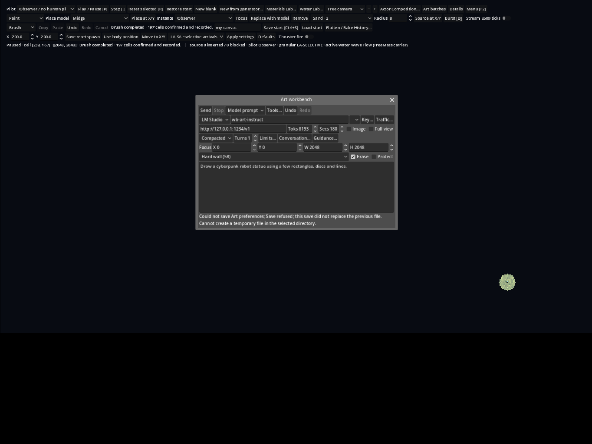
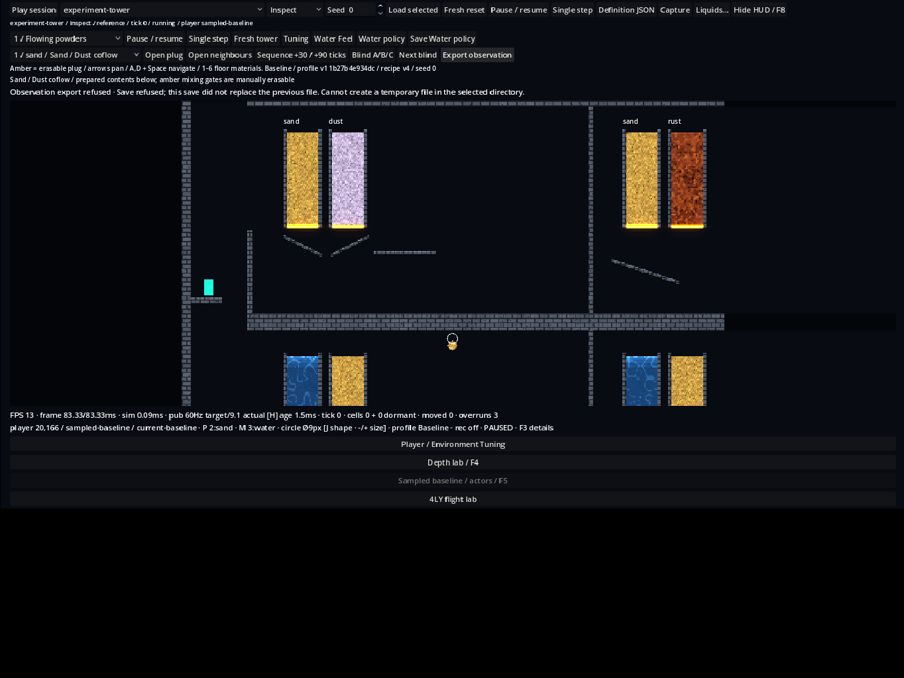

# Product closure recovery and fresh qualification

The 26 November environment reset removed transient workspaces. This record
separates published evidence recovered from commit
`7919e8a752e87e68c4193b3a04960164ab62e117`, unavailable unpublished results, and
newly executed work. It does not reconstruct missing logs or relabel an earlier
GUI pass as the final candidate.

## Custody and review scope

The published [product packet](../README.md), ten original captures, profile and
Tower evidence, and the three source-bound additive-context reviews survived in
Git. Its actual coverage register contains **53 documents: 46 full-text and seven
selected-section reviews**; the summary's stale 51/44 totals are corrected to
that existing register. The [new coverage delta](coverage-delta.json) adds full
reads of the two AMBIENT manuals and identifies the exact scope of the merge,
source-contract, recovery-instruction and independent reviews. It preserves
the earlier review identities instead of claiming that every document was read
again after the reset.

Unpublished e487 source-bound GUI/context files and private holdout material
were not present in the restored publication. Their conversation-level
observations are not treated as retained raw evidence or a new final result.
The original sealed holdout must not be recreated and called the same experiment.
Any fresh context audit is a separately recorded execution; its source, passages
and actual review must be retained independently. This loss does not remove the
earlier published 67245ba5 context review or turn it into a later-source result.

Accepted main `67c1413a2a84077b47fa542cf91d2bd6ba5520ee` introduced the #775
AMBIENT foundation through the controlled mergedown. B resolved five assigned
documentation conflicts while preserving ULTIMA corrections. The current
manuals distinguish accepted opt-in/default-off AMBIENT, its eight-actor limit and
per-actor assignment from unmerged #779 additions. Historical Windows software
renderer and extracted-launcher results remain bound to their original
`f4f94631` package; the later merge is not a rerun or physical owner acceptance.
A independently reviewed the ownership/interfaces source contracts; C reviewed
the portal/status and both complete manual deltas.

## Fresh native GUI: source 4b7cbcd2

[The machine-readable receipt](gui-4b7cbcd2/receipt.json) binds the source,
runtime, steps, exact file digests, original logs and two unedited screenshots.
The application ran from clean tracked source
`4b7cbcd2a0ac90e3ee5b5abfd14b6b6cba24c8b0`, tree
`956970cca1f9383c3ed8b1209cd4a303d250e8a3`. The
[before](gui-4b7cbcd2/source-before.json) and
[after](gui-4b7cbcd2/source-after.json) records retain actual hashes. Import
created untracked Godot UID files; it changed no tracked input. Comparing the
entire `godot/` path to the published integrated source
`fe24da6fc790a38760de28a0ef08c3f5904cd3a6` finds only the separately qualified
IN-TOOLS admission fixture. The executable application inputs are unchanged;
the GUI process is still named by its actual 4b7 source.
The [source-custody bundle](../../closure/README.md#preliminary-local-source-custody)
retains that exact local commit with its documented durable prerequisites;
B independently verified the bundle and its named refs.

The freshly verified executable is Godot
`4.7.stable.official.5b4e0cb0f`, SHA-256
`f85bbc6b15e22416c7d797cd60b63286dd67b9cb13498847056c18520ae55a75`.
The actual native/Rapier bytes are recorded in the admission map. The
[original launch log](gui-4b7cbcd2/workbench.log) reports Linux X11,
OpenGL 4.5 compatibility, Mesa 25.0.7 and llvmpipe LLVM 19.1.7. The application
was 1366×768 on a 1366×1024 desktop with Dummy audio and an isolated user profile.
Unsupported VSync is retained as a warning, not hidden. This is actual manual
native UI, not physical Windows/NVIDIA or a performance acceptance.

| Task | Actual observation and retained check |
|---|---|
| Initial Workbench | Paused 2048-square canvas, Sand/2 and Free camera. An activation click painted 197 disposable Sand cells; no screenshot is represented as an untouched initial canvas. Source review confirms a fresh setup's material and the unsaved-view camera path. |
| Art normal save | Changed LM Studio Toks from 8192 to 8193, then switched to OpenAI. UI remained Idle; a complete 1383-byte preference file was retained. |
| Art real refusal | Changed only the disposable user-data directory to mode 0500. Changed OpenAI Toks to 8194 and selected LM Studio. The visible error explicitly said that the previous file was not replaced and that staging could not be created. All previous bytes/hash remained identical. |
| Art retry | Restored directory mode 0700 and switched LM Studio → OpenAI → LM Studio. UI returned to Idle, both token values appeared in the controls, and the closed configuration contained both. No model request was sent. |
| Tower successful export | Used F2 → Materials sandbox / Experiment Tower → F9 → Export observation. The success/copy label appeared. Actual Ctrl+V into Mousepad and native Save As produced all **9562 bytes** identical to `tower-observation.json`, SHA-256 `f8ce769a2778ea2c40b01ce65284dc7d7c51ccb23ef0f8f52c6f8fab5fd7e16d`. |
| Tower real refusal | Copied a harmless sentinel in Mousepad, set the disposable directory to 0500 and clicked Export observation again. The visible refusal preserved the previous 9562 bytes. Pasting into a new Mousepad document showed the unchanged sentinel. |
| Tower retry | Restored 0700 and clicked Export observation. The exported/copied status returned; the new 9562-byte JSON decoded correctly with a new timestamp. First-success clipboard byte equality and retry's observed application label remain separately identified. |

The [launch script](gui-4b7cbcd2/launch.sh) records this disposable environment's
exact command; its absolute paths are evidence locators, not universal setup
requirements. The operator returned to the feature launcher and stopped the
owned terminal process with Ctrl+C after Alt+F4 did not close it in this desktop.
No natural GUI exit is claimed. The original import and application logs remain
intact. There was no provider inference, owner save, physical hardware test,
power-loss test or browser workaround.

## Actual shipped Windows launcher apparatus

Commit `acfaf9d1` adds
[`qualify_ultima_launcher.py`](../../../../../tools/ci/qualify_ultima_launcher.py)
and nine focused controls. It verifies a pristine package and its declared
manifest, copies only admitted files to a path containing spaces, invokes the
actual `Open Workbench.cmd`, and checks that the launcher's own disposable user
directory receives four authored files. A second real invocation reloads them
without changing their bytes. The existing execution policy governs bounded
import/startup/reopen timing and owned-process cleanup. Engine/script errors,
pause prompts, timeout retirement, zero-exit errors, missing pass markers and
unexpected user-data paths cannot become a success.

Optional graphical ordinary startup is a separate automatic case. Its result
must name the actual Windows renderer and natural completion; it is not manual
playfeel or physical owner acceptance. B's retained
[local control log](launcher-controls.log.txt), and A/C's independent nine-test
passes, qualify the apparatus on their actual Linux host. They do **not** claim
that Windows `cmd.exe`, the shipped batch file or Windows rendering ran there.
The final hosted Windows/package receipt must supply that evidence.

The first actual Windows run at `fe24da6f` stopped before engine acquisition:
all 79 package guards passed, but one launcher unit assertion incorrectly
expected forward slashes from Windows `Path`. The actual command retained the
required nested quotes and correctly used native backslashes. The
[failure and correction receipt](launcher-portability-review.json) preserves
the hosted failure excerpt and
[complete decoded job log](windows-job-139768161914.log.gz), with newline
normalization and both compressed/uncompressed identities declared. The corrected test checks an explicit
`PureWindowsPath` command on every host and the host's native path separately;
it keeps the shell-metacharacter refusals. Nine local controls then passed.
The graphical qualification argument also explicitly selects the existing
Windows ANGLE software path; ordinary shipped-launcher defaults are unchanged.
An actual hosted rerun is still required for the corrected Windows outcome.

## Remaining practical boundary

The earlier explicit browser security-policy denial remains in force; no new
browser renderer or alternate protocol was used. Desktop/narrow rendered manual
review remains unexecuted. Physical Windows/NVIDIA and a real provider/model run
also remain separate owner/deployment work. The
[owner checklist](../owner-qualification-checklist.md) names the exact package,
manual tasks, failure preservation and scope required. The fresh Art/Tower pass
above closes those Linux manual observations without changing these boundaries.

## Fresh public context review at fe24da6f

B independently reviewed the actual final DR01–12 and DR25–36 passages against
the surviving [67245ba5 review](../context-applicability-67245ba5.json), without
using lost e487 raw results. The [new per-question receipt](context-applicability-fe24da6f.json)
records all 120 context identities, expected facts and judgments. Eight ordered
sets match exactly; 16 changed sets were re-adjudicated, including full reads of
21 unique new passages. Every actual text hash and returned document hash was
checked against the pinned source. This was a familiar, non-blind review with
some B-authored manuals, not a generated-answer or holdout evaluation.

First-pass results remain **22 sufficient / two partial / zero wholly wrong
question contexts / zero identified wrong authority**. DR04 still lacks the
focused C-header/cheap-validation detail; DR08 still lacks the complete
Wave-release/ballistic distinction. Explicit human-selected source reads supply
those missing facts, costing **98,272 + 48,842 bytes** of additional full-document
context. Those reads do not change the initial partial judgments. DR36 supports
correct abstention from inventing a future owner decision. The separate layout
question remains sufficiently supported at canonical rank three.

The additional OI01 inspection preserves its **primary-record top-five miss**.
Its rank-two owner-confirmed summary supports the bounded product-intent answer,
but that does not place the primary decision in the returned five passages.
A familiar human selected the exposed document-level route to the 8458-byte
primary record, which B read in full and found sufficient. That route comes from
the complete verified summary's link metadata, not an inline link in the
returned passage; neither autonomous discovery nor a model answer was tested.
No ranker, corpus or fixture was tuned during this review. A owns the other 12
additive questions and the integrated report owns the all-36 result.
