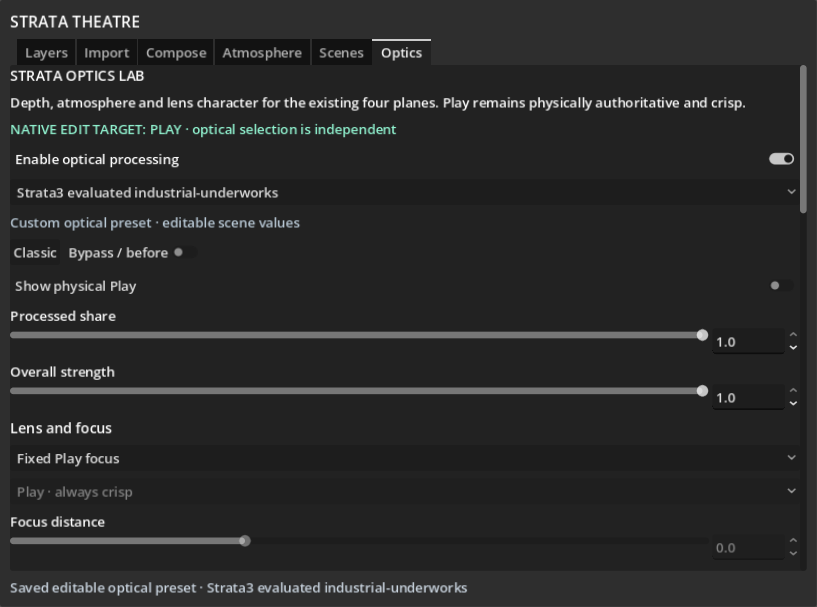
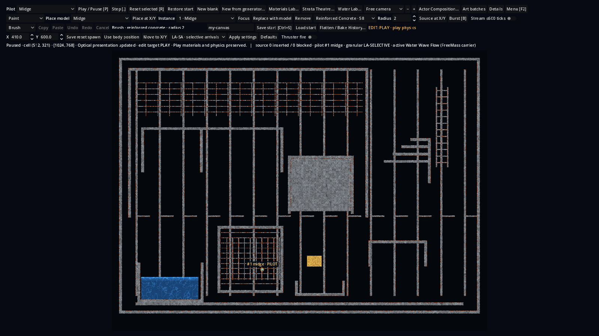
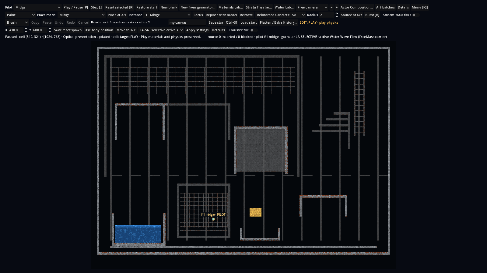
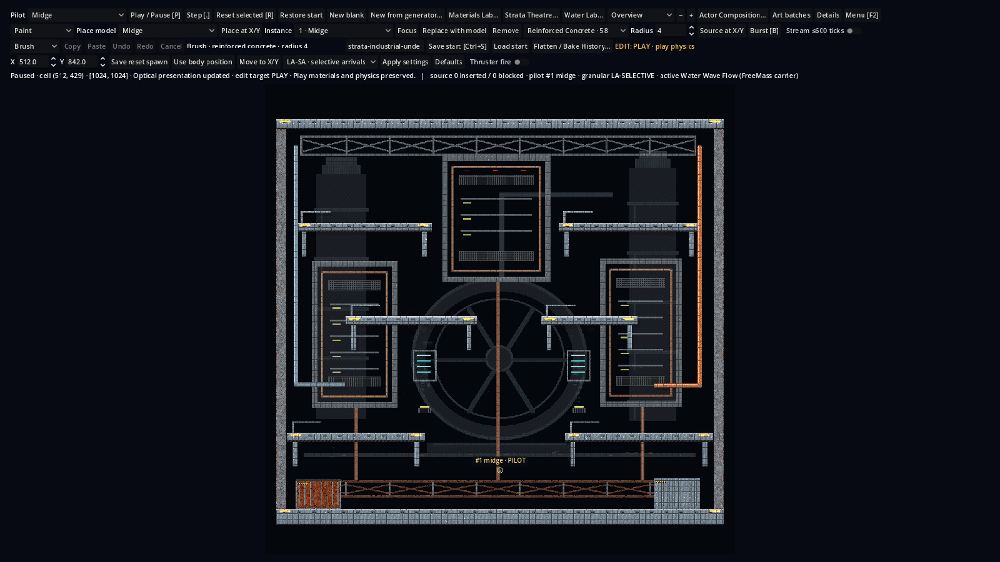
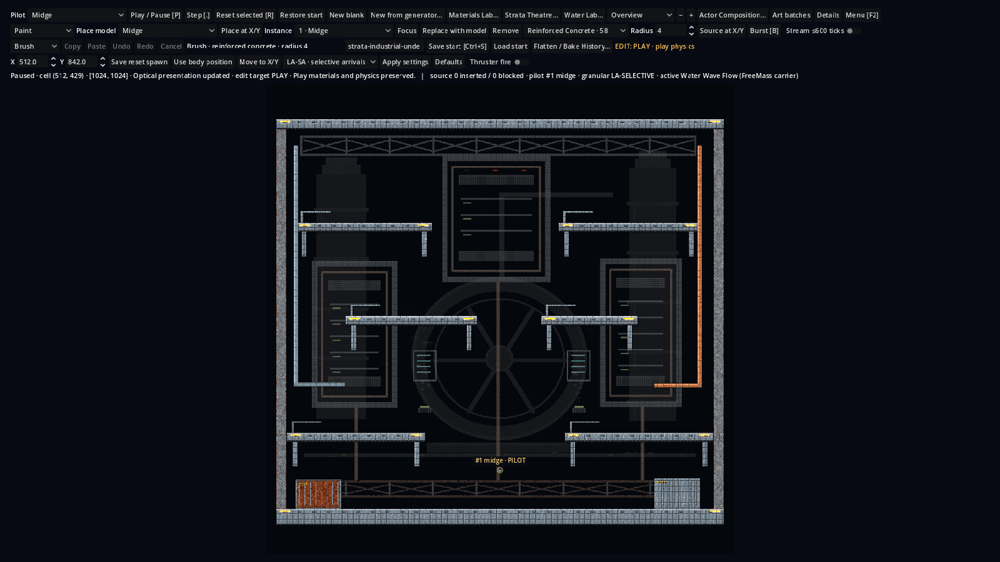
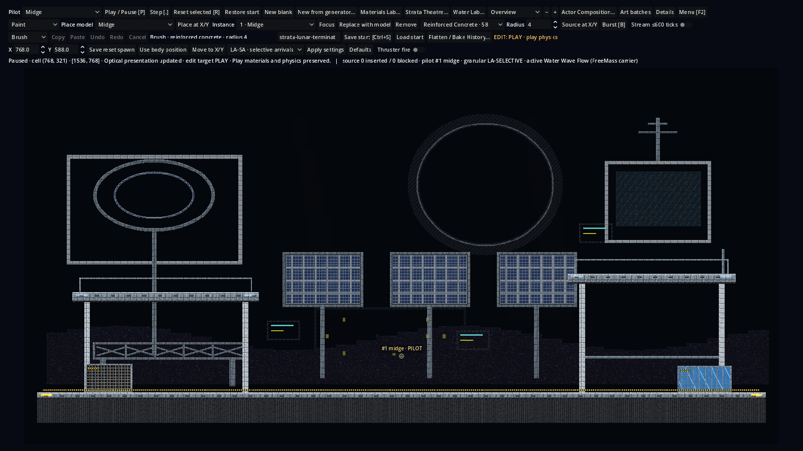
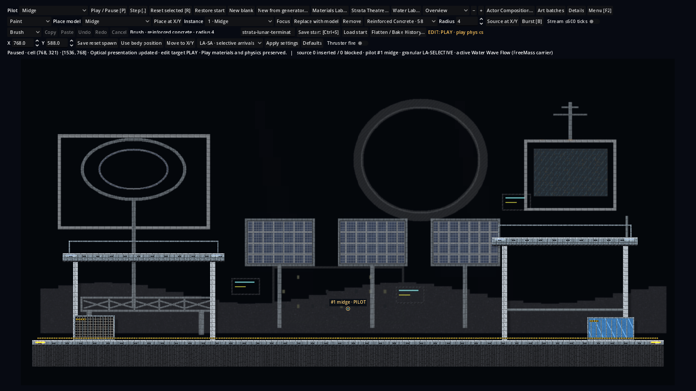

# Strata Theatre 003 — optical architecture and owner decision packet

**Working disposition, 26 November 2026: integrated optical research Workbench;
functional and native evidence available; enabled-optics PERFORMANCE HOLD;
portable Windows qualification in progress; Draft/HOLD.** This packet will gain
the exact evaluator identity only after its actual pristine-extraction checks
finish. It does not announce an available qualified package prematurely.

The application is frozen at `fd0830abcfadd9ae19162e5677943bb131223e59`, source
tree `fd4dc12d6bfd3e13d6b4d26eede8a1171ca1b499`. [Draft PR #785](https://github.com/techrote/cybersand/pull/785)
is stacked on the unmerged Strata 002 archive, preserving qualified application
`934cc0c0eef70dad528155e9a92eebe25e2757eb` and archive
`410ac8e5e613b1454928699dbc9a68cd035f0894`. Later evidence and external observer
commits are distinct from the application that executed. No main merge, Ready
promotion, public release or automatic optical activation has occurred.

## Selected architecture

The system uses Strata's four authoritative authored plane identities directly.
It does not estimate a depth map from a flattened image. The physical Play World
retains its existing native owner, material renderer, actor control, collision,
camera and picking. Each of the three existing decorative material surfaces can
receive one lazily allocated ShaderMaterial. The optical renderer samples those
already rendered RGBA textures, with no additional World, viewport, texture,
native material scan, material upload or simulation turn for an optical change.

Optical distance is an artistic coordinate, independent of simulation position
and geometric editing coordinates. Play is never processed by the new shader.
Changing focus cannot select a paint target or make a decorative platform solid.
Bypass always restores the original material objects. Classic and zero strength
also restore them when temporary Show physical Play is released; that explicit
assistance deliberately overrides authored enablement and strength.
A fresh Classic session has zero optical materials and zero optical uniform
writes; a previously used processed session may retain at most three materials
as a bounded cache until retirement.

The selected modular vocabulary combines tonal hierarchy, saturation and tint,
exponential atmospheric transmission, restrained highlight diffusion,
published-mask architectural shadows, local silhouette/actor separation and
the existing decorative parallax transform. Profiles express different
compositions through that shared implementation. They are not eleven separate
renderers. The [system contract](../../systems/strata-optics.md) specifies
ownership, bounds, configuration and persistence.

Three lens approaches are functional: a dense pixel-aware aperture filter,
silhouette-preserving interior detail suppression and local highlight diffusion.
The aperture samples the nearest material-cell centres with a positive binomial
cross. It interpolates adjacent support weights and caps support at one cell on
Low, three on Balanced and six on High. It removes the earlier sparse filter's
even-radius checker contrast return. The cross remains directional: alternating
one-dimensional rails retain more contrast than a two-dimensional checker. It
is not a Gaussian, calibrated circle of confusion or physically accurate lens.

If a plane has optical depth `d`, settled focus `f`, sharp width `w`, global
defocus `a` and plane response `r`, the selected radius is
`clamp(max(0, abs(d-f)-w/2) * a * r * 3, 0, quality_cap)`.
This formula describes defocus. Independent detail suppression or illumination
can still require a one-cell neighbourhood when defocus is zero; focus is not a
zero-cost switch. Focus can be fixed on Play, set manually, assigned to a separate focal plane or
deliberately follow the authoring plane. Smooth transitions use bounded
exponential interpolation. There is no mouse-driven focus hunting. Temporary
inspection focus is excluded from authored scene settings.

Filtering and interpolation use premultiplied colour and coverage internally.
The final output converts once to the established straight-alpha framebuffer
blend. Classic's wipe side executes the literal old haze expression: an actual
earlier Godot failure showed that an algebraically equivalent blend can differ
by one encoded channel level. That failure, the isolated arithmetic research
and the final exact graphical result all remain in the archive.

The live comparison wipe makes one decorative draw and temporarily uses Classic
parallax, so its divider compares the same geometric alignment. The offline
gallery switches between actual full-profile captures. Those profiles can have
different decorative parallax multipliers even at the same camera; the invariant
is the Play camera mapping and native geometry, not identical rear screen
positions across every full-profile image.

## Interactive facility and persistence

**Strata Optics Lab** is a permanent tab within the existing Strata Workbench
window. It provides master enablement, editable profile choice, focus modes,
focal distance, sharp width, defocus and transition controls, tonal/chromatic
separation, atmosphere, illumination, effect strength and a quality preference.
Per-plane sections expose depth, contrast, saturation, RGB tint, brightness,
defocus response, atmosphere, glow, opacity, parallax and participation. Advanced
effects are disclosed progressively. Play exposes optical depth without
suggesting its physical material surface can be blurred or recoloured.

Bypass, the Classic profile, the processed-share wipe, temporary inspection
focus and **Show physical Play** make comparison accessible. The last option
suppresses competing decoration, including planes excluded from the artistic
profile, without changing Play's material opacity. Existing Stack, Flat, Solo,
native brushes, imports, module composition and Undo/Redo retain their owners.
The original five tab positions are preserved.

The following is an unchanged original Windows capture of the integrated Lab,
after saving an editable named preset. Its [separate interface manifest](selected-captures/interface-manifest.json)
records source, artifact and report identities. The control panel scrolls to
additional focus, atmosphere and per-plane sections.

An explicit optical edit upgrades a scene's `CYSSTRAT` envelope to version 3,
adding a complete validated optics version 1 object. Older v1/v2 documents open
in Classic. The original five environment recipes are byte-identical. Complete
artistic values remain embedded in a scene even when a named preset is later
deleted. Temporary comparison state is not saved as art, and quality belongs to
application preferences. Optical changes do not create fake native Undo entries.

Up to 32 named custom presets hold complete editable configurations. Names are
bounded and control characters are rejected. Writes are staged, flushed,
reread and verified before atomic replacement. A malformed existing catalogue
is reported and preserved. There is no additional standalone preset import
format in this candidate; scene persistence carries the settings. This avoids
another competing project format.

## Artistic outcomes and profile choices

The catalogue has eleven editable profiles. These are artistic starting points;
none is an automatically activated replacement for an old scene's appearance.

| Profile | Useful purpose | Observed or technical limit |
| --- | --- | --- |
| Classic | Exact Strata 002 reference and compatibility fallback | Existing false-platform ambiguity remains. |
| Architectural | Crisp construction inspection with restrained tonal hierarchy | Subtle treatment did not resolve the hardest aligned false routes. |
| Gameplay Clarity | Strongest practical physical-platform and passage distinction in the challenge | Greater rear attenuation; measured enabled-path cost remains unacceptable under the registered hosted gate. |
| Cinematic Deep Focus | Rich machinery, grids and architectural relationships | Bright rear bridges and ladders can remain convincing false affordances. |
| Optical Lens | Manual focal-depth and aperture exploration | Blur does not by itself distinguish collision authority. |
| Diorama | Optional miniature-like depth; especially effective in Lunar stills | Close views soften rear beams strongly; fine cavern texture suffers. |
| Atmospheric Industrial | Warm mineral attenuation and local machinery diffusion | Strong atmosphere can flatten openings; no demonstrated physical scattering. |
| Noir | Strong silhouette hierarchy; second strongest challenge ownership cue | Reduced rear colour is not a colour-vision simulation or universal accessibility proof. |
| Cold Orbital | Cool, restrained instrument/deck environments | Gentle separation still needs sensible composition around critical routes. |
| Alien Bioluminescence | Muted violet cave distance with green/cyan accents | Bright authored material accents must not be mistaken for proven volumetric lighting. |
| Sunlit Megastructure | Warm distant palette and large industrial silhouettes | Its difference from Industrial was modest at the inspected Sunward Overview. |

The three new native showcases are **Sunward Freight Megastructure**,
**Xeno Resonance Grotto** and **Lunar Terminator Observatory**. They use the same
ordinary native authoring/compiler path as the original five environments.
They are usable Workbench compositions, not promotional raster images. A ninth
scene, **Physical Readability Challenge**, supplies deliberate false platforms,
stairs, ladders and filled rear panels, plus real Water, Sand and actors.

[B's source-bound recommendations](b-final-artistic-recommendations.md) cover
all nine scenes and distinguish inspected images from uninspected profiles.
The lead also inspected the original Linux challenge, Underworks, Xeno, Lunar
and Sunward comparisons, and the final Windows challenge Classic/Clarity,
Underworks Deep Focus and integrated Lab originals. Twelve unchanged original PNGs are archived, and six representative images
follow. Their source reports, configuration hashes, geometry, camera and actor
identities are in [the manifest](selected-captures/manifest.json).

### Native challenge: Classic and Gameplay Clarity

The aligned rear extension and filled rear panel become much less dominant.
Their geometry remains present. The treatment improves the cue; it does not
prove an unprimed player will interpret every passage correctly.

### Detailed Underworks: two different priorities

Deep Focus retains fine wheel and chamber construction. Clarity makes the
physical silver platforms more dominant. The lower rear truss can still suggest
a route, particularly in the richer presentation. Diorama's final dense kernel
retains the wheel's rim and six spokes while reducing its fine texture; the
earlier sparse-kernel artistic conclusions were not reused as final evidence.

### Optional lunar lens study

The large empty sky, instrument grids and crisp physical decks make this a
stronger optional miniature composition than the dense mineral texture of Xeno.
This is an artistic still-image judgment, not an ordinary-play performance pass.

## Gameplay readability and independent review

Specialist C inspected all eleven challenge profiles in opaque-name order and
froze scores before revealing the mapping. C knew the native fixture truth, so
the result is an independent specialist-agent assessment, not an unprimed human study.
The recorded platform/passage/detail scores were 5/4/4 for Clarity and 4/3/5 for
Noir. Architectural and Deep Focus retained detail 5 but scored 1/1 on the
deliberately misleading route questions. The disagreement between architectural
beauty and route clarity is preserved rather than averaged away.

Two opaque physical material 58 patches remained exact RGBA across all eleven
captures. In the registered rear-bar patch, encoded-luminance mean was 0.3921 in
Classic, 0.2450 in Clarity and 0.2762 in Noir. Architectural and Deep Focus slightly
raised that dark patch to 0.4039 and 0.3963. Contrast compression can lift dark
pixels; the name of a control cannot guarantee local subordination. These are
supporting encoded-image measurements, not linear-light photometry or proof of
human understanding. [The complete measurement and movement review](c-readability-and-motion-review.md)
specifies regions, sources, scale and limits.

All eleven overview captures relied primarily on the actor label/marker rather
than a resolved body. Forty movement captures across four profiles document a three-actor scene,
actual native/Rapier advancement and exact Play picking inverse errors of 0.0.
Close views resolve actor bodies while they are in frame; the final close camera
excludes two actors by its framing. Clarity reports three reveal rectangles and reduces
nearby rear competition. Those sparse readback frames cannot establish smooth
real-time motion, absence of between-frame flicker or input latency. B separately
reviewed twelve original keyframes and reached the same scale-dependent caution.

The strongest remaining ambiguity is geometric: a rear beam can form a seamless
continuation of a physical platform, and a blurred rear panel can still look
like a closed passage. Future authors should preserve a visible physical edge,
gap or negative-space route instead of relying on a gentle profile to repair
every misleading alignment. Abyss's rear bridge and dark rock masses, and
Vertical's repeated rear floors, remain concrete owner inspection cases.

## Physical progression and performance disposition

The registered full Linux comparison resets identical native challenge geometry
for each of 15 windows, runs three forward/reverse/forward repeats and retains
every completed Rapier step in 90-callback populations. Native publication
observations are separate and can coalesce; a rendered FPS label is not used as
physical progression. Readbacks and native material hashes are outside timing.

| Profile | Median native ticks/s | Rate relative to Classic | Median physical p95 | Result |
| --- | ---: | ---: | ---: | --- |
| Classic | 8.810 | 1.000 | 129.152 ms | Reference |
| Architectural | 7.043 | 0.799 | 156.245 ms | Failed |
| Cinematic Deep Focus | 7.183 | 0.815 | 156.745 ms | Failed |
| Gameplay Clarity | 6.613 | 0.751 | 165.640 ms | Failed |
| Diorama High | 6.647 | 0.754 | 166.191 ms | Failed |

The unchanged minimum rate is 90% of Classic. This run's physical-p95 limit is
154.9824 ms, computed from the larger of 1.20 times Classic p95 or Classic p95 plus
10 ms. All four enabled profiles fail both criteria. The repeat spread does not
erase the throughput result: even the fastest enabled sample is below 90% of
the slowest Classic sample. No extra native capture or texture upload does not
mean a fragment shader is free. [C's independent recomputation](c-performance-review-linux.md)
and [the complete compact summaries](profile-observations-linux.json) retain the
underlying populations, tails, whole-process CPU/RSS and every admission result.

The final Windows full-source cohort, on ANGLE/Microsoft Basic Render Driver,
retains the same failure disposition:

| Profile | Median native ticks/s | Rate relative to Classic | Median physical p95 | Median physical p99 |
| --- | ---: | ---: | ---: | ---: |
| Classic | 2.973 | 1.000 | 335.615 ms | 925.127 ms |
| Architectural | 2.501 | 0.841 | 397.219 ms | 1,116.363 ms |
| Cinematic Deep Focus | 2.469 | 0.830 | 405.805 ms | 1,129.581 ms |
| Gameplay Clarity | 2.258 | 0.759 | 439.741 ms | 1,254.142 ms |
| Diorama High | 2.250 | 0.757 | 438.785 ms | 1,247.809 ms |

Every enabled native/Rapier rate misses 90%. Architectural alone meets the
Windows p95 limit of 402.738 ms. Even its fastest repeat remains below 90% of
the slowest Classic repeat. All nine initial scene admissions exceed 45 s,
ranging from 46.620 to 52.362 s; fresh-process reopens range from 5.871 to 8.934 s.
These are the final source campaign's values, not the later extracted package's
results. The [Windows summary](profile-observations-windows.json) and
[independent raw-timestamp review](renderer-campaign-06-windows-review-a.md)
retain all repeats and exact identities. Its 821.594-second progression process consumed
2,833.046875 observed CPU seconds and reached sampled process-tree RSS of
1,107,976,192 bytes. That scope includes admission, reloads and readbacks and is
not a per-profile CPU/GPU measurement; shared process pages may be counted twice.

The separate six-process hosted Linux Industrial Underworks comparison of original 934cc0c0
against candidate Classic passed exact world RGBA, native/camera/actor matching
and its progression criteria. That disabled-path success must not be substituted
for the enabled challenge results above. Different scenes and observation
populations are explicitly separate.

Both five-minute v2 sessions retained native authority, visible controls and
bounded node/resource counts. Linux completed 1,816 physical steps in 300.824 s;
Windows completed 937 in 302.668 s. After the first profile cycle, node and resource
count ranges were both 0. The actor ascended initially and then contacted the
ceiling; these are continued native play/control sessions, not five minutes of
uninterrupted travel or proof of indefinite leak freedom.

The Windows sustained challenge admission was 69.196 s against the unchanged 45 s
target. Its physical p95 was 662.318 ms, and the real visible slider's callback to
next completed draw p95 was 545.874 ms. The authored value callback p95 of 2.498 ms
describes a different stage. The draw receipt is not physical input-to-photon
latency. These evolving-geometry windows do not supply matched stock-profile
cost ratios. [The sustained review](c-sustained-v2-review.md) retains that scope.

All five original extracted Windows Strata 002 misses remain failures:
51.619 s, 66.316 s, 66.200 s, 59.958 s and 54.804 s. Current Linux admission successes do
not replace those Windows observations. Neither hosted llvmpipe nor ANGLE over
Microsoft Basic Render Driver represents the owner's physical Windows 11/NVIDIA
machine.

## Experiments, rejected approaches and limits

The unified [experiment register](experiment-register.json) joins each hypothesis
to implementation hashes, configuration, captures, correctness and performance
evidence, artistic assessment and disposition. Several important negatives
remain visible:

- Sparse expanding aperture rings caused fine checker contrast to return at
  even radii. Dense bounded sampling replaces them, at a real sampling cost.
- Algebraically equivalent final alpha blending failed exact Classic output
  under partial haze/opacity. The literal legacy final blend is retained.
- Detailed gentle profiles can be attractive while failing false-platform and
  passage interpretation. Blur alone does not remove an apparent affordance.
- New eight-band light shafts and four-band pools function in the existing
  bounded atmosphere system, but are too subtle in the inspected overviews to
  establish convincing volumetric lighting. Their CanvasItems receive opacity
  and clarity treatment, not the complete architectural lens/tonal shader.
- Published occupancy masks are presentation approximations. Fractional
  parallax and current masks versus interpolated moving Play snapshots remain
  alignment risks. Actor reveal uses conservative bounds, not exact occlusion.
- The Workbench exposes pan and zoom, but no ordinary camera-rotation control.
  Camera rotation has not been graphically qualified. Actor rotation is a
  separate covered presentation-bounds concern.

An isolated A1 optimisation skips downstream work only when central and filtered
coverage are both exactly zero. Its first native annex was rejected because a
runtime code hash disagreed with a frozen source-expression hash. A direct
resource diagnostic corrected the initial detached-shader inference. V2 adds
per-host identity diagnostics and direct before/after attachment proof for all
three actual materials, retaining all exact pixel and progression gates. The
application remains unchanged after this separately qualified experiment. Its [registration](shader-cost-probe-registration.md)
and [identity correction](c-shader-identity-correction.md) prohibit retroactively
calling the rejected native timing qualified.

V2 has now passed strict independent readers on both actual hosted backends.
Eighteen synthetic image pairs and six native-world image pairs are exact on
each host, with direct attachment witnesses before and after all 15 timed
windows. A1 improved same-profile native rates by 9.15% (Architectural) and
16.42% (Clarity) on Linux, and 13.29% and 21.46% on Windows. Clarity narrowly meets
the registered rate and p95 flags on both hosts. Architectural reaches
**89.682079%** of Classic on Linux and still fails the 90% rate gate; Windows
Architectural reaches 90.752856%. The Windows initial admission is 63.802 s and
still fails 45 s. These sparse-fixture findings justify further source-bound
adoption review, not a performance pass for frozen application `fd0830ab`.
[Linux](optical-a1-v2-linux-review-a.md) and
[Windows](optical-a1-v2-windows-review-a.md) retain every repeat and limitation.
The [independent adoption assessment](optical-a1-adoption-assessment-a.md)
records the missing dense-scene, ordinary-source and rebuilt-package gates.
A1 is deferred; it is not silently substituted into the principal evaluator.

## Owner walkthrough and remaining delivery gate

The final download must be the portable ordinary Workbench with bundled official
Godot, exact native and Rapier dependencies, all nine native scenes, shaders,
profiles, original-capture gallery, documentation, manifest and
**Open Workbench.cmd**. The package job first runs the full optical/native campaign from a pristine
extracted folder with spaces, and then exercises the actual shipped command on
that unchanged payload. A separate supplemental annex will use a second fresh
extraction and run the shipped command before any editor import, cache creation
or qualification process, closing the cold-first-launch scope explicitly. Until
the original package and these receipts exist, this packet deliberately supplies
no final download identity.

Use the corrected [owner walkthrough](../../operations/strata-optics-evaluation.md)
and [navigation addendum](OWNER-GUIDE-ADDENDUM.md) alongside the immutable package
guide. Begin with Underworks in Classic. Inspect **Layers → Play → Solo**, then
**uncheck Solo** and return to Stack. Open **Optics**, compare Gameplay Clarity
and Deep Focus, try bypass and Show physical Play, and then explore the lens.
Manual optical distance and selected focal-plane mode are distinct choices.
The Lab scrolls normally at desktop size; lower sections are not missing.

Saving a named preset and saving a native scene are separate actions. Enter a
distinct map name before **Save start**. On a fresh launch enter the same name
before Load. Temporary bypass, wipe, clarity assistance and inspection focus
should not return as authored art. A preset selection or evaluation session
does not promote the draft or activate optics automatically for old scenes.

Owner feedback should separately identify platform/passage interpretation,
actor-body visibility, retained detail, preferred palette and optical strength,
focus behavior, atmosphere, camera/picking, scene admission and actual physical
responsiveness. Record scene, profile, quality, zoom, actors, edits, paused/live
state, exact package/source, GPU/driver and desktop scaling. A matched Classic
and processed capture plus an ordinary movement recording is more useful than
an overall beauty score. Preserve settings that fail so the problem can be
reproduced.

**Engineering acceptance is incomplete while enabled-optics progression fails.**
The coherent authoring facility and substantial actual graphical/native evidence
are delivered as research progress; they do not justify a blanket
"engineering qualified" statement. Final portable execution, physical owner
performance, artistic preference and unprimed perceptual understanding remain
separate gates. Draft/HOLD remains in force.
