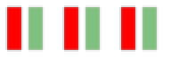

# First hosted optical renderer: independent pixel review

**Result: the isolated shader's 59 checks pass on both hosted backends.** All
six corresponding original PNGs are byte-identical between Linux and Windows.
Specialists A and B independently inspected the captures and obtained the same
pixel measurements. This establishes the tested alpha/sampling/Classic contracts,
not integrated Workbench readability, native isolation, or physical NVIDIA
performance.

Source `12b6beedf5db0caba326266b577b6c9c4f7e597d` ran in
[campaign 45711742479](https://github.com/techrote/cybersand/actions/runs/45711742479).
The [machine-readable review](review.json) retains source tree and exact shader,
test, Godot, native, Rapier, process-log, campaign and image hashes. The six PNGs
here are copied without editing or recompression from the Windows artifact;
their Linux counterparts have the same hashes.

## Actual backends

| Platform | Observed backend | Shader result |
| --- | --- | --- |
| Linux | OpenGL 4.5 Core; Mesa 25.2.8; llvmpipe LLVM 20.1.2, 256 bits; Godot compatibility renderer | 59 checks, zero failures |
| Windows | OpenGL ES 3.0 through ANGLE 2.1.1; Microsoft Basic Render Driver; Direct3D11 `vs_5_0 ps_5_0`; Godot compatibility renderer | 59 checks, zero failures |

Both use official Godot `4.7.stable.official.5b4e0cb0f`. Windows fell back to
ANGLE because its hosted driver did not expose the requested desktop OpenGL
version. Linux reported that changing V-Sync was unsupported. These warnings
remain in the original logs. Neither backend is a physical NVIDIA acceptance
environment.

## Rendered evidence

Coordinates below refer to the original 192×64 RGBA8 captures. RGB channels are
stored premultiplied in the transparent target; the numbers are encoded image
values, not linear-light photometry.

| Witness | Observed RGBA8 | Interpretation |
| --- | --- | --- |
| Classic half-green `(40,20)` | `(0,64,0,128)` | Retains historical straight-alpha composition of the premultiplied source. |
| Processed half-green `(40,20)` | `(0,128,0,128)` | Optical path preserves half coverage and pure green without repeating alpha multiplication. |
| Pixel-aperture red rim `(7,20)` | `(32,0,0,32)` | Expanded coverage retains red hue; no dark or bright RGB/alpha mismatch in this witness. |
| Processed opaque red `(16,20)` | `(255,0,0,255)` | Opaque source colour remains exact with all transforms neutral. |
| Empty region `(4,20)` | `(0,0,0,0)` | No unexpected colour or alpha leaks into that region. |
| Diffusion half-green `(40,20)` | `(0,146,0,146)` | The explicitly stylised highlight treatment deliberately increases coverage while retaining hue. |
| Wipe half-green left/right | `(0,128,0,128)` / `(0,64,0,128)` | One shader reproduces the processed and historical composition on opposite sides. |

The runtime checks additionally verified no texture-border wrap, source-alpha
retention under the detail method, return to the original Classic bytes, eleven
positive/negative architectural shadow IDs, transient focus behaviour and
material-object reuse after 30 bypass cycles.

| Original Classic | Processed neutral | Pixel aperture |
| --- | --- | --- |
|  |  |  |

| Detail method | Highlight diffusion | Single-draw wipe |
| --- | --- | --- |
|  |  |  |

## Remaining concrete gaps

The flat rectangle fixture has no interior frequency variation.
`detail-preserving.png` therefore equals `processed-alpha.png` byte for byte:
this is expected and proves alpha retention, but cannot prove useful suppression
of small architectural detail. A checkerboard and bright-impulse extension is
registered for the next actual-renderer run. High-quality diagonal samples and
the maximum allowed radius also need a rendered witness.

The bounded published-actor reveal extension in `692b4edf` follows this source
identity and requires its own graphical run. Native scene geometry, actual
Workbench controls, whole-scene camera mapping, moving actors and physical
progression need the integrated qualification workstream. Those are separate
claims from the isolated result recorded here.
