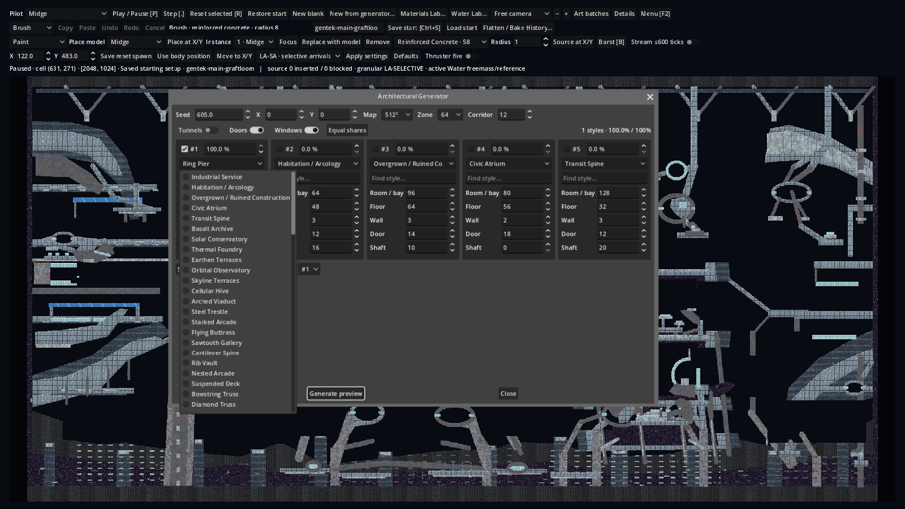
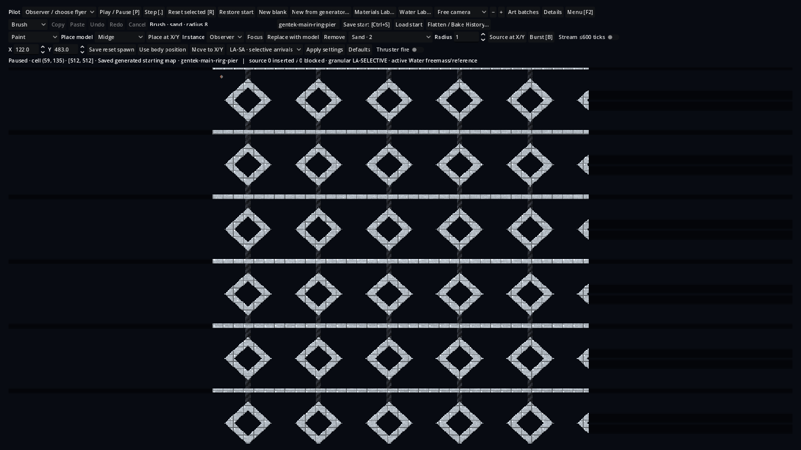
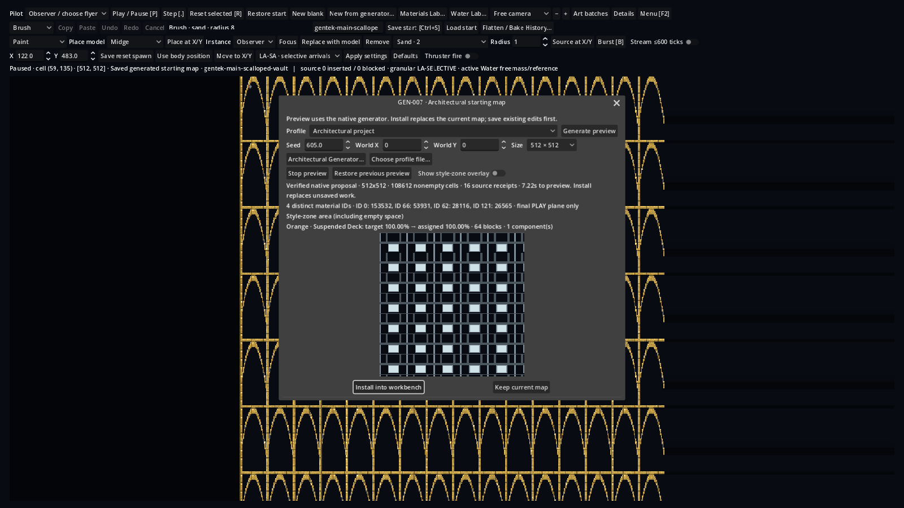
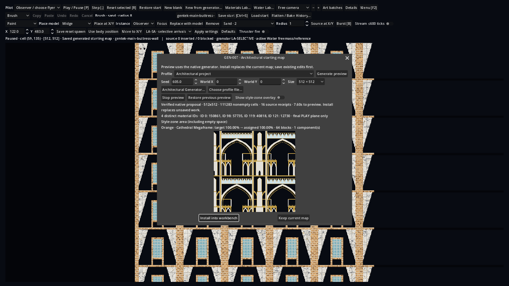
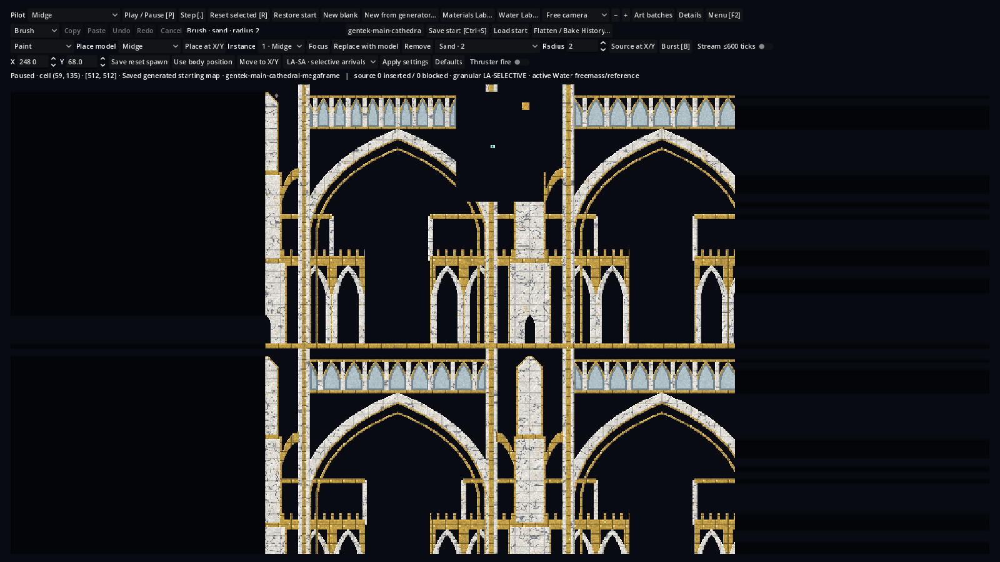
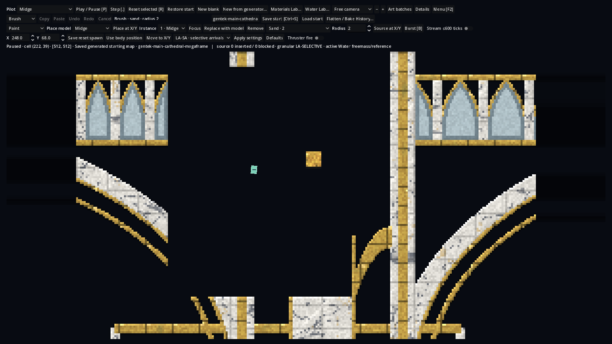
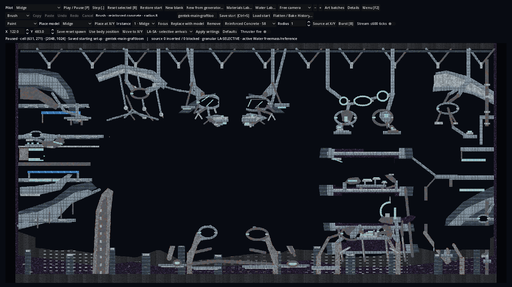

# Current ordinary Workbench screenshots

These are unmodified framebuffer captures from actual Windows Godot 4.7 execution of candidate `87148d66e816f3fd4033e8227a7d310652e2812a`, original run `44770730491`. Their original filenames and SHA-256 identities are recorded in [selected-screenshots.json](selected-screenshots.json). The updated Windows ZIP includes all 35 original captures.

## Expanded catalogue in the ordinary generator

The opened dropdown shows retained presets and Genteks over the admitted Graftloom landscape. Runtime and UI tests verify all 93 unique choices.

## Repaired CLASSIC installed in the native world

Ring Pier after installation and authored Save start.

## Repaired CLASSIC preview and material identities

Suspended Deck's native preview includes its material identity counts and glazing before installation.

## Intact advanced showcase preview

Cathedral Megaframe before the authored actor/material fixture is added, with native material identity counts and preserved glazing.

## Detailed advanced showcase installed

Cathedral Megaframe in the same ordinary Workbench, with its authored Midge and material fixture. The clear area and Sand patch are deliberate authored test edits; the intact generated preview appears above.

## Keyboard-controlled actor alongside generated architecture

Midge and Sand alongside Cathedral glazing and structural cells. The accompanying native receipts verify actual actor movement, advancing native/Rapier ticks, and moving conserved material.

## Large original landscape admitted

Graftloom Slipway R6, 2048×1024 with 13,839 source rectangles, admitted through the accepted Workbench host-claim path.

