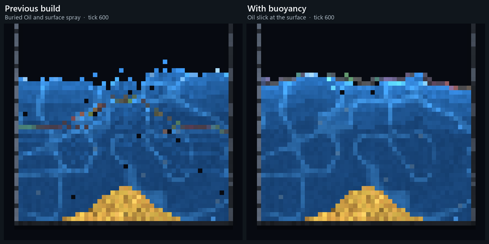
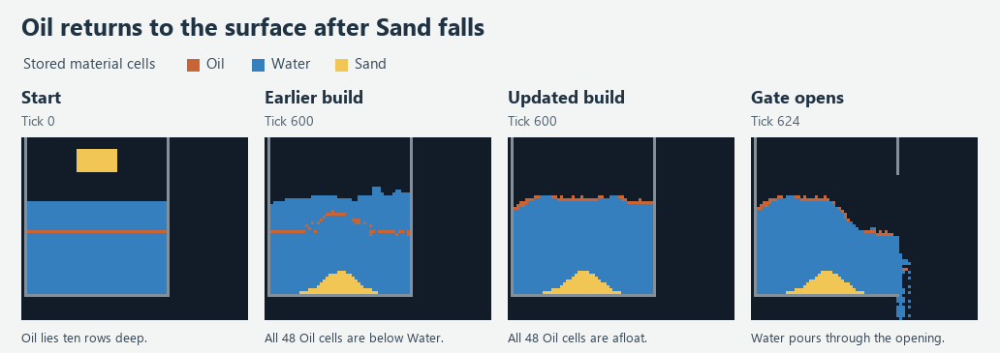

# Oil tank evaluation

The 48-column tank starts 32 cells deep. A single layer of 48 Oil cells replaces Water ten rows below the surface. A 14 × 8 block of Sand falls into it. The tank holds 379,440 Water units and 112 Sand cells. A side gate can open into a lower catch basin without introducing Water. [Implementation, choices and protected-source review](../2026-11-19-wave-oil-buoyancy.md)

Both images use the same camera and the native Windows OpenGL renderer on a TITAN RTX. The earlier Oil strip is visible above the Sand in the left tank. On the right, the colored slick sits on the surface. Both runs kept all 379,440 Water units. The first ANGLE startup attempt timed out. [Oil rising at ticks 0, 10 and 600](workbench-oil-rise.png) · [Frame identities and native readbacks](workbench-captures.json)

The illustration shows native stored cells in inspection colors. Particles in flight are counted separately. The previous build and the candidate used the same six-worker Windows Godot 4.7 gameplay settings. The earlier build left all 48 Oil cells submerged. In the candidate all 48 reached the surface by tick 10, Sand temporarily pushed some of them back under, and all 48 returned. Every stored-plus-flying Water observation remained at 379,440 units. [Windows tank samples and state hashes](windows-tank.json)

| Actual Shared Workbench, same saved start | Previous full-face build | Oil evaluation |
|---|---:|---:|
| Surface Oil at tick 600 | 0 of 48 cells | 48 of 48 cells |
| Columns with surface Oil at tick 600 | 0 of 48 | 41 of 48 |
| Water thrown between ticks 540 and 600 | 13,935 units | 0 units |

Erasing the right wall in the candidate's running Workbench sent **62,382 Water units** into new spray within 30 ticks. This counts cumulative launches and can count a Water unit again after it lands. The Workbench setup translates the native tank by 128 cells horizontally and 192 vertically. Sand grains make location-dependent choices, so use matched positions when comparing builds. [Saved Workbench start](setup-oil-tank.json) · [Extracted-package receipts and hashes](owner-windows.json)

| Native check | Outcome |
|---|---|
| Flat Oil band, no Sand | All 48 cells formed a one-cell-thick slick across the full tank. |
| Falling Sand, original location | All 48 Oil cells floated across 39 columns at tick 600. All 112 Sand grains held the same positions at ticks 540 and 600. Opening the gate threw 53,738 units in 24 ticks. |
| Falling Sand, translated location | All 48 Oil cells floated across 41 columns. No launches occurred between ticks 540 and 3,600. Opening the gate then threw 54,585 units in 24 ticks. |
| Ownership and scheduling | Grid plus in-flight Water closed against an independent cell and parcel count. The 1- and 6-worker native replays matched physical hashes in the original tank. One-unit and 65,535-unit Water retained their quantities through an exchange. |

The two-cell floating support rule settled both tank positions. In a trial that passed the weight of each Oil cell into the head calculation, the Oil covered less of the surface. Retaining unrestricted sideways Oil motion in that trial produced late spray. The selected approximation has no added Oil-weight term. Oil riding waves under wind, a choice of solver for Oil, and per-material Wave tuning remain outside this evaluation.

## Waterwall control

The original 1,024² waterwall replay matched #678 through 1,500 ticks with six workers. Both builds threw **8,549,523 units** in 119,583 parcels, peaked at 3,743 live parcels, reported zero launch refusals and finished with physical hash `1c409b94ab0e0bdd`. The bench used the `selected` profile and original input hashes in the [parent measurement receipt](../wave-water-face-004-2026-11-19/waterwall-measurements.json). The parent and candidate GCC 13.3 benchmark executable hashes were `1dc49fcb3348f513b5fa9504288e5a4f922cfe1dd9fb00f907d798a10f898ee6` and `e15b1ce70afd21d9c7cd9cf8bc942e917d70c13731b2b1fe55017736524c7141`. This replay establishes matching simulation behavior. A separate live Workbench was using the CPU, so it supplies no isolated frame-time comparison.

## Reproduction

From the branch root, run `make CXX=g++-13 wave-spill-test` or run `build/test_wave_spill --filter Oil` after building it. The native test also exercises rigid and floating lids, body masks, a paused endpoint, scheduler phase ordering, cross-chunk temperature transfer, and the movement of Oil in a dry trough. The selected native source is `461b1c1485418bcd8f83f29efe1cccf7ef4a9928`. The branch publication request is `8359ec44e0f129addcf41a54877ed088830960ed`.

For the owner package, the Windows rebuild used the pinned LLVM-MinGW 20260826, Clang 23.1.0, and Godot 4.7. The local build input fingerprint is `d2368b8a1afbb4f511279c5eca83d828dc8afb22ad057aac6a17a63309e140c1`. The DLL SHA-256 is `2d31f8c7d732e1dad1973f2d6bc9dfbc6bed7c8150451269dfab601b886940e6`. The extracted playtest's launcher opens the Shared Workbench. Load **oil-tank**, press **P**, wait for the Sand to settle and erase part of the thin right wall.

The source-matched Windows Godot 4.7 run passed 1,272 Workbench Wave assertions, 797 spill checks, 77 failure-containment checks and 215 failed-World checks. All four test logs and the import log had zero `ERROR:` lines. The packaged Workbench launcher passed, all 952 packaged file hashes matched, and the previous and candidate captures used the same map bytes. Independent review of the final fixes found no outstanding conservation, temperature, scheduling or pressure-boundary issue.

Under WSL Ubuntu 24.04 with GCC 13.3.0, the 42-case spill suite passed in normal, ASan/UBSan and TSan builds. TSan ran with `TSAN_OPTIONS=halt_on_error=1 setarch x86_64 -R ./build/test_wave_spill_tsan`. All three suite outputs had SHA-256 `59a41f2afbcd84e4146d7769c5aab34f2c061d9481355df2a5f9d9e4a6314571`. The original Wave suite passed 33/33. The first broad run in an isolated native source copy lacked the catalogue fixture under `docs/reference`. With the branch fixture directories available, `make -j2 CXX=g++-13 test` passed its prerequisites and all 192 cases. Material catalogue compatibility, documentation, M11 historical integrity and provider policy also passed. All ten focused Wave retrieval questions found a canonical answer in the top five, as did 30/32 general questions.

The [hosted publisher](https://github.com/techrote/cybersand/actions/runs/44632041754) passed all nine jobs and appended the two runtime libraries and their manifests in `91227271ed72c8e7e8fd799a0a3991b6f36d0f6f`. The Windows and Linux manifests agreed on 95 native and 872 other build inputs. All 967 hashes matched the canonical Git blobs at the requested source. All 27 downloaded execution logs were free of Godot errors. The materialized published DLL and shared library matched the validated artifacts. [Hosted runtime hashes and checks](published-runtimes.json)
