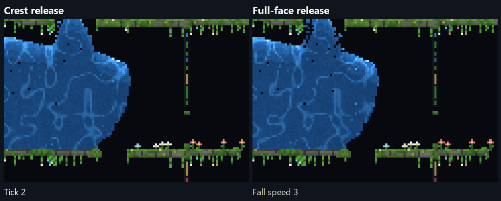
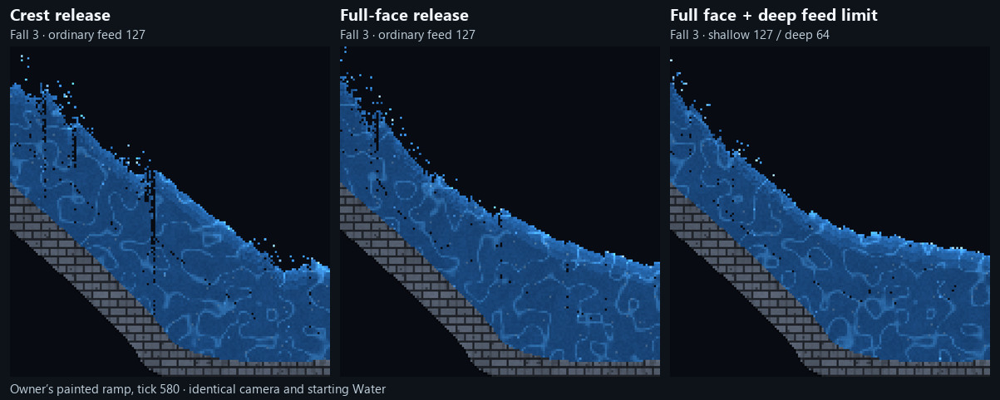

# Full-face Water evaluation

The [main experiment record](../2026-11-19-wave-water-face-004.md) describes the fixtures, native diagnosis, independent review and settings.

## How the wall looks and drains

The wall, bank and Water were loaded from the owner's saved generated map in an ordinary Workbench session. Both graphical comparisons use fall speed 3, two rounds, deep pool feed 64, shallow feed 127, launch budget 128 and six workers. The only difference within the pair is the Full face checkbox.

At tick 12, all release sites on the map had thrown 53,044 units in crest mode and 65,592 in full-face mode. At tick 45 the totals were 218,887 and 250,795. At tick 90 they were 478,680 and 481,759. The capture covers the circled reservoir and opposite shelf. These cumulative totals cover the entire map. Every captured frame closed at 3,052,350 units. [Native readbacks and submitted frame hashes](wall-workbench.json)

| Six-worker measurement | Previous build, fall 8 | Crest only, fall 3 / deep 64 | Full face, fall 3 / deep 64 |
|---|---:|---:|---:|
| Half of original Water leaves the reservoir | 188 ticks | 248 ticks | 255 ticks |
| Peak net export from reservoir, units/tick | 5,080 | 4,025 | 5,258 |
| Cumulative Water thrown across whole map through tick 1,500 | 8.57 million | 9.39 million | 8.55 million |
| Peak live parcels out of 4,096 | 3,416 | 3,414 | 3,743 |
| Launch refusals / deferrals / full-pool skips | 61 / 0 / 0 | 20 / 0 / 0 | 0 / 6,031 / 0 |
| Mean dry rows across 24-row stream window, ticks 60–300 | 0.01 | 0.00 | 0.00 |

At the requested fall speed, the selected profile increased the peak burst from the wall by 31% and half-emptied seven ticks later than the matched crest-only control. The wall covers more vertical rows with spray, especially early in the run. At the previous fall speed of 8, Water cleared the reservoir sooner. The full-face budget deferred launches without filling the pool. The selected wall traces from one and six workers matched byte for byte on all 1,501 samples. Both replays ended at hash `1c409b94ab0e0bdd` after 1,500 ticks. The fall-8 reference reproduced `bd09ffeebb9cf982` from the earlier ramp audit. [Per-tick traces](waterwall-traces.csv) and [reproduction arguments and results](waterwall-measurements.json)

## What changed on the painted ramp

The center and right captures use the same final Windows DLL and all the same settings except Deep pool feed. The left capture uses the earlier crest release with fall speed 3. At ticks 576, 580 and 584 the ordinary Workbench readback held 9,773,895 units in every capture. The submitted frame hashes are stored with their views and capture settings. [Workbench observations](ramp-workbench.json)

Across 31,781 measured column samples on the final full-face law, adding the 64-unit deep limit reduced narrow depleted slots eight or more rows long from 20 to zero, and reduced the longest from 20 rows to four. The earlier crest-only comparison reached 25 rows. These are stored Water observations. Ballistic spray is counted separately in the transport ledger. The flat front reached 64 cells at tick 64, the broad tank wave returned in 138 ticks, and the run-up on the 1:2 grade reached 18 cells. The painted ramp took 416 ticks to deliver 128 cells' worth of Water to the far bank, four ticks longer than full face alone. [Crest motion, signed transport and underlying measurements](sharkfins.md)

## Windows owner package

`CyberSand-Water-Face-Windows-eb8298d68928.zip` contains Godot 4.7 stable, a locally built Windows x86_64 DLL, both supplied maps, the VC runtime and licenses. The packaged `Open Workbench.cmd` reached the ordinary Shared Workbench twice. The first run installed two missing map files. The second preserved two preexisting files of the same names. The extracted package passed 797 spill checks and the graphical case passed 217 assertions with six frame captures on NVIDIA TITAN RTX / ANGLE D3D11. All 951 payload digests matched after execution. [Local package SHA-256, source identities and run receipts](owner-local.json)

## Native tick cost

We ran each 6-worker comparison twice on the owner's Ryzen 5 5600X in WSL2 Ubuntu 24.04. Each scene used the same binary, region, initial state and two Wave rounds. We ran one simulation at a time and reversed the order on the second run. The Workbench and concurrent local native and sanitizer tests were finished or suspended during the timings. The counters report native tick time and exclude graphical rendering and Rapier.

| Canvas | Previous median | Full face / deep 64 median | Previous p95 | Full face / deep 64 p95 |
|---|---:|---:|---:|---:|
| Generated wall, 1,500 ticks | 9.07–9.47 ms | 8.33–8.47 ms | 10.65–11.43 ms | 9.71–9.98 ms |
| Painted ramp, 900 ticks | 3.14–3.22 ms | 3.03–3.10 ms | 6.09–6.23 ms | 5.52–5.61 ms |

The wall and ramp measured slightly faster with the selected profile in both orders. One selected wall run reached 17.16 ms and one selected ramp run reached 18.39 ms on their slowest ticks. These two maps and timings do not establish a frame-rate guarantee. [All eight runs, including hashes and arguments](waterwall-measurements.json)

## Local regression results

The full local aggregate also passed all 192 cases and prerequisites with `timeout 1800 make -j2 test` from the published source archive.

An immutable archive of native implementation `8717ffc04` was tested with Ubuntu 24.04 GCC 13.3.0 under WSL2 kernel 6.18.58.1. The normal, AddressSanitizer plus UndefinedBehaviorSanitizer, and ThreadSanitizer spill executables each passed 37/37 cases. The three test-output files had identical SHA-256 `c67e2ba5c35413497064d0cb4677d862391c86c8025077b78a15c5fa9f5c4cc7`. TSan ran under `setarch "$(uname -m)" -R`. An earlier scratch sanitizer build mixed a pre-change World object file and a newer test header while the optional deep setting was being developed. Rebuilding all binaries from the same immutable archive resolved that failure.

The local Godot 4.7 build passed 1,272 Workbench Wave assertions, 797 spill checks, failure containment (77 checks), failed-World status (215 checks) and the Wave fixture. The curated Web demo setup and its 600-tick Rapier case also passed under Windows Godot. Browser/WebAssembly execution is unqualified. The package tool confirmed the local build input fingerprint against source `eb8298d689288bd3598540f03e4b258d4957c799` and the local GDExtension SHA-256 in the receipt.

The chosen painted-ramp profile also ended at the same hash `a41aa802bd0b8e0d` with one and six workers after tick 900. Documentation validation, M11 historical integrity (18 records / 28 hashes) and CI provider policy passed. The focused retrieval set found its canonical answer for all 9 questions. The general set found 30/32 at top five, matching the parent.

## Published runtimes

[Publication request 22](https://github.com/techrote/cybersand/actions/runs/44618569058) passed all nine jobs. The bot published the Linux and Windows libraries and their two provenance records at `155966b5406322e9ac8c3ce1e2a0611ddf783585`, directly after `eb8298d689288bd3598540f03e4b258d4957c799`. Both downloaded runtime manifests agreed on all 95 native and 867 build inputs. Independent SHA-256 checks matched the corresponding 962 Git blobs. The published DLL and shared library matched their local LFS files, and the strict materialized repository check passed.

Across the two platforms, all 27 downloaded execution logs had zero `ERROR:` lines. Each platform passed 1,272 Workbench Wave assertions, 797 spill checks, 77 containment checks and 215 failed-World checks. Linux also exercised two graphical cases and the Windows CI ZIP passed five extracted-package cases. [Runtime hashes and verification counts](published-runtimes.json) · [Draft/HOLD PR and final-head checks](https://github.com/techrote/cybersand/pull/678)
