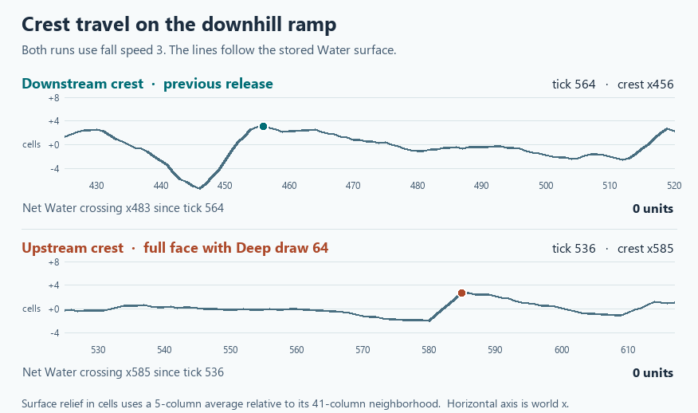

# Which way did the sharkfins travel?

The Water in the marked part of the ramp was flowing downhill. Some steep crests also moved downhill, although their steep face pointed back up the ramp. Other crests really did travel uphill while the water beneath them continued downhill. The simulation retains horizontal momentum and restores surface differences in both directions.

The brick outline places the five orange marks around world columns 440, 483, 554, 706 and 822. In a replay with the previous gameplay settings and fall speed 3, the closest sampled surface to the screenshot was at tick 580. Across ticks 564–596, respectively 117,024, 126,512, 68,271, 102,257 and 92,898 net Water units passed to the right of those columns. The original still gives no exact tick or individual parcel trajectories. In the replay, the dark edge moved through multiple world columns and the adjacent surface rose into a crest.

| Tracking window | Crest x at four-tick intervals | Independently measured net transport |
|---|---|---|
| Previous release, ticks 564–584 | 456 → 463 → 473 → 479 → 487 → 495 | 86,640 units right through x483 |
| Previous release, ticks 696–720 | 476 → 468 → 460 → 452 → 444 → 436 → 428 | 84,373 units right through x476 |
| Full face and Deep draw 64, ticks 536–556 | 585 → 578 → 569 → 561 → 554 → 546 | 45,102 units right through x585 |



## Why the edge looked dark

The tall dark cuts were present in the native mass grid. At tick 580 of the matching run, both faces of the column at x485 carried water outward. At y362 the left face carried about 127 units left and the right face about 125 right in one round. The cell ended with four units out of its usual 255. Several rows in the same column showed this behavior. The visible surface rose abruptly on one side of the depleted column. These neighboring cells and their surface disturbances move, including between chunk boundaries.

Deep draw limits the extra feed across a wet-to-wet face when either adjoining wet stack has five or more responding rows. A deep stack's responding rows share its depth class. The cap leaves the normal Coast allowance, the ordinary head-driven flow term, exposed-face discharge and shallow-front feed available. It works with either release mode. Zero restores the previous rule. Applying a 64-unit cap to every wet face also smoothed the cuts but slowed the initial flat-ground front.

| Six workers, fall 3 | Previous release | Full face | Full face + Deep draw 64 | Full face + ordinary Draw 64 |
|---|---:|---:|---:|---:|
| Observations with a submerged slot at least eight rows tall | 67 | 20 | **0** | 0 |
| Longest submerged slot in the sampled window, rows | 25 | 20 | **4** | 4 |
| Observations with at least 12 rows between the dense floor-attached and upper stored surfaces | 252 | 64 | **0** | 0 |
| Short-scale surface curvature RMS, cells | 1.65 | 1.87 | **1.10** | 1.10 |
| Flat-ground front at tick 64, cells | 61 | 64 | **64** | 39 |
| Dropped-block front at tick 64, cells | 57 | 58 | **60** | 37 |
| Ticks for 128 cells' worth to reach the far ramp basin | 472 | 412 | **416** | 512 |
| Deep tank, first full return, ticks | 138 | 138 | **138** | 138 |

The counts cover 521 columns (x380–900) sampled every four ticks from tick 480 through 720, or 31,781 column observations per tuning. One slot persisting across several samples can contribute several observations. A submerged slot requires a continuous vertical run holding at most 32/255 units per cell, with at least 192 units within three columns on both sides at every row. The separate surface-gap probe starts at the local solid bed, rises through contiguous cells holding at least 64 units, and compares that height with the highest stored cell above the bed holding at least 64 units. Curvature is the RMS second horizontal difference of that upper surface. Parcels are excluded from all three shape observations.

The transport probe independently counts all stored and airborne units on the right side of each section. Its change is signed net crossing. At each sample the scanned grid and all live parcels must account for the complete 9,773,895-unit initial inventory. Crest tracking smooths the upper stored surface with a five-column average and removes the local 41-column mean incline. Peaks were followed in position and checked against the neighboring shape across samples. Screenshot registration used the painted brick contour at approximately 1.669 pixels/cell. The fall-3 tick-580 replay's mean absolute surface difference was 1.59 cells over x140–951, with each column's error capped at 20. Fall 8's nearest replay sample differed by 3.64 cells. Registration error, the unknown original tick and isolated surface spray limit pixel-level comparisons.

## Reproduction

The signed tracks and per-profile instrument results include the compiler, simulation inputs, binary and raw trace digests. The numeric trace is optional bench output sampled outside tick timing. [Machine-readable measurements](sharkfin-evidence.json)

```sh
make build/wave_waterwall
python3 -c 'import json, sys; [print(*e) for e in json.load(open(sys.argv[1]))["edits"]]' setup-water-ramp.json > stamps.txt
build/wave_waterwall ramp stamps=stamps.txt workers=6 substeps=2 gain=32 deep_gain=32 \
  floor_gain=1024 flux_smoothing=16 coast=32 empty_pour_shift=2 draw_head=255 spill=1 ballistic=1 \
  sheet_rate=64 draw=127 launch_budget=128 coyote_ticks=4 level_shift=3 damp_shift=16 calm_damp_shift=8 \
  calm=128 stick=128 sleep_after=90 fall=3 full_face=1 deep_draw=64 ticks=820 every=4 fin_every=4 fin_trace=trace.csv
```

Use `full_face=0 deep_draw=0` for the previous release and `full_face=1 deep_draw=0` for the full-face control. The global cap variant also sets `draw=64`. To inspect the original dark cut, replay the previous release through tick 580 with `dump=480,340,10,56 dumpflux=1`. To reproduce the flat and dropped-front checks, substitute `flat_surge` or `drop_surge` and sample tick 64. The deep tank uses `tank tank_depth=22 tank_step=10 tank_shape=1` at two-tick intervals.
