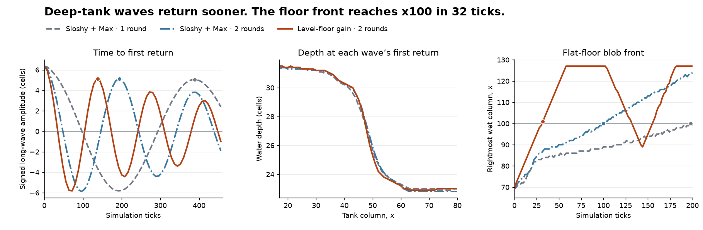

# Returning wave shape and spreading speed

The selected floor gain took the dropped blob past x100 in **32 ticks**. The
previous Sloshy + Max bundle took 198 ticks, or 100 when given the same two
rounds. On a deep pool, a complete wave returned in **138 ticks**, down from
388 or 194. At that return the broad slope was **13% steeper** than the original
Sloshy, while the crest-to-trough depth increased only **1%**, from 8.47 to
8.55 cells. The speed and steepness changes are much larger than the depth change.



| Settings | First return, standard / deep / full band (ticks) | Broad range, standard / deep (cells) | Broad slope, standard / deep (cells per cell) | Flat blob x at t40 / 80 / 160 | First x100 (tick) |
|---|---:|---:|---:|---:|---:|
| Sloshy + Max, one round (#676) | 534 / 388 / 356 | 4.826 / 8.468 | .277 / .516 | 85 / 87 / 95 | 198 |
| Sloshy + Max, two rounds | 268 / 194 / 178 | 4.850 / 8.553 | .283 / .533 | 88 / 96 / 115 | 100 |
| **Level-floor gain, draw head 255, two rounds** | **190 / 138 / 126** | **4.848 / 8.550** | **.310 / .583** | **109 / 127 / 106** | **32** |
| Level-floor gain, draw head 512, two rounds | 190 / 138 / 126 | 4.873 / 8.520 | .309 / .581 | 109 / 127 / 106 | 32 |
| Rejected high general gain, two rounds | 154 / 112 / 102 | 5.267 / 8.896 | .332 / .606 | 98 / 123 / 127 | 44 |

The two-round Sloshy control isolates the benefit of changing the settings
after doubling the rounds. With floor gain, the deep tank cycled 29% sooner.
The returning slope increased 9.4% and its broad depth range differed by
0.003 cells. For the 30-cell full-band pool, floor gain returned a 5.330-cell
range and .355 slope, against 5.320 and .309 for original Sloshy, or 5.359 and
.320 for two-round Sloshy. The moving front hit the fixture boundary at x127
on tick 58, retreated to x89 at tick 144, and reached x127 again at tick 182.
Its x160 value records the second advance.

## Settings and trade-offs

Use Wave, spill, ballistic release, catch falling, and the previous Sloshy +
Max settings. Set **floor gain 1024, deep gain 32, coast 32, draw head 255,
empty pour shift 2 and two rounds**. Ordinary gain stays 32 and flux smoothing
stays 16. Draw head 512 produced the same blob first arrival and wave return
times. The authored ramp and uphill trials determined the choice of 255.
See the [ramp evaluation](../2026-11-19-wave-water-ramp-003.md).

The selected deep tank retained a signed long-wave amplitude of 3.88 cells at
its second full return, versus 3.79 with original Sloshy and 3.84 with
two-round Sloshy. Small ripples were slightly stronger. Second-difference RMS
averaged .083 cells between the first and second returns, versus .058 for
original Sloshy, .060 for two-round Sloshy and .174 for ordinary Wave with Max.
The depth profile in the figure shows the bulk of the wave spans tens of columns.

**High general gain was rejected on the actual ramp.** Gain 256, deep gain 48,
smoothing 12, coast 127 and empty pour shift 1 made a deeper tank wave, but
also formed a 469-row column of grid Water on the supplied map. The tank and
flat blob alone missed that failure. Additional high-gain trials kept the
reasons for rejection measurable. With deep gain 96 and smoothing 16,
curvature peaked at 90 cells on the 22+10 tank and fewer than 1,151 of 1,728
starting cell equivalents remained in the tank's grid at one sample. The world
still conserved all Water. At gain 256 and deep gain 48, lowering smoothing
from 12 to 4 raised average curvature from .134 to .224 cells in the one-round
deep tank. The rejected settings, hashes and traces remain in the results.

## Measurement and reproduction

Each 64-column tank began with a fixed block on the left. The standard, deep
and full-band fixtures started with right-hand depths of 11, 22 and 30 cells
and steps of 6, 10 and 6 cells. The first return is the first positive
fundamental-mode peak following a reversal. Broad range is the difference
between the highest and lowest sliding eight-column mean. Broad slope is the
largest difference between adjacent eight-column means divided by eight. The
flat-floor fixture drops a 12×6-cell blob with its initial right edge at x69.
A front column must contain at least 32 units of landed grid Water.

The shipping apparatus used the three-layer floor law from native commit
`1604b66b19705d79d2704e5119a25823caee0973` plus its ramp bench on WSL2 Ubuntu
24.04, kernel `6.18.58.1-microsoft-standard-WSL2`, g++ 13.3.0,
`-O3 -DNDEBUG -pthread`. Its executable SHA-256 was
`2aeb6fe886553625aa13d1733d1ee30ded38fb1f7c0af38f33b231ab6d85383c`.
The experiment ran nine settings, each with three 1,600-tick tanks and a
200-tick blob, six workers, and a 180-second timeout per invocation. Every
two-tick sample closed the grid-plus-flight ledger exactly. The exploratory
three-layer executable (`e58b95ac54f39b1d936254aadf4098bc3fbc722594d4e7b96897adc9ba60df40`)
matched all 36 final state hashes and both CSV files byte for byte.
Wall-clock performance was measured separately on the supplied map.

```sh
make wave-waterwall
python3 tools/wave_mt/ramp_tank.py build/wave_waterwall /tmp/ramp-tank-results
python3 tools/wave_mt/plot_ramp_tank.py /tmp/ramp-tank-results  # Matplotlib
```

The [settings, summaries and hashes](tank-results.json) retain each setting's
two-tick blob front. The [wave trajectories](tank-traces.csv) retain every
eighth tick. The [column profiles](tank-profiles.csv) show 64 actual probe
depths at the initial step, first reversal and first two returns. Probes round
each column to 0.1 cell. Range, slope and curvature use full-precision quantities.
