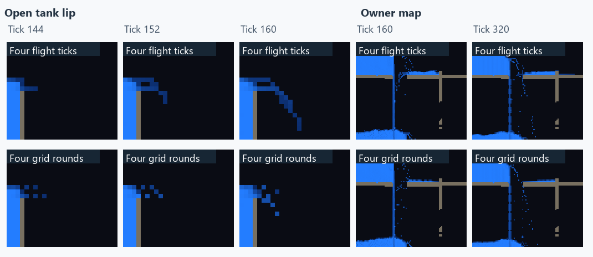

# Grid and parcel crest travel, 19 November 2026

**Keep the parcel version.** In the open tank, the four-round grid lip reached
four cells out three ticks earlier, then fragmented into separate Water cells.
The four-tick parcel grace carried 3.35 times as much Water through the same
high probe over the run. On the owner map the two versions had nearly identical
tick costs, and the parcel version kept more spray and emptied the reservoir
slightly sooner.



## Results

The open tank used Sloshy and Max over-ledge together. The map used Max
over-ledge with ordinary Wave tuning. Occupancy in the high probe sums grid and
parcel mass in x85..116 and y32..43, four or more cells beyond the x81 wall and
above its top. The sum over ticks weights both the amount and duration of the lip.

| Open tank, 560 ticks | Parcel, 4 ticks | Grid, 4 rounds |
|---|---:|---:|
| First arrival in high probe | t146 | t143 |
| Peak mass in high probe, units | 597 | 223 |
| Total mass in probe over time, unit-ticks | 90,259 | 26,978 |
| Parcels launched / units thrown | 553 / 44,537 | 237 / 27,315 |
| Full tick median / p95, ms | 0.488 / 0.573 | 0.529 / 0.672 |

| Supplied 1024² map | Parcel | Grid |
|---|---:|---:|
| Reservoir half-empty, tick | 369 | 375 |
| Peak net outward units per tick, through t900 | 3,374 | 2,777 |
| Reservoir grid mass at t900, cell equivalents | 902.3 | 935.9 |
| Parcels launched / units thrown by t1500 | 92,079 / 6,265,581 | 26,712 / 3,247,140 |
| Peak live parcels / launch refusals / deferrals | 2,324 / 170 / 22 | 728 / 104 / 0 |
| Full tick median / p95, ms | 3.856 / 4.649 | 3.836 / 4.680 |
| Reported Wave storage, bytes | 15,413,760 | 18,690,560 |

Both candidates ran sequentially in the same pilot binary, with six workers and
one round per tick. Each timed map ran for 1,500 ticks, each timed tank for 560.
The local sanitizer was paused during these four runs. The 0.020 ms difference
in map median is within the scale of single-run variation. Per-tick probes and
native captures ran separately from the timed runs.

## Grid rule and checks

The pilot adds a signed remaining-round count per cell and a transfer marker per
face. A qualifying exposed crest spends its usual face share on an Empty
horizontal neighbour. For each of the next four rounds that cell keeps its height
during vertical settling, then offers its mass to the next Empty cell in the
same direction. A blocked advance, head-on arrival, or expiry returns the Water
to normal settling. Only one horizontal face may spend a travelling donor, and
each incoming share is capped at half nominal receiver capacity. The solid and
paused-face checks run before a transfer. Deeper rows keep the existing
ballistic release. The pilot walks one grid cell per round, with discrete
positions and a discrete expiry. The parcel candidate retains its launch
velocity and continuous fixed-point position.

Grid runs on one and six workers produced identical every-tick traces and end
state hashes on both fixtures. The map hash at t900 was `b9d186b5c043084f` and
the tank hash at t560 was `25a738b8be04170d`. Every sampled total equalled the
initial grid-plus-flight mass. A translated tank placed its lip at x125. In the
unblocked control, 90.7 full-cell equivalents of grid Water reached x128 and
beyond by t350. With a one-cell wall at x128 or a paused core beginning there,
that region stayed dry throughout. These checks cover this prototype's
scenarios. The shipped candidate receives the broader native and Godot gates.

## Reproduction

Apply the [scratch patch](grid-crest.patch) to a disposable checkout of
`d4df71fc6bc1bf6267270a4c1445207a02716317`. The patch uses zero context.
It adds apparatus controls only in this scratch build. The checked-in Workbench
uses the parcel implementation. The binary and complete output-file hashes are
in the [comparison receipt](grid-crest-results.json).

```sh
git apply --check --unidiff-zero /path/to/grid-crest.patch
git apply --unidiff-zero /path/to/grid-crest.patch
make wave-waterwall
# All four timed runs use this bundle
bundle='spill=1 ballistic=1 sheet_rate=64 draw=127 draw_head=65535 fall=8 launch_budget=128 catch=1'
slosh='gain=32 deep_gain=16 flux_smoothing=16 damp_shift=16 coast=64 level_shift=3 calm_damp_shift=8 calm=128 stick=128 sleep_after=90'
for crest in coyote_ticks=4 grid_rounds=4; do
  timeout 240 build/wave_waterwall map terrain=terrain-1024.bin stamps=stamps.txt workers=6 ticks=1500 every=300 probe0=440,540,192,102 $bundle $crest
  timeout 240 build/wave_waterwall tank_open size=128 workers=6 ticks=560 every=560 $bundle $slosh $crest
done
# Repeat the map at ticks=900 and the tank at ticks=560, workers=1 and 6,
# with hydrograph=trace.csv and the relevant source_box and stream_box.
# Map: 440,540,192,102 and 627,644,24,24. Tank: 85,32,32,12 and 82,32,32,12.
```
