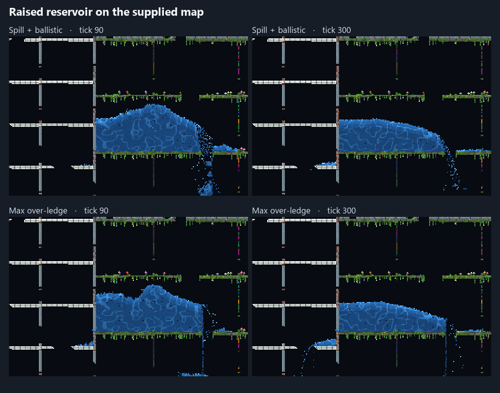
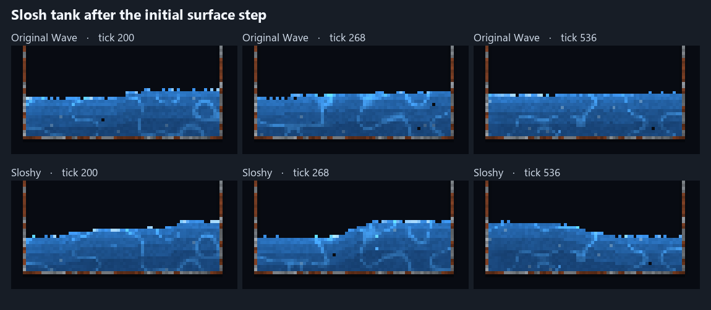
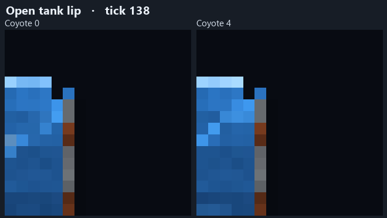
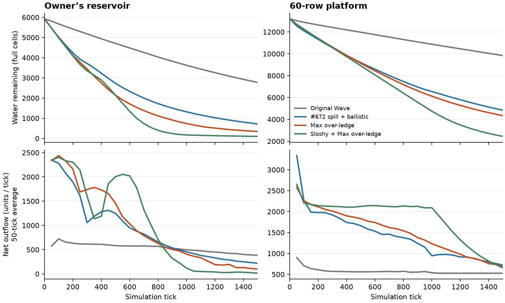

# Waterwall 002 final evaluation

The [main experiment record](../2026-11-19-wave-waterwall-002.md) defines the probes, settings, source lineage and independent review.
Native behavior is frozen at `d4df71fc6bc1bf6267270a4c1445207a02716317` and the Workbench at `bde0a504355167ebf066f9230a8b36b09f4ca9cd`.
The Sloshy tank and blob results in the main record are measured on this native source.

## Windows evaluation

The owner-local ZIP is `CyberSand-Waterwall-002-Windows-bde0a5043551.zip`, 92,637,548 bytes,
SHA-256 `df135e35679edcff48819a2f1630d5c142e1a57cc00c6d98030c903c258c27f6`.
It contains Godot 4.7 stable, the pinned LLVM-MinGW 20260826 / Clang 23.1.0 build of the native DLL
(`5e6f245dc286c7aea92f38aa19da36e4887b09711fe108861ffdf4d8a2c64a56`), the map, VC runtime and notices.
The installed Workbench code and settings match the native and Workbench settings in publication requests 17 and 18. The request also includes
a later presentation-only correction to the manual screenshot driver.

All 950 packaged file hashes matched after extraction and after execution. Two launcher runs used
an isolated profile. The first installed the exact supplied map and the second preserved a different existing
setup of the same name. The extracted Workbench passed 669 spill checks. Opening the supplied map regenerated its
exact GEN-007 terrain and reported 3,052,350 Water units at both t0 and t1 with Max over-ledge applied.
[Machine-readable receipt](owner-local-receipt.json).

The Windows evaluation DLL was built with `C:/Users/_/lcb-local-toolchain/rebuild_and_test.sh` against the reviewed source and
godot-cpp `101ae38034304346a46ea9ea84ae156d3e860496`. Source input fingerprint
`feec23a90521d9070425f356272687b88ce72d8ef6c6748e885388880ba89675`.
Automated Windows Godot 4.7 headless Workbench Wave passed 1,265 assertions / 35 native ticks, spill passed 669,
failure containment passed 77, and failed-World status passed 215. The first graphical test of the updated settings
missed a real pointer event. The driver now waits for a stable enabled hover, then requires the pressed signal.
Two fresh runs passed 217 assertions / six captures each with no ERROR lines, using ANGLE on NVIDIA TITAN RTX.

## Native and documentation checks

The two protected file transitions plus the Apply follow-up are recorded in the main audit.
Source-first commits precede the compatibility entries. Dated historical M11 validation passed
18 records / 28 hashes. The default retrieval evaluation found a top-five canonical answer for 30/32 questions, matching the #672 parent (19 first-ranked, MRR 0.7292 on both).
The focused Wave evaluation found 6/6, with the new Water Lab question ranked first.

## Workbench captures

The map passed ordinary GEN-007 verify-and-install. Each comparison used Water Lab Apply, native readback, six workers
and exact single ticks. Screenshots show the submitted Workbench viewport with the paint preview hidden. All 40 saved
frames matched their receipt hashes. Each recorded map sample held 3,052,350 units and each tank sample held 228,480 units.
The graphical test separately exercises real pointer input and the Apply lifecycle.

The [frame strip](lip-flight.png) shows ticks 144, 148, 152 and 160 after the wave reached the open wall.
At t152 the four-tick crest is still above the lip and farther over it. The [capture receipts](workbench-captures.json)
retain quantities, modes, generation identity, frame hashes and native readback.

Run the Windows Godot 4.7 console with
`--path <scratch> --rendering-method gl_compatibility --rendering-driver opengl3_angle --script res://tests/workbench_waterwall_capture.gd -- <fixture> <output> <mode> <ticks> 6 <view...>`.
Use the supplied JSON with `hybrid` and `max`, ticks 0,90,300 and views
`414,510,270,180` / `600,609,90,60`. For `tank` use `orig` and `sloshy`, ticks
0,130,200,268,536 and view `12,26,75,36`. For `lip` use `combined-nograce` and `combined`,
ticks 138,140,142,144,146,148,152,160,190 and view `76,38,16,16`.

## Final-source flow and timing

**Recommended for the owner's map: Sloshy plus Max over-ledge, at one round.** This pairing
sustained drainage later in the run, kept most of the thrown spray, and kept the longest break
in the 24-row grid sheet to one row during the sampling window. Max alone crossed half-empty earlier;
the combined setting finished with considerably less Water still in the probe at tick 900.

| Scene and controls | First 300, net units/tick | Peak units/tick | Half-empty tick | Grid cells at 900 | Thrown units | Peak live | Median / p95 ms |
|---|---:|---:|---:|---:|---:|---:|---:|
| Owner map, Original Wave | 636 | 1,070 | 1378 | 3,824 | 0 | 0 | 2.52 / 3.27 |
| Owner map, #672 hybrid | 1,878 | 3,942 | 453 | 1,497 | 8,749,479 | 3,510 | 3.47 / 4.38 |
| Owner map, Max over-ledge | 2,115 | 3,374 | 369 | 902 | 6,265,581 | 2,324 | 3.60 / 4.28 |
| Owner map, Max feed without sheet or grace | 2,013 | 3,236 | 391 | 1,052 | 8,072,313 | 3,028 | 3.63 / 4.47 |
| Owner map, Sloshy + Max | 2,189 | 3,118 | 388 | 236 | 8,155,835 | 2,714 | 3.78 / 4.60 |
| Owner map, Max at two rounds | 3,452 | 5,200 | 195 | 294 | 6,091,157 | 2,263 | 6.83 / 8.38 |
| Tall platform, Original Wave | 668 | 2,808 | >1,500 | 11,088 | 0 | 0 | 1.29 / 1.61 |
| Tall platform, #672 hybrid | 2,244 | 7,608 | 986 | 6,942 | 3,337,966 | 3,636 | 1.15 / 1.48 |
| Tall platform, Max over-ledge | 2,197 | 7,608 | 905 | 6,623 | 664,513 | 488 | 1.13 / 1.32 |
| Tall platform, Max feed without sheet or grace | 2,777 | 7,608 | 797 | 6,071 | 3,336,342 | 3,580 | 1.17 / 1.40 |
| Tall platform, Sloshy + Max | 2,238 | 7,608 | 777 | 5,569 | 1,036,414 | 764 | 1.19 / 1.43 |
| Tall platform, Max at two rounds | 3,919 | 9,357 | 467 | 3,756 | 561,692 | 456 | 1.95 / 2.21 |

The combined map median increased 9.0% (0.31 ms) over the #672 hybrid. The final Max-only
median increased 3.8%. In the first quiet pass Max measured 5.6% faster than its hybrid control;
that reversal limits any claim of a small speedup. Two rounds provided a faster initial pour
at nearly twice the hybrid map median. The combined bundle retained 93% of the hybrid throw.
At the tall ledge the two single-round bundles improved sustained drainage and sheet continuity;
neither exceeded the hybrid's peak flow. At fixed tick rate, net first-300 outflow on the map
increased 16.5% with the combined settings.

The [full comparison](discharge-summary.csv) covers 20 fresh timing processes and 20 independent traces, including
four-tick and zero-tick grace, a matched feed-only baseline, Stream draw 128, and two rounds. It lists
refusals, deferrals, capacity skips and gaps. The [50-tick series](discharge-by-window.csv) contains
net outgoing units, retained units and continuity for the main comparisons. Negative net flux means
Water re-entered the source box. Gap counts include only grid Water and report airborne-only rows separately.

All runs used one AMD Ryzen 5 5600X, WSL2 Ubuntu 24.04, kernel 6.18.58.1-microsoft-standard-WSL2,
g++ 13.3.0, six workers, 1,500 ticks. The final executable SHA-256 was
`2784d7f099e7e78caf3597aa88c50f5a17bc2c4709f9259b0878f44fe11215b1`,
from `d4df71fc6bc1bf6267270a4c1445207a02716317`. Local Godot and package runs had ended.
The local sanitizer process was suspended for the entire sequence and resumed afterwards.
Each fresh process was limited to 600 seconds. Total grid plus in-flight drift was zero at every sampled tick.
The map box was `440,540,192,102` and its stream window `627,644,24,24`; on the 60-row platform
they were `0,0,220,200` and `220,204,24,24`. The supplied recipe and stamps have the identities in the main audit.

## Publication attempts

Request 17's Windows guard stopped before Godot execution when Bash parsed a PowerShell conditional.
The Linux and Windows builds and the ordinary native lane had progressed. The successor uses one command
per line under Bash's existing fail-fast setting. The local evaluation uses the same native source and
the two successful graphical real-pointer runs. [Request 17](https://github.com/techrote/cybersand/actions/runs/44443701277).

## Grid-crest follow-up

A subsequent scratch experiment implemented and timed the alternative grid overhang from the design review.
It conserved Water and gave identical 1- and 6-worker traces. It sent the first Water four cells past the wall
three ticks earlier than the parcel crest but fragmented into separate cells. The parcel version carried
3.35 times as much Water through the high probe over time. On the map, grid versus parcel t900 remainders
were 936 versus 902 cells, with 3.25 versus 6.27 million units thrown by t1500. Median tick costs were
3.84 versus 3.86 ms in one paired run. The executable used for the owner ZIP keeps the parcel version.
The [scratch comparison, patch, frames and commands](grid-comparison.md) make the alternative reproducible.

## Local final sanitizers

Ubuntu WSL2 ran the normal suites, ASan with UBSan and TSan. Makefile sanitizer flags were
`-O1 -g -pthread -fno-omit-frame-pointer` and `-fsanitize=address,undefined` or `-fsanitize=thread`.
The runtime commands used `UBSAN_OPTIONS=halt_on_error=1 ASAN_OPTIONS=halt_on_error=1` or
`TSAN_OPTIONS=halt_on_error=1 setarch x86_64 -R`, with 900 seconds allowed per sanitizer process.
The WSL TSan spill process was suspended during the isolated timing runs. The checks include the
12 unchanged base-law hashes, four pinned spill hashes, two-sided partial donors, overfill, size bounds,
walls, paused cores, capacity, expiry, conversion and worker parity.

| Final binary | Result | SHA-256 |
|---|---|---|
| `test_wave_spill` | 31 tests; 0 failures (31 registered) | `703a1635d9b194bf32d5768cee105c1f8336877fefdf01d5eb1d7bd269e9a1c9` |
| `test_wave_spill_sanitized` | 31 tests; 0 failures (31 registered) | `d5c8bac5bda0ecb3662e8da4201871c9b10c0d5d657655d63282db6b461e9cf7` |
| `test_wave_spill_tsan` | 31 tests; 0 failures (31 registered) | `d1001836516f95eca74bb237450f1dac415e8c5af1519e66bca0b8690348b1f6` |
| `test_wave_flow_sanitized` | 33 tests; 0 failures (33 registered) | `05e025f9e62fa5c0eec23c9a0d6f92fc4c26e2163e4f44b3f8fc40ad92bae8f0` |
| `test_wave_flow_tsan` | 33 tests; 0 failures (33 registered) | `0daa7f8d1655e8e8c18311e26a2a5c6fc80f870f3a455df2ffab4ee37f68fe89` |

## Published-platform evidence for request 18

[GitHub-hosted request 18](https://github.com/techrote/cybersand/actions/runs/44444683852) built native source
`579a842a803eca2c387e80c616cabe01fbac1d3d`. The downloaded Linux and Windows evidence bundles agree
on all 95 native inputs and 857 build inputs. All 952 tracked file digests matched the request's Git tree.
Both platforms passed the real Workbench Wave (1,265 assertions, 12 sections), spill (669 checks, seven
sections), failure containment (77 checks) and failed-World status (215 checks). All downloaded execution
logs contained zero ERROR lines. Linux graphical Workbench passed 217 assertions and six captures.
The separate CI Windows package passed all five extracted-package cases; the owner-local ZIP above
also contains the supplied map.

| Runtime | SHA-256 |
|---|---|
| GitHub-hosted Windows DLL | `ed26088ac9931d86ada7c6acd7d2f122c6328b241513d3ea3f585d98e889ed41` |
| GitHub-hosted Linux shared library | `a2a4cec68a935f197c09e95e689ca5799bacc6f625d20714c201fc364f18f7db` |

The local full `timeout 1600 make -j2 test` passed all 192 aggregate cases and the prerequisite
soliding, world-generation and material-baseline suites. An earlier scratch run omitted the capability
matrix JSON used by the liquid-policy identity test; copying the committed fixture and rerunning the
complete target resolved that apparatus failure.

All nine publisher jobs passed, including the normal, ASan/UBSan and TSan Wave, spill and body-boundary
campaign. The bot published exactly the two LFS runtimes and their two provenance files in
`7851f24eb1838704e4e7791c406ea7ba6dc2ef49`. After fast-forwarding to that commit, the strict
materialized repository check passed. The [Draft/HOLD PR](https://github.com/techrote/cybersand/pull/676)
records the final empty commit and its checks.
