# Interlaced Viaduct — native material gallery

Source commit: `8f39f68ae1bcf81045b007e233b2e6838cca4d24`. Input ledger: `0fd1085e99b764fb21a3b9b963587fbea483252d0b99a57102adca3345792c1a`.

These PNGs map actual native material bytes through the ordinary preview palette.

| Case | Extent | Bay / floor / wall | Seed | Empty | Material SHA-256 |
| --- | --- | --- | --- | --- | --- |
| [Hero — 512 × 512](01-hero-512.png) | 512×512 | 80 / 64 / 3 | 271828 | 56.4% | `1a3ed6b187e66b695f78134b876c6a8aa2ff5b04763e18fa5c1373ac23f8069c` |
| [Hero — 1024 × 512](02-hero-landscape.png) | 1024×512 | 80 / 64 / 3 | 271828 | 57.9% | `64b25b1b520dc3b3b7ca897dec557aa72efc90580cdf6816af997c8d0c64b5dd` |
| [Hero — 1024 × 1024](03-hero-large.png) | 1024×1024 | 80 / 64 / 3 | 271828 | 58.0% | `a2eaf92f18e78cdc73b1428233c552cc011bd8a0d9eb12bd447bf3652942d1b1` |
| [Seed 1](04-seed-1.png) | 512×512 | 80 / 64 / 3 | 1 | 56.5% | `1d9d79346677913ff95e787b2ae37a85dff79d69dc512ce05c9af18ddd77d3c2` |
| [Seed 7](05-seed-7.png) | 512×512 | 80 / 64 / 3 | 7 | 56.5% | `a128f2953eecd43db70e3dba37843d12a56935e25f631b949fbc17da600ceb40` |
| [Seed 19](06-seed-19.png) | 512×512 | 80 / 64 / 3 | 19 | 56.5% | `5e9e38ff923b5e74f4908e29a8b0e84f8f6a3dd16297c6b4cf86fed783b513d3` |
| [Seed 42](07-seed-42.png) | 512×512 | 80 / 64 / 3 | 42 | 56.4% | `919a7954e8cb16d59aa88b41c0a7dfd879cf98e40a84a7f359b9453d66ca740f` |
| [Seed 271828](08-seed-271828.png) | 512×512 | 80 / 64 / 3 | 271828 | 56.4% | `1a3ed6b187e66b695f78134b876c6a8aa2ff5b04763e18fa5c1373ac23f8069c` |
| [Seed 8675309](09-seed-8675309.png) | 512×512 | 80 / 64 / 3 | 8675309 | 56.5% | `dfc47ca3fdd7f6661cb08b7a0ffa9c8b992f21bead1f7f2d2401cbbb9b42575e` |
| [Narrow structural bay](10-narrow-bay.png) | 512×512 | 48 / 64 / 3 | 271828 | 49.1% | `f987d598b13389e6698c6345a2c7014b8d6c8e48bc05ec3bb5bd8ecbc9aa11c0` |
| [Broad structural bay](11-broad-bay.png) | 512×512 | 112 / 64 / 3 | 271828 | 63.4% | `bbbea501a0bb7df8dabb3e5254bc645452cec6cd45cb5f41d98d4a7c77915212` |
| [Short vertical separation](12-short-vertical.png) | 512×512 | 80 / 40 / 3 | 271828 | 47.3% | `12cfe70a511540b3ce11bd342f2343b7059fcbfa720a64a472d82eaa24a36497` |
| [Tall vertical separation](13-tall-vertical.png) | 512×512 | 80 / 96 / 3 | 271828 | 60.8% | `5825423a078e8e626dfcb8652feb64d46374b57221c22e6a4a1dc095095e9468` |
| [Thin structure](14-thin-structure.png) | 512×512 | 80 / 64 / 1 | 271828 | 74.4% | `f0968f2674bf5ee46ffd95b64e61af0613a24ac88d8ac3ec0c431781f60e12de` |
| [Heavy structure](15-heavy-structure.png) | 512×512 | 80 / 64 / 5 | 271828 | 40.5% | `f37f3f545bc31733d828d45b6b0d6a64df53bc1a9a66bade41456fffde4affcd` |
| [Pierhead glazing on](16-windows-on.png) | 512×512 | 80 / 64 / 3 | 271828 | 56.4% | `1a3ed6b187e66b695f78134b876c6a8aa2ff5b04763e18fa5c1373ac23f8069c` |
| [Pierhead glazing off](17-windows-off.png) | 512×512 | 80 / 64 / 3 | 271828 | 56.4% | `46142b6274ae9eaca39f2fe428a302976133bccad4c2f5ba7d8fd1dabc7cbfd7` |
| [Pier portals on](18-doors-on.png) | 512×512 | 80 / 64 / 3 | 271828 | 56.4% | `1a3ed6b187e66b695f78134b876c6a8aa2ff5b04763e18fa5c1373ac23f8069c` |
| [Pier portals off](19-doors-off.png) | 512×512 | 80 / 64 / 3 | 271828 | 56.3% | `a8d24c266663c42a2443a284b671f8599314cd2c4590c37b338be2e9400c39c2` |
| [Signed origin — -517, -263](20-negative-origin.png) | 512×512 | 80 / 64 / 3 | 271828 | 56.4% | `1a3ed6b187e66b695f78134b876c6a8aa2ff5b04763e18fa5c1373ac23f8069c` |
| [Arched Viaduct v2](21-arched-viaduct.png) | 512×512 | 80 / 64 / 3 | 271828 | 58.0% | `4f7a1e5fa21bcba2504e7335634564748fe0eeca33ff04b66afde97b4f84de2e` |
| [Hanging Arcade](22-hanging-arcade.png) | 512×512 | 80 / 64 / 3 | 271828 | 80.6% | `2dc410d092aee3c8f3f06eea2a62114429781a8ad8e18e00c422d616b79f568e` |
| [Suspended Deck](23-suspended-deck.png) | 512×512 | 80 / 64 / 3 | 271828 | 61.3% | `8b72654899c8c08a462258733df4fbab110e0b93195e3d8ccfe2acfeb28655cf` |
| [Diagnostic — primary only](24-primary-only.png) | 512×512 | 80 / 64 / 3 | 271828 | 61.9% | `9ce8458abdb01c82947dac949e7fd2c12088465bf0705500a56a5a2916afc820` |
| [Diagnostic — secondary only](25-secondary-only.png) | 512×512 | 80 / 64 / 3 | 271828 | 92.5% | `18f0790c7f2af4cfb424c788274aed91037629e148dc3048638c79e5f0c61116` |
| [Diagnostic — combined](26-combined.png) | 512×512 | 80 / 64 / 3 | 271828 | 56.4% | `1a3ed6b187e66b695f78134b876c6a8aa2ff5b04763e18fa5c1373ac23f8069c` |

## Hero — 512 × 512

## Hero — 1024 × 512

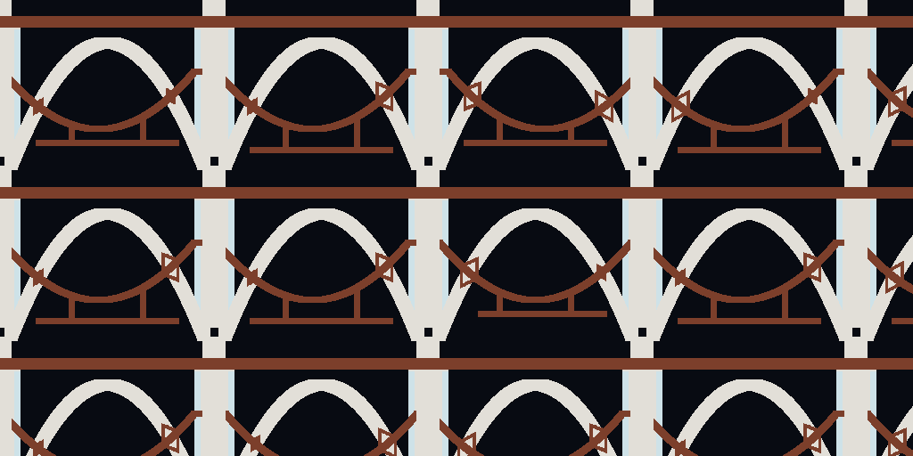

## Hero — 1024 × 1024

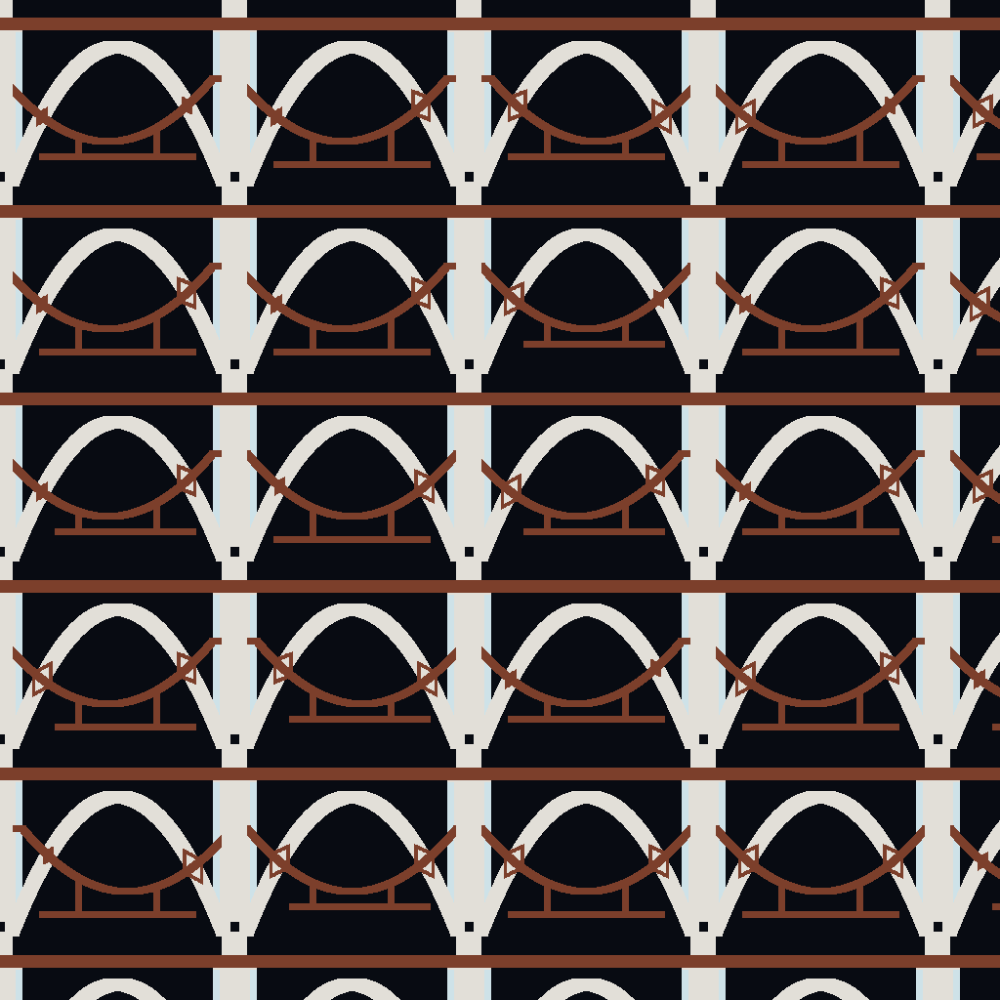

## Seed 1

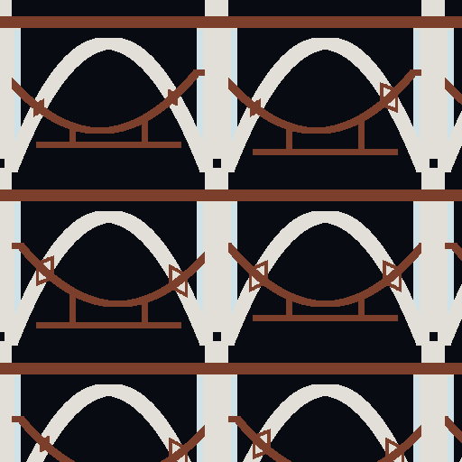

## Seed 7

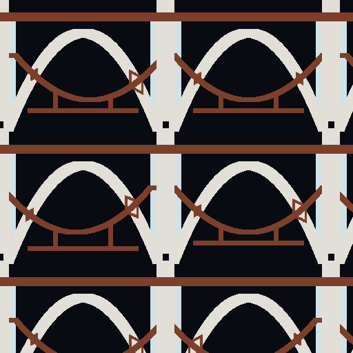

## Seed 19

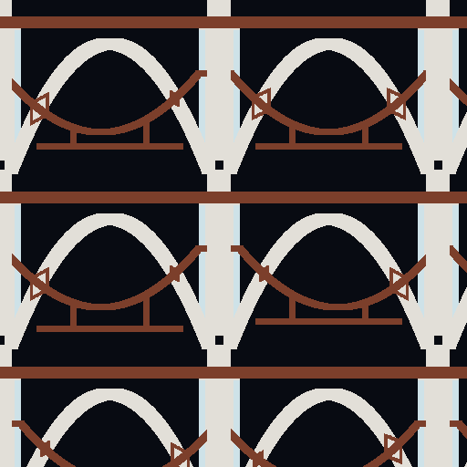

## Seed 42

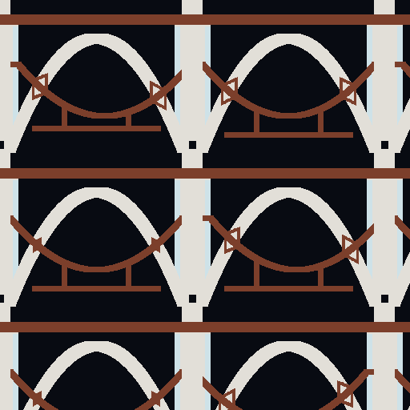

## Seed 271828

## Seed 8675309

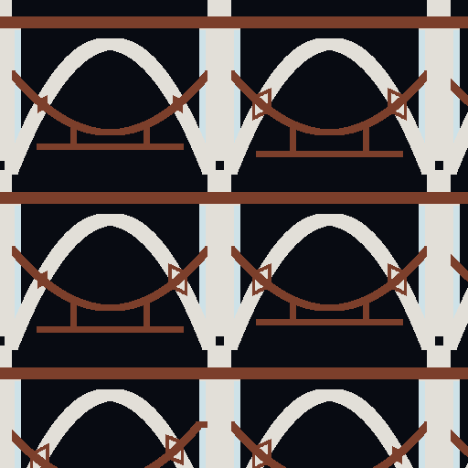

## Narrow structural bay

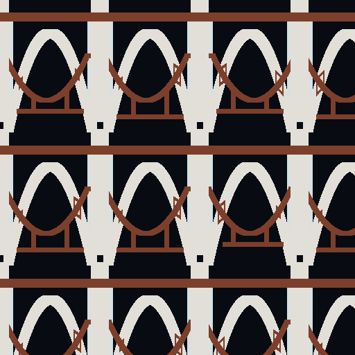

## Broad structural bay

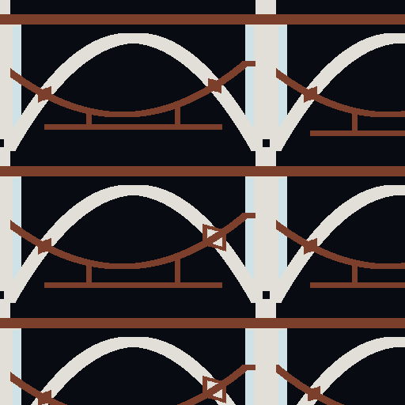

## Short vertical separation

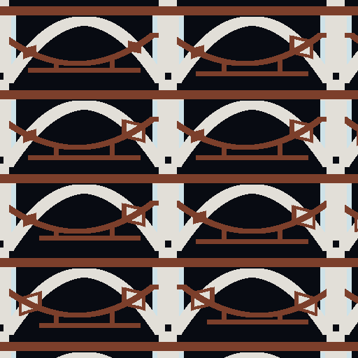

## Tall vertical separation

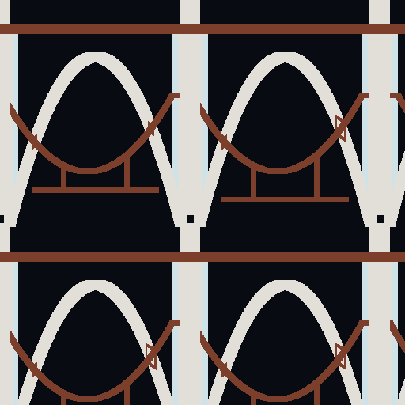

## Thin structure

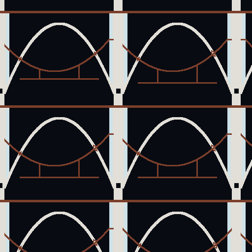

## Heavy structure

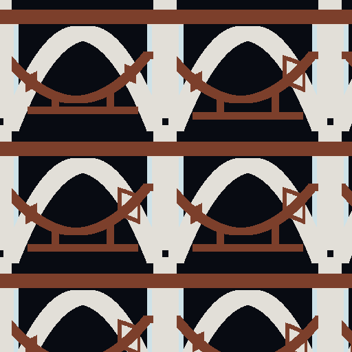

## Pierhead glazing on

## Pierhead glazing off

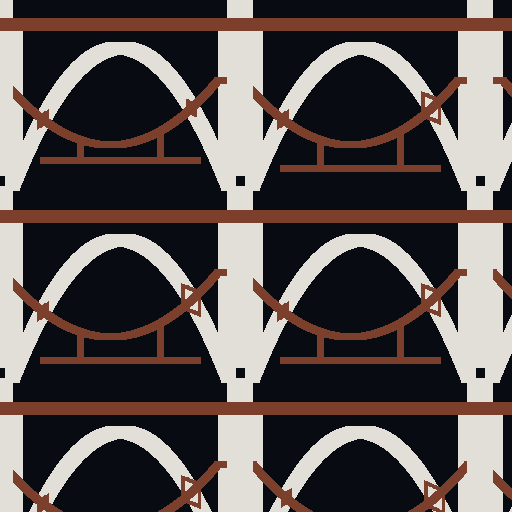

## Pier portals on

## Pier portals off

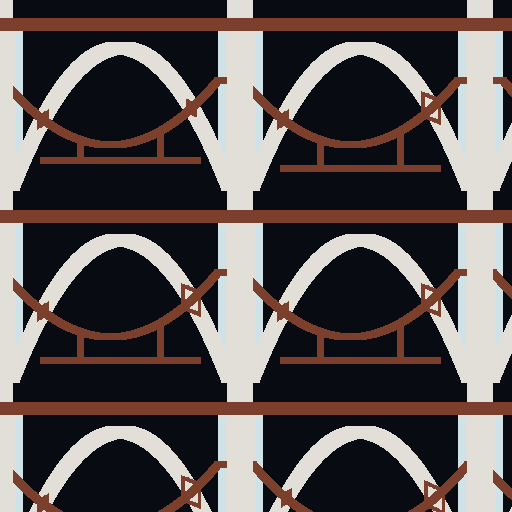

## Signed origin — -517, -263

## Arched Viaduct v2

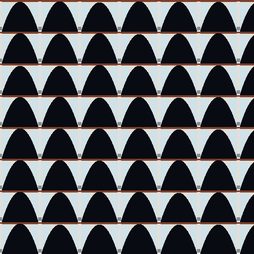

## Hanging Arcade

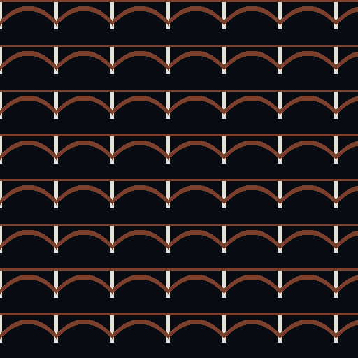

## Suspended Deck

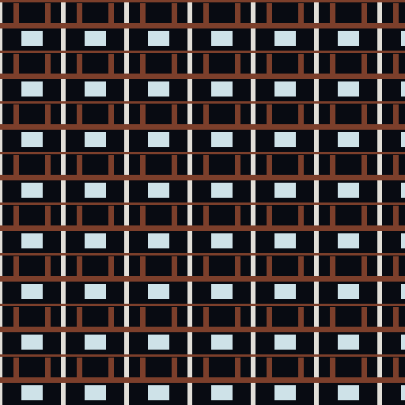

## Diagnostic — primary only

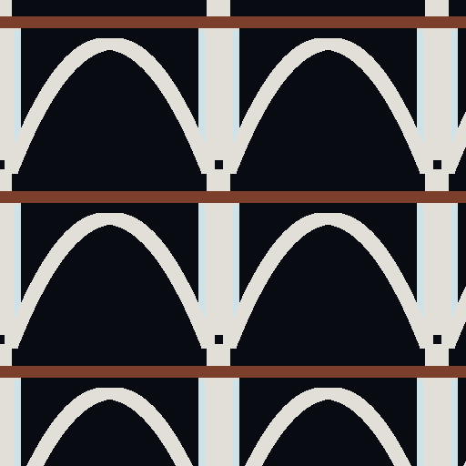

## Diagnostic — secondary only

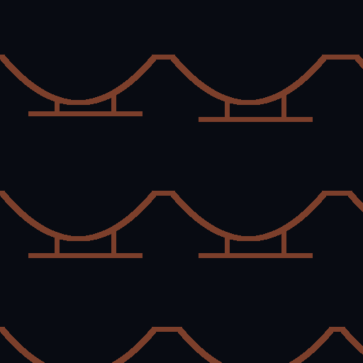

## Diagnostic — combined

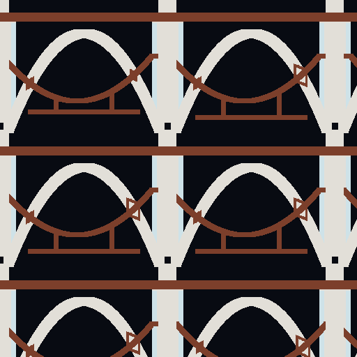

## Qualification and independent review

[Independent review](independent-review.md), [native qualification](qualification.json), [hosted exact-source qualification](ci-summary.json), [ordinary-preset material parity](source-verification.json), and [matched-trial performance](performance-summary.json).

The gallery commit contains evidence only. The exact compiled source is named above and in every source ledger; no build input changes are part of the later evidence commit. Keep this experiment Draft / HOLD.
