# Megatruss Station — native material gallery

Source commit: `279bc4634b1d2b3a47f747c628163e419a728be7`. Input ledger: `8689d760e11dfbe5ec7114b343ff09396c69a5e441dd5eaa4732cc83f90ee6ec`.

These PNGs map actual native material bytes through the ordinary preview palette.

| Case | Extent | Bay / floor / wall | Seed | Empty | Material SHA-256 |
| --- | --- | --- | --- | --- | --- |
| [Hero — 512 × 512](01-hero-512.png) | 512×512 | 64 / 96 / 3 | 271828 | 68.3% | `96f92d7b7325a9b8d13ca2c2d539ac6960d274bad056228e06b1f70b4f4a7171` |
| [Hero — 1024 × 512](02-hero-landscape.png) | 1024×512 | 64 / 96 / 3 | 271828 | 70.0% | `e936cae6b796e46840acf170a102f77f21ce4b13e70634db2156f988bbdd51f1` |
| [Hero — 1024 × 1024](03-hero-large.png) | 1024×1024 | 64 / 96 / 3 | 271828 | 70.6% | `df7548589054218105a8897477c4caaa293d4fec18c93f0bf6c4e3e1f52c0c48` |
| [Seed 1](04-seed-1.png) | 512×512 | 64 / 96 / 3 | 1 | 71.2% | `eb8e7deff6584a807d93fc3342300151cfd680efd1333dbe1104ff0b3ca87324` |
| [Seed 7](05-seed-7.png) | 512×512 | 64 / 96 / 3 | 7 | 72.2% | `0bc5d3c58eb1ce8efc3d6eabe15a47b5f705df07869134b8737b5c137b79b978` |
| [Seed 19](06-seed-19.png) | 512×512 | 64 / 96 / 3 | 19 | 67.9% | `5819a0ed3a4a49e5b2f4147311d06acd495391f20848f463dfcee16587b4d8fc` |
| [Seed 42](07-seed-42.png) | 512×512 | 64 / 96 / 3 | 42 | 69.8% | `ec4f569749c752ada77a0f1d6db39e789906be927a57cbc32096949ae710b1d5` |
| [Seed 271828](08-seed-271828.png) | 512×512 | 64 / 96 / 3 | 271828 | 68.3% | `96f92d7b7325a9b8d13ca2c2d539ac6960d274bad056228e06b1f70b4f4a7171` |
| [Seed 8675309](09-seed-8675309.png) | 512×512 | 64 / 96 / 3 | 8675309 | 70.2% | `bb9713f2b7bb2a8a2c205ca34c994b4ecfe7411811485c9e7007b82bde5a2284` |
| [Compact bays](10-compact-bays.png) | 512×512 | 48 / 96 / 3 | 271828 | 69.3% | `5ec1937771ca735141e9338916c84646dc369590ebbcfbc26a67276c5ea5faa5` |
| [Broad bays](11-broad-bays.png) | 512×512 | 80 / 96 / 3 | 271828 | 70.5% | `c5a932ba9162c6bc01ea0e5b597601284b9e2cb6826f6d6d79a1affd41648db2` |
| [Shallow station](12-shallow-station.png) | 512×512 | 64 / 64 / 3 | 271828 | 61.0% | `bc949873dc95bff4e26fa74e1dc3dc8d92ac72c19f2f0eb915455aaa0351077f` |
| [Tall station](13-tall-station.png) | 512×512 | 64 / 128 / 3 | 271828 | 73.2% | `eee1c2d4bd2c25a0bd98b56731660eb5271767db7b2c959949737a2be0a59804` |
| [Thin members](14-thin-members.png) | 512×512 | 64 / 96 / 1 | 271828 | 81.3% | `7370c60a3b172cabe46ca3b47eed7bf7618755360d203a6a899d0b56a744ba09` |
| [Heavy members](15-heavy-members.png) | 512×512 | 64 / 96 / 5 | 271828 | 56.6% | `6f3f664a0615626438cea3264e1e6b40e5f1f08264f87befb215dd3a8a686c6a` |
| [Glazing on](16-glazing-on.png) | 512×512 | 64 / 96 / 3 | 271828 | 68.3% | `96f92d7b7325a9b8d13ca2c2d539ac6960d274bad056228e06b1f70b4f4a7171` |
| [Glazing off](17-glazing-off.png) | 512×512 | 64 / 96 / 3 | 271828 | 68.3% | `be1c1d7cf80bba1c4759fccaf333c3b5250c784839c0b1daae2c7547dd94b4c3` |
| [Portals off](18-portals-off.png) | 512×512 | 64 / 96 / 3 | 271828 | 68.2% | `64cdd679f5f55a1a7b4e09a43bd0355e5b1149a5c7d3bfbf39d903d0c95d3c7d` |
| [Signed world origin — -512, -256](19-negative-origin.png) | 1024×512 | 64 / 96 / 3 | 271828 | 68.6% | `54f5a15b4bc108e389dcb31c76ee95bcfc8a9ccc502c657b5c164c4d5d65ad4e` |
| [Steel Trestle](20-steel-trestle-comparison.png) | 1024×512 | 64 / 96 / 3 | 271828 | 67.6% | `cd1a3c8500c5a8cf1197ea8f31851f6c5bc6b15d68f7a6be070d16492bb30720` |
| [Space Frame](21-space-frame-comparison.png) | 1024×512 | 64 / 96 / 3 | 271828 | 43.9% | `92fda737c165b116308303b540758dc1f7490bb516ab97088c246a6cb0e66b31` |

## Hero — 512 × 512

## Hero — 1024 × 512

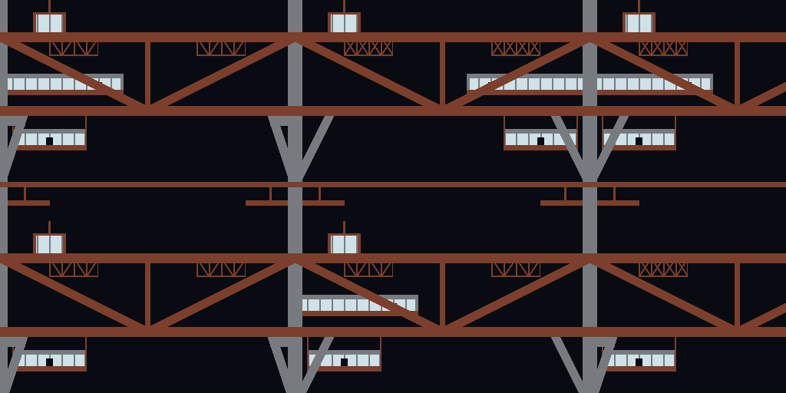

## Hero — 1024 × 1024

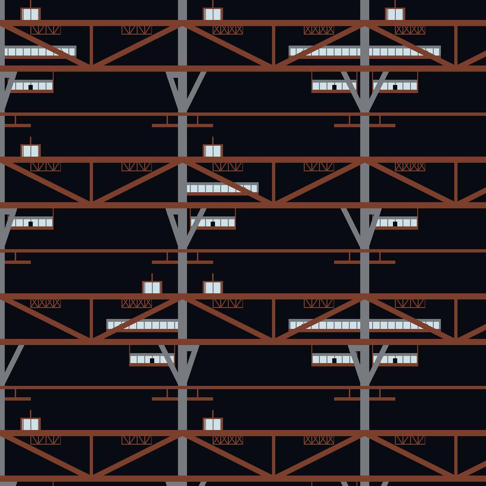

## Seed 1

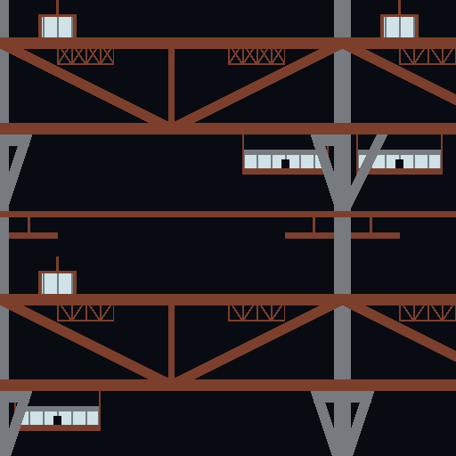

## Seed 7

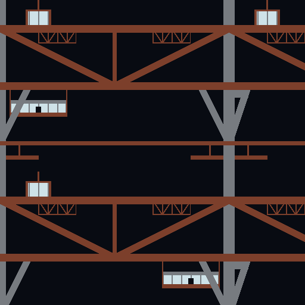

## Seed 19

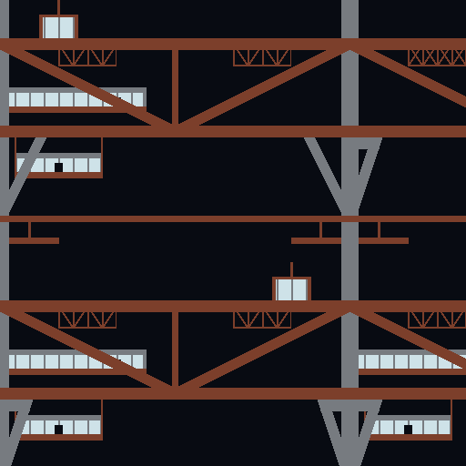

## Seed 42

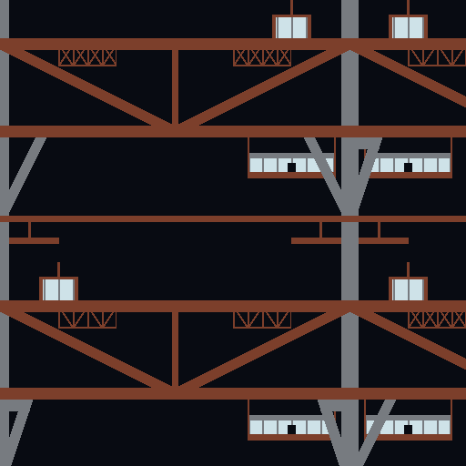

## Seed 271828

## Seed 8675309

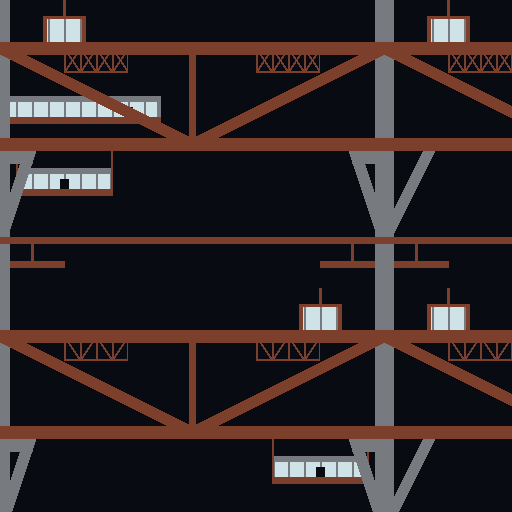

## Compact bays

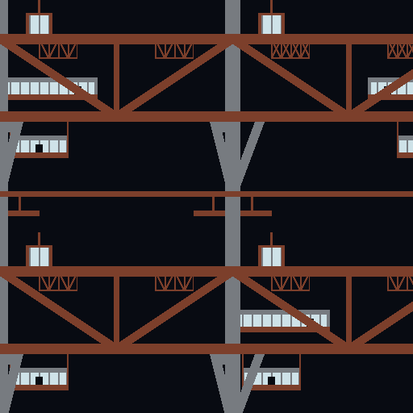

## Broad bays

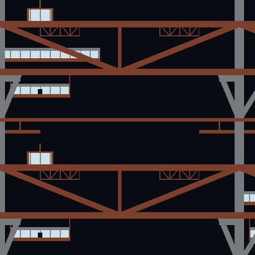

## Shallow station

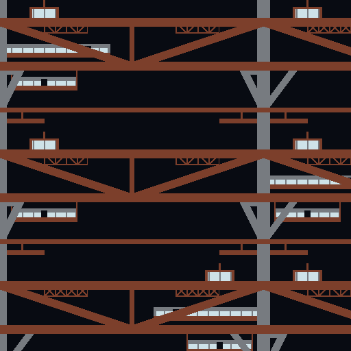

## Tall station

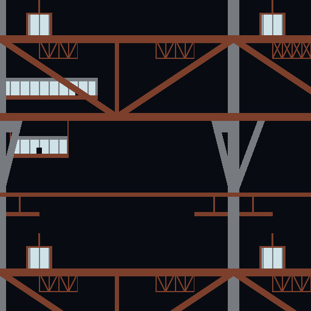

## Thin members

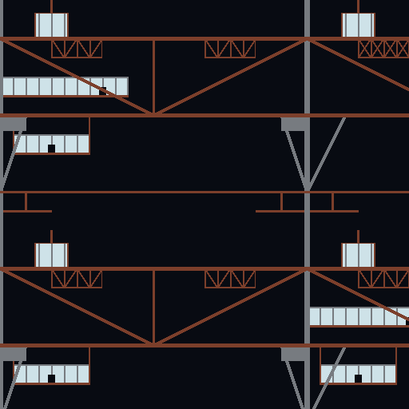

## Heavy members

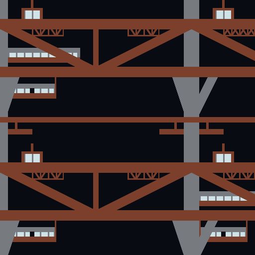

## Glazing on

## Glazing off

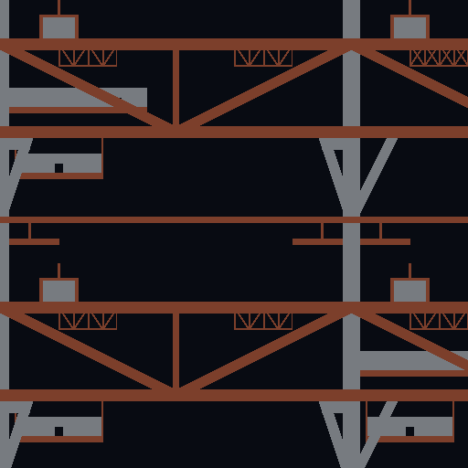

## Portals off

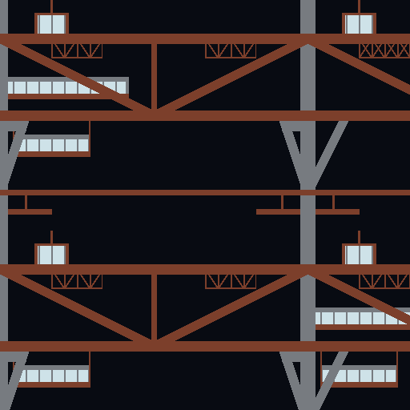

## Signed world origin — -512, -256

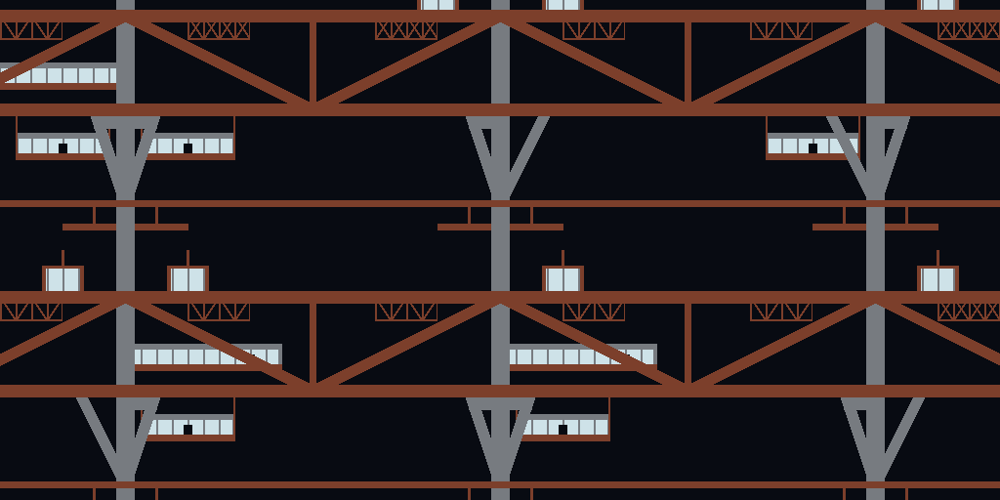

## Steel Trestle

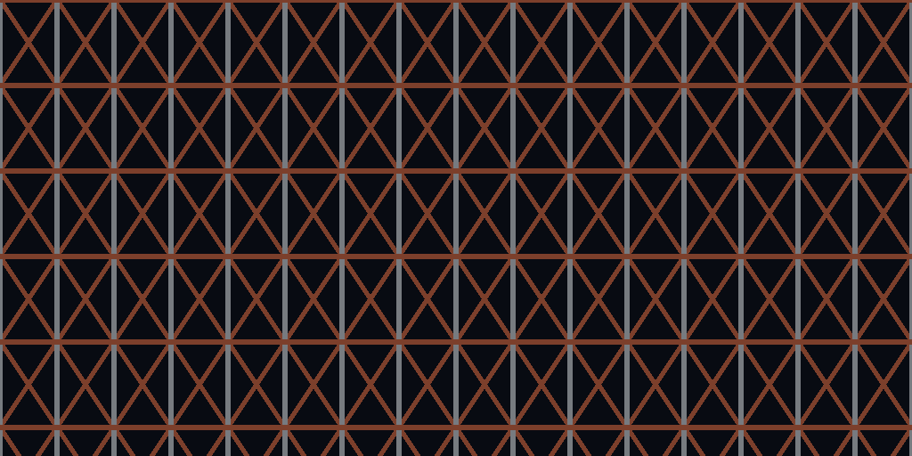

## Space Frame

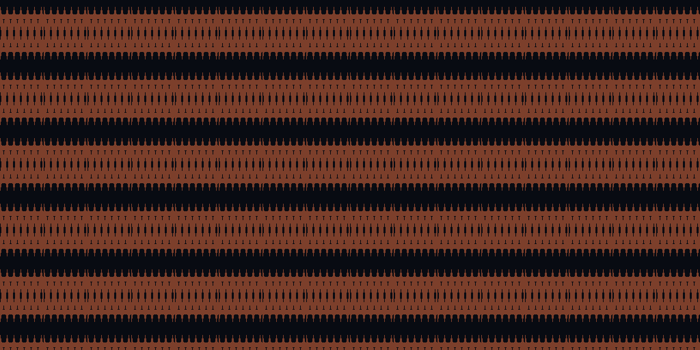
