# Rosework Gatehouse — native material gallery

Source commit: `5132a454f1db80c5b54dc6fef56b488ef9b3edc9`. Input ledger: `7778471bf4f8f6d2f57decb98c4a95b0e6dc50b77d08bccb0e478277e14b2a28`.

These PNGs map actual native material bytes through the ordinary preview palette.

| Case | Extent | Bay / floor / wall | Seed | Empty | Material SHA-256 |
| --- | --- | --- | --- | --- | --- |
| [Hero — 512 × 512](01-hero-512.png) | 512×512 | 128 / 80 / 3 | 271828 | 61.2% | `1a2e4ed3a09a918101525887d1bda78241593eb0b44b224501702fe9ef89f994` |
| [Hero — 1024 × 512](02-hero-landscape.png) | 1024×512 | 128 / 80 / 3 | 271828 | 61.4% | `f997ef242cb21c07d0a80ba80e4b06c29aa8533da11e56095140c1ec0fe9b283` |
| [Hero — 1024 × 1024](03-hero-large.png) | 1024×1024 | 128 / 80 / 3 | 271828 | 60.5% | `be265a5e03251129d089766605370dcc032f1bcde0bfb279d43f051fec5ae00b` |
| [Seed 1](04-seed-1.png) | 512×512 | 128 / 80 / 3 | 1 | 61.6% | `a39a319ffac1af035eb78af6e07c43660138add0add29390d693a29004ad304f` |
| [Seed 7](05-seed-7.png) | 512×512 | 128 / 80 / 3 | 7 | 59.7% | `a96b166f99fc7f6b2a33d9a8dca79ae00ebb889264ac171a7eac9fa68be3fa3c` |
| [Seed 19](06-seed-19.png) | 512×512 | 128 / 80 / 3 | 19 | 61.3% | `bbf1180943707ba3e5f0d4f4402f3b7f7675f5fd0d35c8fdbc09f47f538a54b2` |
| [Seed 42](07-seed-42.png) | 512×512 | 128 / 80 / 3 | 42 | 61.2% | `a7dd731a2e51b1a56159c9ccbe6ba5657b5c8599402f13aa8c1c096ef3c6b097` |
| [Seed 271828](08-seed-271828.png) | 512×512 | 128 / 80 / 3 | 271828 | 61.2% | `1a2e4ed3a09a918101525887d1bda78241593eb0b44b224501702fe9ef89f994` |
| [Seed 8675309](09-seed-8675309.png) | 512×512 | 128 / 80 / 3 | 8675309 | 60.5% | `97b9d97c4d00d5e8e9a3e399a79108ca91b25155d8170d778eda86e39f7dc98a` |
| [Small diameter](10-small-rose.png) | 512×512 | 80 / 80 / 3 | 271828 | 61.2% | `3e75f17d070836f0d602881cd358774aa800932d4c8841dac0b966f99ae798d0` |
| [Large diameter](11-large-rose.png) | 512×512 | 160 / 104 / 3 | 271828 | 68.6% | `cfca53305befd1b4ba0c7c1da527c10b58e315ffc78b506a0993648ed0d974fd` |
| [Short towers](12-short-towers.png) | 512×512 | 128 / 56 / 3 | 271828 | 61.3% | `dea6753285c9266659710743300b8a0e03777c6aaf7cc90f24cdab97f484cd43` |
| [Tall towers](13-tall-towers.png) | 512×512 | 128 / 112 / 3 | 271828 | 62.0% | `08e1905af0d11119773a4ca46311d94ba2437406d823363a3e25e78c02a250c5` |
| [Thin tracery](14-thin-tracery.png) | 512×512 | 128 / 80 / 1 | 271828 | 64.8% | `e4d716f2bdb71e57b5d7e006162db84537371e9d27fac65fd88efd28a39de6f6` |
| [Heavy tracery](15-heavy-tracery.png) | 512×512 | 128 / 80 / 5 | 271828 | 57.9% | `c29e9aa95176d4833b1da7c5eac93ff441a97b9856ce476b9fe7bcab47489544` |
| [Glazing on](16-glazing-on.png) | 512×512 | 128 / 80 / 3 | 271828 | 61.2% | `1a2e4ed3a09a918101525887d1bda78241593eb0b44b224501702fe9ef89f994` |
| [Glazing off](17-glazing-off.png) | 512×512 | 128 / 80 / 3 | 271828 | 62.9% | `c50f4663dd85bd0eb4070ad9f2bec965bb6eddfd4aed844fd0bfa5e635a0db44` |
| [Side doors off](18-side-doors-off.png) | 512×512 | 128 / 80 / 3 | 271828 | 60.1% | `6e465dcb753f6e4e1b787a1f15eb1d7d972130aaf762c751c6bf8097a733f044` |
| [Signed origin — -512, -256](19-negative-origin.png) | 512×512 | 128 / 80 / 3 | 271828 | 61.2% | `1a2e4ed3a09a918101525887d1bda78241593eb0b44b224501702fe9ef89f994` |
| [Pointed Arcade](20-pointed-arcade.png) | 512×512 | 128 / 80 / 3 | 271828 | 44.6% | `49ebe46c3f9fabf666a592710ffb89e060b6e25b6e3622bef9f3cad1404a5cc3` |
| [Drum Vault](21-drum-vault.png) | 512×512 | 128 / 80 / 3 | 271828 | 83.8% | `fa8f93c6f23518131556fe21d953228f993f166d2cfc03465385fd2005cd2774` |
| [Basilica](22-basilica.png) | 512×512 | 128 / 80 / 3 | 271828 | 74.4% | `ed434cf1ad4067267f6356e404e2194bf0b09b7339b864d9ea8598350e602f04` |
| [Side doors on](23-side-doors-on.png) | 512×512 | 128 / 80 / 3 | 271828 | 61.2% | `1a2e4ed3a09a918101525887d1bda78241593eb0b44b224501702fe9ef89f994` |

## Hero — 512 × 512

## Hero — 1024 × 512

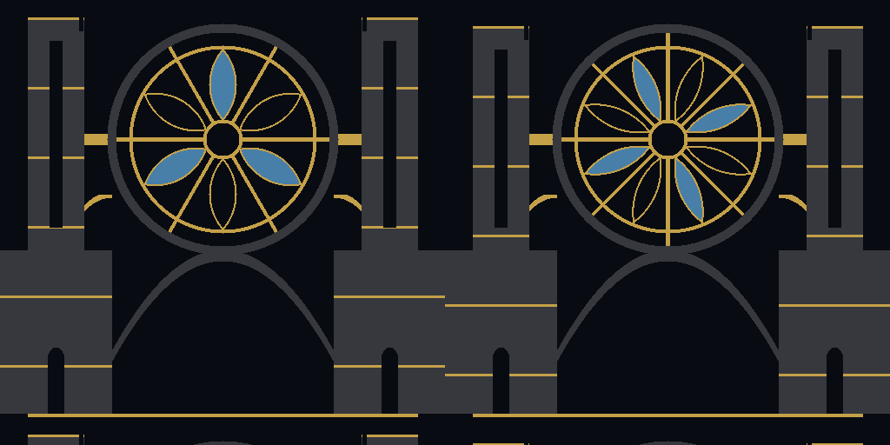

## Hero — 1024 × 1024

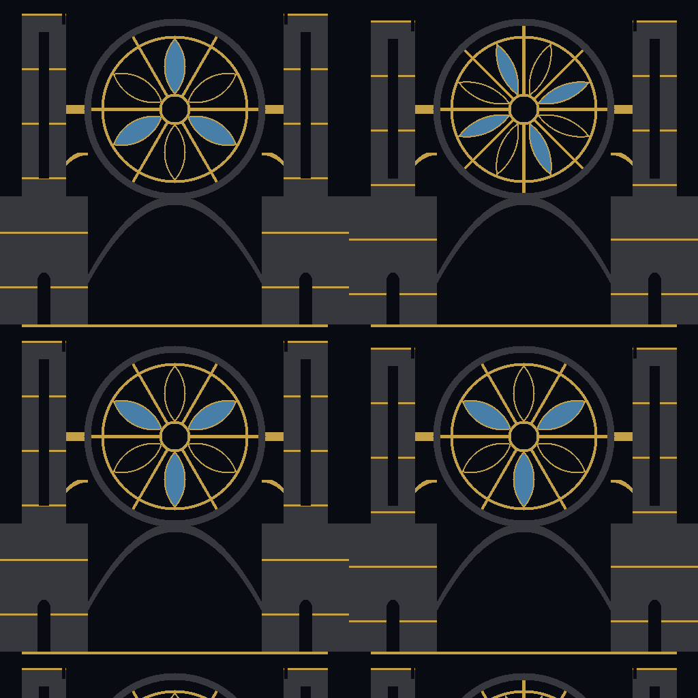

## Seed 1

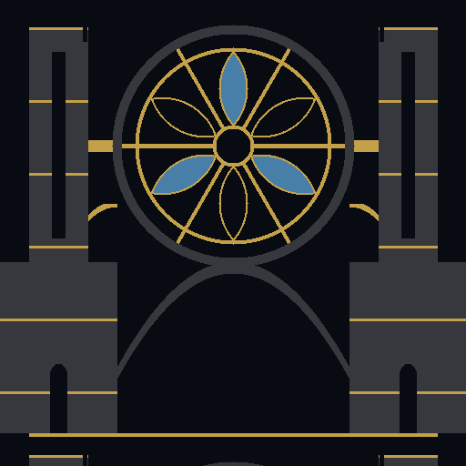

## Seed 7

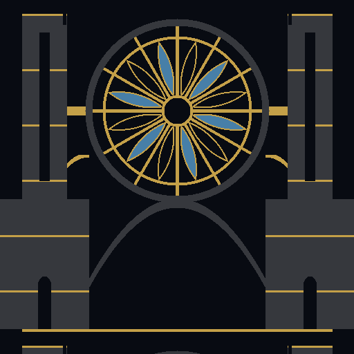

## Seed 19

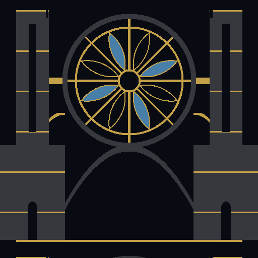

## Seed 42

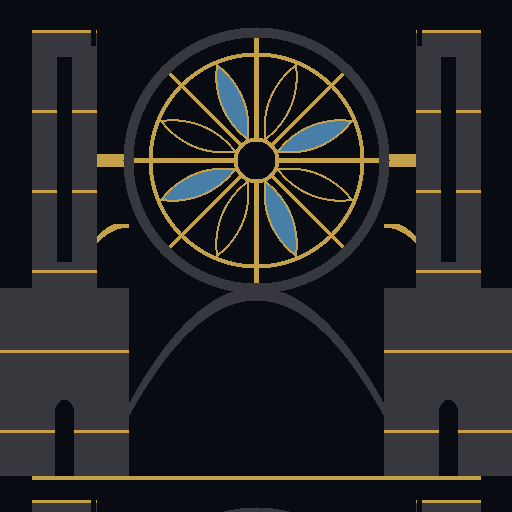

## Seed 271828

## Seed 8675309

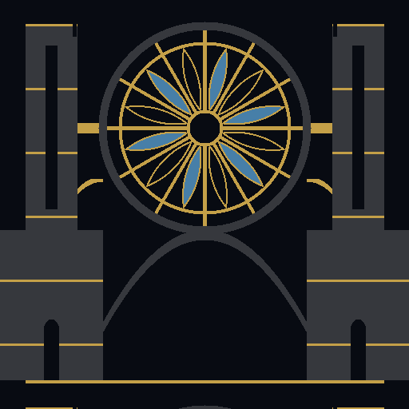

## Small diameter

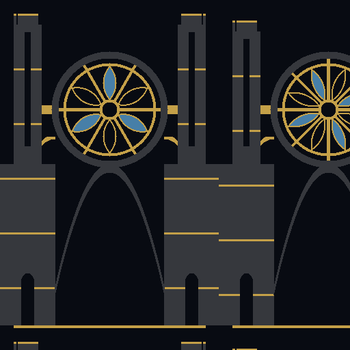

## Large diameter

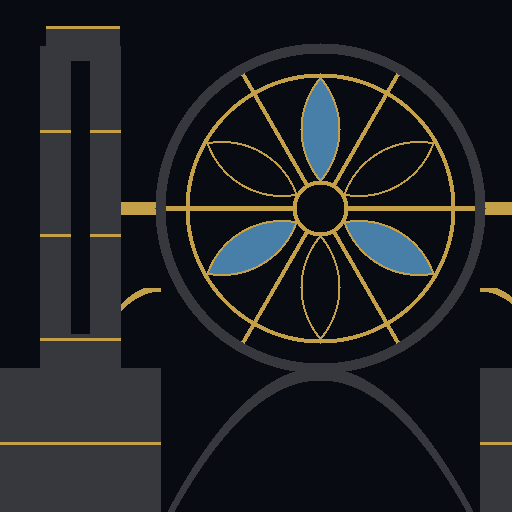

## Short towers

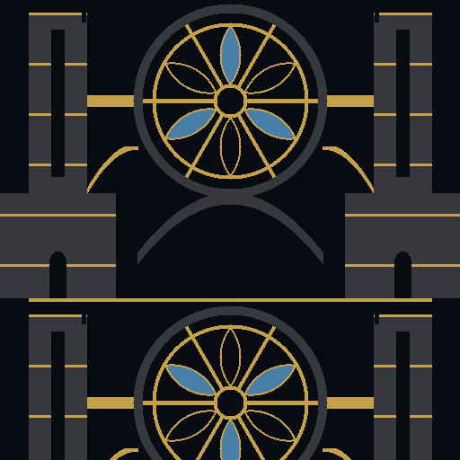

## Tall towers

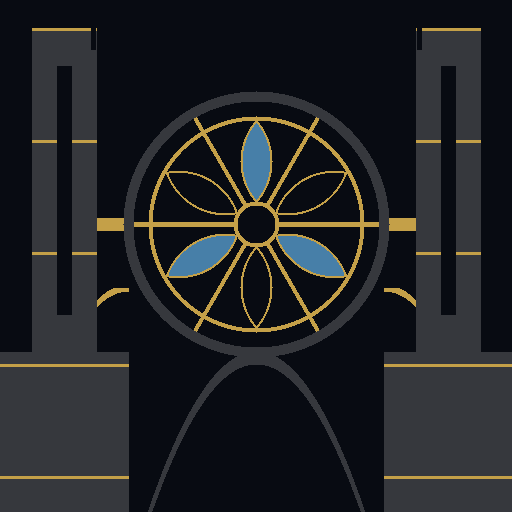

## Thin tracery

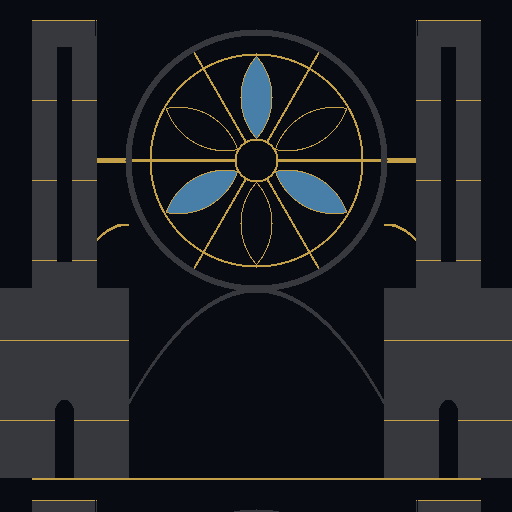

## Heavy tracery

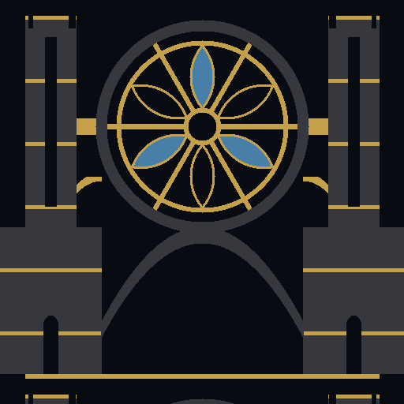

## Glazing on

## Glazing off

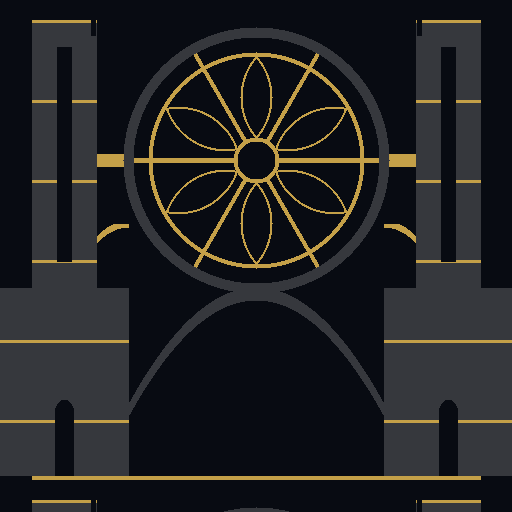

## Side doors off

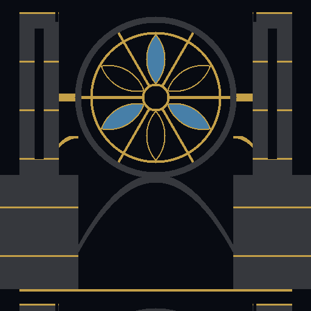

## Signed origin — -512, -256

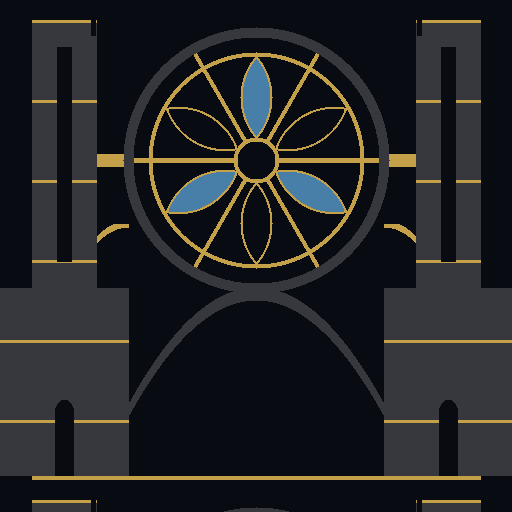

## Pointed Arcade

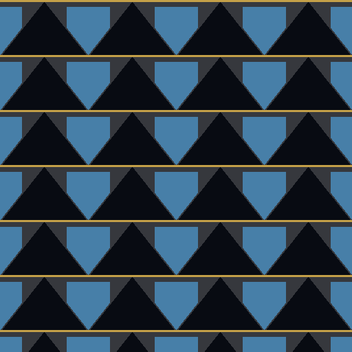

## Drum Vault

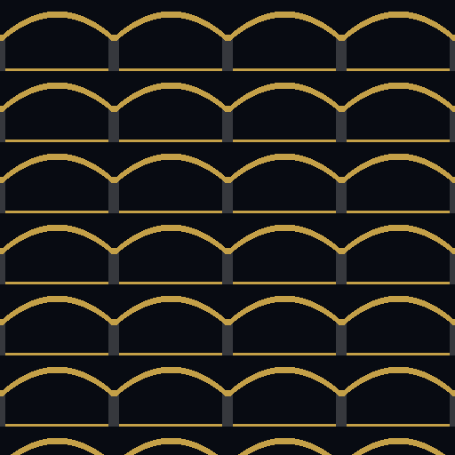

## Basilica

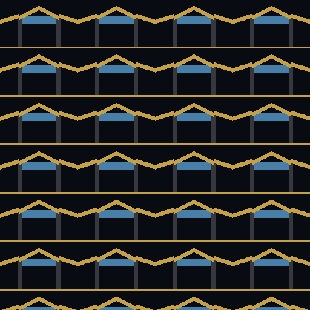

## Side doors on

## Qualification and independent review

[Independent review](independent-review.md), [native qualification](qualification.json), [hosted exact-source qualification](ci-summary.json), [ordinary-preset material parity](source-verification.json), and [matched-trial performance](performance-summary.json).

The gallery commit contains evidence only. The exact compiled source is named above and in every source ledger; no build input changes are part of the later evidence commit. Keep this experiment Draft / HOLD.
