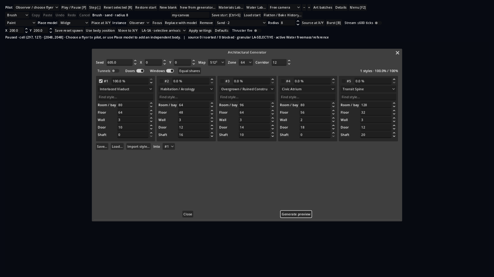
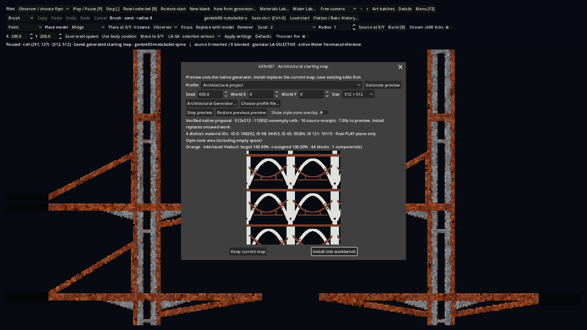
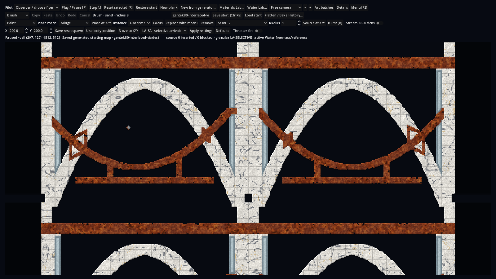
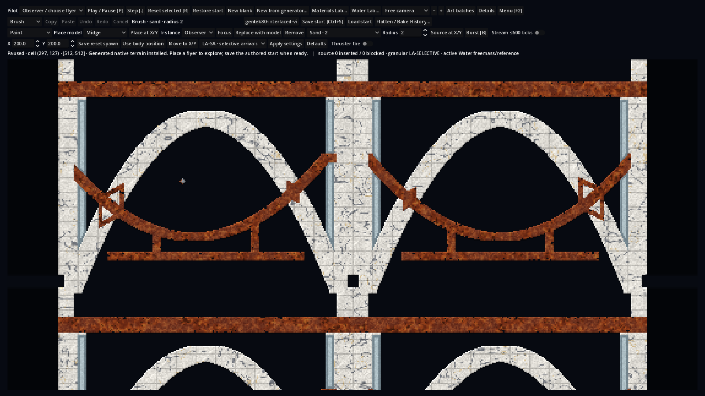
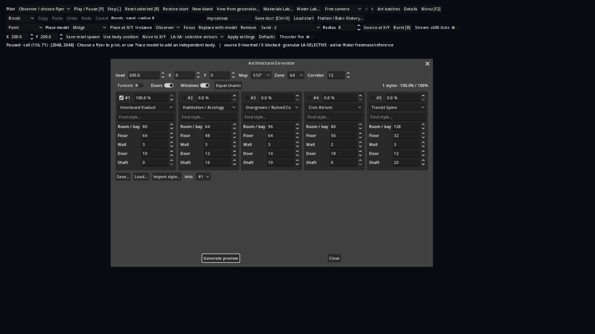
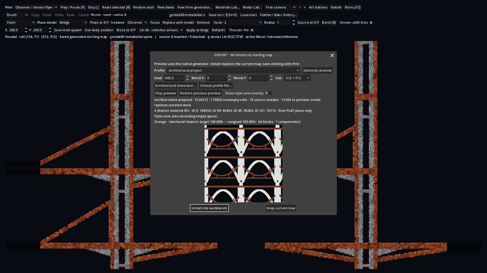
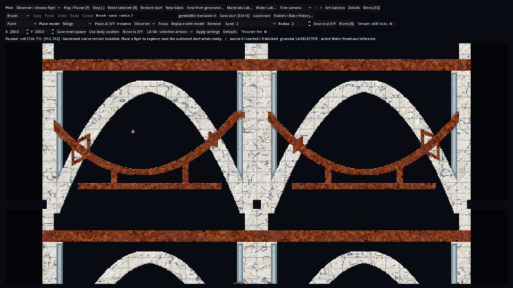

# Final Workbench execution frames

Application `bf1bd8c8e6f189b36a3cb0f582185e5d529297d0`; native build `82da41a945b1d98e0267a2a20b56ec66d83f71f6`; orchestration `f69b68a88401b28b3fe688c3d070162ebcd090c5`; original run 44690026779.

[See the three mixed-Composition projects on Linux and Windows](mixed/README.md). The complete 80-style native gallery, variants and repairs are [available here](https://github.com/techrote/cybersand/blob/fea465b014757fce9000be6b30e368d5ab187c43/docs/images/gentek80-integration/README.md).

These are eight unmodified original PNGs. Full source, runtime, artifact, process, encoded PNG and decoded RGBA hashes are in `frame-manifest.json`.

## linux

### gentek80-search-and-selection

Ordinary Shared Workbench Architectural Generator, with Interlaced Viaduct selected and the five style cards and Find style controls visible. The menus are closed; this frame does not show all 93 choices at once. The original author/reopen receipts separately prove80 Genteks among93 total selector choices.

Original artifact `14608534716`; phase `author`; PID `2631`; SHA256 `8b1609e52ca62fb5ea33e8a0be9f392e7a4426d628380954b1642930436c3235`.

### gentek80-interlaced-viaduct-preview

Native Interlaced Viaduct preview at 512×512, seed 605, displayed before installation. The previously installed Metabolist Spine World remains visible behind the confirmation dialog. The preview reports 113,852 nonempty cells and 16 source recipe receipts. The available Install into workbench action preserves the normal confirmation step.

Original artifact `14608534716`; phase `author`; PID `2631`; SHA256 `9903fc79e9f89841a816c160bd5022bc73ed76f235b96d1c17f8c7aefbf0f998`.

### gentek80-interlaced-viaduct-edited-world

Interlaced Viaduct installed into the ordinary native World after material paint/erase interaction, Save start and native simulation step. The authored opening in the central support and the saved map name remain visible. Original per-style assertions check the edits and persisted recipe.

Original artifact `14608534716`; phase `author`; PID `2631`; SHA256 `8aaf4fea606eae49269730ae0a218f3a36a59b2c00f783f91d7b02c97a9afd5a`.

### gentek80-interlaced-viaduct-restored-world

Interlaced Viaduct after reopening the saved start in a separate Godot process and restoring the World. The geometry and authored opening remain visible. Original receipts separately check exact material/recipe reconstruction and edit retention; the framebuffer is not used as the sole save/reopen oracle.

Original artifact `14608534716`; phase `reopen`; PID `2817`; SHA256 `08d5c99617b9a39ef57483851eea7aa8fce45013bf0f1b526859aceff3e842c7`.

## windows-package

### gentek80-search-and-selection

Ordinary Shared Workbench Architectural Generator, with Interlaced Viaduct selected and the five style cards and Find style controls visible. The menus are closed; this frame does not show all 93 choices at once. The original author/reopen receipts separately prove80 Genteks among93 total selector choices.

Original artifact `14611486673`; phase `author`; PID `3188`; SHA256 `967fc9b26a08738c4907e8238a5dc50fd3774e5a4a7d49f7c9402be8323003e9`.

### gentek80-interlaced-viaduct-preview

Native Interlaced Viaduct preview at 512×512, seed 605, displayed before installation. The previously installed Metabolist Spine World remains visible behind the confirmation dialog. The preview reports 113,852 nonempty cells and 16 source recipe receipts. The available Install into workbench action preserves the normal confirmation step.

Original artifact `14611486673`; phase `author`; PID `3188`; SHA256 `aed895676486b995fb6298c1238762ad7201f6d0f2200ce7de99ddec08ae9a73`.

### gentek80-interlaced-viaduct-edited-world

Interlaced Viaduct installed into the ordinary native World after material paint/erase interaction, Save start and native simulation step. The authored opening in the central support and the saved map name remain visible. Original per-style assertions check the edits and persisted recipe.

Original artifact `14611486673`; phase `author`; PID `3188`; SHA256 `cdc841159d13ff2437ce4e984ac876c857873845f17f49eddfc124330f3ad36a`.

### gentek80-interlaced-viaduct-restored-world

Interlaced Viaduct after reopening the saved start in a separate Godot process and restoring the World. The geometry and authored opening remain visible. Original receipts separately check exact material/recipe reconstruction and edit retention; the framebuffer is not used as the sole save/reopen oracle.

Original artifact `14611486673`; phase `reopen`; PID `6460`; SHA256 `5bc9f6c489e7242472d9acba59a0412c2d66a3a15fdfaab9eed6948b1995f46a`.

## Scope of mixed Compositions

The supplemental campaign uses the accepted planner with automatic tunnels, doors and windows enabled. Zone masks and tunnel cuts visibly remove parts of some supports and glazing. The checks establish real multi-style selection, deterministic generation, installation, material editing, saving and independent reload. They do not establish structural support or a walkable route across every zone interface. Turn Tunnels off to inspect uncut forms; ordinary editing can finish joins. No negotiated-boundary or SWARM research is included.

The frame manifests preserve the original staging receipts and source identities. Publishing these copies does not alter the candidate, the original execution artifacts or their images.
