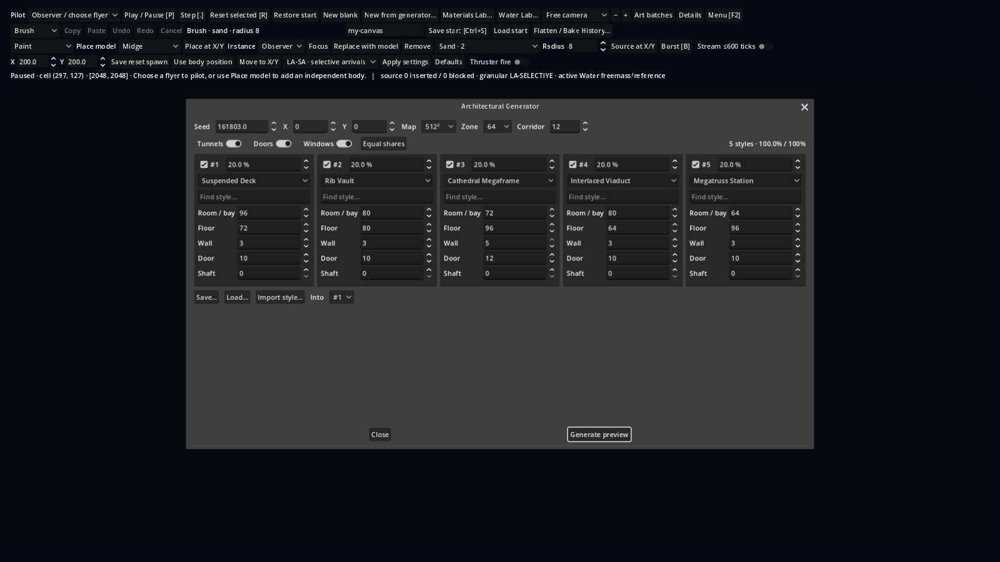
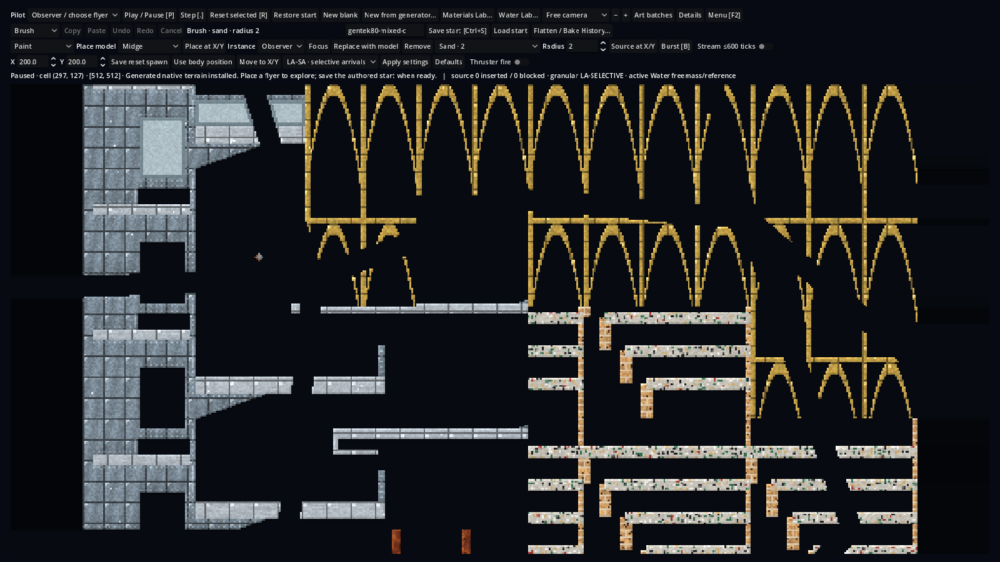
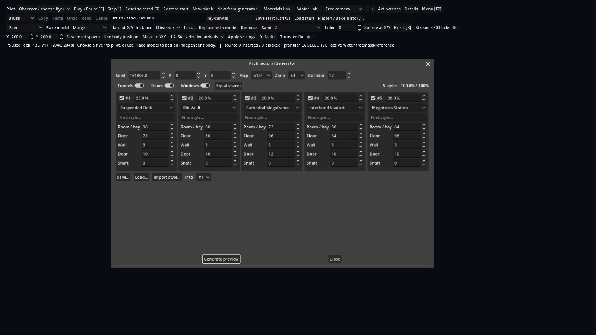

# Supplemental mixed-Gentek original UI evidence

Run [44707515958](https://github.com/techrote/cybersand/actions/runs/44707515958) completed successfully on Linux and Windows. Candidate source remains `bf1bd8c8e6f189b36a3cb0f582185e5d529297d0`; these images are unchanged originals.

## Linux — five-card selection

Linux/X11: ordinary Architectural Generator with Suspended Deck, Rib Vault, Cathedral Megaframe, Interlaced Viaduct and Megatruss Station selected in five equal 20% cards. Seed 161803, 512-square map, 64-cell zones and default tunnels, doors and windows. Complete original UI framebuffer.

SHA256 `c1850688eae92c5da1d1c6c2848462a1bcac2dfb9d8b9ff00f8d2ffe4075b60c` · 1600 × 900 px

## Linux — independent-process restoration

Linux/X11: Project C restored through ordinary Load start in an independent process. Cascade Terrace, Scalloped Vault, Buttress Wall, Interlock Brutalism and Suspended Arcology share one native World. Full material readback verifies all 262,144 source-plus-edit cells and both saved strokes; this screenshot does not certify support or traversal across style interfaces.

SHA256 `cd6b5d353d72cc794aa7d6100df441faa09a56b4e3d692514de5203c978139f8` · 1600 × 900 px

## Windows — five-card selection

Windows, pristine evaluation ZIP: ordinary Architectural Generator with Suspended Deck, Rib Vault, Cathedral Megaframe, Interlaced Viaduct and Megatruss Station selected in five equal 20% cards. Seed 161803, 512-square map, 64-cell zones and default tunnels, doors and windows. Complete original UI framebuffer.

SHA256 `8ab65f3bc49f788e2acbd9a2f8447bea98d81b730821b512d5cb81ecd5ecfe32` · 1600 × 900 px

## Windows — independent-process restoration

Windows, pristine evaluation ZIP: Project C restored through ordinary Load start in an independent process. Cascade Terrace, Scalloped Vault, Buttress Wall, Interlock Brutalism and Suspended Arcology share one native World. Full material readback verifies all 262,144 source-plus-edit cells and both saved strokes; this screenshot does not certify support or traversal across style interfaces.

SHA256 `3f196642cd4115570b74272707260e44046fff328d9ed312d54f811c7e27e6ae` · 1600 × 900 px

