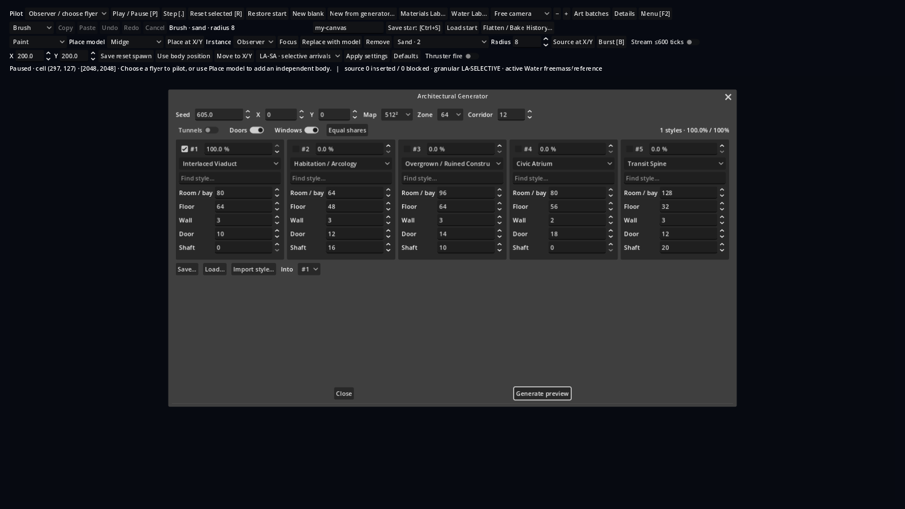
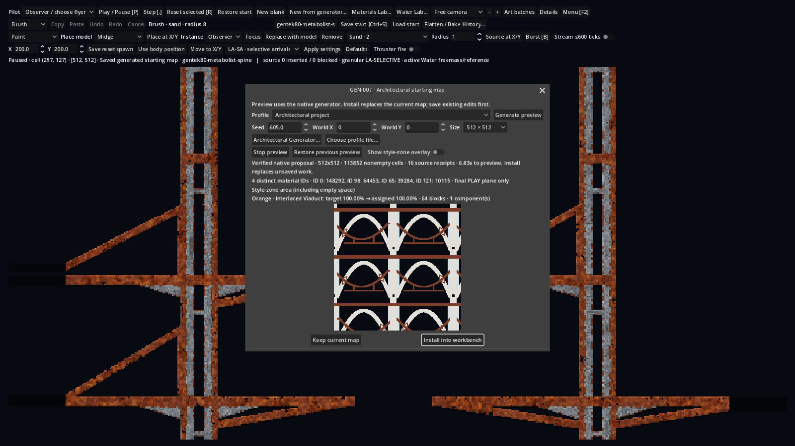
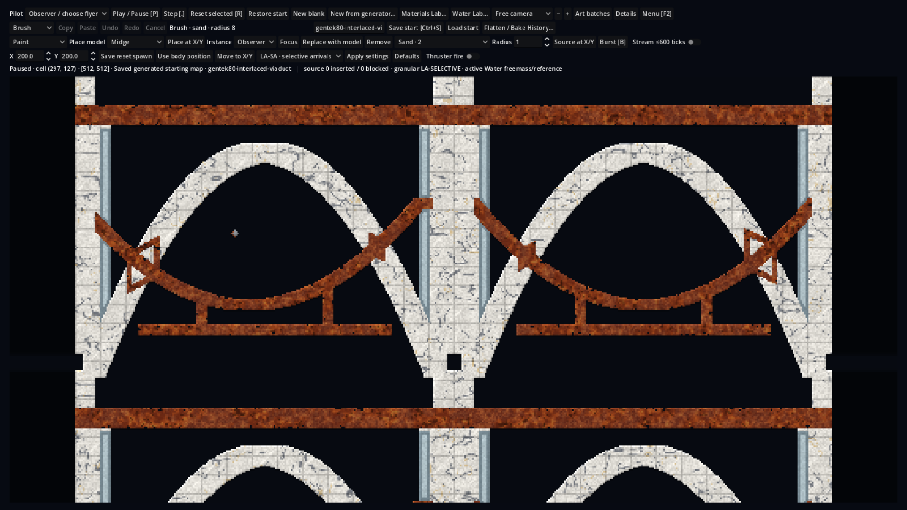
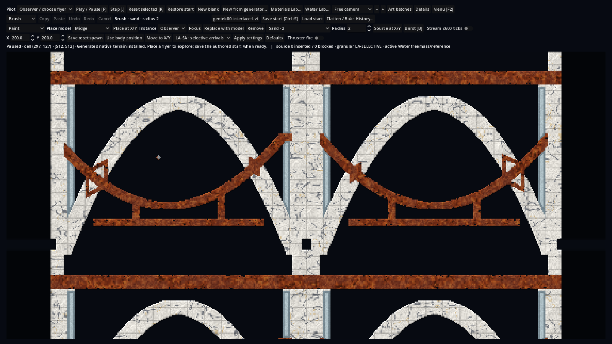
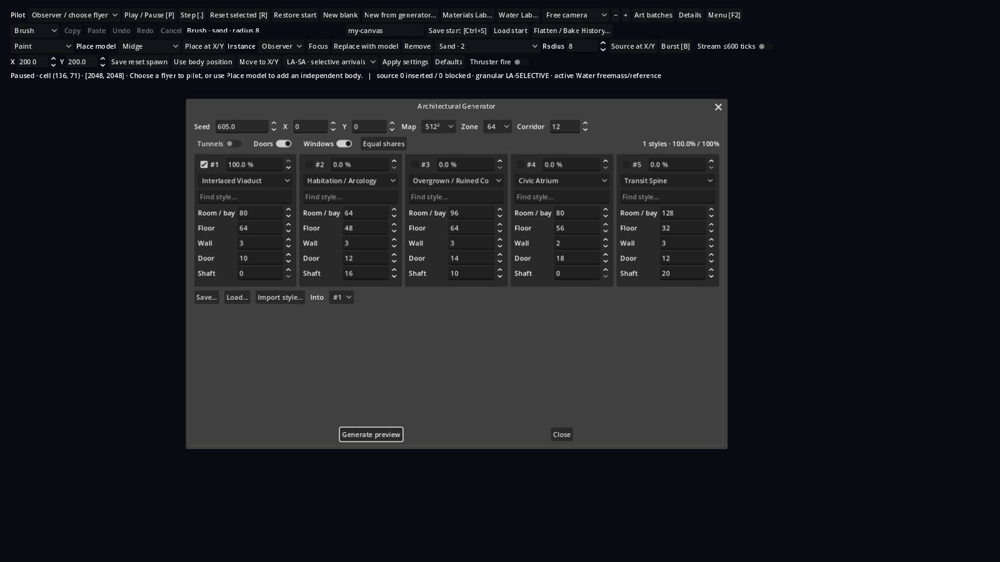
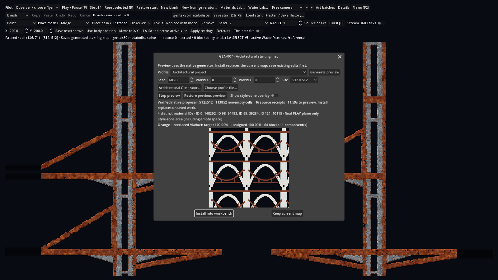
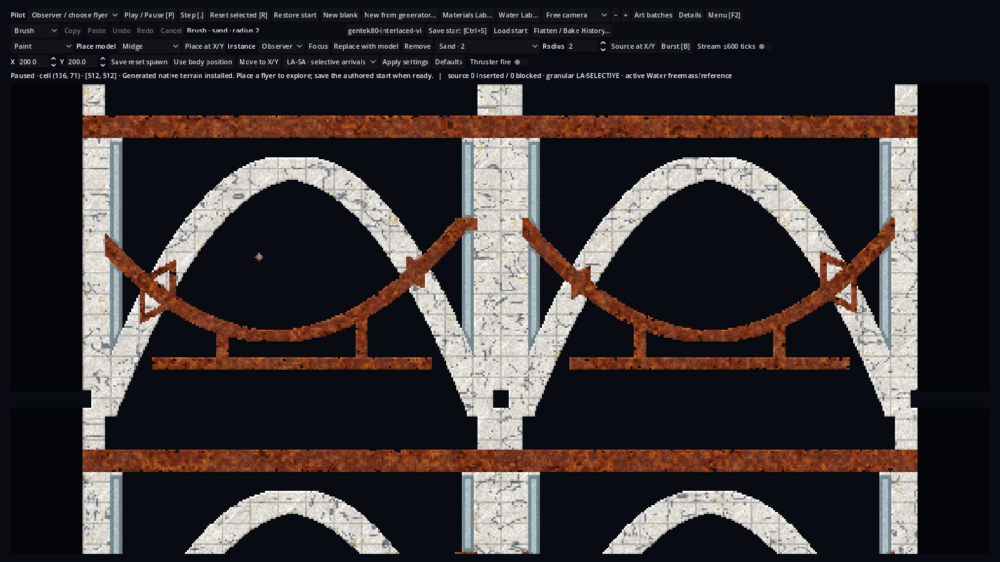

# Ordinary Workbench execution evidence

These are original, unaltered Godot framebuffer PNGs from source qualification of **GENTEK-80-INTEGRATION-001**. They supplement the [complete 80-Gentek native gallery](../gentek80-integration/README.md).

- Application/build source: `82da41a945b1d98e0267a2a20b56ec66d83f71f6`.
- Source tree: `62c3210595f34b500cf6844e61085a5afcb3e85e`.
- Original qualification: [run 44674555113, attempt 1](https://github.com/techrote/cybersand/actions/runs/44674555113).
- Each platform's native runtime and original artifact identity is recorded below. The delivered final commit and package have separate execution receipts; these captions retain the source of these original captures.

## Linux source-qualified Workbench

Runtime SHA-256: `5195149bb4ee0b826d258f46627397d4a3e79d0d22cd3072ca0518aa75ebd878`.

[Original complete Linux evidence artifact 14604798235](https://github.com/techrote/cybersand/actions/runs/44674555113/artifacts/14604798235). Actual capture size: **1600×900**. Both original Workbench phases completed all 80 Genteks with zero failures, in different processes.

### Selector and search

The ordinary Architectural Generator displays five style cards, per-card search fields and the bottom actions. The selector popup is closed in this frame; expanded-popup behaviour is not inferred from this screenshot. Catalogue reachability is verified separately by the original 80-style execution receipts.

### Native Interlaced proposal

The proposed Interlaced Viaduct is shown with native material counts, generation time and the install action. The backdrop is the previously installed Metabolist World, which remains in place while the proposal awaits confirmation.

### Installed and edited native World

The ordinary textured World after installation, paint/erase, Save start and an acknowledged native simulation tick. Exact edit-cell assertions and saved recipe/material identities are recorded in the accompanying original author report.

### Separate-process restoration

Captured in the independent reopen process after the saved recipe and persisted edits were reconstructed and checked. The original author/reopen PIDs are 12081 and 12165.

### Original PNG identities

| Published PNG | Original captured filename | SHA-256 |
| --- | --- | --- |
| [linux-selector.png](linux-selector.png) | `gentek80-search-and-selection.png` | `8b1609e52ca62fb5ea33e8a0be9f392e7a4426d628380954b1642930436c3235` |
| [linux-interlaced-preview.png](linux-interlaced-preview.png) | `gentek80-interlaced-viaduct-preview.png` | `ae089992b363b232fcb98c367e8bd9ac723021f2ef45694af96669b13f727ad7` |
| [linux-interlaced-edited-world.png](linux-interlaced-edited-world.png) | `gentek80-interlaced-viaduct-edited-world.png` | `8aaf4fea606eae49269730ae0a218f3a36a59b2c00f783f91d7b02c97a9afd5a` |
| [linux-interlaced-restored-world.png](linux-interlaced-restored-world.png) | `gentek80-interlaced-viaduct-restored-world.png` | `08d5c99617b9a39ef57483851eea7aa8fce45013bf0f1b526859aceff3e842c7` |

## Windows source-qualified Workbench

Runtime SHA-256: `2b7a1fbb8410270498e5c0ce8f9384a598c4467397e4ca1bda0111d6c5985447`.

[Original complete Windows evidence artifact 14607203494](https://github.com/techrote/cybersand/actions/runs/44674555113/artifacts/14607203494). Actual capture size: **1600×900**, using Godot 4.7 compatibility rendering through ANGLE / Microsoft Basic Render Driver on Windows Server 2022. Both original Workbench phases completed all 80 Genteks with zero failures, in different processes (author PID 2132; reopen PID 5828).

### Find style in the ordinary Architectural Generator

The existing five style cards show their Find style fields, geometry controls and lower actions without clipping at the actual 1600×900 Windows viewport. Interlaced Viaduct is selected at 100% in card 1. The dropdown is closed in this image; the accompanying all-80 UI records verify the 93 choices and filtering behavior.

### Native Interlaced proposal before confirmation

The native preview shows Interlaced Viaduct with its install and keep-current-map actions visible. The previously installed Metabolist Spine World intentionally remains behind the dialog until confirmation. This is the proposal view, before installation of the Interlaced World.

### Installed, edited and saved native World

Interlaced Viaduct is installed in the ordinary Shared Workbench, with native marble, rusted steel and glass textures visible. This author-phase capture follows ordinary paint and erase, Save start, and one completed native simulation tick; the retained report checks the material edits and saved recipe.

### Saved start restored in an independent process

The separate reopen process loads the saved Interlaced start and its ordered material edits into a fresh native World. The retained checks verify the same recipe and paint/erase cells. The displayed World body matches the edited frame; the toolbar reflects the reopened state.

### Original PNG identities

| Published PNG | Original captured filename | SHA-256 |
| --- | --- | --- |
| [windows-selector.png](windows-selector.png) | `gentek80-search-and-selection.png` | `967fc9b26a08738c4907e8238a5dc50fd3774e5a4a7d49f7c9402be8323003e9` |
| [windows-interlaced-preview.png](windows-interlaced-preview.png) | `gentek80-interlaced-viaduct-preview.png` | `747b9c37bbe17362c124b5eeaccbeb7859686cd679aa49cfdca199c6c70167ab` |
| [windows-interlaced-edited-world.png](windows-interlaced-edited-world.png) | `gentek80-interlaced-viaduct-edited-world.png` | `cdc841159d13ff2437ce4e984ac876c857873845f17f49eddfc124330f3ad36a` |
| [windows-interlaced-restored-world.png](windows-interlaced-restored-world.png) | `gentek80-interlaced-viaduct-restored-world.png` | `5bc9f6c489e7242472d9acba59a0412c2d66a3a15fdfaab9eed6948b1995f46a` |

These are original source-build captures. Expanded menus, other display sizes and physical owner-GPU performance are not shown. The later final-commit execution and package admission retain their own original evidence.

