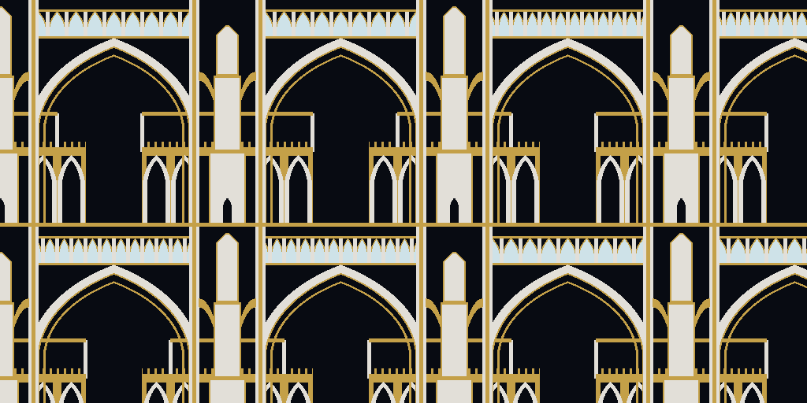
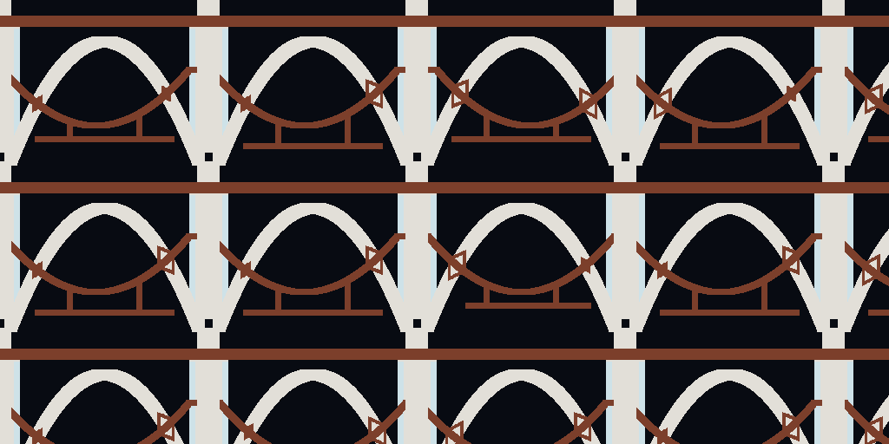
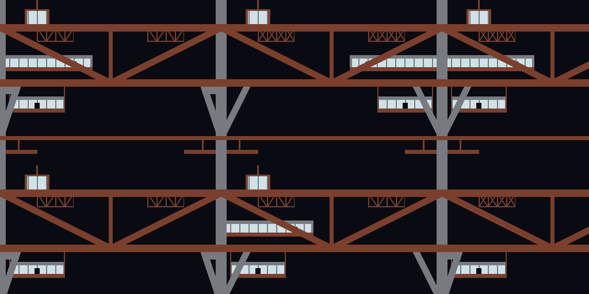

# Architectural Generator walkthrough

Build a native material map, inspect it before replacing your scene, then paint,
play and save the result. Open **Development workbench** from the feature
launcher and choose **New from generator… → Architectural Generator…**.
The [first-launch guide](getting-started.md) covers a source checkout or a
complete, source-identified evaluator. Generator availability is accepted
implementation; a particular evaluation package keeps its own source identity.

*Fresh native material visualization from the documentation baseline, seed
271828. This is a 1024 × 512 crop of a 1024-square single-style project, rendered
headlessly from stored material IDs. It is not a Workbench GUI screenshot.
[Capture provenance](../audits/2026-11-24-docs-renaissance/assets-b.json).*

## Choose a Gentek and its parameters

A **Gentek** is a native architectural generator technique. A **variant** changes
its admitted geometry, material or aperture parameters. A **preset** is a named
starting configuration. A **composition** assigns styles to zones of one map.
These terms describe authoring choices; they do not promise structural stability
or navigable routes through every generated crop.

The chooser has **80 Genteks plus 13 earlier architectural presets**. Use
**Find style…** in a card to narrow by name, family or theme. The
[visual catalogue](../images/gentek80-integration/README.md) makes the differences
between frames, trusses, vaults, spines and suspended structures easier to see.
Five cards support one to five enabled styles; unused cards may stay disabled.

For a first scene:

1. Choose **Map 512²**, **Zone 64**, and seed **271828**. The architectural
   form offers 512² and 1024², even though a fresh blank Workbench is 2048².
2. Enable only card **#1**, choose **Cathedral Megaframe**, and set its share to
   **100%**. Keep the preset's geometry initially.
3. Turn **Tunnels** off and leave **Doors** and **Windows** on. The switches
   control independent automatic cuts; a door here is a material aperture.
4. Click **Generate preview**. Wait for completion in the parent generator
   window, then inspect the material map. Generation does not replace the scene.
5. Return to **Architectural Generator…**, change a geometry parameter offered
   for that style, regenerate and compare. Keep the seed fixed while comparing
   one parameter. A disabled or inapplicable field is not an effective control.

*Interlaced Viaduct, the same accepted-source headless capture scope and seed.
Material geometry is native output; physical load-bearing is not inferred.*

## Make the three-style map

For a composition, enable cards **#1**, **#2** and **#3**. Choose Industrial
Service, Habitation / Arcology and Overgrown / Ruined Construction; set shares
**45 / 30 / 25**. With **Map 1024²**, **Zone 64** and seed **161803**, the 256
planning blocks divide into 115 / 77 / 64 blocks. Coverage describes assigned
zone area, including empty rooms, rather than the quantity of wall material.

Use **Equal shares** when you want the enabled cards balanced automatically.
The total must be 100%; disabled cards contribute nothing. **Show style-zone
overlay** in the parent window reveals the five original slot colours. A sparse
composition using cards 1, 3 and 5 retains those slots' colours and legend names.
With tunnels disabled, whole-map connectivity is not guaranteed. Zone boundaries
can clip rooms; these are editable starting maps.

## Compare the independent controls

Keep seed, dimensions and shares fixed when comparing a switch:

| Control | What to inspect |
| --- | --- |
| Tunnels | Automatic shared passages across style zones. Explicit expert-recipe paths remain independent. |
| Doors | Automatic doorway apertures. Disabling these does not create interactive door objects. |
| Windows | Admitted glazing and window apertures for the selected style. |
| Geometry fields | Bay, room, floor, wall or other dimensions actually consumed by that Gentek. |
| Shaft width | Arcology service-shaft width; zero disables that shaft. |
| Material selections | Native admitted structural materials; validation may reject an unsupported combination. |

Native validation explains contradictory dimensions or unsupported inputs.
Vault dimensions must divide the extent; do not assume every field works for
every technique. See the [generator contract](../systems/architectural-generator.md)
for schemas, deterministic identity and native geometry boundaries.

## Install, paint, save and reopen

1. Save any current work you want to keep. After a complete preview, click
   **Install into workbench**. Installation explicitly replaces the material map.
2. Keep the scene paused. Paint a visible mark and erase an opening. Follow
   [painting and history](workbench-painting-and-history.md) for shapes and Undo.
3. Enter a unique name in the painting row and use **Save start [Ctrl+S]**.
   The control is visible in that row; it is not hidden under Details.
4. Exit completely, relaunch, enter that name and choose **Load start**.
   The **Verify and reopen saved starting map** dialog generates and verifies
   its saved recipe. Wait for the complete preview, then click **Install into
   workbench** to reconstruct it. Cancelling keeps the current map; a source
   identity mismatch refuses the proposal without replacing it.
5. Check the generated baseline and ordered paint/erase edits. Actors reconstruct
   from authored settings and spawns. Their exit-time momentum is not restored.

Saved generated starts embed the resolved native recipe and do not require the
original external style or project file. They preserve an authored result, not
an arbitrary evolved simulation state. [Saving](workbench-saving.md) explains
when explicit **Flatten / Bake History…** is appropriate.

## Exercise recovery and custom styles

**Keep current map** leaves the installed scene alone. **Stop preview** cancels
preparation; it does not roll back an already installed scene. After changing
settings, generate a new complete preview or use **Restore previous preview**
before Install becomes available again. A rejected request must not silently
replace the last valid map.

Inside **Architectural Generator**, **Save…** and **Load…** store and restore the
project controls. **Import style…** loads a validated declarative style into the
chosen **Into** slot. These are separate from Workbench **Save start**.
The source example
[`custom-masonry-court.style.json`](../../examples/worldgen/architectural/custom-masonry-court.style.json)
sets its own windows option rather than inheriting the global setting. Expert
native recipes use **Choose profile file…** in the parent generator window.

*Megatruss Station, same headless material-render scope. The source project,
recipe hashes and native chunk receipts are retained with the capture record.*

## Five-style and sparse-slot graphical acceptance

Source and regression coverage include five enabled cards and non-contiguous
cards 1, 3 and 5. A human evaluation should still inspect legibility, scrolling,
keyboard entry and previews at the actual desktop scale. Native output equality
and hosted captures do not establish Windows/NVIDIA playfeel.

## Owner acceptance record

When reporting a problem, record the source/package SHA, pinned Godot version,
renderer, display scale, seed and saved project. Include the smallest style and
parameter combination that reproduces it. State whether the problem occurred
while previewing, installing, painting, saving or reopening.

This walkthrough was checked against `architectural_generator_dialog.gd`,
`architectural_generator_project.gd` and `workbench_generator_dialog.gd`; its
native illustrations were executed headlessly. Fresh pointer-driven GUI testing
was blocked in the documentation environment. The original
[Phase A/B qualification walkthrough](https://github.com/techrote/cybersand/blob/00cdb02f103265b6dc5224c68283e9a0c8cb449f/docs/operations/architectural-generator-playtest.md)
retains the earlier dated evaluation history. It does not put accepted #582,
#684 or #691 back under an old candidate merge hold.
