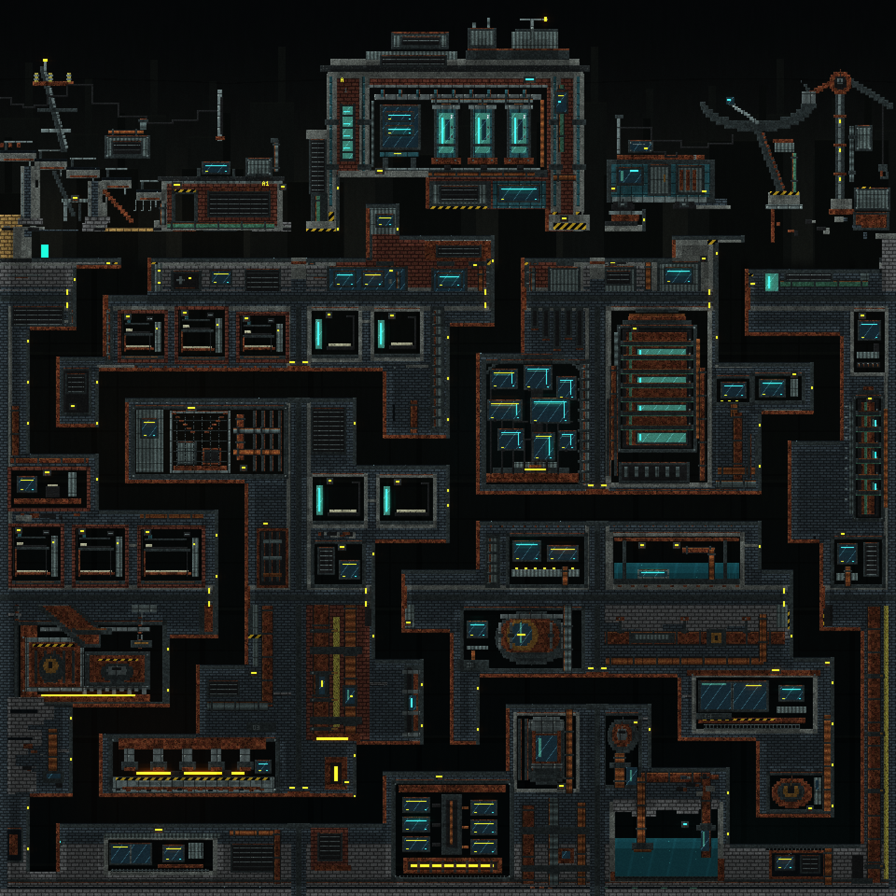

# Blacksite Nine

Blacksite Nine is a continuous 3 × 3 industrial complex. Two ruined wastelands
flank a fortified research laboratory on the surface. Six buried districts pack
worker cells, containment machinery, pressure vessels, crushing equipment and
flooded pumps into heavy walls and narrow service passages. Restrained instrument
light, dark wiring, corroded metal and deep recesses give the complex its
oppressive atmosphere.

All nine districts occupy **one 960 × 960 region of one native world**. Twelve
reciprocal passages connect neighbouring districts. The map buttons select camera
views of that world. Crossing a district boundary preserves
the player, materials and edits on both sides; **R restores the entire complex**.
The separate [Neon Reliquary descent](neon-reliquary-demo.md) retains its four
independently installed district scenes and its existing F11 launcher.



## Open and explore Blacksite Nine

**Desktop:** press **Shift+F11**, or click **Blacksite Nine / Shift+F11** above the
world. A normal Godot launch can pass `-- --blacksite-nine` after the project
arguments. **Web:** choose **Blacksite Nine / 3×3** in the demo menu; Shift+F11 is
also available while the game has keyboard focus. Both entry points install the
same native MicroScenario definition, `showcase/blacksite-nine`; the Web demo ID
is `blacksite_nine`.

Installation starts paused at tick zero in the complete-complex view. Press
**F** for a close view following the player, then **P** to run. The player begins
on the west intake road in Slag Approach. Use **A/D** to move and hold **Space**
to rise through shafts with the existing jetpack; release Space to descend.
Small amber guide marks identify the service passages between districts.

The suggested circuit is **A1 → A2 → B2 → B1 → C1 → C2 → C3 → B3 → A3**.
The [district map](#district-map-and-the-exploration-route) below names each stop
and its connecting passages.

| Control | Action |
|---|---|
| Shift+F11 / Blacksite Nine launcher | Install the original, paused nine-district complex |
| 3×3 tile map | Open the spatial map and frame one 320 × 320 district |
| Whole complex | Frame the entire 960 × 960 composition |
| Follow player / F | Enable a 480 × 270 following view; F toggles follow off again |
| Arrow keys | Pan the camera |
| P | Resume or pause the ordinary simulation and player motion |
| R / Fresh reset | Restore all nine districts and the starting player, paused in the overview |
| F8 | Hide or restore controls and the brush outline for a clean view |
| Depth & haze | Toggle distant scenery, haze, wall exposure and recess shading |
| G | Toggle the existing material glow |
| Mouse paint/erase | Edit the native material cells in the current view |

The map highlights the **player's district** and the control row names it.
Selecting another district view does not move the player. The popup blocks
painting, movement, jetpack and camera-pan input beneath it. After selecting or
closing it, release held mouse buttons and movement/pan keys before a new input
gesture resumes. Ordinary material simulation may continue while the map is
open. **F10 remains the desktop gameplay recorder**. Plain
**F11** continues to open Neon Reliquary.

Current controls and accepted-install handling are defined by
[`CyberBlacksiteNinePresentation`](../../godot/scripts/blacksite_nine_presentation.gd),
[`main.gd`](../../godot/scripts/main.gd) and
[`web_demo_controller.gd`](../../godot/scripts/web_demo_controller.gd).

## District map and the exploration route

The codes correspond to the popup's three rows and three columns. Each district
is 320 × 320 native cells; the complete map begins at world coordinate `(32,32)`.

| Row | West | Centre | East |
|---|---|---|---|
| Surface | **A1 · Slag Approach** | **A2 · Aster Research** | **A3 · Ashworks Breach** |
| Middle works | **B1 · The Intake Warrens** | **B2 · Containment Choir** | **B3 · Condensate Works** |
| Deep works | **C1 · Furnace Ossuary** | **C2 · The Synapse Vault** | **C3 · Blackwater Terminus** |

Slag Approach's collapsed viaduct and leaning transmission frame lead toward the
laboratory's three containment cassettes. Beyond the laboratory, Ashworks Breach
places a damaged receiver dish and abandoned crane above a buried cargo tram.
The middle row contrasts worker bunks and a freight cage with a monitor theatre,
containment galleries and tall condensate machinery. The deepest row is built
around offset crusher jaws, an instrument vault and a flooded pump terminus.
The [surface](../../godot/scripts/blacksite_nine_surface.gd),
[middle works](../../godot/scripts/blacksite_nine_midworks.gd) and
[deep works](../../godot/scripts/blacksite_nine_depths.gd) recipes own these forms.

The suggested circuit visits every district. Cross the intake road into the
laboratory, descend its containment throat, turn
west through the worker inspection gallery, then descend the freight shaft.
Follow the lowest works east and climb the two return wells to the eastern
wasteland. Additional connections form useful loops: the western maintenance
well links A1 directly to B1, the central utility throat connects B2 to C2, the
condensate artery connects B2 to B3, and the surface exit joins A2 to A3.

Every horizontally or vertically neighbouring pair has a reciprocal passage.
There are **twelve shared ports**, all authored into the same native geometry:

| Neighbours | Shared passage |
|---|---|
| A1 ↔ A2 | Laboratory intake road |
| A2 ↔ A3 | Decontamination exit |
| B1 ↔ B2 | Worker inspection gallery |
| B2 ↔ B3 | Condensate service artery |
| C1 ↔ C2 | Furnace transfer tunnel |
| C2 ↔ C3 | Sump control gallery |
| A1 ↔ B1 | Western maintenance well |
| A2 ↔ B2 | Laboratory containment throat |
| A3 ↔ B3 | Eastern service descent |
| B1 ↔ C1 | Ossuary freight shaft |
| B2 ↔ C2 | Synapse utility throat |
| B3 ↔ C3 | Blackwater return well |

[`CyberBlacksiteNineLayout`](../../godot/scripts/blacksite_nine_layout.gd) owns
district positions, passage offsets, orthogonal route centre lines and the tour
indices `[0,1,4,3,6,7,8,5,2]`. Internal boundaries are ordinary material cells and
openings. Moving through them requires no scene installation, loading screen,
wraparound or player teleport.

## What persists when the camera or district changes?

The tile map, whole-complex button, following view and camera pan preserve the
installed recipe, cell state, tick, player and pause state. They do not reconstruct
an offscreen district. Edits made in one district remain when looking at another
or returning to it. The fixed interest region `[32,32,960,960]` keeps the whole
complex admitted under the ordinary native scheduler while the camera moves.
It does not introduce a streamed-world subsystem or an offscreen catch-up rule.

**R** applies the installed definition again: all nine districts, their Water and
the initial player placement are restored together, and the view returns to the
paused overview. Launching Blacksite Nine again also installs its original layout.
Choosing a different scenario replaces the complex through the existing host.
Leaving through an ordinary Web demo restores that demo's selected quality and
view size and hides the Blacksite-specific presentation.

Desktop installation is acknowledged by the asynchronous simulation owner
before the accepted scene title and overview change. Web installs synchronously.
A pending installation or blocking experiment/definition modal prevents a second
launcher request from replacing the accepted scene. These are the existing
[MicroScenario host boundaries](microscenarios.md), reused by the new presenter.

## Native construction and the shared seam pass

[`CyberBlacksiteNine.rectangles()`](../../godot/scripts/blacksite_nine.gd)
combines the three row recipes into one ordered construction stream in a finite
1024 × 1024 world. Each row produces tile-local rectangles using the shared
[art helpers](../../godot/scripts/blacksite_nine_art.gd) and existing material
identities. Masonry, consoles, pipes, glass, wires and lamps are native cells with
their existing collision and material behavior. Open corridors are actual Empty
cells.

After composing the art, the complex adds the outside retaining walls, route
floors, shaft walls and reciprocal seam structures. A **final 28-cell-wide clear
band** follows every layout route and crosses each shared port. This final pass
keeps decorative panes, cables, lights and rungs out of the authored circulation
volume. Both sides of a seam share the same collar and passage treatment.

The schema-2 definition uses Baseline transport, the existing Water8/coherence12
setup, the sampled player and paint/erase/player tools. Execution policy remains
owned by the normal host. There are no Rapier bodies, scheduled emitters, scripted
destruction events or observation objectives. Native Water is initially contained
in the authored lower machinery and pools.

| Complete-complex identity | Final checkpoint |
|---|---|
| Ordered construction rectangles | 3,527 |
| Authored cell writes, including overlapping layers | 2,776,918 |
| Material identities, including Empty | 32 |
| Canonical definition bytes | 58,021 |
| Canonical definition SHA-256 | `225b0cdbd677d678cdfd5188df2f8fd17987e7edfbe508049fbbae261f21d489` |

The complete definition must fit the unchanged MicroScenario limits: 4,096
construction records, eight world-areas of rectangle writes and 1 MiB of canonical
JSON. Authored writes include overwritten layers and Empty carves; they are not
the number of occupied cells. Validation completes before native replacement.
The [dated Blacksite Nine evidence](../audits/2026-10-18-blacksite-nine.md) records
the final recipe and source/runtime identities.

## Continuous presentation

The [backdrop](../../godot/shaders/blacksite_nine_backdrop.gdshader) samples
absolute world coordinates for the dead surface skyline, underground wall
courses, distant conduits, haze and fixed grain. It reads the accepted current
and previous material textures and excludes occupied cells, unfinished
material-to-empty transitions and the sampled player. Paint and erase update
that mask through the ordinary publication path.

The separate [exposure grade](../../godot/shaders/blacksite_nine_grade.gdshader)
multiplies the rendered material appearance. Eight bounded neighbouring material
samples distinguish exposed edges from deep recesses; depth darkens the buried
mass while instrument glass and guide lamps remain readable. It excludes Empty
cells and the sampled player. **Depth & haze** controls both the backdrop and the
grade; both are disabled if a modified definition enables rigid bodies.

These effects use the same world positions in the atlas, tile and following
views. There is no per-view parallax, tile tint, camera vignette or time-varying
grain. The scene's ordinary material renderer and glow remain in use. Neither
presentation pass writes cells, supplies collision or introduces lighting,
pressure or thermal simulation.

## Reproduce the atlas and tile captures

Use the pinned Godot runtime with materialized, source-matched native libraries
and a rendering display. The capture helper starts the real desktop scene and
waits for its accepted native installation and render publication:

```sh
godot --path godot --rendering-method gl_compatibility --max-fps 30 \
  --script res://tools/capture_blacksite_nine.gd -- \
  --capture-dir=/absolute/output/directory
```

[`capture_blacksite_nine.gd`](../../godot/tools/capture_blacksite_nine.gd)
captures a paused tick-zero **2880 × 2880** image at three pixels per native cell.
It writes `blacksite-nine.png`, nine **960 × 960** district PNGs named by code and
district, the canonical `blacksite-nine.scenario.json`, and `capture.json` with
camera bounds, recipe hash and runtime identity.
The nine files are exact crops from that one rendered atlas, preserving the same
shared glow; stitching the crops reconstructs the overview. Headless mode is
rejected because it cannot submit the rendered capture.

The retained [portable scene definition](../images/blacksite-nine/blacksite-nine.scenario.json)
can be pasted into the MicroScenario **Definition JSON** editor or passed to the
existing [headless runner](microscenarios.md#headless-runs-from-the-same-definition)
with `--definition=/absolute/blacksite-nine.scenario.json`. Applying the definition
installs a fresh whole complex; the file is authored setup data, not a saved
continuation of an edited or running world.

The native backend is required for this scene. The ordinary GDScript fallback
does not acquire equivalent materials or construction semantics. This is
exploratory scene content. Dated native, controller, visual and browser results
have separate scopes in the [implementation audit](../audits/2026-10-18-blacksite-nine.md);
the scene does not qualify a Water successor, general traversal/body coupling or
production performance.
