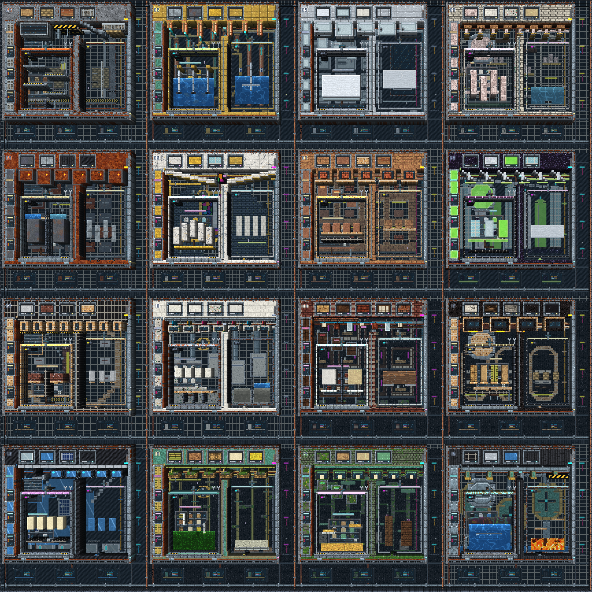
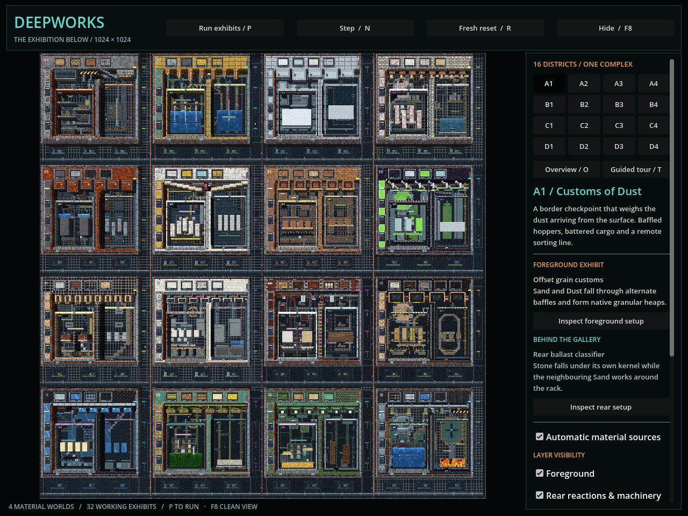

# Deepworks — the exhibition below

## What is the map?

**Current source:** Deepworks is one **1024 × 1024 total map**, divided into a
4 × 4 grid of sixteen 256 × 256 districts. Every district has foreground
architecture, an independent rear apparatus and service layer, local atmosphere,
and a distant architectural scene. Its **32 exhibits** pair one foreground setup
with one rear setup per district. The composition uses all **51 MAT-002 building
materials, IDs 81–131**, including architectural specimens and material swatches;
the [building catalogue](../systems/building-material-catalogue.md) owns their
actual native rules and material identities.

The map extends the layered presentation of
[Strata Theatre](../systems/depth-layers-and-parallax.md), with the connected
industrial composition and small architectural details of the earlier showcase
maps. Numbered bays, valves, pipe clamps, specimen shelves, signal lamps, cargo,
stained windows, domestic niches and distant machinery give each district a
distinct setting. Foreground apertures deliberately expose the rear apparatus.
Full coverage means all four planes are authored across all sixteen districts;
open space remains part of the composition.

Source: [`CyberDeepworksMap.build()`](../../godot/scripts/exhibition/deepworks_map.gd),
[`CyberDeepworksArchitecture`](../../godot/scripts/exhibition/deepworks_architecture.gd)
and [`CyberDeepworksExhibits.build()`](../../godot/scripts/exhibition/deepworks_exhibits.gd).



The atlas is a 2048 × 2048 presentation capture of the 1024 × 1024 map. Image
resolution does not enlarge the simulation. The sixteen retained 512 × 512 tile
images are exact crops of this atlas.

## Open, inspect and replay a setup

Choose **Deepworks** in the desktop feature launcher, pass the user argument
`--deepworks`, or open [`res://deepworks.tscn`](../../godot/deepworks.tscn) directly:

```sh
godot --path godot -- --deepworks
godot --path godot res://deepworks.tscn
```

Use the pinned Godot and materialized native libraries from the
[build guide](local-build-and-validation.md). Deepworks starts paused in the
whole-map Hybrid view. Click a district, then **Inspect foreground setup** or
**Inspect rear setup** for a closer view and the apparatus description. Press
**P** to start its native clocks and material sources.

This is a free-camera material exhibition with painting controls. It has no
ordinary actor session, player-follow mode or F5 actor picker. The shared
foreground circulation is real cleared native geometry: horizontal galleries
and vertical shafts make 24 internal district connections. Camera movement and
district selection preserve the entire map and all ongoing reactions.

Reaction supplies are finite. To watch a selected setup from its original
condition, choose the district or apparatus, press **R**, then **P**. **R resets
all four worlds and all sixteen districts**, reinstalls the source programme,
and pauses; it preserves the camera and selected district. It is not a local
specimen refill. The resulting products remain in the world until further
native interactions, painting or a whole-map reset changes them.



Source: [`CyberDeepworks._ready()`, `reset_exhibition()`, `select_district()` and
`focus_exhibit()`](../../godot/scripts/exhibition/deepworks.gd).

## Districts and their paired exhibits

Codes read left to right, then top to bottom. The descriptions below identify
authored native mechanisms; each specimen follows the current cellular rules,
including competing reactions and later consumption of products.

| District | Foreground setup | Independent rear setup |
|---|---|---|
| **A1 · Customs of Dust** | **Offset grain customs:** Sand and Dust fall through alternating baffles and form heaps. | **Rear ballast classifier:** falling Stone and Sand work around a separate rack. |
| **A2 · Copper Choir** | **The charged choir:** Spark charges actual Metal electrodes beside Water, permitting Steam production. Brass is the casing. | **Remote boiler relay:** another Metal rail and Water bath carry their own charge sequence. |
| **A3 · Frost Mortuary** | **Thermal autopsy:** Fire contacts Packed Snow, producing meltwater and Steam. | **Salt-thaw mortuary:** falling Salt reacts with Packed Snow to form Brine and Slush. |
| **A4 · Halite Exchange** | **Halite percolator:** Water dissolves Rock Salt Block into Brine and Salt. | **Rear salt evaporator:** Fire contacts Brine to produce Steam and granular Salt residue. |
| **B1 · Oxide Records** | **Twin weathering records:** Water and Brine weather Bare Iron into Rusted Steel; the Brine contact threshold is higher. | **Zinc archive etcher:** Acid attacks Zinc Sheet; Salt and Smoke compete with broad corrosion. |
| **B2 · Marble Reliquary** | **Effervescent reliquary:** Acid attacks Marble, with Foam and Salt when the pair rule wins. | **Chalk ossification theatre:** Acid on Chalk Block can release Foam and Dust, alongside competing corrosion. |
| **B3 · Clay Ossuary** | **Terracotta firing shelves:** Lava fires Raw Clay into Terracotta Tile. | **Adobe memory kiln:** Lava fires Adobe Brick into Red Brick. |
| **B4 · Prism Foundry** | **Three-glass furnace:** Lava melts Glass Block, Frosted Glass and Uranium Glass into flowing Molten Glass. | **Snow quench prism:** Molten Glass drops onto Packed Snow, producing Glass and Steam. |
| **C1 · Thermite Chapel** | **Twin thermite censers:** timed Spark pilots convert Thermite Brick into Lava. | **Magnesium vigil:** Spark is consumed as Magnesium Plate converts to Fire. |
| **C2 · Lime Casting Hall** | **Lime slaking cascade:** Water and Quicklime Block produce Steam and Cement, which can cure in the lower moulds. | **Paired curing moulds:** Cement cures through native contact rules; the right mould receives Water. |
| **C3 · Rainward Tenements** | **Leaking wall samples:** Water softens Gypsum Board and Sugar Glass into Paste in separate gutters. | **Rear earthwash:** persistent Water contacts erode Rammed Earth into falling Sand. |
| **C4 · Timber Crematorium** | **Four-fibre crematorium:** a Lava pilot ignites Pine Planks, Cardboard, Bamboo and Plywood; native burn state emits Fire and eventually removes the samples. | **Sandbag unseaming:** Fire converts rigid Sandbag into ordinary falling Sand. |
| **D1 · Polymer Reclaimer** | **Wax reclaim still:** Lava turns Wax Block into Oil, which can flow, ignite and drain around the baffles. | **Polymer recovery retort:** Fire and Polymer Panel can produce Smoke and Oil, followed by further native combustion. |
| **D2 · Poison Garden** | **Poison-to-water cascade:** Water converts Toxic Sludge into more Water; the disappearance of sludge distinguishes conversion from simple filling. | **Sodium caution garden:** Water droplets reaching Sodium produce Steam and Fire. |
| **D3 · Mycelium Crypt** | **Seed reliquaries:** Seeds meet Sand, germinate and grow native Plant. The source does not inject Plant. | **Timber mycelium crypt:** Fungus grows into its actual Wood and Oak Timber substrates; other decorative woods are not assumed compatible. |
| **D4 · Abyssal Sump** | **Density well:** Mercury drops through lighter liquids while Oil and Water retain their own transport rules. | **Geothermal drain:** falling Water contacts Lava to produce Stone and Steam. |

Source: the sixteen apparatus functions and `_exhibit()` records in
[`deepworks_exhibits.gd`](../../godot/scripts/exhibition/deepworks_exhibits.gd).
The A1 rear Stone feed falls through an open chute beside the Gabion; its native
kernel does not spread sideways off a shelf. The
[completion audit](../audits/2026-10-20-deepworks-pr185-completion.md) records
this repair and supersedes the original reaction-pass claim. Retained captures
keep their original recipe identity; post-tick images predate the feed repair.
These demonstrations do not add pressure, thermodynamic or material rules to
the native engine. Their canonical behavior remains in the
[material kernels](../systems/materials-and-rule-kernels.md) and
[building catalogue](../systems/building-material-catalogue.md).

## Four full-size worlds and independent clocks

Every plane owns a separate **1024 × 1024 native material world**. The displayed
map remains 1024 × 1024 in total; the four overlapping planes do not form a
2048 × 2048 terrain or sixteen separately loaded scenes.

| Internal plane | UI name | Running target | Authority and coverage |
|---|---|---:|---|
| `play` | Foreground | 30 Hz | Full map, cleared circulation and sixteen interactive foreground apparatuses. |
| `scripted` | Rear reactions & machinery | 20 Hz | Full map, independent rear scenery and sixteen native apparatuses. |
| `effects` | Atmosphere | 15 Hz | Authored atmospheric material and bounded local environmental sources across every district. |
| `background` | Distant architecture | 0 Hz | Full authored distant map, never ticked; the first copied material publication is cached. |

The **rear layer** is the interacting background set: it runs real native
material drops, reactions and transport. The fourth plane, whose internal key
is `background`, is deliberately frozen distant architecture. Its pixels are
rendered through the same canonical material appearance system. Hiding a plane
only changes visibility; it does not pause its native clock or source schedule.
All districts run together, including those outside the camera.

The host serializes adapter calls into its four isolated worlds. Rendering
consumes copied RG8 packets, never mutable native storage. Failure of a native
step or publication stops the exhibition and freezes presentation; it is not
silently replaced with a successful frame. Layer visibility, parallax, relief,
haze and liquid reflections do not transfer cells, charge, mass or collisions
between worlds. The [depth contract](../systems/depth-layers-and-parallax.md)
owns their rendering and publication rules.

Source: [`CyberDeepworks.reset_exhibition()` and `_fault()`](../../godot/scripts/exhibition/deepworks.gd),
[`CyberDeepworksRuntime`](../../godot/scripts/exhibition/deepworks_runtime.gd)
and [`CyberDepthLayerRuntime`](../../godot/scripts/depth/depth_layer_runtime.gd).

## How do the scripted drops and reactions work?

The current recipe contains **77 bounded source events**. Each record names a
unique ID, district, target plane, rectangle, material, first native tick,
period and repetition limit. Immediately before that plane's due native tick,
the owner applies its due source rectangles, then calls the ordinary native
step. The scheduler supplies reagents and environmental edits; native rules
produce and subsequently move or consume the reaction products. Apparatus
descriptions and expected-product metadata do not paint results into the world.

Reaction feeds have finite repetition limits so completed specimens and their
products can be inspected. Repeating environmental sources and drains are
confined to the effects plane. Switching **Automatic material sources** off
prevents future scheduled writes while existing material continues to simulate.
Switching it back on admits future due ticks; missed opportunities are not
replayed in a catch-up burst. Pause stops the three dynamic clocks and freezes
material animation. **N** advances each active dynamic plane once; this manual
step is not one frame of the normal 30/20/15 Hz pacing.

The **guided tour** starts simulation and follows a serpentine district route,
changing view every 14 running seconds. A nominal circuit takes 224 seconds.
It is camera automation: it neither resets districts on arrival nor delays
their native clocks until visited. A late visit can therefore show an already
completed reaction. Stop the tour and use **R**, then **P**, to replay a room
from its original state while retaining its camera view.

The complete candidate programme and all four authoring layers are validated
before replacement. Invalid dimensions, rectangles, material IDs, schedules or
capacity requests preserve the current exhibition. Successful reset advances
the generation and clears earlier queued commands and event counters. The
[configuration reference](../reference/configuration-reference.md#depth-host-and-deepworks-configuration)
owns event and authoring limits. This dedicated programme does not change the
shared MicroScenario schema or implement general serialized replay.

Source: [`CyberDeepworksRuntime.install()`, `_validate_programme()` and
`_step_layer()`](../../godot/scripts/exhibition/deepworks_runtime.gd),
[`CyberDeepworks._process()` and `toggle_tour()`](../../godot/scripts/exhibition/deepworks.gd)
and [`CyberDeepworksMap.recipe_hash()`](../../godot/scripts/exhibition/deepworks_map.gd).
The recipe hash includes all four layer definitions and explicit event fields;
it identifies authored content, not a saved running state.

## Controls

| Input or control | Result |
|---|---|
| **P / Space** | Run or pause all three dynamic planes and their material animation. |
| **N / Step** | Pause and advance each active dynamic plane by one native tick. |
| **R / Reset** | Restore all worlds, specimens and sources; pause while preserving the current camera. |
| **District grid**, **[ / ]** | Select a 256 × 256 district view without changing material state. |
| **Inspect foreground / rear setup** | Centre a 200 × 200 view on that district's selected apparatus. |
| **O / Home / Whole map** | Show the full 1024 × 1024 composition. |
| **WASD / arrows**, **middle-drag** | Pan the camera. |
| **Mouse wheel** | Zoom around the pointer; supported view widths run from 128 to 1024 cells. |
| **T / Guided tour** | Start or stop the camera tour; starting it also resumes a paused exhibition. |
| **1–5** | Foreground only, quantized relief, four material layers, Hybrid depth, Diorama cutaway. |
| **Layer visibility checkboxes** | Show or hide foreground, rear apparatus, atmosphere or distant architecture. |
| **Automatic material sources** | Enable or disable scheduled material writes; existing native reactions continue. |
| **Paint foreground / Paint rear apparatus** | Choose the independently editable native world. |
| **Left mouse / right mouse** | Add the chosen material / erase, using the selected brush radius of 1–8 cells. |
| **F8 / Tab** | Hide or show the controls for a clean view. |
| **F2 / Escape** | Close the exhibition and return to the feature launcher. |

The painting palette includes Water, Sand, Acid, Spark, Fire, Lava, Salt, Steam,
Brine, Oil, Packed Snow, Thermite Brick, Magnesium Plate, Quicklime Block and
Wall. Pointer coordinates use the selected plane's inverse parallax transform,
so rear painting and the foreground brush target their own visible native cells.
UI interaction, modal menus and focus loss release painting/panning input; a
fresh press is required after those boundaries.
Arrow keys continue adjusting a focused brush slider without moving the camera.
Click the map to return keyboard focus to it, then release and freshly press
any movement key held while using a control.

Source: [`deepworks.gd` input, UI and focus handling](../../godot/scripts/exhibition/deepworks.gd)
and [`CyberDepthCompositor.screen_to_layer()`](../../godot/scripts/depth/depth_compositor.gd).

## Reproduce images and verify changes

The capture helper uses an actual graphical renderer and rejects headless
execution:

```sh
godot --path godot --rendering-method gl_compatibility --audio-driver Dummy \
  --script res://tools/capture_deepworks.gd -- \
  --deepworks-output=/absolute/path/to/deepworks-captures
```

It writes the paused overview, controls, sixteen exact atlas crops, selected
detail views, the four isolated planes, and a later composition after 240
manual ticks of each dynamic plane. The latter is not 240 frames of independently
paced normal play. `--quick` limits capture to the controls, atlas and sixteen
crops. `capture-manifest.json` retains recipe, renderer, engine and runtime
identities plus image dimensions and hashes. Set `CYBERSAND_SOURCE_REVISION` to
the inspected checkout identity when collecting review evidence.

The [focused validation commands](local-build-and-validation.md#deepworks-and-depth-dimensions)
separate source/authoring checks, native reaction checks, controller behavior
and actual rendered pixel tests. Dated acceptance records must identify the
tested source and runtime; these source descriptions do not establish Windows,
browser, physical-actor or lower-end GPU acceptance. The native ABI, material
kernels, dependency pins and ordinary sandbox owner remain unchanged.
