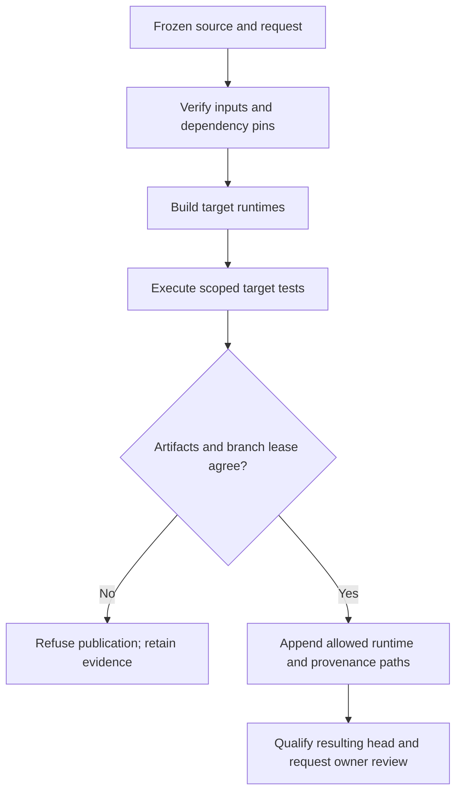

# Repository development and release

A reviewable source change, an executed test, a source-matched runtime, physical
owner acceptance and permission to merge are separate outcomes. Preserve that
separation in the branch, PR description, validation evidence and final handoff.

## Current checkout and repository policy

Work in an identified branch from refreshed accepted main. Inspect the actual Git
root, HEAD, status, relevant dependency pins and LFS state before changing files.
Use the [source identity guide](source-checkpoint-and-recovery.md) for companion
workspace boundaries and recovery. A historical branch name or checkpoint in a
handover is not an instruction to resume that branch.

Track source, tests, documentation, locks, notices and the required retained runtime
libraries. [.gitattributes](../../.gitattributes) puts runtime payloads in Git LFS;
a pointer is not a usable DLL or shared library. Keep generated imports beyond the
three portable bootstrap records, build outputs, exports, toolchains, environments,
caches, private traffic, credentials and machine-local configuration out of source
commits. [.gitignore](../../.gitignore) and [dependency provenance](../../third_party/README.md)
record the concrete boundaries. Never replace historical release hashes to make
a new build appear validated.

For concurrent work, inspect the active candidate and changed paths before editing
its subsystem documentation. Reconcile accepted-main facts on an isolated branch;
do not merge an unaccepted implementation merely to document its promised feature.
[Current status](../reference/status-and-roadmap.md) owns the programme routes.

## Reconciliation and design choices

**Current owner policy (2026-11-06):** agents reconcile long-running or stacked
branches with main as needed, without stopping for owner approval. Integration
must not silently decide a design question, though. When a conflict or merge has to
choose between competing systems, laws or designs, or changes default behavior or
feel, the agent:

- chooses the best-supported option and continues;
- records it under **Design choices** in the PR: what was chosen, the alternative,
  why, and what reversing it would take, written in plain language for a
  non-programmer owner;
- keeps the evidence and qualification needed for that choice. Protected-source
  transitions, provider policy and release gates still apply.

Purely mechanical conflicts (text, docs, routing) need no entry. The owner reviews
these notes asynchronously and may redirect later. This adds no gate: merging to
main, Ready, deleting finished work and default promotion remain owner actions as
before.

To limit drift, prefer refreshing long-running branches from main after significant
main merges, and land a base before stacking more than one dependent layer on it.

## Current CI provider and draft gating

Routine active CI uses literal GitHub-hosted runner labels. The
[provider-policy checker](../../tools/ci/check_ci_provider_policy.py) rejects
`.circleci/config.yml`, active external-provider routing tokens, `*_RUNNER`
indirection and unsupported `runs-on` values. Historical provider experiments are
evidence, not permission to change this policy. Any authorized provider migration
must update the canonical policy and checker together.

Draft PRs intentionally suppress expensive Native, GDExtension/Godot and scoped
Water execution while retaining cheap documentation/provenance checks. For an
implementation PR, the owner-controlled Ready transition enables the applicable
final qualification. A policy/docs-only scope result or Draft skip is not a
runtime pass. This documentation mission remains **Draft/HOLD** until explicit
owner review; it does not promote, merge, release or change defaults.

Before an implementation merge, record the exact resulting-head
Documentation/provenance result and every applicable Native, GDExtension/Godot,
scoped apparatus and graphical gate. A source-sensitive provenance mismatch is a
blocker, even when an earlier binary ran successfully. Inspect actual completed
jobs and original readbacks; a workflow badge alone cannot establish full coverage.
The [development-claims programme](development-claims-remediation-programme.md)
separately owns completion and active-implementation ownership semantics.

## Parallel validation and source-scope advice — 2026-10-31

This stable heading now routes to the accepted
[CI execution and performance policy](ci-execution-and-performance.md). It owns
source-derived matrices, complete budgets, required coverage and advisory timing.
Current workflow files are the scheduling implementation. Separate CI optimization
candidates and their measurements stay candidates until accepted; documentation
must not promote their fan-out, runner use or timing result.

The [Native source-scope advisory](../../.github/workflows/native-scope-advisory.yml)
is informational and sets `native_skip_authorized=false`. It authenticates source
identity and examines both sides of renames; no required job consumes an exemption.
Changing dependency-aware skip policy needs its own owner decision and qualification.
Missing, foreign-source, duplicated, incomplete or failed required evidence cannot
be repaired by treating a skipped aggregate as success.

## Source-matched runtime publication

A source-only documentation edit does not require rebuilding unchanged native
inputs. A native/binding input change does. Use the applicable guarded publisher
and request contract; an old publisher's branch, source SHA or approval does not
provide a lease for new work.

For native Windows/Linux publication, verify:

1. **Source custody:** the intended exact source, native and build-input hashes,
   dependency pins, clean/declared deltas and source branch are identified.
2. **Actual builds and execution:** both required target artifacts and the scoped
   native/Godot/package cases have complete, positive-count, error-free original
   evidence. Compilation and cross-compilation are labelled separately.
3. **Artifact identity:** library SHA-256/size, provenance input set, build/execution
   source and committed LFS object agree. Downloaded bytes are actually available;
   naming a hash alone is not custody.
4. **Publication lease:** the expected branch head still matches the authorized
   immutable request. Reject competing source pushes or mismatched evidence.
5. **Write boundary:** append only the publisher's allowed runtime/provenance
   paths, with the required parent and atomic lease. Native publication normally
   appends the two libraries and two provenance manifests; the actual contract is
   authoritative for its precise scope.
6. **Resulting-head admission:** recheck source/provenance and every applicable
   complete gate after publication/integration. Scoped publisher tests do not
   replace the full implementation or owner acceptance requirements.

[Architectural Generator publication](../systems/architectural-generator.md#retained-runtime-publication)
is one concrete existing contract. The
[current/historical gate guide](current-and-historical-validation.md) explains
what repository provenance checks can establish. Do not hand-edit hashes, reuse
an old source lease, overwrite another programme's branch or weaken a failed
required check to complete publication.

## Main-branch protection: exact owner action

The 24 September inspection and proposed owner ruleset are preserved in the
[source-pinned previous guide](https://github.com/techrote/cybersand/blob/00cdb02f103265b6dc5224c68283e9a0c8cb449f/docs/operations/github-development-and-release.md#main-branch-protection-exact-owner-action).
They do not establish today's remote protection state. Inspect current remote
rules with authorized administrative access before claiming protection exists or
changing it. This documentation task neither installs a ruleset nor changes owner
merge authority.

The existing recommendation distinguished a universal Documentation/provenance
check from path-scoped Native/Godot/Water checks that may intentionally skip.
Preserve that scheduling distinction when an owner-authorized protection task is
undertaken; making an intentionally absent job unconditional can deadlock a PR.
The procedural exact-head implementation gates remain required independently of
the remote ruleset's configuration.

## Unresolved CI contradictions

These are source-inspected Web configuration gaps at the recorded accepted source,
not inferred failures of every existing Web artifact:

| Conflict | Source evidence | Separate required work |
|---|---|---|
| Web workflows select Emscripten 4.0.11; builder checks 4.0.20 | [Toolchain workflow](../../.github/workflows/web-toolchain.yml), [Web workflow](../../.github/workflows/web-demo.yml), [builder](../../tools/build_web.py) | Align accepted producer/consumer pins and execute the result |
| Workflow requests `--native-tests` without a separate `--native-cpp` | Same builder argument validation and Web workflow | Supply the supported isolated native bindings |
| `--compile-only` returns before runtime fixtures/export | [Builder control flow](../../tools/build_web.py) | Select and execute the intended runtime/export coverage |
| Runtime lock records export templates as `absent-and-unpinned` | [Godot runtime lock](../../third_party/godot-runtime.lock.json) | Record exact template provenance and qualify reproducible exports |

The companion wrapper's acquisition-base `source_commit` was a previously recorded
identity limitation. Reinspect that separate workspace before treating it as a
current fact; this source repository cannot attest an unseen local wrapper.
Issue #3 and the canonical Web/build guides retain those release responsibilities.
No native/Godot documentation pass resolves Web export or browser acceptance.

## Release gates

Use a clean, identified source checkpoint; materialize required LFS objects; verify
[exact inputs](local-build-and-validation.md#which-build-inputs-are-required); build
and execute the applicable supported-platform matrix. Record source-to-binary
identity, artifact hashes and complete outcomes, including failed, timed-out,
skipped, unavailable and not-run cases. A native build, package import, hosted
software-rendered capture and physical owner evaluation are different evidence.

An external release additionally requires the owner's licensing and distribution
decision. [LICENSE_STATUS.md](../../LICENSE_STATUS.md) records no selected public
license for original work; [third-party notices](../../THIRD_PARTY_NOTICES.md) and
exact Godot/Rapier/godot-cpp records remain required in bundles. Do not invent a
license, public download URL or release claim. Finish the
[documentation checklist](documentation-maintenance.md#documentation-update-checklist)
and obtain the explicit release authorization before publication.

## Isolated Water inertial runtime publication

The Water/Brine sequence-specific publication records remain deliberately dated.
Read the [original Water publication audit](../audits/2026-10-25-water-inertial-publication.md)
for original request schemas, source hashes, platform results and preserved failed
attempts. The historical Water and Brine namespaces were distinct. Those records
qualify their exact input sets; they do not arm a new request or authorize a new
branch write. For current work use the [publication custody rules](#source-matched-runtime-publication)
and the applicable current publisher contract.

## Earlier checkpoint detail

The [source-pinned previous guide](https://github.com/techrote/cybersand/blob/00cdb02f103265b6dc5224c68283e9a0c8cb449f/docs/operations/github-development-and-release.md)
preserves older source identities, publication transcripts and original procedures.
They are dated evidence, not a fresh source lease or permission to act.
