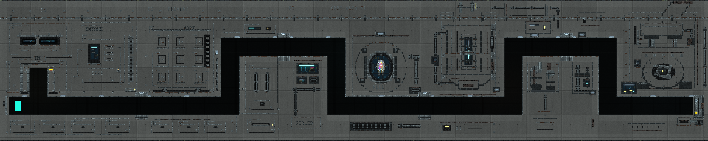

# Grey Area 51

Grey Area 51 is a continuous **five-tile concrete bunker**, one district high.
Heavy cast slabs enclose an inspection bastion, sealed records, a containment
vault, isotope machinery and a disposal lock. Small instrument lights and deep
mechanical recesses interrupt broad concrete faces. Its narrow passages alternate
between upper and lower transfer levels through the installation.

All five **192 × 192** districts occupy **one 960 × 192 region** beginning at
world coordinate **(32,32)**. Four shared **24-cell passages** connect them in
one native world. Choosing a tile changes the camera; crossing its boundary
preserves the player and edited terrain. **R restores the entire bunker**.
[`CyberGreyArea51`](../../godot/scripts/grey_area_51.gd) owns the complete recipe;
the [layout](../../godot/scripts/grey_area_51_layout.gd) owns district positions
and connected route centre lines.



## Open and explore Grey Area 51

**Desktop:** select **Grey Area 51** in the combined feature launcher, press
**Ctrl+F11** in the sandbox, or click **Grey Area 51 / Ctrl+F11** above the world.
For direct entry, pass `-- --grey-area-51` to the normal project launch:

```sh
godot --path godot -- --grey-area-51
```

**Web:** choose **Grey Area 51 / 5×1** in the demo menu. Ctrl+F11 also requests
the scene while the game has keyboard focus. Both controllers use scenario
**`showcase/grey-area-51`** and demo ID **`grey_area_51`**. The existing
[Neon Reliquary](neon-reliquary-demo.md) F11 and
[Blacksite Nine](blacksite-nine-demo.md) Shift+F11 entries remain available.

Installation opens the whole-bunker overview, paused at tick zero. The baseline
sampled player begins in Intake Bastion's lower transfer tunnel. Press **F** to
follow, **P** to run, use **A/D** to move and hold **Space** to rise through the
two security shafts. Release Space to descend through the intervening doglegs.
These entry paths are defined by the
[feature launcher](../../godot/scripts/feature_launcher.gd),
[desktop controller](../../godot/scripts/main.gd),
[Web controller](../../godot/scripts/web_demo_controller.gd) and
[demo catalogue](../../godot/scripts/demo_worlds.gd).

| Control | Action |
|---|---|
| Grey Area 51 launcher / Ctrl+F11 | Install the original five-district bunker, paused |
| 5×1 tile map | Open the horizontal district map; select a 192 × 192 camera view |
| Whole bunker | Frame all five districts in the 960 × 192 overview |
| Follow player / F | Enable a 320 × 192 following view; F toggles follow off again |
| Arrow keys | Pan the camera and leave follow mode |
| P | Resume or pause the ordinary simulation and player motion |
| R / Fresh reset | Restore the entire bunker and selected actor at the starting position, paused in the overview |
| F5, desktop | Open the existing exploratory actor picker; applying an actor restores the selected map |
| F8 | Hide or restore controls and the brush outline |
| Depth & haze | Toggle recessed scenery, concrete formwork, wall grading and recess shading |
| G | Toggle the existing material glow |
| Mouse paint/erase | Edit native material cells in the current view |
| F2, desktop | Close the session and return to the combined feature launcher |

The following view spans the bunker's full height: its camera origin stays at
world **y=32** and horizontal following is clamped to the strip. Manual panning
uses the existing finite-world camera limits. The map highlights the player's
district; viewing another district does not move the player.

While the map popup is open, painting, movement, jetpack and camera-pan input
are blocked underneath it. Release held mouse buttons and movement/pan keys
after selecting or closing the map before beginning another gesture. The popup
does not itself pause ordinary material simulation. **F10 remains the desktop
gameplay recorder**.

On desktop, F5 retains the existing **41 articulated Rapier choices** and sampled
references. Applying a choice restores the map's starting geometry and actor
position; material edits and motion are reset. R retains that actor choice.
The [physical actor programme](physical-actor-programme.md#how-do-i-switch-actors-without-leaving-an-exploratory-map)
owns actor controls and admission. This desktop picker does not extend the Web
actor interface.

## The five districts and connected route

The popup reads from west to east. Coordinates below are world-space tile
origins; every district has the same 192 × 192 extent.

| Code | District | Origin | Architectural landmark and route |
|---|---|---|---|
| 01 | **Intake Bastion** | `(32,32)` | Stepped inspection throat, guard slits and a dead communications plinth above the lower entrance tunnel |
| 02 | **Records Mortuary** | `(224,32)` | Sealed concrete record cassettes and a retracted handling cradle; the lower tunnel rises at local x=120 to the upper exit |
| 03 | **Null Containment** | `(416,32)` | Circular shielding around a suspended specimen and small observation fittings; the upper entrance descends at local x=72 |
| 04 | **Isotope Engine** | `(608,32)` | Buried engine, pressure manifolds and isolation drums; the lower passage rises at local x=120 |
| 05 | **Disposal Lock** | `(800,32)` | A disposal press and sealed terminal lock; the upper entrance descends at local x=56 to the final transfer corridor |

The main route visits **01 → 02 → 03 → 04 → 05**. Intake also has a small
inspection pocket connected to its lower tunnel at local x=52. It is a side
pocket in the same geometry. No district is loaded or regenerated when the
player enters it.

| Neighbours | Shared passage | Boundary x | Centre y, local / world |
|---|---|---:|---|
| Intake Bastion ↔ Records Mortuary | Intake transfer | 224 | 144 / 176 |
| Records Mortuary ↔ Null Containment | Records security throat | 416 | 64 / 96 |
| Null Containment ↔ Isotope Engine | Containment service return | 608 | 144 / 176 |
| Isotope Engine ↔ Disposal Lock | Engine isolation lock | 800 | 64 / 96 |

[`CyberGreyArea51Layout.paths()`](../../godot/scripts/grey_area_51_layout.gd)
defines each orthogonal backbone. The composer adds common portal treatment and
applies a final 24-cell-wide Empty carve to every segment. That pass clears
decorative lamps, glass or cables from the authored circulation volume and gives
both sides of each boundary the same passage. The ends remain finite; the
camera map and route do not wrap.

## What persists across a tile view, map switch or reset?

Within Grey Area 51, the tile map, overview, following view and camera pan preserve
the accepted scenario, cells, player, tick and pause state. They send no terrain
replacement command. Edits made in one district remain when looking at another
or returning to it. The fixed interest region **`[32,32,960,192]`** admits the
whole bunker under the existing native scheduler; it adds no streaming,
offscreen reconstruction or catch-up subsystem.

**R** reinstalls all five districts together and returns to the paused overview.
Launching Grey Area 51 again requests its original layout. Choosing Blacksite
Nine, one of the four independent showcase districts, or an ordinary demo
replaces the installed scenario through the existing host. These are separate
installations; they do not retain each other's offscreen edited state.

[`CyberBlacksiteNinePresentation`](../../godot/scripts/blacksite_nine_presentation.gd)
is the single presentation owner for both connected maps. After an accepted
installation it selects the appropriate title, 3×3 or 5×1 popup, view list and
shaders. It retains one pointer/keyboard release gate and one saved world-view
minimum size across direct Blacksite ↔ Grey switches, restoring the caller's
minimum when leaving the connected-map presentation. Ordinary demos regain their
own presentation and selected quality/view size.

Desktop waits for its asynchronous simulation owner's acknowledgement before
changing the accepted map presentation. Web installs synchronously. Pending
replacement and blocking definition/experiment modals use the existing
[MicroScenario admission boundary](microscenarios.md). These source-level
ownership rules do not turn a headless controller run into browser validation.

## Native concrete and presentation

The composer begins with a native **Concrete58** slab, then adds the
[western districts](../../godot/scripts/grey_area_51_west.gd), central containment
and [eastern districts](../../godot/scripts/grey_area_51_east.gd) using bounded
[tile-local art helpers](../../godot/scripts/grey_area_51_art.gd). Concrete faces
retain substantial quiet area; thin lead joints, black wiring, small steel
fittings and restrained cold-white/cyan/amber indicators describe the embedded
machinery. Decorative material cells retain their normal collision rules.
Walkable passages and small air recesses use actual Empty cells.

The schema-2 definition keeps **Baseline transport**, **Water8/coherence12**,
the ordinary owner execution policy and paint/erase/player tools. Its baseline
enables the sampled player and disables rigid bodies. It adds no scheduled
emitters, events or observation objectives. Native material identities, cell
ABI and capacities are unchanged. The complete recipe must still fit **4,096
rectangle records**, **eight 1024 × 1024 world-areas of authored writes** and
**1 MiB canonical JSON**; overlapping and later-erased layers count as writes.
The [shared MicroScenario contract](microscenarios.md) owns those limits.

The [backdrop](../../godot/shaders/grey_area_51_backdrop.gdshader) adds recessed
bunker wall courses and subdued illumination behind Empty native cells. The
[material grade](../../godot/shaders/grey_area_51_grade.gdshader) adds Concrete
formwork, pour variations, tie holes and damp streaks; bounded neighbouring
material reads distinguish openings from buried mass. Both consume accepted
current/previous render textures, preserve occupied/player masks and use
absolute world coordinates. The same location keeps the same appearance when
framed in the overview, a tile view or the following camera. There is no
per-camera tint, parallax or time-varying grain.

**Depth & haze** controls both effects. They are disabled while rigid bodies
are present, preserving the shared presenter's existing body-mask restriction.
These effects do not write native cells, provide collision or create light,
pressure, temperature or material simulation. The ordinary material renderer
and glow remain in use.

## Capture and validation routes

Use a rendering display and the pinned Godot runtime with materialized,
source-matched native libraries:

```sh
godot --path godot --rendering-method gl_compatibility --max-fps 30 \
  --script res://tools/capture_grey_area_51.gd -- \
  --capture-dir=/absolute/output/directory
```

[`capture_grey_area_51.gd`](../../godot/tools/capture_grey_area_51.gd) starts the
real desktop scene, waits for the accepted native installation and render
publication, and requires a paused tick-zero capture. It writes a **3840 × 768**
overview named `grey-area-51.png`, five **768 × 768** district PNGs,
`grey-area-51.scenario.json` and `capture.json`. The five PNGs are exact crops
of one rendered overview at four pixels per native cell, including its shared
glow. The manifest records camera bounds, recipe identity and runtime identity.
Headless mode cannot submit this rendered capture and is refused.

The [test-selection guide](testing-validation-and-replay.md#connected-authored-scene-validation)
separates native geometry/traversal, desktop/Web-controller lifecycle and actual
rendered-pixel checks. Recipe counts, Concrete/solid fractions, hashes, executed
commands and platform outcomes belong to the
[dated Grey Area 51 audit](../audits/2026-10-19-grey-area-51.md) and
[validation ledger](../reference/validation-evidence.md). A source inventory or
successful headless run does not qualify browser export, Windows interaction,
every actor's traversal or the separate foundational physics programmes.
