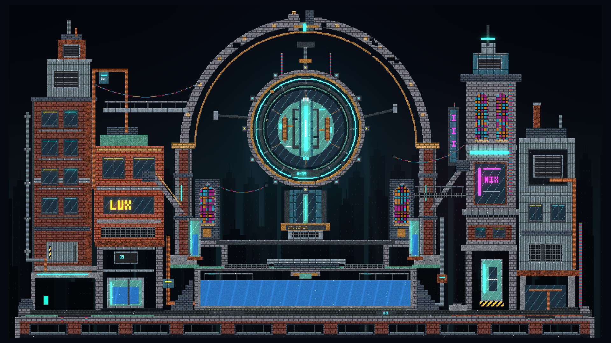
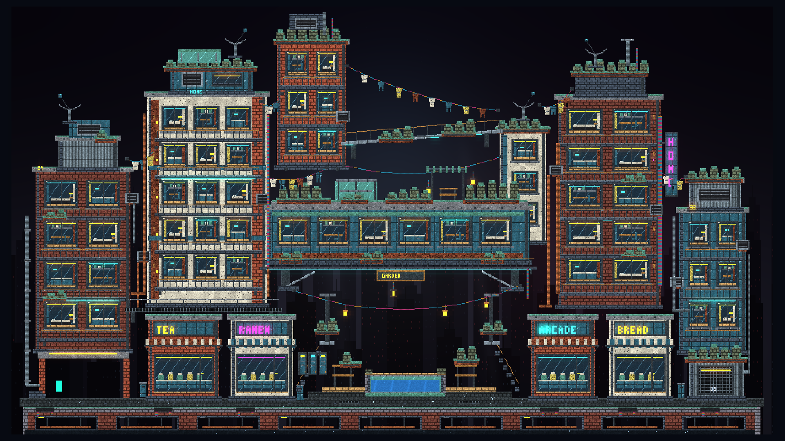
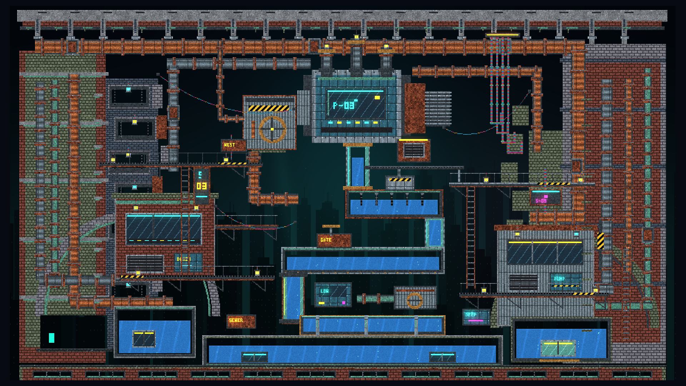
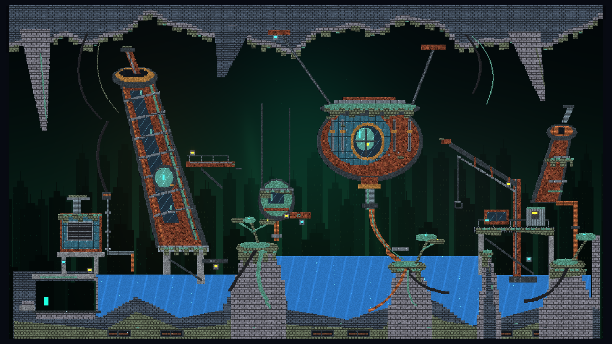

# Neon Reliquary and the city below

Four district tiles descend from an illuminated machine cathedral through an
inhabited residential layer and a dense sewer ravine into a drowned industrial
biome. Each retains a full 960 × 540 overview and four composed close-ups.

| Tile, from top to bottom | Art direction | Demo ID |
|---|---|---|
| Neon Reliquary | Suspended cyan engine, broken cathedral arch, stained glass and flooded vaults | `neon_reliquary` |
| Middle Cyberberbia | Stacked apartments, warm rooms, balconies, roof gardens and an inhabited garden bridge | `middle_cyberberbia` |
| Sewertech Alley | Descending sluice, dense pipe racks, pump machinery, inspection lights and mossy culverts | `sewertech_alley` |
| Industrial Underswamp | Drowned refinery structures, suspended process vessel, broken gantries and overgrown pools | `industrial_underswamp` |

The district selector and **Above / Below** buttons follow this order. Changing
district loads its original paused layout and replaces the current tile's edits.
The viewpoint selector preserves the current tile and its edits. **R / Fresh
reset** restores only the selected tile. The stack has two ends; navigation does
not wrap from the swamp to the reliquary.

Each tile uses one bounded 1024 × 1024 native world. This is explicit scene
selection; no offscreen worlds, seamless cross-boundary simulation or streaming
subsystem are introduced. The logical catalogue positions are `(0,0)` through
`(0,3)`, independent of the local native coordinates inside each tile.

## Neon Reliquary

An illuminated machine hangs inside an industrial cathedral, above flooded vaults
and between asymmetric service towers. The composition emphasizes scale, ornate
construction and contrasting finishes. It deliberately gives visual detail and
atmosphere priority over practical architecture or realistic engineering.

The main forms are a cyan mechanical heart, a monumental stone arch, bronze and
verdigris bands, stained-glass lancets, brick workshops, corrugated cladding,
gantries, pipe fittings, suspended cables and a broad lower cistern. Cyan leads
the palette; magenta signs and small amber lights separate the side quarters.



Actual Godot 4.7 Compatibility rendering. Detail captures:
[suspended heart](../images/neon-reliquary/heart.png),
[drowned nave](../images/neon-reliquary/nave.png),
[west quarter](../images/neon-reliquary/west.png),
[broken crown](../images/neon-reliquary/crown.png).

## Middle Cyberberbia

The first district below the reliquary is visibly inhabited. Apartment stacks
step around a broad garden bridge, with lit rooms, small furnishings, balconies,
roof planters, aerials and laundry lines. Warm cream and brick façades alternate
with cool enamel cladding. Ramen, tea, bread and arcade shopfronts gather around
the lower court; suspended lanterns lead toward a small fountain.



Detail captures: [hanging garden court](../images/neon-reliquary-descent/middle_cyberberbia/middle-cyberberbia-01.png),
[west terrace homes](../images/neon-reliquary-descent/middle_cyberberbia/middle-cyberberbia-02.png),
[rose apartments](../images/neon-reliquary-descent/middle_cyberberbia/middle-cyberberbia-03.png),
[lanterns and the lower court](../images/neon-reliquary-descent/middle_cyberberbia/middle-cyberberbia-04.png).

## Sewertech Alley

Pipe-covered retaining walls enclose a deep service ravine. An oversized pump
head feeds a stepped sequence of glass-fronted sluices above the bottom canal.
Catwalks, ladders, valves, cable bundles, riveted housings, hazard stripes and
inspection lights layer the machinery. Mossy culverts and drowned rooms soften
the brick, corroded metal and utility teal.



Detail captures: [pump stack 03](../images/neon-reliquary-descent/sewertech_alley/sewertech-alley-01.png),
[descending sluice](../images/neon-reliquary-descent/sewertech_alley/sewertech-alley-02.png),
[west inspection quarter](../images/neon-reliquary-descent/sewertech_alley/sewertech-alley-03.png),
[drowned service rooms](../images/neon-reliquary-descent/sewertech_alley/sewertech-alley-04.png).

## Industrial Underswamp

The lowest tile opens into a broad cavern beneath an uneven mineral roof.
A leaning refinery still and a large suspended process vessel dominate the
silhouette, with a small condenser and broken cargo gantry as secondary forms.
Three flooded basins, rooted islands, verdigris growth, long hanging cables and
small inspection lamps give the abandoned machinery a quieter, overgrown finish.
Green haze and restrained rust accents separate it from the denser district above.



Detail captures: [leaning still](../images/neon-reliquary-descent/industrial_underswamp/industrial-underswamp-01.png),
[suspended process vessel](../images/neon-reliquary-descent/industrial_underswamp/industrial-underswamp-02.png),
[flooded root islands](../images/neon-reliquary-descent/industrial_underswamp/industrial-underswamp-03.png),
[abandoned gantry](../images/neon-reliquary-descent/industrial_underswamp/industrial-underswamp-04.png).

## Open and explore the level

**Desktop:** launch the normal project and press **F11**, or click
**Neon Reliquary / F11** above the world, then use **Below** or the district
selector to visit the lower tiles. A command-line launch can pass
`-- --showcase` to Godot. **Web:** all four district names appear in the demo menu.
Both controllers install the same selected `showcase/...` definition through
the existing native MicroScenario host.

[District navigation at 1280 × 720](../images/neon-reliquary-descent/district-navigation.png)
shows the selector, neighboring-tile controls and independent viewpoint row.

| Control | Action |
|---|---|
| District menu | Load the selected district's original paused layout |
| Above / Below | Load the neighboring tile in the top-to-bottom stack |
| Viewpoint menu | Frame the complete scene or a close-up without resetting materials |
| P | Resume/pause the ordinary material simulation |
| R / Fresh reset | Rebuild the current tile and return to its paused overview |
| Arrow keys | Pan the camera |
| F | Toggle player follow |
| F8 | Hide/restore controls and the brush outline for a clean scene view |
| Distant city | Toggle the decorative skyline, haze and dust backdrop |
| G | Toggle the existing material glow |
| Mouse paint/erase, A/D, Space | Existing material tools, player movement and jetpack |

Each tile starts paused at tick zero. The player starts in an open west landing;
the tiles have no objectives, scheduled destruction or automatically refilled
emitters. Water in the cistern and inspection vessels is ordinary native Water.
Reset restores the authored material layout after exploration or edits.

| Viewpoint | Origin | Logical view |
|---|---|---|
| The whole reliquary | 32, 16 | 960 × 540 |
| The suspended heart | 272, 96 | 480 × 270 |
| The drowned nave | 272, 286 | 480 × 270 |
| West service quarter | 32, 88 | 480 × 270 |
| The broken crown | 272, 16 | 480 × 270 |

This table describes the original top tile. Each lower tile defines its own four
detail viewpoints in its recipe. The presentation fits each logical view to the
available window. Leaving any district through the Web demo menu restores the
selected ordinary quality/view.

## How the scene is authored

[`CyberNeonReliquary`](../../godot/scripts/neon_reliquary.gd),
[`CyberMiddleCyberberbia`](../../godot/scripts/middle_cyberberbia.gd),
[`CyberSewertechAlley`](../../godot/scripts/sewertech_alley.gd), and
[`CyberIndustrialUnderswamp`](../../godot/scripts/industrial_underswamp.gd) emit deterministic,
ordered native construction rectangles. Arches, rings, cables, masonry, signs,
openings and vessels are real material cells, so painting and erasing changes
the same structure the material renderer displays. The recipe uses existing
material IDs and the schema-2 [MicroScenario contract](microscenarios.md).
[`CyberShowcaseTiles`](../../godot/scripts/showcase_tiles.gd) owns the district
order, title/ID routing and logical stack positions. The lower recipes reuse
the original bounded geometry helpers and existing material palette.

The finite world remains 1024 × 1024. Each tile fixes simulation interest to
`[32,16,960,540]`, keeping its material contents inside the declared scene active
when viewing a detail. It uses Baseline transport and the existing Water8 /
coherence12 setup. It has no scheduled events, observation goals or Rapier bodies.
The four recipes stay within the existing 4,096 construction-record,
eight-world-area and 1 MiB definition limits. These limits remain
unchanged and are checked before native replacement.

| Tile | Ordered rectangles | Authored cell writes | Material identities |
|---|---:|---:|---:|
| Neon Reliquary | 3,973 | 543,468 | 34 |
| Middle Cyberberbia | 3,721 | 683,781 | 34 |
| Sewertech Alley | 3,592 | 1,012,489 | 30 |
| Industrial Underswamp | 3,722 | 492,550 | 25 |

Authored writes include intentional overlapping layers; they are not a count of
unique occupied cells. The recipe contract checks the complete ordered sequence.

The native backend is required. The ordinary GDScript fallback does not gain
equivalent scene construction or material semantics from this addition.
This aesthetic scene is exploratory content; it supplies no Water successor,
traversal, body-coupling or performance acceptance.

## Presentation and ownership

[`CyberShowcasePresentation`](../../godot/scripts/showcase_presentation.gd)
creates district/viewpoint controls and one backdrop for the accepted tile. It reads the existing
accepted current/previous render textures and the existing player rectangle.
It adds no native queries, mutable world image, simulation thread or cell fields.
The normal material palette, emission and glow shaders remain the foreground
renderer.

The [backdrop shader](../../godot/shaders/neon_reliquary_backdrop.gdshader)
draws a restrained distant skyline, coloured haze, shafts and sparse dust only in
empty cells. Current material occupancy, unfinished previous-material transitions
and the sampled player are excluded. Material paint/erase therefore updates its
mask through the ordinary render publication. The atmosphere does not show
through occupied glass, gas or partial Water cells; those continue using the
existing material renderer. These lights and skyline silhouettes are decorative
scenery, with no collision, heat or illumination authority.
The backdrop is disabled for an edited definition that enables rigid bodies;
the authored scene has none.

The top tile keeps its original cyan atmosphere. Middle Cyberberbia adds warm
rose/amber haze around the inhabited bridge; Sewertech Alley shifts toward
utility teal; Industrial Underswamp uses muted green and rust-coloured haze.
The selected palette derives from the accepted district identity, with the same
material/player/transition mask for all four.

New scene installation uses the established desktop worker acknowledgement or
synchronous Web host. A pending reset or open experiment/definition modal blocks
the showcase shortcut. On desktop, this also includes an open actor selector or
an actor installation awaiting acknowledgement. Viewpoint popups block paint
underneath them and require mouse release before paint resumes. F8 also hides the
player/environment and actor launchers and dismisses their tuning panels,
preserving the promised clean view. Accepted showcase installation clears
ordinary sandbox actor prototypes through the existing MicroScenario transition.

## Reproduce the visual captures

Use the pinned Godot runtime and materialized, source-matched native libraries.
The capture script uses the normal desktop scene and its real material/glow
pipeline. A desktop display or Xvfb with software OpenGL is sufficient:

```sh
godot --path godot --rendering-method gl_compatibility \
  --resolution 1920x1080 --max-fps 30 \
  --script res://tools/capture_neon_reliquary.gd -- \
  --capture-dir=/absolute/output/directory
```

It writes five 1920 × 1080 PNGs and a JSON capture manifest with district position,
view, paused tick, runtime and canonical recipe identity. Add
`--tile=middle_cyberberbia`, `--tile=sewertech_alley` or
`--tile=industrial_underswamp` to choose another tile. Add **`--all-tiles`** to
capture all twenty views into four district subdirectories. `--headless` cannot submit rendered frames and is
explicitly rejected by the capture script. The focused
[`test_neon_reliquary.gd`](../../godot/tests/test_neon_reliquary.gd) exercises
construction and both controller lifecycles; the separate
[`test_showcase_tiles.gd`](../../godot/tests/test_showcase_tiles.gd) checks the
four-tile order, new native recipes, district transitions and reset boundaries. The
[`test_showcase_backdrop_render.gd`](../../godot/tests/test_showcase_backdrop_render.gd)
checks real pixels for material/player/transition/edit masking on a rendering
display. Dated results and platform scope belong in the
[four-tile implementation evidence](../audits/2026-10-18-neon-reliquary-descent.md).
The [original Neon checkpoint](../audits/2026-10-18-neon-reliquary-demo.md)
retains the earlier recipe and visual-validation record.
