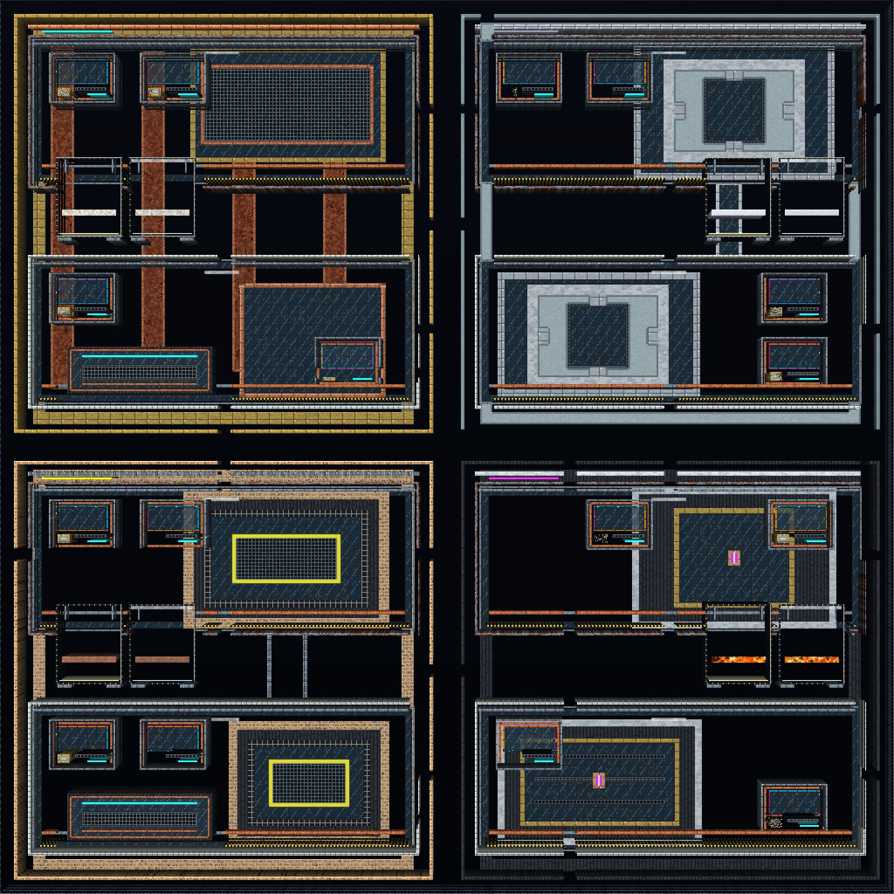

# Procedural Deepworks qualification and visual review

## What is being qualified?

**Current scene: The Fourfold Works.**
[gen007-deepworks.json](../../examples/worldgen/gen007-deepworks.json) describes
one 1024 × 1024 total map, projected into play, scripted/rear, effects/atmosphere
and frozen background/far. Its native hierarchy owns the districts, galleries,
apparatus and architectural details. Reusable rules and plane templates expand
that hierarchy. No authored bitmap or per-material-cell listing supplies the map.

The retained Linux qualification covers reference seed **19301** and declared
variants **19317, 19337 and 19361**. Each contains four major regions, eight named
galleries, 24 tagged microfeatures, 14 structures crossing native chunk boundaries,
two connected optional loops, and four paired native exhibits: eight independently
checked play/rear setups. These are measured fixture quantities, not guarantees
for arbitrary seeds or future recipe edits. See the
[structural receipts](../audits/gen007/qualification.json) and
[capture manifest](../images/gen007/capture-manifest.json).

Structural, initial-containment and exact generation-parity checks cover all four
seeds. Full native mechanism execution and clock-isolation checks use reference
seed 19301; all four seeds have retained rendered comparisons.

The [qualification viewer](../../godot/scripts/worldgen_qualification.gd) uses the
existing semantic-plane runtime and material compositor. Launch it directly:

```sh
godot --path godot res://gen007_qualification.tscn
```

The Workbench 2 graph/tools page can load the same recipe for editing. Its
generation preview and the material-rendered scene are distinct views of the
same native proposal. The viewer starts from a complete validated bundle; sources
and reactions are independently owned by the established dynamic-plane clocks.

The [acceptance ledger](../audits/2026-10-21-gen007-workbench-qualification.md)
records actual measured counts, all declared seeds, source/runtime identities,
timings, memory, retained captures and unresolved requirements. Availability of
the recipe or a passing structural count is not visual acceptance.

## Where are the regions and named galleries?

The gallery numbers below are the viewer selector and retained close-up order.
Each region reuses the upper/lower gallery definitions while its larger apparatus,
material roles and service-cabinet arrangement establish a different composition.

| Region and district capture | Upper gallery | Lower gallery | Regional apparatus |
|---|---|---|---|
| [Copper Choir](../images/gen007/gen007-region-1.png) | [1. Intake Choir](../images/gen007/gen007-gallery-1.png) | [2. Copper Service Cloister](../images/gen007/gen007-gallery-2.png) | Copper organ ribs, manifold grille and pipe chest |
| [Frost Observatory](../images/gen007/gen007-region-2.png) | [3. Meltwater Lens](../images/gen007/gen007-gallery-3.png) | [4. Frosted Survey Vault](../images/gen007/gen007-gallery-4.png) | Braced optical cores within aluminium cradles |
| [Ember Terraces](../images/gen007/gen007-region-3.png) | [5. Firing Terrace](../images/gen007/gen007-gallery-5.png) | [6. Ember Transit Gallery](../images/gen007/gen007-gallery-6.png) | Refractory furnace shells, liners and flue |
| [Basalt Archive](../images/gen007/gen007-region-4.png) | [7. Geothermal Registry](../images/gen007/gen007-gallery-7.png) | [8. Basalt Memory Hall](../images/gen007/gen007-gallery-8.png) | Framed vault doors, locks and register shelves |

The [viewer guide capture](../images/gen007/gen007-guide.png) shows the complete
controls. Choose a seed and gallery, toggle any material plane, or use run/pause,
single step and reset. The scene starts paused. Keyboard shortcuts are P for
run/pause, N for one manual tick, O for the overview and F8 to hide controls;
wheel zoom and middle-button drag change only the view.



## How is deliberate composition kept procedural?

Author the major district silhouettes and routes first, then reuse gallery,
cabinet and apparatus rules inside those places. Named features and stable IDs
make the composition inspectable. Candidate layouts and seeded details supply
variation while structural material roles and passage clearance remain explicit.
Keep the reference seed and all variant seeds declared in the fixture.

Material choices follow the [MAT-002 catalogue](../systems/building-material-catalogue.md):
stable structural walls and containment, local metal/glass/service accents,
bounded reactive contents and thematic background treatment. A random palette
swap does not establish coherent regional identity. Empty air, sightlines and
rear windows are intentional composition choices; four-plane treatment does not
mean every cell must be nonempty.

The recipe report must retain its UTF-8 byte size, reusable rule/template counts,
expanded feature counts and manually fixed placements. Authored region bounds,
routes and shared apparatus proportions are legitimate declarative design;
listing every output material cell is not. Inspect the hierarchy/plane rules in
the workbench to determine which choices are fixed and which depend on seed.

The current recipe is **61,845 UTF-8 bytes**, with 26 grammar rules and 124 plane
templates: 111 projection, eight finite-feed and five link templates. Native
expansion produces 161 semantic features and 336 projections. Its
[builder](../../tools/worldgen/build_gen007_recipe.py) writes only declarative
JSON; the native generator performs feature expansion, seeded candidate selection,
route construction and final material rasterization. The
[qualification manifest](../../examples/worldgen/gen007-qualification.json)
retains the counts and authoring ledger.

The manually fixed design consists of four district anchors, two shared gallery
definitions, one reused optional-loop definition and four exhibit definitions.
The source contains 43 candidate boxes, 83 relative projection rectangles and
eight relative fixture rectangles. Native expansion reuses this feature geometry.
The baseline has no final hard material overrides.
The native route-distance preference selects two of four candidate cabinet sites
in each gallery; all four declared seeds produce different actual cabinet
layouts and different play/rear material hashes. The far apparatus and sparse
effects treatment deliberately retain identical material hashes across these
seeds.

Reusable definitions include upper/lower galleries, both cabinet arrangements,
cabinet windows, gauges, shelves, signals, service rails and optional-loop courts.
Optical cores reuse apertures and four braces; vaults reuse locks; every native
vessel reuses pilot strips, base feet and inlet posts. The eight galleries each
have nonempty treatment and intentional empty cells on all four planes. The
structural receipts retain those per-gallery counts for every declared seed.

## How are routes checked after all material decisions?

The structural table in issue #193 requires one primary route reaching all major
regions, two optional loops and secondary passages. The qualification oracle
must sample the **final projected play material**, after all plane projections
and final hard overrides. A semantic route record alone cannot prove clearance.

The scene's independent clearance check requires a 7 × 7-cell square of final
Empty play cells at every tested route center, then checks four-neighbor
connectivity. It explicitly reaches all four regions, all eight galleries, the
two outboard courtyard loops in Copper/Ember and their secondary connections.
A deliberate blocking hard override is a negative control. The graph describes
a floating clearance profile; it does not certify that a particular walking,
flying or articulated actor can traverse the map.
Actor/controller acceptance remains separately scoped.

Whole-map and tiled generation agree on every material plane, canonical semantic
and projection records, and the normalized union of fixture/link registrations.
The retained test uses reverse-order 128-cell tiles for all four seeds, an
alternate forward 256-cell partition for the reference seed, four independently
configured workers generating 512-cell quadrants, and 31/4096-cell budget slices
through a seam. Native worker comparisons qualify scheduling independently of a
Godot UI preview. Budget exhaustion rejects the attempted edit while preserving
the previously accepted plan.

## How do the paired native exhibits prove their mechanisms?

Each major region contains a corresponding play/rear apparatus. The feed
fixtures provide ordinary native reagents; expected-product metadata is never
used as painting instructions. Run all eight plane-specific setups and record
each helper's completion, actual applications, transport and produced material.

| Paired apparatus | Initial substrate | Supplied reagent | Native product observed |
|---|---|---|---|
| Copper brine retort | Salt | Falling Water | Brine |
| Frost snow lens | Packed Snow | Fire at the contact surface | Water |
| Ember clay kiln | Raw Clay | Falling Lava | Terracotta Tile |
| Basalt geothermal well | Lava | Falling Water | Stone |

The [reaction receipts](../audits/gen007/reactions.json) record 220 manual ticks
per active plane, 16 finite feed applications per apparatus, substrate depletion
and actual product peaks for all eight setups. Products are absent initially and
are never supplied by the feed fixture. Falling-feed setups also require transport
below the inlet; Fire uses its explicit snow contact surface. Removing the feed
or the reaction partner produces none of the claimed product in any apparatus.
Fabricated no-op and aborted-helper receipts are rejected. A helper abort or
script error invalidates the run even when the process exits zero or other
sections report passing assertions.

Rear-only execution must leave play and frozen far data unchanged; effects have
their own owner and clock. Complete fixture application accounting prevents an
unvisited or silently aborted setup from being labelled passed. Finite feeds
expire, and explicit reset creates new Worlds and fresh lifecycle identities.

## What graphical evidence is required?

Use a display-backed Godot compatibility renderer. Linux Xvfb plus Mesa is a
valid software-rendered execution environment when named as such. Headless
no-frame shortcuts do not satisfy graphical acceptance. New required tests use
the `_render.gd` suffix so the existing regression dispatcher supplies a display.

Retain the full composition, each isolated plane, semantic route/socket overlay,
chunk-boundary and theme-transition crops, close-ups and all seed comparisons.
Captures must identify the exact source commit/tree, recipe bytes and hash,
native runtime hash, Godot version, renderer/environment and image hashes.
Scope post-step images to their retained evidence; exact clock/fixture lifecycle
claims require corresponding runtime receipts.

The retained [27-image manifest](../images/gen007/capture-manifest.json) identifies
source `2f7f65bf6e80c7258f2bdda19f949760d211b59e`, the exact recipe and local
Build5 native library hashes, Godot 4.7, X11/Mesa llvmpipe, capture dimensions and
each PNG hash. It contains the atlas, viewer and twelve regional/gallery views
linked above, plus:

- Isolated [play](../images/gen007/gen007-play.png),
  [rear](../images/gen007/gen007-scripted.png),
  [effects](../images/gen007/gen007-effects.png) and
  [far](../images/gen007/gen007-background.png) material planes.
- The [final route/socket overlay](../images/gen007/gen007-routes-sockets.png).
- Exact atlas crops across native chunk boundaries
  [x64](../images/gen007/gen007-chunk-seam-x64.png) and
  [y128](../images/gen007/gen007-chunk-seam-y128.png), and thematic transitions
  [x512](../images/gen007/gen007-central-vertical-seam.png) and
  [y512](../images/gen007/gen007-central-horizontal-seam.png).
- The same world coordinates for seed
  [19317](../images/gen007/gen007-seed-19317.png),
  [19337](../images/gen007/gen007-seed-19337.png) and
  [19361](../images/gen007/gen007-seed-19361.png).
- The rendered composite [after 220 manual step calls](../images/gen007/gen007-after-220-ticks.png),
  with no product painting.

The post-step image is a visual witness after the capture script's 220 successful
manual step calls. Its manifest does not retain per-layer clocks or fixture
lifecycle receipts for that particular captured runtime instance. The separate
[reaction report](../audits/gen007/reactions.json) proves mechanism completion,
clock isolation and application accounting for its own executed fixture run;
those receipts do not attest the image instance's exact state.

Inspect these images against the actual
[Deepworks atlas](../images/deepworks/deepworks-atlas.png), its retained detail
captures and [exhibition guide](deepworks-exhibition.md). Record the visual
judgment separately for composition, regional coherence, route readability,
layer correspondence, detail density, material roles and visible seams.
Passing feature counts is not evidence of equal polish. A deficient pass requires
an explicit fix and a fresh capture, or an honest open gate.

The retained 2026-10-21 review gives this scene a **qualified pass for approaching
the deliberate modular Deepworks style**: regions have distinct apparatus at
room scale, upper/lower arrangements differ, paired vessels have support and
inlets, and material accents connect the machinery. It still has broader negative
spaces, one frequently reused service-cabinet family and less varied fine
machinery than hand-authored Deepworks. Some variant cabinet sites overlap focal
far forms; in seed 19317 a gold plinth band crosses the lower Copper grille.
These remain composition limitations in the qualified pass. Equal polish and
owner aesthetic approval are not claimed. The audit preserves the earlier
sparse/repetitive visual failure and the subsequent corrections separately from
structural test success.

## How are cost and performance claims reported?

GEN-007's bounded candidate indices accelerate sampling by identifying nearby
grammar features, routes and projections. They preserve canonical record order
and still use the original geometry/mask tests. Index creation is charged to
preparation work and memory. Conservative logical charges remain explicit and
must fit declared recipe limits; the indices do not authorize unbounded output.

The recipe declares at most 4,000,000,000 logical operations for a whole four-plane
bundle, 16,000,000,000 for generic final-raster validation, 16 MiB of charged
plane-plan storage and 64 MiB of publication data. The four qualified seeds fit
those limits. Native grammar storage and plane-plan storage are separate charges;
neither is process memory. Seed 19337 leaves only about 0.8% of the plane-operation
budget despite four unused template slots. New seeds or denser edits can receive
an explicit bounded refusal and require fresh qualification.

Report actual local generation, validation and preview durations separately from
logical units. Include compiler/runtime, OS/CPU, renderer, resolution, seed,
worker/slice settings and peak-memory measurement method. A charged-operation
heatmap is an estimate; a measured-chunk-time heatmap is local timing at chunk
resolution. Neither establishes target-PC performance or per-cell timing.

The declared process envelope is **2 GiB for headless qualification/reactions**
and **4 GiB for graphical execution**. The original provisional 2 GiB graphical
bound failed during cold Mesa rendering and remains a retained failure. The
cold/warm difference is consistent with renderer initialization and shader-cache
overhead; the measurements do not attribute the peak to a particular allocation.
The final canonical software-renderer run uses `LIBGL_ALWAYS_SOFTWARE=1`,
`LP_NUM_THREADS=2` and `GALLIVM_PERF=nopt`; its fresh XDG/Mesa-cache peak fits the
revised 4 GiB envelope. Cold and warm timing/RSS records, Godot static allocation
peak, native charged storage and their different scopes are retained in the
[audit](../audits/2026-10-21-gen007-workbench-qualification.md) and
[raw evidence directory](../audits/gen007/). The Linux process wrapper records
the maximum child/descendant RSS, not aggregate simultaneous process-tree memory.

## How can the retained qualification be reproduced?

Use the pinned Godot version and a source-matched native extension following
[local build and validation](local-build-and-validation.md). Run these Linux
commands from the repository root. Set the executable path to the pinned local
installation; output goes to a fresh temporary directory. Keep other native
builds and Godot tests idle when comparing timings.

```sh
GEN007_GODOT=/absolute/path/to/Godot_v4.7-stable_linux.x86_64
GEN007_OUT="$(mktemp -d /tmp/cybersand-gen007.XXXXXX)"
export CYBERSAND_SOURCE_REVISION="$(git rev-parse HEAD)"
export XDG_DATA_HOME="$GEN007_OUT/data"
export XDG_CONFIG_HOME="$GEN007_OUT/config"
export XDG_CACHE_HOME="$GEN007_OUT/cache"

python3 tools/worldgen/build_gen007_recipe.py
git diff --exit-code -- examples/worldgen/gen007-deepworks.json examples/worldgen/gen007-qualification.json

CYBERSAND_GEN007_QUALIFICATION_REPORT="$GEN007_OUT/qualification.json" \
GEN007_RSS_LIMIT_BYTES=2147483648 GEN007_CACHE_STATE=headless-no-renderer-cache \
python3 docs/audits/gen007/measure-process.py "$GEN007_OUT/qualification" \
  "$GEN007_GODOT" --headless --audio-driver Dummy --path godot \
  --script res://tests/test_gen007_qualification.gd

CYBERSAND_GEN007_REACTIONS_REPORT="$GEN007_OUT/reactions.json" \
GEN007_RSS_LIMIT_BYTES=2147483648 GEN007_CACHE_STATE=headless-no-renderer-cache \
python3 docs/audits/gen007/measure-process.py "$GEN007_OUT/reactions" \
  "$GEN007_GODOT" --headless --audio-driver Dummy --path godot \
  --script res://tests/test_gen007_reactions.gd
```

The graphical test requires a display; a headless renderer fails the gate.
Use fresh graphical XDG and Mesa paths for the cold run, then reuse them for the
warm comparison and full capture:

```sh
export LIBGL_ALWAYS_SOFTWARE=1 LP_NUM_THREADS=2 GALLIVM_PERF=nopt
export XDG_DATA_HOME="$GEN007_OUT/render-data"
export XDG_CONFIG_HOME="$GEN007_OUT/render-config"
export XDG_CACHE_HOME="$GEN007_OUT/render-cache"
export MESA_SHADER_CACHE_DIR="$GEN007_OUT/render-cache/mesa"

GEN007_RSS_LIMIT_BYTES=4294967296 GEN007_CACHE_STATE=fresh-XDG-and-Mesa-cache \
python3 docs/audits/gen007/measure-process.py "$GEN007_OUT/render-cold" \
  xvfb-run -a -s '-screen 0 1280x1280x24' "$GEN007_GODOT" --path godot \
  --rendering-method gl_compatibility --audio-driver Dummy \
  --script res://tests/test_gen007_qualification_render.gd

GEN007_RSS_LIMIT_BYTES=4294967296 GEN007_CACHE_STATE=warm-repeat-after-canonical-cold-render \
python3 docs/audits/gen007/measure-process.py "$GEN007_OUT/render-warm" \
  xvfb-run -a -s '-screen 0 1280x1280x24' "$GEN007_GODOT" --path godot \
  --rendering-method gl_compatibility --audio-driver Dummy \
  --script res://tests/test_gen007_qualification_render.gd

GEN007_RSS_LIMIT_BYTES=4294967296 GEN007_CACHE_STATE=warm-cache-after-render-gates \
python3 docs/audits/gen007/measure-process.py "$GEN007_OUT/capture" \
  xvfb-run -a -s '-screen 0 2304x2304x24' "$GEN007_GODOT" --path godot \
  --rendering-method gl_compatibility --audio-driver Dummy \
  --script res://tools/capture_gen007.gd -- \
  "--gen007-output=$GEN007_OUT/captures"
```

Every required helper must finish: qualification reports all four seeds, workers,
budgets and negative controls; reactions report eight verified exhibits plus the
native-pairs, no-feed and missing-partner sections; the renderer reports its three
sections. The capture command must report 27 actual images and four seed receipts.
The scripts fail incomplete helpers and negative-control regressions; the wrapper
also rejects timeout, exceeded RSS bounds and recipe/runtime changes during the
run. Inspect the resulting images and retain their manifest alongside the JSON
reports. Assertion totals alone do not establish completion.

The final completion gate also needs source-matched Linux/Windows runtime
publication and all applicable exact-head Documentation, Native, Godot and
scoped apparatus checks. See the
[repository acceptance policy](github-development-and-release.md#current-ci-provider-and-draft-gating).
The visual review, platform execution and issue closure remain distinct claims.
