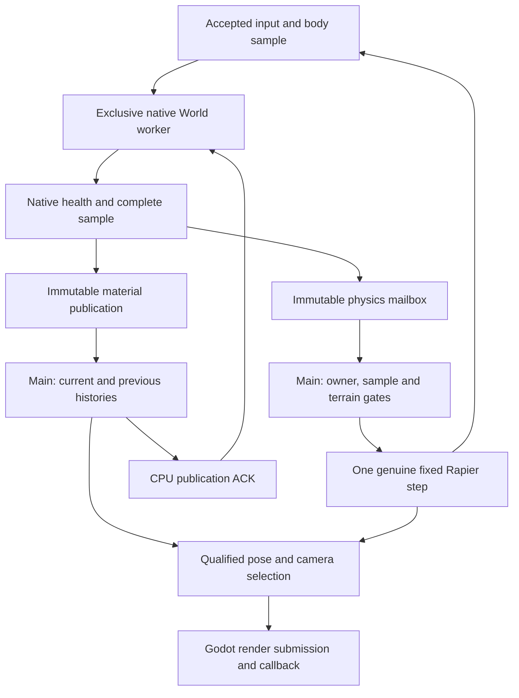

# PUBPRES-COMPLETION-001 — engineering handover

**Status: source qualification candidate; REPAIR/HOLD.** This file records the new integration,
not a retrospective performance PASS. Production defaults, donor branches and
owner merge authority remain unchanged. Owner Windows/NVIDIA acceptance has not
been performed by this mission.

## Contents

1. **Source custody** — Accepted main, immutable donor identities and integration decisions.
2. **Ownership and execution** — The actual worker, Main, physics and rendering boundaries.
3. **Corrections and evidence** — Reproduced failures, repairs and qualified limitations.
4. **Qualification protocol** — Source-matched physical, graphical and platform gates.
5. **Delivery and owner acceptance** — Windows package, launch and practical decision gates.

## 1. Source custody

| Source | Exact identity | Disposition |
| --- | --- | --- |
| Accepted main at integration | `00cdb02f103265b6dc5224c68283e9a0c8cb449f`, tree `06b62d73138028d1f7615b83edc9810491bf6287` | New candidate starts here; preserve accepted actor, Art/session logging, Water and CI work. |
| Original integration [#682](https://github.com/techrote/cybersand/pull/682) | `4302ba2058c1bdac1c3fc54540c078dfc9147573` | Preserved code/evidence donor; not an exact-head performance PASS. |
| Protected archive | `archive/pubpres-integration-001-4302ba20-20261122` at the same `4302ba20` | Read only; no rewrite. |
| Measured original integration I | `8503ec19e4d620e125dc6df2c5c6571b1256cb92` | Historical physical comparison source, only with its own native runtime. |
| Playability D [#719](https://github.com/techrote/cybersand/pull/719) | `d316c281e0abb575eb6302afc12ec44f211460ba`, tree `7a57dc0873dd161abe165f3a60e14e64886d04a8` | Common implementation donor, integrated once. Its failed final campaign remains negative. |
| Later recovered [#740](https://github.com/techrote/cybersand/pull/740) | `adedb2761bad6cce91002ffe50c50c39b5f63645`, tree `3eb5c0490aa29b4569ceebef48ccd338079b63b6` | Selective salvage: source custody, import fix, causal traces and mounted camera fixture. Its conditional-store native optimization was requalified and left out after a negative current-source comparison. No wholesale second integration. |
| New candidate C | `codex/pubpres-completion-001-20261122` | Dedicated branch. Read exact commit/tree from each build/qualification receipt. |

The dedicated [Draft/HOLD PR is #757](https://github.com/techrote/cybersand/pull/757).
Its first published checkpoint is `a784215ea46a8726b53af19ff0f38986ed1c5253`,
tree `a0d690486c5b275ea80bf87f5c57016767e00a2e`, identical to local development
source `1f2cccb9dd64b29410100d2082944ab625d5a729`. Published parents are accepted
main and D. The first local integration was a two-parent merge of accepted main and D:
`5ecdc3ca97aaa862e842cee767b81c52927a24da`, tree
`75c5899aecdf06812dc5f4b4a365366b97652554`. A connector-published commit may
have different commit metadata; any such mapping must prove identical tree and
parents rather than relabel local execution as execution of another commit.

The first targeted hosted campaign uses published
`1aaacaa6ca7038eb469012719af1a4b8473c8cc8`, tree
`96f8680e791f64f1a62500fe7821bb9518a279c2` (the tree of local `0bd6f770`).
[Run 45072609238](https://github.com/techrote/cybersand/actions/runs/45072609238)
retains its original failures. Later fixture, evidence and delivery repairs do
not retroactively turn that run green. Each final package and campaign must bind
its own actual published commit; this document is not a substitute for that receipt.

| Shared source | Reconciliation |
| --- | --- |
| `godot/scripts/main.gd` | Retain D's strict Workbench admission, separate physics publication, optional same-frame/rendezvous paths, dual-history publication and camera/presentation controls. Root owns this integration seam. Add bounded causal observation without changing authority. |
| `godot/scripts/simulation_worker.gd` | Retain D's immutable health-first publications, native ownership and genuine sample wake. Specialist A owns changes. |
| `godot/scripts/simulation_snapshot.gd` | Retain the donor's distinct native/physics/render identities and timestamps; no new mutable cross-thread state. |
| `godot/scripts/rapier_physics_bridge.gd` and `workbench_physics_bridge.gd` | Preserve accepted manual stepping, exact actor/sample/terrain checks and response validation. |
| `godot/scripts/shared_workbench.gd`, `art_batch_panel.gd` | Merge donor camera/Workbench controls with accepted session-only audit and actor composition. Do not restore persistent session-log duplication. |
| `blit_material_publisher.gd`, presentation/coherence/pose modules | Reuse the integrated implementation and keep full-image fallback. Specialist B owns renderer fixes and independent byte oracles. |
| Native adapter | Retain D's source-matched diagnostic/probe and reset failure-safety changes. No old native binary substituted. |
| Windows/qualification tooling | Specialist C salvages the independently diagnosed import fix, repairs stale native-source guards and bounded workflow scheduling, then qualifies actual extracted packages. |

Related programme and donors: [#717](https://github.com/techrote/cybersand/issues/717),
[#577](https://github.com/techrote/cybersand/issues/577),
[#609](https://github.com/techrote/cybersand/pull/609),
[#628](https://github.com/techrote/cybersand/pull/628),
[#651](https://github.com/techrote/cybersand/pull/651).
The [306-artifact recovery handoff](https://github.com/techrote/cybersand/pull/682#issuecomment-7084581385)
is the original evidence catalogue; do not duplicate its multi-gigabyte archive
into source. SWARM, ObjectShard, Water-family, ACT composition, SCRIPT-HOTPATH and
unrelated CI programmes retain their separate ownership.

## 2. Ownership and execution

Native World is owned by its worker. Rapier and scene/UI mutation are owned by
Main. Publications are immutable and independently fenced. A rendering ACK
releases retained CPU data after successful submission; it is not proof of GPU
completion. Neither `frame_post_draw` nor a render FPS counter proves scanout or
physical advancement.

Full ImageTexture publication, legacy guarded presentation and disabled
experimental continuations remain the conservative defaults. Every experiment
has an explicit selector, a bounded trace and a source-matched OFF control.

Causal observation joins sample acceptance, worker latch, native start/end,
healthy mailbox handoff, Main observation, terrain installation, native response
application, genuine manual steps, material consumption, ACK and Main callback
boundaries. The trace records World/session/epoch/sample/revision identities.
Observation does not authorize work, read World from Main, add mailbox polls,
install extra terrain, accumulate time credits or create callbacks.

## 3. Corrections and evidence

### Preserved negative findings

- Original Windows M–I–C run `44785110041` preserved the first 144 actual Rapier
  outcomes but did not establish consistent C-over-I progression improvement.
- Original installed qualification: 22 PASS / 5 FAIL; four Separate startup
  failures and the rendezvous observation failure. These are not rewritten.
- `4302ba20` packaging and documentation failures prevented exact-head
  qualification; obsolete `de109d01` guards and missing matrix `max-parallel`
  are plumbing defects, not passing gameplay evidence.
- D's final run `44963596029` retained Windows import-custody and Linux GPU
  first-read failures. Same-frame continuation did not establish Wave2048 gain.
- Dense/sparse and fresh-storage experiments that moved work downstream remain
  negative unless a new controlled experiment supplies contrary evidence.
- Current-source native conditional-store A/B/B/A measurements preserved all 144
  physical outcomes and material quantities but did not reproduce the historical
  gain. Large current Wave column means were 45.849/45.999/46.206/42.216 ms;
  the candidate run mean was 4.70% slower. The optimization is not selected.
  See the [physics evidence review](../audits/2026-11-22-pubpres-completion/physics-review.md).
- The Linux software-renderer full/stage/target/target/stage/full transition
  sequence gave frame p95 values 8.613/15.536/13.992/14.747/12.836/7.368 ms.
  Target retirement fixes the first-read correctness defect but establishes no
  speed gain. Full publication remains the conservative default. These results
  do not qualify Windows graphics or owner NVIDIA hardware.

### Reproduced in this mission

The default requested-rate blend could briefly weight the old material plane
after a same-size World replacement, despite accepting the new generation and
ACK correctly. Main now requires a qualified same-World predecessor for either
timing policy. The exact old/current histories remain intact; this only removes
invalid visual contribution. The focused production-intake regression originally
failed one of ten checks and now passes all ten, including the next valid
same-World blend. This is a presentation correctness repair, not a timing gain.

The pinned Godot 4.7 timer implementation subtracts the iteration's precomputed
delta from timers created later in that iteration. A controlled reproduction
with 175 ms preceding-frame work made a newly created 150 ms timer expire after
33,460 wall microseconds and two genuine physics callbacks. This explains a
mechanism for the original false observation window; original logs do not retain
enough clocks to reconstruct its exact first decrement. The corrected gate must
still require three callbacks within a real 150,000-microsecond observation and
must preserve a failure for actual starvation. It must not simply await three
callbacks without a deadline.

The renderer specialist reproduced the Safe reachable/R8/two-slot failure on
pinned Godot 4.7 with llvmpipe: the first current-history read contained four
stale pixels; the immediate second read and previous-history read were exact.
This is a real first-read correctness failure. A second-read-only oracle is not
an acceptable repair.

The recovered Radial2D descriptor issue is a specific CRLF-to-LF conversion,
not permission to ignore source changes. Pinning canonical descriptor bytes must
retain unexpected-change and tamper rejection.

Independent cross-review identified two diagnostic-only scope defects in Main:
assuming every physical bridge has a Workbench session, and labelling ordinary
non-Workbench transactions as having passed Workbench terrain/sample gates.
The repair keeps unknown session identity at `-1`, restricts the gate claim to
the actual Workbench path, and adds a real Godot regression. The additive v2
causal reducer separately binds response application to the packet's snapshot
and transaction exit to the genuine completed-step counter; it never treats an
entry, accepted flag from another snapshot or callback as a completion.

### Whole-pipeline diagnosis

The quiet local 65-second full/target/target/full series on `d4fb4804` completed
1,444/1,442/1,418/1,431 genuine steps, with physical-gap p95
61.242/61.701/76.856/63.880 ms. Target retirement did not produce a repeatable
whole-application gain. All ten recovery transitions and both complete GPU
history planes were validated in each arm. The current sparse native packets
can still require full publisher staging: packet sparsity is not evidence of
sparse GPU work. See the [renderer review and raw archive identities](../audits/2026-11-22-pubpres-completion/renderer-review.md).

In an observed 122.383 ms full-publication gap, native work completed after
15.436 ms and handed off after 16.141 ms; the next genuine physics callback
did not enter until 115.353 ms. Solver time was 0.584 ms. There was no intervening
application callback in which an additional Main poll could have progressed
physics. A separate external Linux scheduler witness found Main sleeping in
futex/poll intervals while matching native work was ready, with little measured
Main run-queue delay. This identifies a host/render-loop interval, not the
futex owner, GPU completion, scanout or an NVIDIA driver defect.

A separate stock llvmpipe 9/4/4/9-worker control improved native tick medians
when restricted to four renderer workers, but reduced real 65-second progression
from 1,430 to 1,025/1,021 steps before returning to 1,430. That intervention is
rejected. Conditional native stores, clipped native loop bounds and the measured
cache-line-alignment hypothesis likewise supplied no repeatable end-to-end win;
none is selected. No production thread, Water or publisher default changes.

### Targeted hosted qualification repairs

The first hosted runtime lane independently built all M/I/D/C native closures
for Windows and Linux. Packaging then passed extraction, every-file verification,
tamper/process controls and two actual fresh shipped-command launches. These
facts do not erase subsequent installed authoring or graphical failures.

Three retained failure categories required current-source fixture repairs:

- The old combined authoring fixture expected a prior Art conversation to resume.
  Accepted `ART-SESSION-LOG-001` intentionally preserves preferences and audit
  files while starting fresh in-memory model context. The repaired fixture
  verifies empty new context, a distinct new root audit, and unchanged prior
  audit bytes captured after orderly shutdown. It retains all native authored
  material, generator, actor, equipment, Save/Load and continued-edit checks.
- The small reachable-staging fixture indexed a tile pool that its own policy
  correctly omitted. It now exercises the actual full staging ring and requires
  both owner/format sections to finish. The original exit-zero script error
  remains a failure under the strict log-aware harness.
- Windows also delivered an ordinary desktop mouse event while the camera
  fixture expected its directly injected synthetic pointer to remain fixed.
  An explicit ambient event reproduced all six original failed assertions and
  identical addressed cells on Linux. Only that synthetic-pointer subsequence
  now suppresses ambient viewport input; actual root resizing, normal controller
  remapping and independent pixel picking remain tested. The fixture records
  observed as well as requested positions and restores input before Follow.
  The repaired local graphical gate passes 1,732 checks; Windows must rerun it.

Original Windows Safe physics guards also pass their true 150 ms windows, and
the extracted evaluator passes two actual same-profile launches. The actual
65-second target-blit sustained run nevertheless includes a 608.601 ms Rapier
completion gap. Its matching native handoff occurs after 16.547 ms, followed by
inline draw delivery at 606.805 ms and the next physics callback at 606.922 ms;
the solver itself takes 0.217 ms. No intervening application callback is present.
This is a measured stock Safe/software-ANGLE host gap, not proof of GPU hardware
completion or a physical NVIDIA defect. The two Separate diagnostics terminate
with GLAD initialization errors and Windows access violations before exercising
their publisher fixtures. They remain failed experimental startup evidence.

Independent raw-evidence review also strengthened sustained validation: actual
unique callbacks, complete native/sample/handoff joins, recomputed Water closure,
strict publication serials and all ten pulse/recovery pairs must agree with the
trace. An empty or rehashed contradictory trace cannot pass on summary counts.
Raw V1 does not contain per-command input events; the fixture checks its tape
internally. Do not claim an independent per-command trace that was not recorded.

## 4. Qualification protocol

Qualification separates source tests, headless native/Rapier, real graphical
Linux software rendering, hosted Windows ANGLE/WARP, and owner NVIDIA gameplay.
No category substitutes for another. Local GCC 14.2 development results must
not be described as the pinned hosted compiler result.

Before timing, require exact source/runtime/fixture identity, valid native health,
actual worker participation, complete ordered input tape, identical completed-step
actor/contact outcomes, bounded queues and complete histories. Preserve the
original arm when an import, renderer startup, readback or timeout fails.

Use same-host counterbalanced OFF/ON/ON/OFF or D/C/C/D arms. Fixed-first-144
completed-step outcomes and equal wall-time windows answer different questions;
report both without pooling unlike hosts or averaging percentile populations.
Measure actual steps/s and physical-gap p50/p95/p99/max, native time and handoff,
sample readiness-to-admission, terrain time, frame intervals, accepted revisions,
material age, publication CPU time and memory. Add sustained playback beyond
startup. Final acceptance requires repeatable representative Wave gameplay gains
without equivalent downstream stalls, material corruption or non-Wave regression.
Record exact numerical decision criteria before the frozen campaign.

The final registration adds a separate M/C/C/M whole-source comparison of current
accepted main against C on current Wave2048 Follow and Wave512 Follow. M retains
combined physics/legacy presentation; C requests early publication/coherent
presentation with continuation Off, and both use full material publication.
This compares complete source/policy bundles; it cannot isolate one repair.
I at `8503ec19` lacks the required current-Wave workload readback and receives
an explicit untimed incompatibility refusal for that case, not a substitute arm.

Required correctness includes delayed completion, reset/epoch/pause fences,
stale/missing/advanced ACK, rejected material patches, history recovery,
dense-to-sparse reuse, real save/fresh-process reopen and active shutdown.
The transition oracle retains all 180 accepted revisions and both full histories.
Independent review rotates A over B's coupling, B over A's temporal correctness,
C over measurements/custody, with root reviewing every authority change.

### Independent combined-source review

The pre-final review snapshot is local `eeea6c3277e9b5fad820c7f17a114d8efa4d3cb4`,
tree `124f8071cc68150fcc3c7ee1b339fd1af883e657`. Relative to the targeted hosted
candidate, its Godot/native diff contains only the two repaired fixtures.
Later evidence-upload filtering does not alter product execution.
The subsequent Windows camera repair is fixture-only and retains a discriminating
negative control; its product source remains identical to the reviewed snapshot.

| Reviewer | Authored work | Independent review performed |
| --- | --- | --- |
| A — native physics specialist | Worker causal trace, hold-clock fixture and unselected native experiments | Root Main authority, B's actor/render coupling, C's sustained decoder and owner collection. Independently replayed exact raw native-to-Rapier joins, nine evidence tamper cases and hosted continuation attempts. |
| B — renderer specialist | Target-retirement option, renderer/camera fixtures and sustained gameplay observer | A's callback/worker timing, root's World blend and accepted-main authoring reconciliation, C's actual package/launcher and root's collector. Independently decoded graphical histories, Art audits and raw performance arms. |
| C — platform specialist | Build, package, workflow and evidence tooling | Exact source/compiler/runtime closure, original failures, counterbalanced measurement, root's collector bounds and native experiment source. Independent receipt/ZIP/hash checks supplement authored validators. |
| Root — lead/integrator | Main integration, World-blend gate, Art fixture reconciliation and result collector | Every selected authority, provenance and acceptance change; reconciled current main against the donors and rejected unsupported performance promotions. |

A and B found no remaining blocking production authority or renderer source
finding in this snapshot. Confirmed evidence and collection findings were
repaired, then independently rechecked: copied empty/contradictory traces refuse,
real originals still pass, and admitted run bytes are exactly those archived.
These reviews do not establish a gameplay performance PASS or replace final
installed Windows execution. The [physics review](../audits/2026-11-22-pubpres-completion/physics-review.md)
and [renderer review](../audits/2026-11-22-pubpres-completion/renderer-review.md)
identify original source versions and retained raw artifacts.

## 5. Delivery and owner acceptance

The final evaluator must contain the pinned stock Godot 4.7 executable, exact
native and Rapier DLLs, required runtime components/notices, project resources,
every-file manifest/checksums and an obvious `Open Workbench.cmd`. Default launch
is ordinary conservative Workbench. Experimental comparisons use separate labels.

Extract into a fresh writable directory and actually launch, advance a native
Wave/physical-actor workload, author, Save and reopen in a new process. Verify
source immutability and result export after execution. A built ZIP alone is not
installed-package qualification.

Owner acceptance must cover sustained Wave/actor play, Follow and Free cameras,
fast rotation/effects, dense transitions, painting, pause/reset/save/reopen and
longer playback. Export timing and logs. Windows software-host success remains
separate from the owner's TITAN RTX or other NVIDIA hardware decision.

The packaged `ACCEPTANCE.md` describes the actual **Save start / Load start**
controls: they preserve authored starts, not evolved live Water or velocities.
`Collect Results.cmd` verifies the immutable package and writes a new ZIP outside
it, with exact launch receipts, bounded logs/reports/saved starts and optional
owner notes/screenshots. Limits are 16 MiB per file, 128 MiB total, 512 included
files and 8,192 enumerated entries; omissions remain explicit. Captured run
identity and archived run bytes are the same stable read. The original profile,
saves and package remain unchanged. Installed Windows execution and independent
ZIP-entry verification are required in addition to synthetic collector tests.

Final disposition remains **REPAIR/HOLD** until the source-matched progression,
correctness, installed Windows and independent review gates have actual evidence.
No merge, Ready promotion, automatic default change or donor closure is allowed.
