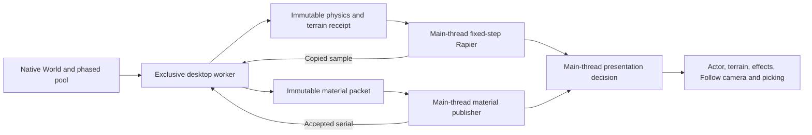

# Workbench publication and progression evaluation

**Draft/HOLD.** PUBPRES-INTEGRATION-001 branches from accepted `de109d0131641d6adc8d25bb9ced7ca3d4991105` (tree `ecca857905825ce6c478952eb0a1ad3902569007`). That is the Wave Waterwall merge. The evaluation joins one native/physics handoff, one material publisher and one presentation decision. Gameplay acceptance and promotion require the matched campaign and owner review.

## Design choices

| Source | Candidate use | Scope left in donor |
| --- | --- | --- |
| [#609](https://github.com/techrote/cybersand/pull/609) `5a36ce49404ed7dc8a9e5815593d250ab990615a` | Camera, mask-checked actors, Engine Lab, two-target texture staging and value-only physics mailbox | Custom Windows EGL engine, Separate rendering launch default, and historical packaging and workflows |
| [#628](https://github.com/techrote/cybersand/pull/628) `e8818048391e1560aaa973392e0de655b6dd46c4` | Bounded observed pose timeline, elapsed receipt checks, current-origin holds, paced recovery and measured material age | Duplicate renderer, runner and raw texture identity as a pose certificate |
| [#651](https://github.com/techrote/cybersand/pull/651) `839f70ff8cf2d6dd7466580e31ed897a4b6e3983` | Registered dense/sparse transition schedule and negative evidence | Second hybrid publisher and pending CPU compaction cache |
| [#335](https://github.com/techrote/cybersand/pull/335) and [#345](https://github.com/techrote/cybersand/pull/345) | One complete retained baseline outside dirty limits, adapted for real Workbench extents and clipped native RG8 patches | Older publication ancestry and fixed 1024-only packet checks |

#566 (`214de85adef2`), #593 (`9628729af052`) and #606 (`2632422aa67e`) are inherited through #609. The candidate uses the stock pinned Godot 4.7 engine, accepted native and Rapier binary inputs, and Safe rendering. The explicit candidate launcher selects `blit`, `early`, `coherent` and `measured` through `CYBERSAND_MATERIAL_PUBLICATION`, `CYBERSAND_DIAG_PHYSICS_PUBLICATION`, `CYBERSAND_DIAG_PRESENTATION` and `CYBERSAND_DIAG_MATERIAL_TIMING`. The same-source comparison uses full, combined, legacy and legacy timing. Default launches without treatment settings use the comparison policies. The strict sample fence and manual Rapier fixed step apply to both arms. The optional donor wait modes are outside the candidate campaign.

## Owners and lifetime

Before publishing either receipt the worker performs all fallible native reads and checks World health. The early mailbox can overlap immutable GDScript payload packing. It grants no material authority. Collider packets follow native source identity, body epoch and hard-surface revision. Material-only refresh requests leave that cache eligible. Rapier gates on exact feedback and complete terrain. The Main callback may drain a pending terrain installation with an additional 32-chunk, 1 ms allowance before material upload.

The worker holds one exact full frame plus the existing maximum of 256 dirty records and twice the larger of the finite default area or Workbench area in dirty bytes. It checks the cap before appending, keeps recovery pending until a complete replacement is acquired, and ignores ACKs beyond the last handed-off serial. Stale ACKs cannot release later bytes. A native packet may retain padding or clipped halo bytes and those bytes count toward the cap.

A complete native packet arrives detached from World and exchange storage. The worker retains that immutable byte array as both the full baseline and the publication while it contains only the baseline. The first unacknowledged delta copies the baseline into a writable journal before appending. Later snapshots copy the accumulated journal for publication. This keeps older snapshots valid through ACKs, refreshes and appended deltas. The trace records the first native capture status and total time inside native capture, including a retry when required. The existing exchange interval also covers worker retention.

The bounded owner-deadline repair discards overdue polling debt only after an
unpaused Workbench's valid consumed body sample has actually completed. It
does not turn unused callback time into native or physical progression. During
that rebased wait, pending control work and render ACKs wake the ordinary owner
turn promptly. No-body and paused waits retain their prior cadence. Native
health observations, prepared-World adoption and the exact sample/terrain
admission fences remain in their existing owners.

The launcher accepts saved Engine Lab worker requests only when the JSON
value is a finite integral number from 0 through 32. Godot parses JSON numbers
as floats, including integer values written by Engine Lab. The profile
round-trip regression checks the real writer, launcher and newly constructed
worker request; strings, booleans, fractions and out-of-range values keep the
existing default. Saved requests still apply only to newly constructed workers.

The blit publisher rotates two persistent linear RGBA8 texture targets. It takes a large, entirely dirty image directly through bounded staging and avoids extracting every tile before the whole copy. When a dense publication invalidates all slots in the recycled plane and the incoming edit touches at most four tiles, it copies the complete accepted GPU plane to the recycled target and stages only those tiles. It never reads from the target it is writing. The two drawable identities and preceding frame remain intact. Small or partial areas normally take the tile path. Neither path swaps texture representations when density changes. Queued `Image` inputs have a distinct immutable lifetime. The stage ring offers reuse distance. A submission receipt establishes queued work and ACK authority. It supplies no completion or scanout timestamp.

On every supported graphical backend, including Windows software ANGLE, a
`blit` or `auto` request uses the existing sparse publisher when its checked
pair can be constructed. The explicit `full` control retains Main's complete
R8/RG8 ImageTexture pair. Capacity or structural refusal still takes the
verified full fallback with its reason recorded. The temporary
`windows_angle_warp_full` automatic override is **Rejected** after the matched
gameplay results below; current receipts retain an empty `policy` field for
schema continuity. No adapter, density or actor heuristic replaces it.

At 128 or more logical tiles, the copy-and-patch transition has its own preallocated one-tile and four-tile staging rings. Each ring uses the same slot limit as ordinary staging and independent textures, samplers and cursors. At 2048² RG8 with three slots the additional GPU texture payload is 491,520 bytes. Setup warms and accounts for those resources. This keeps the transition's staging reuse independent of later ordinary sparse updates.

The coherent controller uses copied Rapier observations with actual completed step timestamps. Historical endpoints need qualified receipts and bounded age. A currently paused step can remain current. A previously current pose may hold briefly while continuously visible and certified against every contributing material texture. After withholding, re-entry requires a fresh endpoint check. Workbench paint and actor selection use the last submitted camera mapping.

## Evidence boundaries

- [#651 graphical qualification](https://github.com/techrote/cybersand/actions/runs/43854022451) retained 60 repeated full-plane seeds and an unresolved transition regression. Production stages and the installed `transition_2048_w1` case must be measured independently of that donor.
- [#609 exact-head application gate](https://github.com/techrote/cybersand/actions/runs/43987453993) passed scoped correctness but retained adverse Windows Follow p95 and maxima. The recorded maxima were 335.063 to 390.963 ms and 248.674 to 460.038 ms. The worst spans included terrain holds and long callback intervals.
- [#628 exact-head application gate](https://github.com/techrote/cybersand/actions/runs/44440448157) passed the corrected history controls on the donor source. [The previous exact-head attempt](https://github.com/techrote/cybersand/actions/runs/44438101082) retains its current-origin hold failure.
- [#456](https://github.com/techrote/cybersand/pull/456) observed predominantly off-CPU `space_step` wall time on the calling thread. A new wall-only trace cannot distinguish Rapier waits, descheduling and its background work. [#449](https://github.com/techrote/cybersand/pull/449) provides the earlier stage comparison.
- The accepted-main defect was reproduced on Windows with stock Godot and the accepted native DLL. Two separate two-byte changes forced two full replacements on each of 1024×1024, 2048×1024 and 2048×2048, even when the second edit followed ACK of the original baseline.
- [Hosted Windows evidence at `5f0681c8`](https://github.com/techrote/cybersand/actions/runs/44655894455/artifacts/14593754055) includes a transition regression on software ANGLE. Frame p95 in A–B–B–A order was 14.122, 42.350, 42.184 and 13.928 ms. In 29 of 30 candidate cycles, the first ordinary reuse of the staging resource used by the history-copy transition coincided with a roughly 38 ms upload-call stall. The separate rings address that observed reuse path.
- On the NVIDIA TITAN RTX at `5f0681c8`, all Wave Flow Follow arms produced a complete 8 MiB native packet on ticks 1–19 despite prompt ACKs. In the longest candidate physical gap of 83.342 ms, native tick wall time was 54.567 ms, render exchange was 8.719 ms and the completed Rapier call was 0.256 ms. This evidence locates the delay before physics admission and leaves the native tick's CPU versus wait split unresolved.

Keep per-arm source and runtime hashes, renderer identity, workload hash, native and actual Rapier receipts, raw frame traces and rejected arms together. `transition_2048_w1` uses synthetic timed edits through Main to isolate the publisher. The Free/Follow workloads launch real native Worlds and Needle instances. Future gameplay timing uses a dedicated Wave Flow cohort with the same authored World and Needle tape. It requires a native construction receipt for the effective `wave_flow_v1` solver and observes completed Wave rounds and task participation. FreeMass remains a matched control, and PressureFlow is a separate workload. Software-hosted and local NVIDIA timing have distinct evidence scopes. The comparison arm is an isolated treatment on integration source. Accepted `main` is a separate source comparison.

## Focused Windows WARP transition comparison

The [focused workflow](../../.github/workflows/pubpres-warp-transition.yml) takes its runtime and project from the [retained Windows evaluation artifact](https://github.com/techrote/cybersand/actions/runs/44706204266/artifacts/14616761210) at `8503ec19e4d6`. It verifies the package, then uses an isolated project copy with a recorded test overlay that can bypass the history copy at sparse re-entry. The ordinary publication policy and installed launchers are outside the overlay.

On one Windows host the workflow requires ANGLE on the actual Microsoft Basic Render Driver. Manual `reentry` replays the original uncapped `transition_2048_w1` tape in fresh processes. The four comparison arms use blit publication in clone, compact full, compact full and clone order. Two full-only references bookend that comparison.

The `steady-sparse` experiment compares both blit and full-only publication on the original transition tape and a steady-sparse tape on the same host. The control keeps the 8×8 updates and substitutes 8×8 updates at the original dense positions. It seeds the unchanged area to the material and condition from the last dense generation before measurement on the original tape. Both tapes warm up for 30 revisions and measure each of the next 180. The scratch publisher uses the exact package source and only the fixture has a tape selector.

Separate untimed replays compare both complete RG8 texture histories against independently advanced expected images after every measured admission. These replays also verify that the histories at the end of warm-up match across the two tapes. The workflow keeps individual run receipts and reports frame intervals, accepted cadence and publication wall time, including the ordinary frames following sparse re-entry. These fixtures contain no active native World or Rapier progression.

The `direct-drawable` comparison retains the original transition tape and both
drawable history identities. Its isolated treatment replaces whole-plane shader
blits with the public `RenderingServer.texture_2d_update` operation on those same
RGBA8 textures. Immutable converted images upload 16 MiB per 2048-square plane;
ordinary sparse staging is unchanged. Full-only bookends surround the original
blit / direct update / direct update / original blit comparison. Per-revision
untimed readback verifies both complete histories. This registered repair probe
does not change the installed application or establish gameplay acceptance.

The [direct-update result](https://github.com/techrote/cybersand/actions/runs/44742148112/artifacts/14632191513)
is **Rejected as the performance solution**. Frame p95 in R–A–B–B–A–R order
was 13.918/42.105/40.012/40.048/42.141/14.042 ms. Both complete histories were
exact at all 180 measured revisions and all six decoded framebuffers matched.
The first dense update spent 27–28 ms in the upload call plus approximately
8.4 ms in conversion; later dense uploads took approximately 4 ms. The old
following-callback stalls moved into publication. The original archive SHA-256
is `9149263ab65317ae0eea46439a8fe06da62fb8be28498331f64c58ffcecde349`.

The next registered `fresh-drawable` probe changes that same whole-plane upload
to public `texture_2d_create` followed by `texture_replace`. Each destination
gets a separate immutable RGBA8 donor, consumed by replacement; destination
RIDs and the two logical histories stay unchanged. This tests whether fresh
storage avoids recovering a previously framebuffer-written texture into CPU
staging. Godot 4.7 and its exact ANGLE implementation support that hypothesis;
only matched end-to-end observations can establish the improvement. Two
untimed 180-revision, both-plane oracles must pass before timed R–A–B–B–A–R
capture starts. The original direct-update option and its negative evidence
remain available. No native or physical behavior changes in this probe.

The `fixed-material` control keeps both full-plane writes in each cycle and
uses Reinforced Concrete for both. The visual condition still varies and all
ten 8×8 edits are retained. It compares the original and fixed-material tapes
under both full-only and blit publication, with unchanged product runtimes.

The [fresh-storage probe](https://github.com/techrote/cybersand/actions/runs/44745728887/artifacts/14633770983)
preserved both byte-exact planes and improved cadence over the original blit
arms. Frame p95 remained 32.656–34.227 ms against 9.275–9.392 ms for the
same-run full-only references. Its 15 long intervals per arm moved to later
sparse frames. These transition-only results motivated the temporary full
publication policy for Windows software ANGLE. The later matched gameplay
campaign rejected that automatic selection; its original captures remain intact.

The [fresh-whole result](https://github.com/techrote/cybersand/actions/runs/44745728887/artifacts/14633770983)
is also **Rejected as the performance solution**. On its separately identified
EPYC 9V45 WARP host, R–A–B–B–A–R frame p95 was
9.275/29.361/34.227/32.656/30.044/9.392 ms. Whole uploads became cheap, but the
ordinary sparse ring's first reuse spent approximately 7.6 ms in its 32 KiB
upload, with subsequent frame tails near 32–34 ms. Both full histories stayed
exact through all 180 admissions. The original archive SHA-256 is
`a0654d50bf58d13ae65c6318813026c1c717404b3a27e85677702daabec3b977`.
Do not compare this host's absolute timing to the earlier EPYC 7763 runs.

The registered `sparse-storage` comparison uses that rejected fresh-whole path
as A and adds fresh immutable layered staging storage as B. Each new RG8
layered donor replaces the storage behind the existing stage RID; the same
three slots, fixed samplers, sparse shader and two complete history RIDs remain.
The first sparse draw can also promote sampled texture storage to render-target
storage in ANGLE, so removing a later upload wait alone is insufficient. Both
untimed history oracles must pass before the R–A–B–B–A–R comparison. Original
frame tails and accepted cadence decide this probe, with gameplay still a
separate source-matched gate.

The [sparse-storage result](https://github.com/techrote/cybersand/actions/runs/44749261508/artifacts/14634428498)
is **Rejected as the performance solution**. R–A–B–B–A–R frame p95 was
9.333/33.678/31.608/33.620/34.651/10.613 ms on this separately identified WARP
host. All four blit arms retained 15 intervals of at least 30 ms out of 180;
neither full-only reference had one. Fresh layered storage reduced the first
reuse upload call from roughly 8 ms to 0.23 ms, but the time reappeared after
submission and in later callbacks. Both complete histories remained exact.
Archive SHA-256:
`db8676d6960d2194aee5e6798f3597410745453e06ded434e60d00ea063c0ac5`.
The earlier fixed-material control also retained the blit tail with unchanged
production code. These mechanisms remain available only through an explicit
workflow dispatch; ordinary source changes now use the installed production
comparison and do not automatically repeat rejected experiments.

The portable **Quick A-B Test.cmd** compares accepted `de109d01`, prior
integration `8503ec19`, and the package's exact candidate in M–I–C–C–I–M order.
**Transition A-B Test.cmd** applies the retained `transition_2048_w1` inputs to
those three actual source renderers. Separate untimed processes first verify
both history planes after every one of 180 admissions. Timing processes use
the same pinned engine, window, uncapped display, source-verified observer and
input sequence, and retain original framebuffers. The current registration
executes the real blit renderer for both the prior integration and the repaired
candidate, including WARP. Earlier `9018d09d` and `e25b76c6` captures retain their
explicitly registered full-policy treatment and are not relabeled. Gameplay remains a separate real-owner lane,
with 144 completed physical steps and wall-time windows reported independently.

## Rejected automatic Windows software-renderer policy

The [original `9018d09d` installed campaign](https://github.com/techrote/cybersand/actions/runs/44762581512/artifacts/14652413186)
completed all six M–I–C–C–I–M gameplay cases and the separate transition lane.
Its archive SHA-256 is
`8d21bba5bf22bbc274cad45df962cbba2f9a449fbb3e9eea29ff91fc7c8e45e1`.
The actual Windows ANGLE host used the Microsoft Basic Render Driver/D3D11,
EPYC 9V74 and the same pinned Godot 4.7 within each comparison. The transition
benefit was repeatable: I frame p95 was 34.674/34.580 ms, while C was 11.497/11.684 ms,
and all 3×180×2 history checks and six actual framebuffer comparisons passed.
That detached renderer lane has no native or Rapier owner.

The real gameplay results did not support automatic full selection. The table
uses each arm's first 144 genuinely completed physical steps; each pair lists
the two I or C processes from the same matched campaign.

| Workload | I physical p95 / maximum, ms | C full-policy physical p95 / maximum, ms | I / C actual steps per second |
| --- | --- | --- | --- |
| Wave Follow 2048², 4 workers | 329.501 / 794.926; 311.527 / 797.770 | 761.834 / 816.319; 754.843 / 812.941 | 4.065, 4.248 / 3.659, 3.474 |
| FreeMass Free 2048², 4 workers | 277.447 / 294.427; 278.138 / 294.675 | 709.246 / 775.608; 742.706 / 789.808 | 4.545, 4.382 / 3.784, 3.897 |

Wave Free 2048² also worsened its physical maxima from 340.677/330.015 ms in I to
796.121/765.983 ms in C. The one-worker FreeMass Follow case improved modestly:
I delivered 3.760/3.777 steps/s with 802.697/809.756 ms maxima; C delivered 3.840/3.827
with 750.805/733.463 ms maxima. Whole-source comparisons include the worker repair,
so they do not isolate the override as the only causal change. They do show that
the transition benefit is insufficient to select full uploads automatically
for ordinary gameplay. The strongest adverse results and the improving case
remain in the original evidence.

The repair therefore removes only that automatic override. Explicit full
selection, the existing sparse renderer, exact histories, guarded fallback,
native health and physical admission remain. The next candidate requires fresh
source-matched qualification. This change makes no claim that the performance
objective or physical Windows/NVIDIA acceptance is complete.

## Actual full-upload gameplay and the remaining main-thread wait

The [installed `673204d1` Windows campaign](https://github.com/techrote/cybersand/actions/runs/44747735460/artifacts/14635876030)
verified the software ANGLE policy in ordinary Workbench. Its transition frame
p95 was 13.707/13.752/13.683/13.745 ms in A–B–B–A order, with both histories
exact. This same-source comparison used full/combined/legacy in A and
policy-full/early/coherent in B. It is not the separate M/I/C source comparison.

Actual Wave Follow remained slow: frame p95 was
277.362/276.355/305.052/303.391 ms and the worst completed physical gap was
315.775/285.221/471.496/376.949 ms. The native and physical clocks are distinct.
In the 471.496 ms interval, native completion arrived at +99.771 ms and the
first healthy matching physical publication at +101.648 ms. A full texture
submission began at +196.306 ms and ended at +461.245 ms. Its existing backend
timer measured 263.125 ms around detached-image creation and
`ImageTexture.update`; the eventual Rapier solver call took 0.701 ms. These are
wall intervals, not per-thread active CPU or independent GPU completion times.
The unchanged health, terrain and completed-step checks still apply.

This localizes an implementable full-path hypothesis that the rejected RGBA8
blit probes did not test. The [bounded full-storage comparison](../../.github/workflows/pubpres-full-storage.yml)
uses that exact retained package and changes only the full R8/RG8 texture leaf
in disposable source copies: update existing storage versus
`ImageTexture.set_image` with the same immutable detached image. Both histories,
native worker, actor input, shader and presentation selectors remain identical.
The test separates detachment and API wall time, checks both complete GPU
histories before timing, and uses ABBA actual Wave Follow on 2048×1024 and
2048² Worlds. Whole frame and physical tails, accepted native progress and
actual process memory determine the result; a shorter API call alone does not.

The original installed-evidence archive SHA-256 is
`8e6535636e1ea9b5db7bdb2e1c4a1415418ac34751c2967128aaf4f5d530f9a0`.
The performance objective remains **unmet** on this evidence and physical
Windows/NVIDIA owner acceptance remains **HOLD**.

The [actual full-storage result](https://github.com/techrote/cybersand/actions/runs/44757331392/artifacts/14639644280)
is **Rejected as the performance solution**. Both treatments passed all
180 current and 180 previous history comparisons before timing. All eight
Wave Follow arms completed at least 144 real physical steps, with exact
first-144 body trajectories within each World. On this separately identified
Windows WARP host (EPYC 9V74, four logical processors), the first-144 results in A/update–B/set_image–B/set_image–A/update
order were:

| World | Frame p95, ms | Physical gap p95, ms | Worst physical gap, ms | Actual steps/s |
| --- | --- | --- | --- | --- |
| 2048×1024 | 480.854 / 567.049 / 521.374 / 468.451 | 246.956 / 246.361 / 245.806 / 247.260 | 685.525 / 713.611 / 691.775 / 719.865 | 9.836 / 9.756 / 9.369 / 10.146 |
| 2048² | 666.884 / 861.690 / 975.493 / 635.723 | 537.691 / 916.146 / 1000.433 / 697.451 | 757.416 / 1023.645 / 1033.163 / 759.239 | 4.348 / 3.622 / 3.357 / 4.061 |

Replacement reduced API p95 from 236–700 ms to 1.1–3.3 ms and increased actual
process peak working set. The complete larger-World frame and physical tails
worsened. In B1's 1023.645 ms physical gap, native completion arrived at
+20.425 ms and the first healthy matching handoff at +22.313 ms. The texture
API took 0.876 ms; Main finished its callback at +25.463 ms, but post-draw
arrived at +1021.295 ms. The eventual Rapier solver took 0.344 ms. B2 retained
the same pattern with a 1033.163 ms gap. These end-to-end intervals demonstrate
real physical waiting after timely native completion; reducing the API wall
interval did not remove the underlying render/post-draw delay. A separate GPU
completion timestamp and per-thread active/wait attribution remain unavailable.

No `set_image` change enters production. Image detachment itself measured only
microseconds in both treatments and remains required for immutable queue
ownership. The prior default-off fixed16 native-wait policy also stays disabled:
its [donor completion audit](https://github.com/techrote/cybersand/blob/5a36ce49404ed7dc8a9e5815593d250ab990615a/docs/audits/2026-11-16-physics-freeze-remediation-002-completion.md)
already rejects its physical p95 and frame-cadence regressions. It was not rerun
as a new repair. The successful full-storage original archive SHA-256 is
`96223317862ce453a2b3ec86e681b5940d776e96a43a5a40a52925b58cc01bf4`.
The first attempt's source-guard failure, before any oracle or timing, is also
retained with SHA-256
`0dd4906220f2245514c5080ff9e78dfb261f736fba45257787d645cb15792270`.

## Bounded worker scheduling control

The final worker bytes `b547f7a5c640f70fed3a15441cb7d89a7478a9c826640be4b901f5d6407d5549`
were compared against the original worker in an isolated, preregistered ABBA
control on base `df804bb40e83af14002fe44e2f7a9745b85ee46f`. It used real Wave
Follow, four participating native workers, identical full RG8 publication and
Godot 4.7 on Linux llvmpipe. This is a component control; the complete candidate
still requires its separate M/I/C application comparison.

Over the same 144 completed physical steps, immediate duplicate publications
fell from 163/166 in A to zero in both B runs. Total repeated publications fell
from 406/412 to 182/181. Frame p95 in A–B–B–A order was
75.770/67.397/70.358/76.837 ms and p99 was
90.271/75.624/80.246/100.038 ms. Physical p95 remained mixed at
124.929/113.128/126.221/122.259 ms; completed physical rates were
14.299/14.744/14.293/14.312 steps/s. Each step still represents exactly 1/60
second of simulation. This establishes reduced repeated work, not recovered
real-time physical progression.

All four first-144 body trajectories and all 143 shared native Water ledgers,
body samples and terrain revisions were exact. The independent real-owner
control passed 60 checks including no-body timing, paused paint, ACK/resync,
reset and stop. The two earlier measured scheduling variants remain rejected:
the broad rebase altered ordinary timing, and the first narrowed version let
ACK/control wakeups affect ordinary waits. Their traces and adverse tails are
retained. The portable evidence includes these originals in
`pubpres-native-physical-local-originals.zip` with SHA-256
`21d5d0c700a9213f2f3975ed07c1c6b3ee963a867e65ccf06092fa735dddfbec`.
