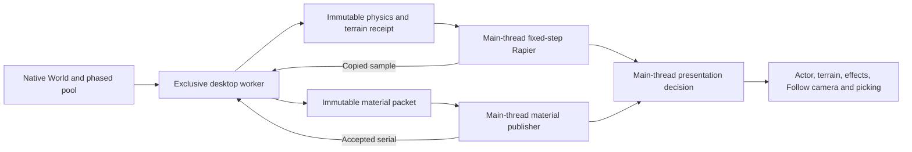

# Workbench publication and progression evaluation

**Draft/HOLD.** PUBPRES-INTEGRATION-001 branches from accepted `de109d0131641d6adc8d25bb9ced7ca3d4991105` (tree `ecca857905825ce6c478952eb0a1ad3902569007`). That is the Wave Waterwall merge. The evaluation joins one native/physics handoff, one material publisher and one presentation decision. Gameplay acceptance and promotion require the matched campaign and owner review.

## Design choices

| Source | Candidate use | Scope left in donor |
| --- | --- | --- |
| [#609](https://github.com/techrote/cybersand/pull/609) `5a36ce49404ed7dc8a9e5815593d250ab990615a` | Camera, mask-checked actors, Engine Lab, two-target texture staging and value-only physics mailbox | Custom Windows EGL engine, Separate rendering launch default, and historical packaging and workflows |
| [#628](https://github.com/techrote/cybersand/pull/628) `e8818048391e1560aaa973392e0de655b6dd46c4` | Bounded observed pose timeline, elapsed receipt checks, current-origin holds, paced recovery and measured material age | Duplicate renderer, runner and raw texture identity as a pose certificate |
| [#651](https://github.com/techrote/cybersand/pull/651) `839f70ff8cf2d6dd7466580e31ed897a4b6e3983` | Registered dense/sparse transition schedule and negative evidence | Second hybrid publisher and pending CPU compaction cache |
| [#335](https://github.com/techrote/cybersand/pull/335) and [#345](https://github.com/techrote/cybersand/pull/345) | One complete retained baseline outside dirty limits, adapted for real Workbench extents and clipped native RG8 patches | Older publication ancestry and fixed 1024-only packet checks |

#566, #593 and #606 are inherited through #609. The candidate uses the stock pinned Godot 4.7 engine, accepted native and Rapier binary inputs, and Safe rendering. The explicit candidate launcher selects `blit`, `early`, `coherent` and `measured` through `CYBERSAND_MATERIAL_PUBLICATION`, `CYBERSAND_DIAG_PHYSICS_PUBLICATION`, `CYBERSAND_DIAG_PRESENTATION` and `CYBERSAND_DIAG_MATERIAL_TIMING`. The same-source comparison uses full, combined, legacy and legacy timing. Default launches without treatment settings use the comparison policies. The strict sample fence and manual Rapier fixed step apply to both arms. The optional donor wait modes are outside the candidate campaign.

## Owners and lifetime

Before publishing either receipt the worker performs all fallible native reads and checks World health. The early mailbox can overlap immutable GDScript payload packing. It grants no material authority. Collider packets follow native source identity, body epoch and hard-surface revision. Material-only refresh requests leave that cache eligible. Rapier gates on exact feedback and complete terrain. The Main callback may drain a pending terrain installation with an additional 32-chunk, 1 ms allowance before material upload.

The worker holds one exact full frame plus the existing maximum of 256 dirty records and twice the larger of the finite default area or Workbench area in dirty bytes. It checks the cap before appending, keeps recovery pending until a complete replacement is acquired, and ignores ACKs beyond the last handed-off serial. Stale ACKs cannot release later bytes. A native packet may retain padding or clipped halo bytes and those bytes count toward the cap.

The blit publisher rotates two persistent linear RGBA8 texture targets. It takes a large, entirely dirty image directly through bounded staging and avoids extracting every tile before the whole copy. Small or partial areas still take the tile path. Neither path swaps texture representations when density changes. Queued `Image` inputs have a distinct immutable lifetime. The stage ring offers reuse distance. A submission receipt establishes queued work and ACK authority. It supplies no completion or scanout timestamp.

The coherent controller uses copied Rapier observations with actual completed step timestamps. Historical endpoints need qualified receipts and bounded age. A currently paused step can remain current. A previously current pose may hold briefly while continuously visible and certified against every contributing material texture. After withholding, re-entry requires a fresh endpoint check. Workbench paint and actor selection use the last submitted camera mapping.

## Evidence boundaries

- [#651 graphical qualification](https://github.com/techrote/cybersand/actions/runs/43854022451) retained 60 repeated full-plane seeds and an unresolved transition regression. Production stages and the installed `transition_2048_w1` case must be measured independently of that donor.
- [#609 exact-head application gate](https://github.com/techrote/cybersand/actions/runs/43987453993) passed scoped correctness but retained adverse Windows Follow p95 and maxima. The recorded maxima were 335.063 to 390.963 ms and 248.674 to 460.038 ms. The worst spans included terrain holds and long callback intervals.
- [#628 exact-head application gate](https://github.com/techrote/cybersand/actions/runs/44440448157) passed the corrected history controls on the donor source. [The previous exact-head attempt](https://github.com/techrote/cybersand/actions/runs/44438101082) retains its current-origin hold failure.
- [#456](https://github.com/techrote/cybersand/pull/456) observed predominantly off-CPU `space_step` wall time on the calling thread. A new wall-only trace cannot distinguish Rapier waits, descheduling and its background work. [#449](https://github.com/techrote/cybersand/pull/449) provides the earlier stage comparison.
- The accepted-main defect was reproduced on Windows with stock Godot and the accepted native DLL. Two separate two-byte changes forced two full replacements on each of 1024×1024, 2048×1024 and 2048×2048, even when the second edit followed ACK of the original baseline.

Keep per-arm source and runtime hashes, renderer identity, workload hash, native and actual Rapier receipts, raw frame traces and rejected arms together. `transition_2048_w1` uses synthetic timed edits through Main to isolate the publisher. The Free/Follow workloads launch real native Worlds and Needle instances. Software-hosted and local NVIDIA timing have distinct evidence scopes. The comparison arm is an isolated treatment on integration source. Accepted `main` is a separate source comparison.
