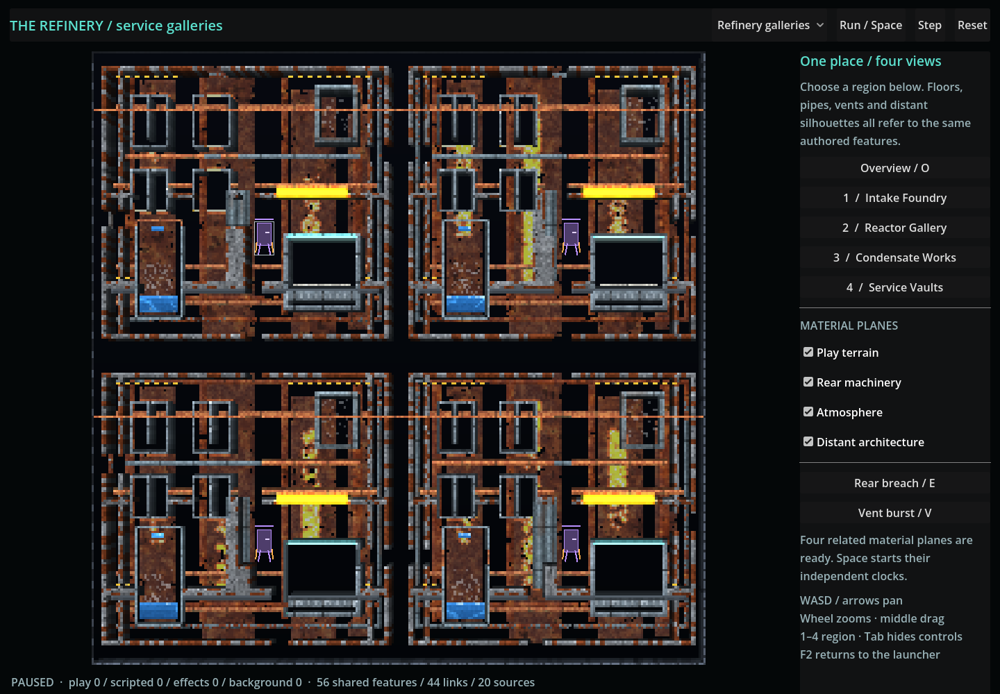
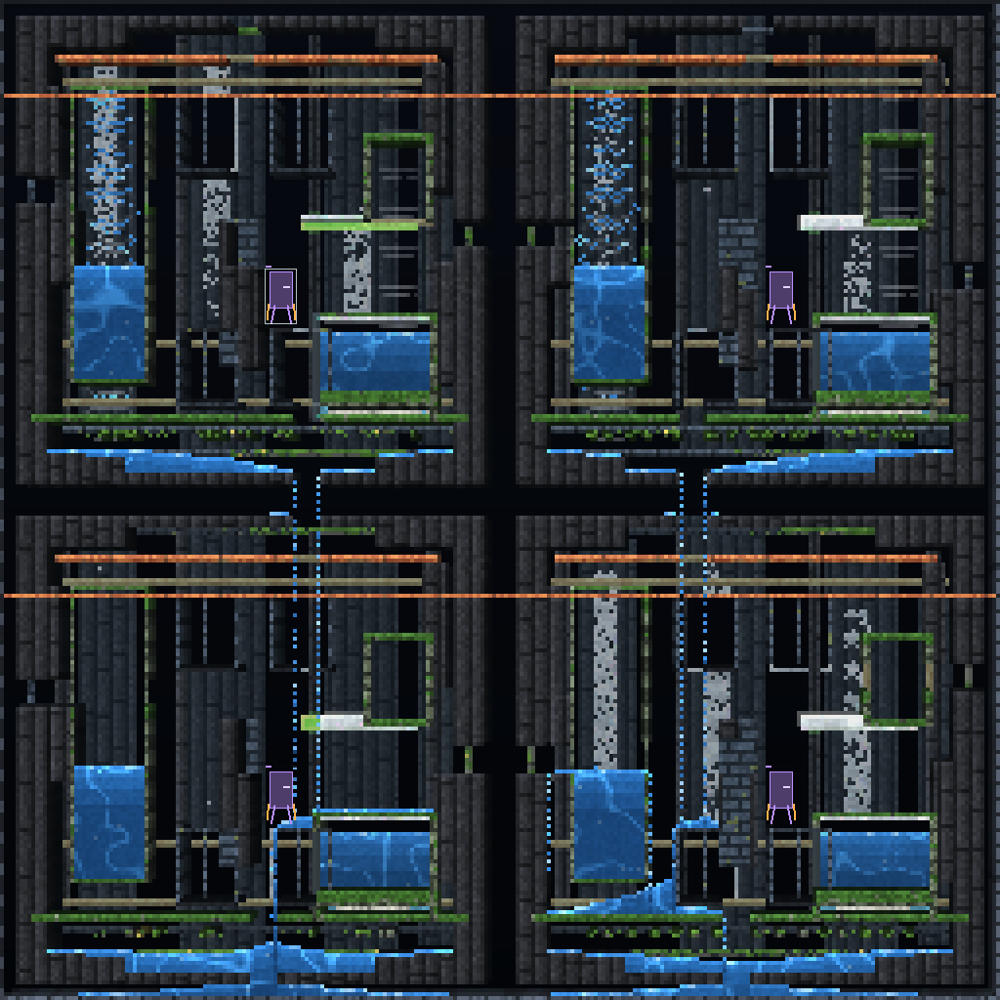

# Authoring and inspecting coherent semantic depth scenes

## Start with one place

Use [semantic-refinery.json](../../examples/worldgen/semantic-refinery.json) or
[semantic-flooded-cavern.json](../../examples/worldgen/semantic-flooded-cavern.json).
Each is a schema-3 GEN-004 recipe with an optional `semantic_planes` schema-1
member. Both cover absolute cells `[-128,-128,256,256]`: four canonical
128-cell regions and sixteen 64-cell chunks. The presentation names the four
regions; the canonical region/rule/slot IDs remain the generation identities.

The refinery uses cast floors, copper service geometry, reactors, inspection
windows, overhead vents and distant industrial towers. The cavern reuses that
semantic vocabulary with basalt ribs, flooded passages, ruined masonry,
mineral silhouettes and restrained fog. Both include a native Salt/Water reactor,
a waterfall/spray pair, an atmospheric vent/drain, a matching rear service pipe,
a machinery footprint and explicit bounded blast/burst event links.

Routine authoring changes JSON. Native modules remain the separately registered,
trusted extension mechanism. Camera settings belong in the scene; adding them
to a recipe is rejected rather than allowing zoom to alter cells or ownership.

## Build the hierarchy before its four projections

Choose the world namespace, canonical region size/window and stable feature rule
IDs. Give each complex, room and apparatus a contained rectangle. Use the
existing grammar for explicit routes, sockets and constraints; inspect its
semantic records before working on visual density. A feature may span storage
chunks without acquiring extra owners.

For each feature, decide its responsibility on play, rear, atmosphere and far.
Add projections that point back to that feature or a canonical regional route.
Use a shell for architectural mass, a fill for a solid part or explicit opening,
and an omission with a reason for intentional empty space. Per-plane overrides
are world-space authoring data; a presentation offset does not replace geometry.
Keep passage carving later than surrounding structure and retain final hard
material overrides. Recheck projected play materials after any blocking change.

Use the existing [building material catalogue](../systems/building-material-catalogue.md).
Keep effects restricted to the accepted environment materials. Density may
produce deterministic sparse accents, but every native nonempty run still counts
toward the host's rectangle budget. Very noisy decorations can be valid native
content but exceed this bounded preview host. Simplify them or author a smaller
finite region; do not raise limits without measuring the resulting publication.

## Connect features through declared links

Use `pipe` and `machinery` static correspondence for shared service geometry and
play/rear apparatus. Use `window` presentation metadata to describe a background
composition opening. Use static `waterfall` and `vent` records to refer to actual
owned source/drain fixtures. Their source and target features need admitted
projections on the named planes.

Only `explosion` runtime links from play to rear and `vent` runtime links from
rear to effects authorize events. Pick a target rectangle large enough for the
permitted disc, excluding guard cells. The blast has a minimum radius of four;
all discs remain within the owner's 32-cell maximum. A static link into the
background never authorizes runtime writes. Native reactions do not implicitly
forward across layers.

## Make reagents finite and products observable

Specify a stable fixture ID, feature rule, dynamic plane, feature-relative
rectangle, ordinary material and finite tick schedule. Use one-time `setup`
only at tick zero, and use positive start ticks for source/drain programmes.
Repeat is strictly positive and finite. A cleanup tick must follow the final
feed. The target plane's own native clock determines when the source runs.

For a reactor, author its containment and transport path first. Put reagent
setup and feed fixtures in that apparatus. Add `expected_products` only as
inspection expectations; do not add product-painting fixtures to make a test
pass. Exercise the native mechanism with the other planes paused. Record feed
counts and transported/product cells, then run a missing-partner or disabled-feed
control. Require explicit helper completion and an error-free log.

Actor declarations are optional play-only placement values. They select existing
sampled models through the current actor catalogue/session; the examples use
four `skimmer` placements. The host checks the model body fits its feature and
stages the existing actor owner with the candidate play World. This is not a
non-play actor simulation or a new Rapier owner. Use copied actor snapshots for
presentation and generation-checked actions for control.

## Launch and inspect

Open the **Semantic depth** launcher entry, `res://semantic_depth.tscn`, or start:

```sh
godot --path godot -- --semantic-depth
# Select the contrasting example directly:
godot --path godot -- --semantic-depth --semantic-example=cavern
```

| Control | Result |
|---|---|
| Example selector | Stages and admits a complete refinery or cavern configuration. |
| Space / P | Runs or pauses the independent dynamic clocks and finite feeds. |
| N / Step | Advances each admitted dynamic plane once; background stays frozen. |
| R / Reset | Replaces all four Worlds with a new generation and invalidates old events. |
| 1–4 | Frames the selected canonical region. |
| O | Returns to the complete overview. |
| WASD / arrows; middle drag | Pans the presentation camera. |
| Mouse wheel | Zooms the presentation view. |
| Plane checkboxes | Shows or hides the four rendered planes without changing native state. |
| E / rear damage | Submits a copied identity-checked blast for a declared rear damage zone. |
| V / vent burst | Submits the declared bounded rear-to-effects route. |
| Tab | Hides/shows controls for viewing and capture. |
| Esc / F2 | Returns to the feature launcher through its existing navigation. |

The scene starts paused. Dynamic rates are 30/20/15 Hz for play/rear/effects;
background is zero. One `Step` is one tick per dynamic plane, not an equal
wall-time advance. A failed candidate preserves the visible previous scene.

## Inspect provenance and retain evidence

`get_plane_plan()` returns copied feature/projection/fixture/link/actor records
and budgets. `inspect_plane_cell(plane, absolute_position)` returns contributors,
feature IDs and related fixtures/links/actors. `generate_plane_bundle()` is the
complete installable output; `generate_plane_region(Rect2i)` is a finite tile
proposal with canonical registration IDs and no live installation permission.
`begin_plane_region`, `advance_plane_region` and `cancel_plane_region` expose the
bounded staging/cancellation path.

Use `runtime.lifecycle_stats()` and `actor_snapshot()` to inspect registrations,
applications, receipts and play-only actor ownership. Keep content revision,
adapter request serial and owner reset generation distinct when interpreting a
capture. An identical bundle retry must not change its native tick or replay setup.

The actual-pixel capture workflow is:

```sh
CYBERSAND_SOURCE_REVISION=$(git rev-parse HEAD) \
  xvfb-run -a godot --path godot --rendering-method gl_compatibility \
  --display-driver x11 --audio-driver Dummy \
  --script res://tools/capture_semantic_depth.gd -- \
  --semantic-output=/absolute/output/directory
```

It requires a graphical material renderer and retains 22 PNGs: each example's
guide, composite, four isolated planes, four region views and post-240-tick
composition. The manifest binds recipe SHA-256, source, native runtime,
renderer, fixture lifecycle receipts and per-plane diagnostics and each PNG hash. The capture helper
fails if a plane is empty, a helper stops early, the native step fails or fewer
than the complete images/receipts are produced. Independent pixel tests exercise
camera changes, per-plane rendering and unchanged native/semantic ownership.

The [build guide](local-build-and-validation.md#semantic-plane-generation-and-native-fixtures)
lists focused and hosted gates. The [dated audit](../audits/2026-10-21-gen005-semantic-planes.md)
records what actually executed, with limitations. A static screenshot alone is
not evidence of native chemistry, actor traversal or persistent streaming.

## Rendered examples

The capture package contains actual Godot material renders. Its exact source,
native runtime and renderer are identified in the
[capture manifest](../images/semantic-depth/capture-manifest.json); publication
status and platform qualifications are recorded in the
[dated audit](../audits/2026-10-21-gen005-semantic-planes.md#current-publication-and-final-acceptance).
Each set also contains four named-region details, the guide UI and a composition
after 240 native ticks.

| Example | Composite and native evolution | Isolated material planes |
|---|---|---|
| Refinery/service gallery | [Composite](../images/semantic-depth/refinery-composite.png) · [After 240 ticks](../images/semantic-depth/refinery-after-240-ticks.png) · [Guide](../images/semantic-depth/refinery-guide.png) | [Play](../images/semantic-depth/refinery-play.png) · [Rear](../images/semantic-depth/refinery-scripted.png) · [Atmosphere](../images/semantic-depth/refinery-effects.png) · [Far](../images/semantic-depth/refinery-background.png) |
| Flooded cavern | [Composite](../images/semantic-depth/flooded-cavern-composite.png) · [After 240 ticks](../images/semantic-depth/flooded-cavern-after-240-ticks.png) · [Guide](../images/semantic-depth/flooded-cavern-guide.png) | [Play](../images/semantic-depth/flooded-cavern-play.png) · [Rear](../images/semantic-depth/flooded-cavern-scripted.png) · [Atmosphere](../images/semantic-depth/flooded-cavern-effects.png) · [Far](../images/semantic-depth/flooded-cavern-background.png) |




