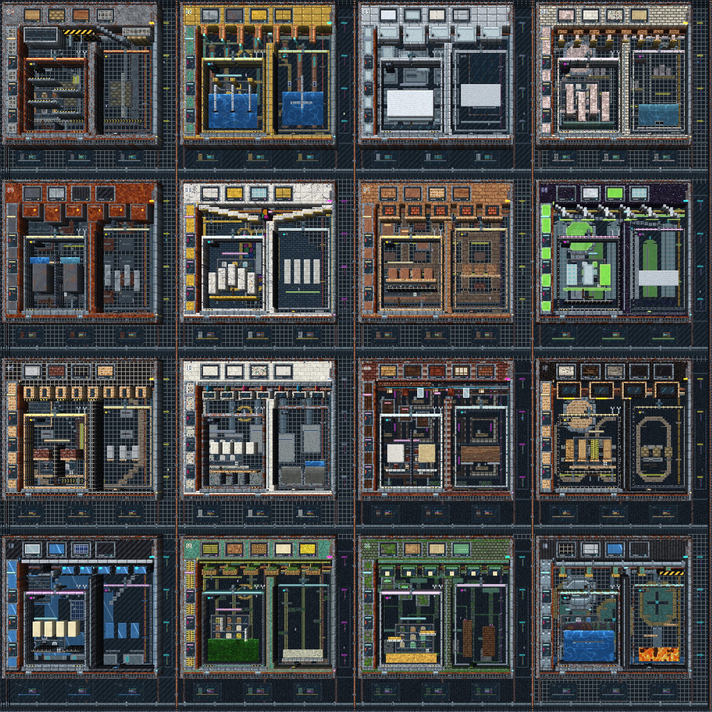
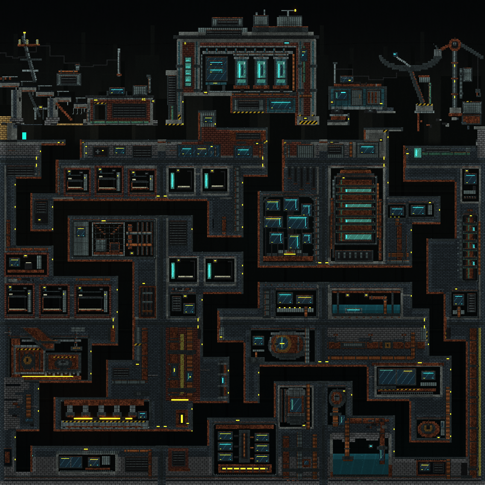
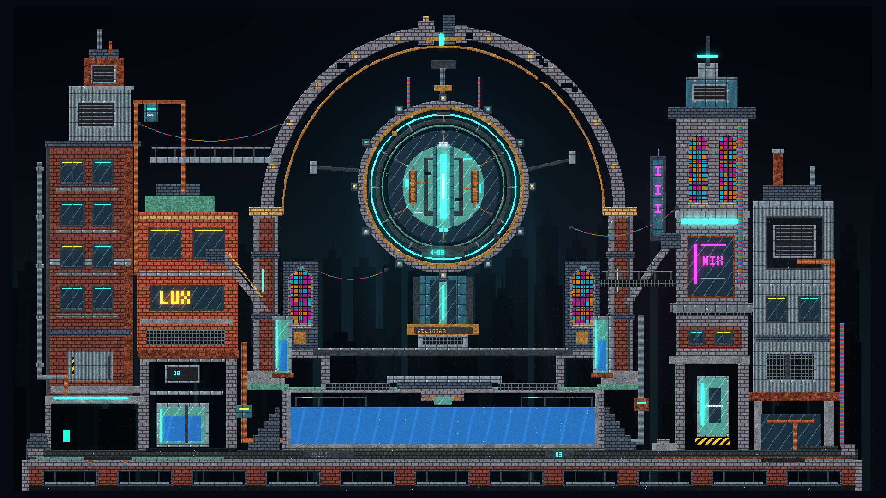
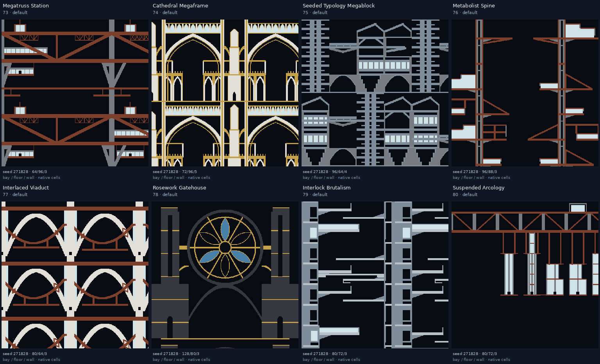

# Explore the showcases

The feature launcher is a collection of distinct scenes and laboratories. Each
entry has its own controls and reset behavior. **F2 returns to the launcher and
closes the current session.** Save authored Workbench work before leaving it.

| Launcher entry | Why open it? | Guide and boundary |
| --- | --- | --- |
| Development workbench | Paint, generate, place actors, run material experiments and save starts. | [First session](workbench-first-session.md); ordinary authoring front door. |
| Materials Lab | Inspect effective native properties and compare candidate definitions. | [Materials Lab](materials-lab-authoring.md); candidate Worlds remain isolated. |
| Player playground | Try seven movement presets on a shared course. | [Controls](../systems/player-control-playground.md); experimental handling, not physical acceptance. |
| Deepworks | Explore sixteen districts with foreground/rear material exhibits and four material planes. | [Exhibition](deepworks-exhibition.md); free-camera viewer, not the ordinary actor session. |
| Blacksite Nine | Traverse a continuous 3×3 industrial complex in one native world. | [Blacksite guide](blacksite-nine-demo.md); district camera changes preserve the complex. |
| Neon Reliquary | Visit the machine cathedral and three district tiles below it. | [Scene guide](neon-reliquary-demo.md); switching district reconstructs that tile, not seamless streaming. |
| Actor sandbox | Compare the articulated Rapier catalogue through F5. | [Physical actors](../systems/physical-actor-rigs.md); distinct from Workbench Actor Composition. |
| Materials sandbox / Experiment Tower | Inspect structured native material experiments. | [Experiment Tower](experiment-tower.md). |
| Liquid comparison / Wave Flow | Compare law-specific Water behavior and apparatus. | [Liquid comparison](lcb-manual-comparison-ux.md), [Wave evaluation](wave-flow-evaluation.md). |
| Thunderbowl / Physical Thunderbowl | Exercise controller contracts, scripted pilots and physical equipment. | [Control reference](../systems/thunderbowl-control-reference.md); sampled virtual-tag rewards and physical lab have different scopes. |
| 4LY Flight Lab | Inspect the dedicated physical drone training plant. | [Flight contract](../systems/physical-free-flight.md); calibration and handling claims are qualified separately. |
| World generation workbench | Inspect generation stages and semantic authoring previews. | [Generation Workbench 2](../systems/generation-workbench-2.md); separate from the Shared Workbench generator dialog. |
| Semantic depth | Compare generated refinery and cavern projections. | [Depth authoring](semantic-depth-authoring.md); four-plane semantic scene. |
| Strata Theatre | Explore standalone layering, parallax and depth modes. | [Layered world contract](../systems/depth-layers-and-parallax.md); ordinary Workbench integration is a separate candidate. |

The [World Art viewer](../tools/world-art-preview.md) supplies another standalone
viewer/capture workflow. Its artwork dimensions are not native playable World
limits. It is not an automatic import of every reference image into simulation.

## A material exhibition: Deepworks

Retained graphical capture of the existing 1024×1024 total-map exhibition.
Choose a district while paused, inspect its apparatus, then press **P** to run.
**R** resets the entire exhibition while keeping the camera. Reactions continue
across districts, so reset before comparing a late exhibit with its original
state. The [exhibition guide](deepworks-exhibition.md) lists each experiment,
layer clock and capture procedure.

## A connected place: Blacksite Nine

Retained application atlas of the standalone complex. Use the 3×3 tile map,
**Whole complex** and follow camera to inspect routes. Camera changes keep the
same world and edits; **R** resets the whole complex. Read the
[route and controls](blacksite-nine-demo.md) before assuming shortcuts from a
different scene apply.

## A constructed city: Neon Reliquary

This retained Godot Compatibility-renderer image shows the standalone scene.
The **Above / Below** controls visit Middle Cyberberbia, Sewertech Alley and
Industrial Underswamp. District changes load their original paused layouts and
replace the previous tile's edits. Viewpoint changes within a tile preserve it.

## Native architectural variation

This source-identified native gallery predates this documentation edit and keeps
its own [source/runtime manifest](../images/gentek80-integration/README.md).
Its 80 Genteks are available through the accepted Architectural Generator.
The gallery is material geometry, not proof of structural load simulation or
automatic destructible-body conversion. Try the
[generator walkthrough](architectural-generator-playtest.md) to create and edit
your own starting map.

## Image and source scope

These images are genuine retained CyberSand output, reused without altering the
original evidence. They are not fresh physical GPU acceptance captures. The
documentation asset manifest records hashes, source records and intended use.
Launcher labels and routes are source-checked against
[`feature_launcher.gd`](../../godot/scripts/feature_launcher.gd); each linked
canonical guide owns the scene-specific controls and capture provenance.

The [retained refinery guide](../images/semantic-depth/refinery-guide.png) shows
the standalone Semantic depth composition. Its
[capture manifest](../images/semantic-depth/capture-manifest.json) identifies
the original four-plane native material sources and renderer.
