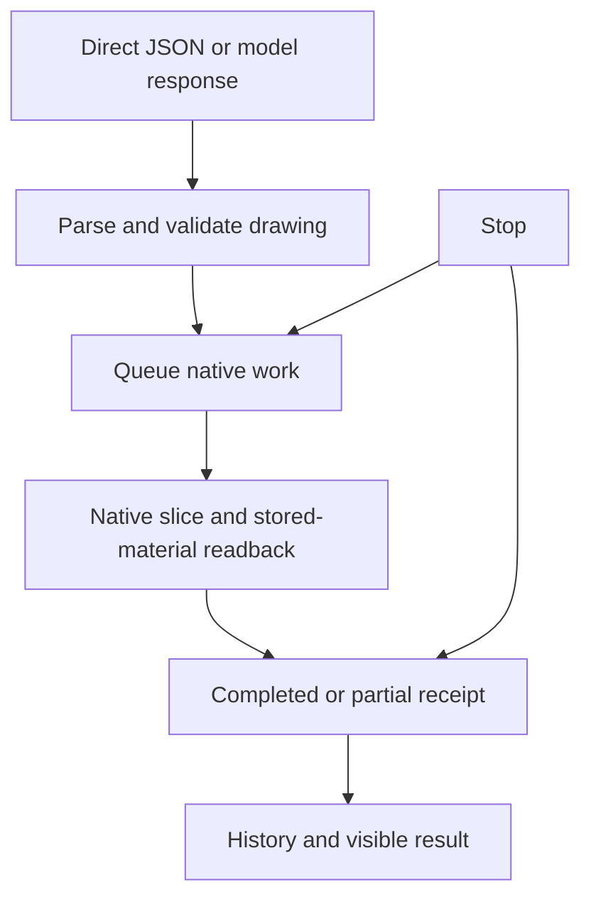

# Art Workbench

Open **Art batches** in the ordinary Shared Workbench. The floating **Art
workbench** window offers **Direct JSON**, **Model prompt** and **Scanline**.
All three draw through the same native authoring boundary. Begin paused with a
small clear work area so the result is easy to inspect.

## Draw without a model

1. Set **Focus** to X=0, Y=0, W=128, H=192 in a blank part of the canvas.
2. Select **Hard wall (58)** and leave **Erase** enabled.
3. Select **Direct JSON** and enter this small example:

```json
[
  {"shape":"rectangle","x0":32,"y0":32,"x1":95,"y1":159,"material":58},
  {"shape":"disc","x":64,"y":70,"radius":12,"material":0}
]
```

4. Click **Draw** and wait for the terminal native result. The rectangle is
   filled with material 58; the disc erases a hole. Existing bodies and protected
   source regions can refuse or exclude cells.
5. **Undo** reverses the latest recorded edit while its source is still valid.
   Use **Save start** in the Workbench to preserve the authored result.

Art's **Hard wall (58)** label is the legacy name for material 58, shown as
**Reinforced Concrete · 58** in the main Paint palette. The ID is the same;
the two pickers currently use different names.

Ordinary Art draws over source cells only when their stored material is Empty
(0) or material 58. Existing Sand, Water and other material IDs are excluded,
even if the selected output material is permitted. Body, source and protected
area guards apply separately. Human painting has a different admission path.

Direct JSON uses canvas coordinates. Drawing modes can have different coordinate
conventions: the LM Studio geometry and Scanline paths interpret their model
output relative to the focus area. The application supplies those instructions
to the model. Do not copy offset-area model output into Direct JSON without
checking its coordinates.

**Tools…** exposes the admitted shape vocabulary: rectangle, disc, line, pixels,
polyline, polygon and airbrush. Line widths are in cells. A point-count setting
of zero adds no extra user cap; native slices, material policy and scene bounds
still apply.

## Connect a provider you already use

Choose **Model prompt**, then the provider. The endpoint and model fields are
editable. These are the presets in accepted source, not a promise that a service
still offers every preset model:

| Provider | Protocol | Initial endpoint | Initial model ID |
| --- | --- | --- | --- |
| LM Studio | Chat Completions | `http://127.0.0.1:1234/v1` | `wb-art-instruct` |
| OpenAI | Responses | `https://api.openai.com/v1` | `gpt-5.6-luna` |
| NVIDIA | Chat Completions | `https://integrate.api.nvidia.com/v1` | `qwen/qwen3-next-80b-a3b-instruct` |

For a local server, start your already-installed server and load a model under
the identifier you enter. A custom endpoint must include its API base path,
normally `/v1`. LM Studio sends no fabricated API key; **Key…** can supply a
token if your configured server requires one. Cloud providers require your own
key. Keys remain in process memory, separately per provider, and are not stored
in preferences.

For a first request, keep **Turns** at 1, use a small focus area, and ask for a
few simple shapes. **Toks** limits output tokens and **Secs** sets HTTP timeout;
the initial values are 8192 and 180 seconds. Model output is parsed as admitted
drawing data and still validated natively. Prose or malformed geometry is not
executed as code.

**Image** attaches a crop of the rendered canvas for a vision-capable model;
**Full view** uses the visible canvas instead of only its intersection with
Focus. This requires a graphical runtime. **Guidance…** edits the drawing
instructions. **Conversation…** edits which current-session messages will be
used as future model context without rewriting past native results.

## Context, limits and repeated requests

**Full** includes current-session conversation; **Compacted** keeps the most
recent 12 conversation messages, including user prompts, model replies and native
result feedback. These are individual messages, not 12 complete request/response
cycles. When older messages are omitted, it also adds a latest-result summary.
**Custom** currently uses the Compacted behavior; **None** omits prior
conversation. These are context choices, not storage guarantees.

**Turns** limits requests per Send. Zero continues until Stop, model completion
or another configured limit. **Limits…** supplies a minimum request gap, run
duration and estimated spending controls. Zero disables the corresponding
limit. Spending uses your entered rates and reported tokens after a response;
it can exceed the ceiling by one request and cannot be tracked when usage is
missing. There is no live pricing lookup or prepaid-credit guarantee.

## Stop, Hide and native results

**Stop** cancels pending HTTP/capture and scheduled turns, invalidates the request
generation and requests the native executor to stop. A native slice already
executing can finish at its boundary. A reported **partial** result can therefore
have changed the canvas. Read the confirmed count and use available Undo; do not
assume cancellation rolled everything back.

Closing the Art window **hides** it. It does not mean Stop, save, or end of the
Workbench session. Reopen **Art batches** to inspect the same session. For
Undo/Redo, Stop first and wait for model, capture, drawing, deferred manual
strokes and receipt processing to settle. Both Art and manual controls use the
same chronological history.



**Queued is admission, not applied success.** A result from before Reset, Load
or World replacement is stale and must not draw into the new scene. Source
failures, rejection and missing acknowledgements are not success receipts.

## Conversation and private traffic

Each new Workbench session starts with an empty in-memory conversation. Hiding
and reopening Art within that session keeps it; ending the session discards it.
Provider/model/endpoint/control preferences can persist in
`user://art-provider.cfg`. Previous conversations are not automatically restored.

The **ULTIMA candidate** verifies the complete closed preference file before
replacing the previous configuration. If Art reports **Could not save Art
preferences**, the old on-disk preferences remain; the controls can still show
the changes made in this session. Restore write access or free space, adjust the
preference again, and check that the save error clears. A changed control alone
is not evidence that its preference was saved. If the error reports the 1 MiB
file budget, shorten oversized saved guidance instead. The separately hardened,
retained private receipt journal does not restore an old conversation or replay
a completed drawing after restart.

The first log event creates one new JSONL file under `user://art-traffic/`.
Requests, responses, direct programs and native results append there for the
session. **Traffic…** shows the path, a readable or Raw JSONL view, filtering,
copy and **Save full JSONL…** export. Old archives are preserved on disk but are
not attached to a new session. Logs are evidence for manual diagnosis, not exact
replay of an evolving World.

In the **ULTIMA candidate**, desktop **Save full JSONL…** writes a separate
staging file and verifies its closed length and digest before native replacement
of the destination. The progress label changes to **Verifying closed export**;
**Cancel export** or **Stop** can interrupt before that replacement. A refusal
or cancellation leaves the destination unreplaced by this export. If cleanup
cannot remove its own staging file, the message identifies that uncommitted
file. Wait for the completed result before treating the export as saved.

An append to an existing traffic log is acknowledged only after the closed new
bytes are verified. A failed append can leave an incomplete final record; the
previous complete events remain, and the log becomes read-only for that session.
Retain the original. Export can recover complete events before an interrupted
final record and displays the recovery warning; it does not silently repair the
source archive or reconstruct a discarded conversation. These checks establish
the tested desktop file outcomes, not fsync/power-loss durability or a browser
storage guarantee. The [archive reader](../../godot/scripts/art_traffic_archive.gd)
and [provider](../../godot/scripts/art_provider.gd) define those boundaries.

The logger redacts known key/bearer patterns and configured credentials, but
prompts, model replies, canvas images and other private content remain sensitive.
Inspect and redact a diagnostic extract before sharing it. An endpoint is the
destination for its request and credentials; automatic HTTP redirects are
disabled. Never paste unrelated secrets into a prompt.

## When a request fails

Check the endpoint, exact model ID, server state and key for the chosen provider.
Inspect **Traffic…** for the actual error. Incomplete/truncated model output does
not become a completed drawing. Use a smaller task or a supported model and
explicitly resend after correcting it. Accepted source has ongoing Art
responsiveness repairs tracked separately; this guide does not claim that the
unmerged close/error/UI repairs are already installed.

## Source and verification scope

[`art_batch_panel.gd`](../../godot/scripts/art_batch_panel.gd) owns controls,
profiles and session flow; [`art_provider.gd`](../../godot/scripts/art_provider.gd)
owns wire adapters and logging; [`art_batch_executor.gd`](../../godot/scripts/art_batch_executor.gd)
owns native drawing. See the [provider contract](../systems/workbench-art-providers.md)
and [direct drawing contract](../systems/workbench-direct-art-batches.md).
No paid model call is needed to follow the Direct JSON tutorial.
