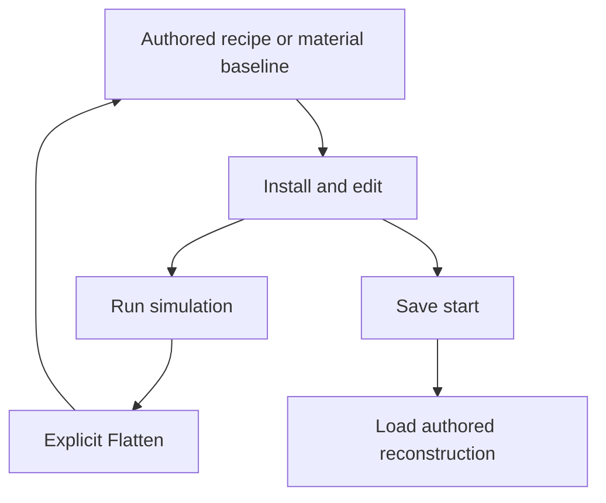

# Saving authored worlds

**Save start** retains an authored starting scene. It is not an exact checkpoint
of an evolved simulation. Use the name field beside **Save start [Ctrl+S]** and
**Load start**; wait for a success message before leaving the session.

Names accept 1–48 ASCII letters, digits, underscores or hyphens. Saving an
existing name replaces that named start; use a new name to keep an earlier
version. There is no separate overwrite-confirmation step.

## What each action means

| Action | Preserved or changed |
| --- | --- |
| **Save start** | Saves the current authored recipe/baseline, acknowledged construction edits and supported actor/equipment configuration. |
| **Load start** | Reconstructs that authored scene with initial material/physical state. A generated start first opens a verified preview; confirm **Install into workbench** to replace the current map. |
| **Restore start** | Rebuilds the current authored start; later free simulation is discarded. Observe any refusal on generated/flattened failed owners. |
| **Reset selected [R]** | Resets the selected actor through its current control path; this is not a global file load. |
| **Flatten / Bake History…** | Captures the current native stored material plane as a new authored baseline and discards prior construction/Undo history. The live World continues. |
| **Menu [F2] / exit** | Ends the session. Saving is explicit. |

## Save a generated scene

1. Finish a native preview and explicitly install it.
2. Pause and make your manual or Art edits. Wait for their final native receipts.
3. Enter a unique name and **Save start**.
4. Close Godot, reopen the Workbench and **Load start** with that name.
5. The **Verify and reopen saved starting map** dialog generates and verifies
   the embedded recipe. Wait for its complete preview, then click **Install into
   workbench**. Until that confirmation, the current map stays installed.

A source-identity mismatch refuses the generated proposal and keeps the current
map. Do not treat opening the dialog or finishing its preview as a completed
load. Plain setup and flattened material starts use their own reconstruction
paths and do not require this generated-preview confirmation.

Generated starts embed their resolved recipe and ordered material edits. Loading
does not depend on the original external project/style file, but still validates
the recipe and reconstructed source/material identity. **Save…** inside the
Architectural Generator saves its project controls; it is a different file
from the installed Workbench start.

## Capture a changed material layout with Flatten

Run the scene until materials have moved or reacted. Choose
**Flatten / Bake History…**, read the confirmation and accept only if discarding
earlier construction and Undo/Redo is intended. The capture uses complete stored
material IDs, including Empty, at two bytes per cell. It does not use rendered
colours or try to preserve temperature, velocity, fluid quantities or body state.

The existing live World, tick and actors continue unchanged. **Flatten does not
Save.** After it completes, new acknowledged edits are relative to the new
baseline. Click **Save start** to make that authored result persistent. Later
simulation is excluded unless another explicit Flatten captures its materials.

Reopening initializes materials normally. A plant's stored identity can return
with ordinary initial behavior; Flatten does not carry a general frozen-growth
or exact-energy promise. The [authoring contract](../architecture/shared-workbench-authoring-data.md)
owns the format and the separate owner-intent distinctions.

## Where starts live

The normal directory is `user://workbench` under Godot's application data
directory. It is outside a typical extracted evaluator folder. The same
application profile can therefore see starts from earlier launches; use unique
names and preserve valued files before evaluating a different source. This is
ordinary file persistence, not a persistent-area streaming or catch-up system.

Setup-v2, generated-start-v1 and material-baseline-v1 retain distinct readers.
The ordinary authored record budget is **32,768 rectangles/stamps**, subject to
its **1 MiB** envelope and native construction checks. A material baseline stores
its own complete uint16 plane; it does not make arbitrarily fragmented future
edit histories unlimited. The precise
[format and compatibility contract](../architecture/shared-workbench-authoring-data.md#flatten-and-storage-compatibility)
owns validation.

## When saving refuses

Pending native operations, unconsumed results, partial edits, prepared
replacements and pending Flatten can block Save. Read the refusal, Stop/wait
where appropriate, and use the offered recovery path. A queued request is not
confirmation that its result is in the saved document.

After a native owner fault, a settled flattened document with acknowledged edits
has a specific authored-data recovery route: Save, close the process, reopen and
Load. Save preserves the baseline and recorded edits, not the failed World or
unrecorded simulation. Legacy unacknowledged disc instructions and unsettled
operations can still refuse. Follow the
[fault-recovery procedure](gen008-flatten-qualification.md#recovering-after-a-native-owner-fault)
instead of assuming Reset can resume a failed owner.

## Source and verification scope

Save/load dispatch and guards are in
[`shared_workbench.gd`](../../godot/scripts/shared_workbench.gd).
[`workbench_setup.gd`](../../godot/scripts/workbench_setup.gd),
[`workbench_generated_map.gd`](../../godot/scripts/workbench_generated_map.gd) and
[`workbench_material_baseline.gd`](../../godot/scripts/workbench_material_baseline.gd)
own the three authored representations. Physical persistent-area and RAMCACHE
candidates remain separately tracked in the [roadmap](../reference/status-and-roadmap.md).
