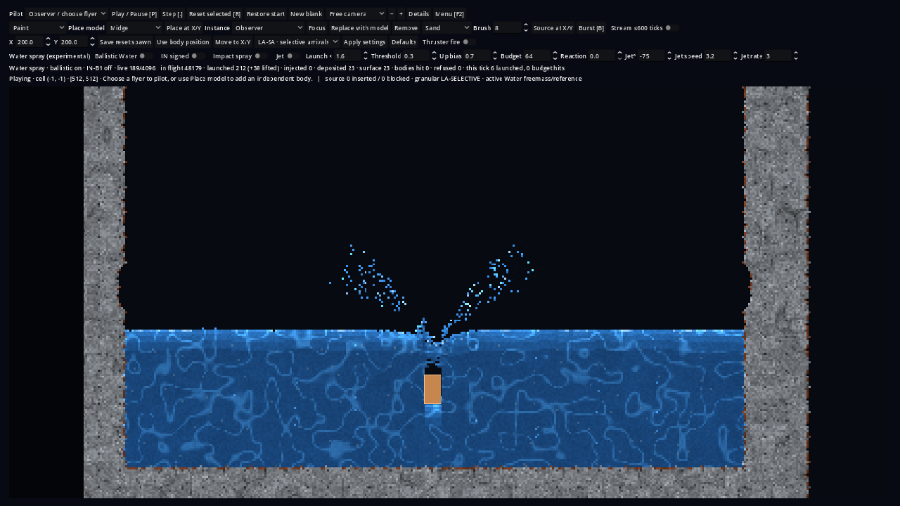

# Workbench Water Lab

Open **Water Lab…** from the ordinary Workbench toolbar to select a Water law,
inspect the native settings actually applied, tune transport and use existing
Water equipment. The window gathers several distinct experiments and controls;
it does not imply that every solver has the same semantics. The accepted
consolidation and Waterwall repairs include [#672](https://github.com/techrote/cybersand/pull/672).

## Compare two settings from the same start

1. Make or load a small authored Water scene and **Save start** under a unique
   name. Keep its dimensions and terrain fixed for the comparison.
2. Open **Water Lab… → Solvers & scenes**, choose **Wave Flow**, then press
   **Apply solver / tuning**. Confirm the **Applied** native column.
3. On **Wave tuning**, select **Gameplay default** and apply. Run for a chosen
   number of steps, then pause and note the result.
4. **Load start** again before the second trial. Change one supported setting,
   apply it and run the same number of steps. Applying alone retains current
   cells; it does not restore the beginning of the experiment.
5. Record the law, applied values, authored start, number of native ticks and
   any refused request. A screenshot by itself cannot establish equal quantity
   accounting or solver equivalence.

The controls below were source-checked. This documentation change did not run
a new physical Windows evaluation. Original measurements retain their dated
source and fixture scope.

## Entry and navigation

The Workbench has **one** permanent **Water Lab…** entry in the top toolbar.
Open it to access a resizable, scrollable, non-modal five-tab Water Lab:

| Tab | Controls |
|---|---|
| Solvers & scenes | One Water-law selector for FreeMass, Wave Flow, PressureFlow reference/cached/dormant and Inertial; four authored comparison scenes and pool workers |
| Wave tuning | Bounded Wave controls, Body push (Water force on Rapier actors), presets, Reset, Revert and native values |
| Transport & spray | Ballistic, IN signed, face release and tuning, PF gas/capacity, fine cores, impact spray, jet tuning |
| Equipment | Valves, drains, nozzles, aiming, pumps, supply, placement and built-in equipment starts |
| Advanced policy | Full native-backed liquid policy assignment editor, original presets, geometry and one-shot normalization |

The native **Applied/Requested/STAGED/REFUSED** report and **Apply solver /
tuning** action stay fixed below the tabs. No secondary Wave/spray popups are
created by Shared Workbench. The older per-material policy dropdown is retained
only in **Advanced policy** and remains semantically distinct from Wave Flow's
FreeMass-carrier overlay.

The action commits pending numeric text in the clicked Water Lab Window, then
in the main Workbench Window, before collecting its request. Both Windows can
retain focused fields: a pending main X/Y and a pending child supply value must
both reach an equipment action. Typing a value and clicking **Apply solver /
tuning** does not require Enter or a click outside the field first. The moved
scene, equipment and tuning actions use the same Window-aware field commitment.

When a saved setup requests an invalid liquid policy, the native preparation reports the refusal. The running World retains its applied policy and any paint already committed. [Refusal regression](../audits/2026-11-19-wave-oil-lava.md#ready-for-review-validation-20-november)

**Fresh Workbench sessions use Wave Flow with Waterfall spill and Ballistic release.** Loading an ordinary authored canvas uses the current Water selection. To switch back to Wave after trying another solver, select it and press **Apply solver / tuning** or **Load / reset scene**. The active native column confirms the accepted law. Returning
to PF/Inertial/FreeMass restores Water's law-specific requests over the current
policy. Edits to Brine or other liquids made while Wave is active remain current.
Remembered Water parameters return only where they belong to Water or to a
currently dormant family; an already active shared family keeps its current
parameters, including its defaults. Native validation still decides admission.
The [water ramp evaluation](../audits/2026-11-19-wave-water-ramp-003.md) compares the fresh settings against Sloshy + Max over-ledge on the same authored canvas.

## Body push (Water force on actors)

**Bodies (Rapier actors)** on the Wave tab sets how hard Wave Water pushes
actors and bodies. It changes only the force offered to Rapier, never the Water.

- **Body push** is n/256 of the original push. 256 means unchanged, and 0 means
  Water never pushes a body.
- **Push by amount** = 1 scales each wet cell's push by the Water it holds. A
  faint trickle (a few units) then presses about 1% as hard as a full cell. In
  original Wave, a trickle across a flyer's top pressed as hard as a solid sheet
  and could pin even large flyers. 0 keeps original Wave.

The Water Lab stages Push by amount = 1. A World constructed without the option
keeps the original per-cell push.

Body push and Push by amount cover every path by which Water pushes a body:

- Wave contact with resting or leaning Water;
- the Workbench boundary pressure of Water touching a body face (the strongest
  term, 0.19 per cell per tick);
- displacement when a body moves into Water;
- ballistic parcel splash and optional impact-spray launch reaction (Body push
  only, since both already account for the exact parcel quantity).

The original impact comparison measurements belong to the
[dated Waterwall review](../audits/2026-11-18-waterwall-review-remediation.md).
They do not describe a new measurement of every current scene.

## Waterwall spill

The **Wave tuning** tab ends with a **Waterwall spill** subsection. It adds no
toolbar control.

| Control | Meaning |
|---|---|
| Waterwall spill | On: exposed Wave faces beside open air discharge quickly, and unsupported Water falls faster. Off: original Wave Flow, for direct comparison |
| Ballistic release | Exposed faces throw Water outward as parcels that arc, land and rejoin the grid. It throws through the Ballistic Water parcels, so turning it on also turns on Waterwall spill and Ballistic Water; turning Ballistic Water off turns it off |
| Fall speed / Pool feed | Cells per round for unsupported Water, and mass units per round a pool may move toward its draining edge |
| Throw speed / Parcels per tick | Outward speed as n/256 of √(2gh), and the per-tick launch budget (ballistic release only) |
| Blobs / Stream share | Blobs (1, the default) clumps thrown water into blobs where it meets falling water. Stream share keeps part of each throw pouring straight down (0, the default, is off). Both apply to ballistic release only |
| Stream draw | Adds a vertical stream poured straight down from each throwing face, on top of the full throw. The pool behind the face refills it, unlike Stream share, which takes the stream out of the throw. 0 (the default) is off. Ballistic release only |

As with every Water Lab control, these settings are staged until **Apply solver /
tuning** or **Load / reset scene**. The native readback beside each control and
the spill status line show what is actually running: exposed-face transfer,
falling cells, parcels launched, in flight, landed, refused or deferred, ticks
with a full parcel pool, and launch and flight time. A spill request is only
sent with Wave Flow. **Gameplay default** stages the complete Wave and spill bundle. The older Wave presets and **Reset Wave defaults** stage Wave tuning alone.

**Ballistic Water** (Transport & spray tab) works with Wave Flow, with or
without spill: impact spray, jets, nozzles and Water thrown by bodies fly as
ballistic parcels and rejoin the Wave grid. Choosing Wave keeps its setting.
With spill on but Ballistic release off, the native release budget reads 0 by
design. **Face release** is available under Wave only while Waterwall spill is
off, because spill owns exposed faces.

To compare, load a start, select **Wave Flow** and press **Apply solver / tuning** with spill
off. Then turn **Waterwall spill** (and optionally **Ballistic release**) on and
press **Apply solver / tuning** again. Apply retains the current cells, so to compare from the
same authored state, reload the start between runs.

## Native failure and recovery

If a native operation fails, Workbench pauses and keeps its last valid view.
The message begins `Native tick … stopped:` and retains the first native error.
For body-occupancy preparation it also identifies the failing stage, body/proxy,
source cell and intended destination. Copy the full message before resetting.
The error is retained through later reads and refused edits. Recovery builds a fresh authored setup; it does not resume a partially failed
World. Generated or flattened starts can refuse Reset/Restore on a failed owner
and direct you to Save, restart and Load instead. Follow that specific refusal.

Body push = 0 disables the force offered to Rapier, but overlap reconciliation
still moves Water out of the body. Thus zero push does not disable relocation
or ballistic launch and does not rule out an occupancy-preparation fault.

The accepted failed-owner protection covers native exceptions during editing,
coupling and copied observations, including a fault discovered during publication.
The original underwater surface-crest trigger remains unconfirmed. The native
boundary stress suite and the focused Godot failure/recovery tests are separate
from physical Windows/NVIDIA owner acceptance. Source-matched results belong to their dated evidence, and a successor
package needs its own source/runtime identity. See
[failed-owner save recovery](gen008-flatten-qualification.md#recovering-after-a-native-owner-fault)
for the settled authored-document route; it does not capture the failed World.

## Acceptance and retained boundary

The original #661 consolidation mounts the existing control objects inside
Water Lab and changes no native solver. The later #672 review repairs add native
Water-only policy restoration and correct the ballistic corner, coordinate and
Body push contracts described in the
[dated remediation record](../audits/2026-11-18-waterwall-review-remediation.md).
Material IDs, producer/generation services and scenario schemas are unchanged.
Editor Save/Load remains a starting-canvas recipe, not a physical Wave snapshot.
Changing Wave settings preserves compatible cells/actors but resets Wave's
retained flux; illegal conversion or configuration still refuses atomically.

Regression added to the real Shared Workbench Wave test verifies all five tabs,
the exact original control objects and always-visible native readback, no extra
Wave/spray popup, and tab switching. The remediation adds keyboard-entered
numeric text followed by an action click, native readback, and preservation of
accepted non-Water assignments/shared-family settings across Water-law changes.
Existing native Wave and Workbench tests
remain required. Physical Windows 11/NVIDIA GUI acceptance, including low-height
displays and pointer interaction, remains owner-gated.

The original UI branch and stacked-candidate HOLD instructions are preserved in
the [baseline text](https://github.com/techrote/cybersand/blob/00cdb02f103265b6dc5224c68283e9a0c8cb449f/docs/operations/workbench-water-lab.md#acceptance-and-retained-boundary).
They describe that earlier review, not the status of accepted source. For active
successors, use the [current-state register](../reference/status-and-roadmap.md).

## Faster horizontal spread on the water ramp

If your source-matched evaluator includes the **water-ramp** named start, enter
that name and **Load start**, then **Play / Pause [P]**. The original evaluation
package installed this fixture when its name was free; do not assume every
ordinary checkout has that user-directory save. Fresh sessions already use Wave, spill, blobs and ballistic release. To return to that setup after trying another law, select **Wave Flow**, stage **Gameplay default**, then press **Apply solver / tuning**. Reload the canvas to start the Water from the top again.

The gameplay profile runs **two rounds per tick**, with Gain 32, Deep gain 32, Floor gain 1024, flux smoothing 16, Coast 32, Empty pour shift 2 and Feed head limit 255. **Floor gain** adds horizontal momentum to the first few rows of a shallow front over continuous, level solid ground. **Gain** drives the general Water response and **Deep gain** controls the restoring force in a pool. **Feed head limit** bounds how strongly pool feed can persist against a rising Water level. Water can still run up a slope on impact. See the [measured ramp and flat-floor comparisons](../audits/2026-11-19-wave-water-ramp-003.md). To reduce frame cost, stage **Rounds** at 1 and Apply.

The ordinary v2 setup records the material policy. It has no field for the Wave selection. A baseline-carrier file such as the ramp uses the session's current selection. A saved alternate Water law takes effect on load. The Water Lab shows the accepted solver after the replacement completes.

## Compare Sloshy and Max over-ledge presets

Open **Water Lab → Wave tuning**. Select **Sloshy** to stage the deep-water response and short-wave smoothing. Select **Max over-ledge** to stage the sheet, crest flight, blobs and ballistic release together. You can combine both. Press **Apply solver / tuning** and check the native values beside the controls. Apply resets retained Wave momentum. Reload the same starting setup for a fair comparison.

**Deep gain** sets how hard a deep pool pushes back. Ordinary **Gain** controls a shallow advancing front. **Flux smoothing** reduces sharp changes in the movement of adjacent wet faces. **Sheet rate** sends deeper exposed rows through the grid while the crest can still throw. **Coyote ticks** sets how long a crest parcel travels level. Set the four new values to zero to turn off their effects. Reset Wave tuning and restore the previous spill settings to reverse a whole bundle. The [dated evaluation](../audits/2026-11-19-wave-waterwall-002.md) records the tested settings and results.

A face can spend its share only once. If the crest throw already uses the whole allowance, Stream draw has no spare Water to pour on that face. Deeper sheet rows can still pour.

## Try full-face release at fall speed 3

The following named canvases belong to the cited evaluation packages; ordinary
source checkout does not install every historical user save. When **water-ramp**
is available, let the pool form, then use a radius-24 brush to paint Oil and drop
Lava where Oil meets Water. The [recorded replay](../audits/2026-11-19-wave-oil-lava.md) gives exact positions, ticks and results.

To see a wave travel under a slick, load **oil-impinge** in the Windows evaluation and press **P**. Let the falling Water hit the shelf and the two layers settle. Drop a fresh brushful of Water on the left and watch the Water–Oil boundary on the right. This uses the existing Wave gameplay settings. [Tank replay](../audits/2026-11-20-wave-oil-impinge.md)

In the Oil evaluation ZIP, load **oil-tank** and press **P**. A strip of Oil starts ten cells below the surface while Sand drops onto the pool. After it settles, erase a stretch of the thin right wall at the Water line to release a wave into the lower basin. The Wave gameplay profile already has spill, ballistic release and fall speed 3 enabled. [Oil tank evaluation](../audits/2026-11-19-wave-oil-buoyancy.md)

If the **water-wall** fixture is present in your evaluator, load it and press
**Play / Pause [P]**. The accepted **Gameplay default** enables **Full face**, **Ballistic release** and **Blobs**, and sets **Fall speed** to **3**. Fall speed counts grid cells per solver round. The gameplay profile runs two rounds per tick. Parcels use their own gravity and velocity.

For a comparison, open **Water Lab → Wave tuning**, keep Fall speed at 3, clear **Full face**, and press **Apply solver / tuning**. Reload the same start for each run. The previous sheet setting sends spray from the crest and pours deeper rows down the edge. Selecting **Full face** lets exposed rows below the crest feed both the outward spray and the falling sheet. The native readback beside the controls shows which settings are active. [Experiment and measurements](../audits/2026-11-19-wave-water-face-004.md)

The gameplay profile sets **Deep pool feed** to **64** and keeps **Pool feed** at **127**. This keeps the shallow front fast while reducing the vertical cuts in deep moving Water. For an A/B on **water-ramp**, compare Deep pool feed **0** and **64**, use **Apply**, and reload the same start. Zero uses ordinary Pool feed at every depth. Leave **Full face** and **Fall speed** at the same values for both runs.

## Retained visual examples

*Original Windows ballistic-Water frame at tick114 from the
[5 November experiment](../audits/2026-11-05-wcx-ballistic-water.md).
This illustrates the retained parcel mechanism, not a fresh default-profile
measurement or current toolbar screenshot.*

The [equipment leak capture](../images/in-tools-361/liquid-lab-leak.png) shows a
bottom valve releasing a reservoir in the original equipment evaluation. Its
[dated record](../audits/2026-11-09-in-tools-361-workbench-equipment.md) owns the
source, native ledger and timing claims.

## Source and defaults

The normal Workbench selects `gameplay_water_options()` during setup. A bare
native `WorldConfig` is a separate entry path and does not automatically select
that gameplay bundle. Do not copy a laboratory/native baseline into a statement
about the fresh interactive default. The [solver policy](../architecture/liquid-solver-family-policy.md)
and [Wave contract](../architecture/wave-flow-v1.md) explain the distinction.

Controls live in [`workbench_water_lab.gd`](../../godot/scripts/workbench_water_lab.gd),
with requests and readback coordinated by
[`shared_workbench.gd`](../../godot/scripts/shared_workbench.gd). The native
`select_gameplay_water` helper owns the gameplay bundle. Save captures authored
layout/configuration under the [save contract](workbench-saving.md), not exact
Wave flux, ballistic parcels or evolved physical continuation.
