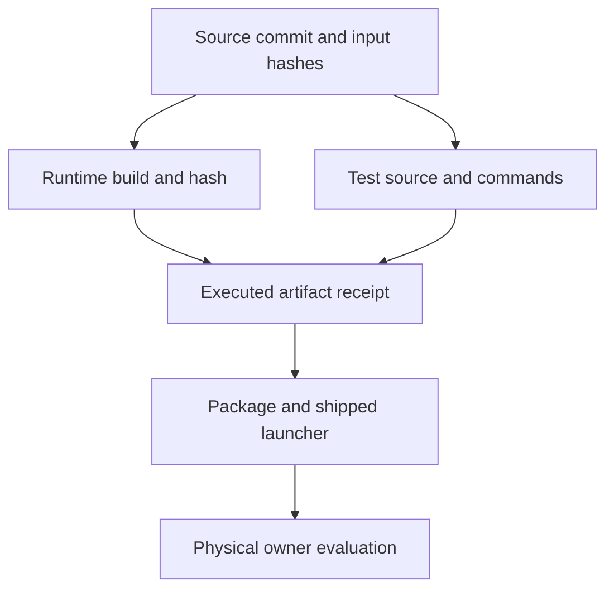

# Validation evidence ledger

A useful validation claim names **the source, artifact, platform, command,
fixture and result**. This page routes evidence and explains its scope. It does
not convert old campaigns into fresh passes or maintain a second live CI dashboard.
The [state register](status-and-roadmap.md) identifies accepted source and active
candidates; their principal records own changing qualification results.

## What has actually been established?

| Evidence class | A justified conclusion | A conclusion it cannot supply |
|---|---|---|
| Source inspection | A named path/symbol contains the described implementation or control | That it executed correctly, was packaged, or felt good on a physical device |
| Compilation | The selected inputs compiled with the recorded toolchain | Runtime correctness or all-platform support |
| Pointer/hash/provenance check | The recorded source inputs and selected bytes or LFS pointer agree | Materialized executability when only pointers were checked; actual runtime execution |
| Native fixture | The named native behavior met the recorded assertions on that binary/host | Godot integration, rendered appearance or gameplay acceptance |
| Godot headless test | A named application/native path executed under the recorded Godot/runtime | Graphical rendering, physical GPU behavior or interactive feel |
| Graphical capture | The recorded renderer produced the inspected frame(s) | Unobserved transient events, long-session stability or physical owner acceptance |
| Package/launcher test | The actual shipped artifact launched under the recorded conditions | That all other systems or the owner's Windows/NVIDIA environment passed |
| Physical owner evaluation | The owner accepted the stated behavior on the stated device/source | A universal performance guarantee or unrelated programme completion |
| Documentation/retrieval qualification | Structure, routing, authority containment and the reviewed claims met the recorded checks | A new runtime or physical-platform acceptance |

The [claims-remediation programme](../operations/development-claims-remediation-programme.md)
separates Implemented, Integrated, Verified, Accepted and Dispositioned. A merged
feature, a passing test and a closed issue are different observations.

## Source and artifact custody

Each stage records its own identity and result; none is inferred from the previous
stage. Documentation-only commits may preserve exact native input bytes while
changing the overall Git tree. Keep the original native build commit and the
actual tested script/source identity. Conversely, an old successful run cannot
qualify changed native input merely because the DLL still loads.

The selected [Windows native provenance](../../godot/addons/cybersand_native/runtime-provenance.json)
and [Linux native provenance](../../godot/addons/cybersand_native/runtime-provenance.linux.json)
contain source inputs, artifact hashes and original workflow evidence. Rapier has
its own [Windows](../../godot/addons/godot-rapier2d/runtime-provenance.windows.json)
and [Linux](../../godot/addons/godot-rapier2d/runtime-provenance.linux.json)
records. Use [source custody](../operations/source-checkpoint-and-recovery.md)
and [publication procedure](../operations/github-development-and-release.md)
for verification and branch leases.

## Current and historical checks are separate

From the source root, use the commands in
[current and historical validation](../operations/current-and-historical-validation.md).
The principal checks have deliberately different meanings:

| Check | Scope |
|---|---|
| `python3 tools/ci/check_docs.py` | Metadata, canonical ownership, corpus selection, local links/anchors and frozen source references; source semantics require review |
| `python3 tools/ci/check_repository.py` | Current docs, dependency pins and recorded runtime/input/pointer identity; materialization is reported separately |
| `python3 tools/ci/check_repository.py --require-materialized` | Also requires the repository's selected runtime payloads to be real bytes |
| `python3 tools/ci/check_m11_consistency.py` | Retained historical records and all 28 original source hashes against audited Git revision `05ea45fda7bdd7b0150eb86c4922c202e89e08f4` |
| `python3 tools/ci/check_m11_consistency.py --compare-working-tree` | Explicit comparison of today's implementation with M11; expected source evolution is reported as drift, not repaired by changing historical hashes |
| `python3 tools/docs/retrieval_eval.py --output <path.json>` | Saved lexical retrieval contexts/ranks for the selected question set; answer correctness needs separate source-grounded review |

The frozen questions retain some pinned companion-workspace source references.
The Documentation workflow identifies that companion commit; a bare source clone
can lack those inputs. Recover the pinned context or report the missing boundary,
rather than altering frozen expectations to conceal it.

Preserve original failures and M11's 18 retained records. Current source drift,
an unavailable old Git object, a missing LFS payload and a corrupt historical record
are different failures. A shallow clone may need the audited Git objects. Neither
updating old hashes nor disabling the historical check is a legitimate repair.

## Where to find representative retained evidence

These records are **dated evidence with their own source/platform limits**. Their
presence does not imply rerun or acceptance at today's documentation head.

| Subject | Retained source and boundary |
|---|---|
| Failed-world quarantine and region re-entry | [Issue #1](../audits/2026-09-08-issue-1-failed-ticks.md), [issue #2](../audits/2026-09-08-issue-2-interest-regions.md). Preserve the combined failure/re-entry contracts and remaining platform limits. |
| Stage-3B recovery / issue #65 | [Recovery audit](../audits/2026-09-24-cybersand-recovery-audit.md). PR #106's frozen native/test source `8dfa779a561374a5693556f50def3e9666783a98` and merge `cdf0a0874d4732c41273e10d921bcd5feaac3e3c` identify the repaired/landed checkpoint. |
| Broad player/body acceptance | [Remediation programme](../operations/development-claims-remediation-programme.md), [#11 integration forensics](../audits/2026-09-24-rem002-issue11-integration-forensics.md). The first #11 repair was never integrated; later reuse does not retroactively make that original branch merged. |
| Material catalogue and physics | [MAT-002 review](../audits/2026-10-19-mat002-review-and-validation.md), [Materials Lab completion](../audits/2026-11-11-materials-lab-completion.md). Kernel, metadata, isolated-world, host and visual evidence have different coverage. |
| Physical actor timeout repair | [BVH comparison](../audits/2026-10-24-physical-actor-bvh-validation.md), [repair integration](../audits/2026-10-24-issue-234-physical-hang-repair.md). The earlier #233 campaign had no native stack; later attribution cannot be retroactively inserted into it. |
| Architecture and Flatten | [GEN-007 completion](../audits/2026-11-15-gen007-runtime-completion.md), [Flatten qualification guide](../operations/gen008-flatten-qualification.md), [accepted Gentek gallery](../images/gentek80-integration/README.md). Native render, hosted GUI and owner evaluation remain distinct. |
| Water behavior | [Oil impingement](../audits/2026-11-20-wave-oil-impinge.md), [Wave contract](../architecture/wave-flow-v1.md), [Water Lab](../operations/workbench-water-lab.md). Different families, profiles and source triples must not be pooled into a universal result. |
| Actor composition | [Dated composition evidence](../audits/2026-11-20-workbench-actor-composition.md), [current actor contract](../systems/workbench-actor-composition.md). Accepted #683 is separate from later continuous-play/pilot candidates. |
| Render copy and progression | [Current-main copy qualification](../audits/2026-11-01-render-copy-production-reconciliation.md), [rendering contract](../architecture/rendering-and-gameplay-bridges.md). Fast copies/render FPS do not establish continuous physical progression. |
| Art session logging | [Accepted #727](https://github.com/techrote/cybersand/pull/727), [provider contract](../systems/workbench-art-providers.md). Session-only logging supersedes old cross-session restore behavior. Later HTTP/close repairs need separate evidence. |
| World Art | [Capture](../tools/world-art-capture.md), [evaluation](../tools/world-art-evaluation.md). Software-rendered/hosted frames and a physical acceptance harness are not owner NVIDIA acceptance. |

The issue #65 recovery records distinguish actual retained Linux execution from
the **then-retained Windows cross-build**, for which Windows execution was not
claimed in that recovery. Later target-OS campaigns have their own identities.
Do not generalize either historical limitation or a later pass to every runtime.

## What do recording and save passes prove?

REC-001 observes immutable publications. It can support inspection and comparison
of delivered snapshots, but sampling can miss events between publications. It is
not complete transient-event capture or a general exact coupled replay.
[Recording guidance](../operations/gameplay-recording.md) owns its current modes.

Authored starts and material-baseline files preserve the fields their formats
actually encode. A Save/Load pass does not prove exact resumed cellular quantities,
thermal state, solver history, worker state, body velocity or a complete input
timeline. Native physical checkpoint formats have versioned support/refusal
contracts of their own; [save/replay reference](level-saves-and-replay.md) owns
those distinctions. A physical hash or receipt version is not a blanket claim of
complete future-state identity.

Configured workers do not prove actual parallel participation. Legacy compatibility
getters can be fixed zero/one rather than measured work. A tick serial, a draw
counter or a rapidly changing HUD can advance without demonstrating the physical
behavior being investigated. Use the named source getter and a physical witness
appropriate to the claim.

## Platform limits and honest outcomes

Old sanitizer results and current Windows fixtures do **not** prove Linux,
Firefox or Safari work. Historical M11, dated Chromium compatibility/threaded
results, later Linux native/headless/rendered evidence and physical Windows
observations retain separate scope. Browser support must be established on the
actual source, profile and browser; a successful Web compile is insufficient.
The existing records do not supply universal Firefox/Safari acceptance. Web
toolchain/template/export-identity obligations remain separately tracked.

Use explicit outcomes: **PASS** for executed criteria that passed; **FAIL** for an
executed failure; **SKIP** for a deliberately suppressed gate; **NOT RUN** for no
execution; **BLOCKED** for an unavailable prerequisite. Describe the reason and
preserve failed attempts. A Draft-skipped expensive job is not a green runtime
result. A documentation candidate can be qualified as documentation while runtime
and physical acceptance remain outside its scope.

Keep diagnostic evidence minimal and safe to share. Record source, version, short
reproduction, actual result and relevant sanitized output. Art traffic and owner
maps can contain private content; do not attach whole archives merely to report a
UI defect. Never publish provider credentials.

## Earlier detailed ledger

The full prior ledger, including original timings, exact commands, preserved
failures and LCB publication sequences, remains at
[its immutable accepted-source revision](https://github.com/techrote/cybersand/blob/00cdb02f103265b6dc5224c68283e9a0c8cb449f/docs/reference/validation-evidence.md)
and in the [preservation packet](https://github.com/techrote/cybersand/blob/20170bd6259498c3d2774ab274567febb043fc1d/docs/audits/2026-11-24-docs-renaissance/README.md).
Consult it deliberately for those historical questions. Keep new evidence under
its own dated identity instead of rewriting old totals or broadening their scope.
