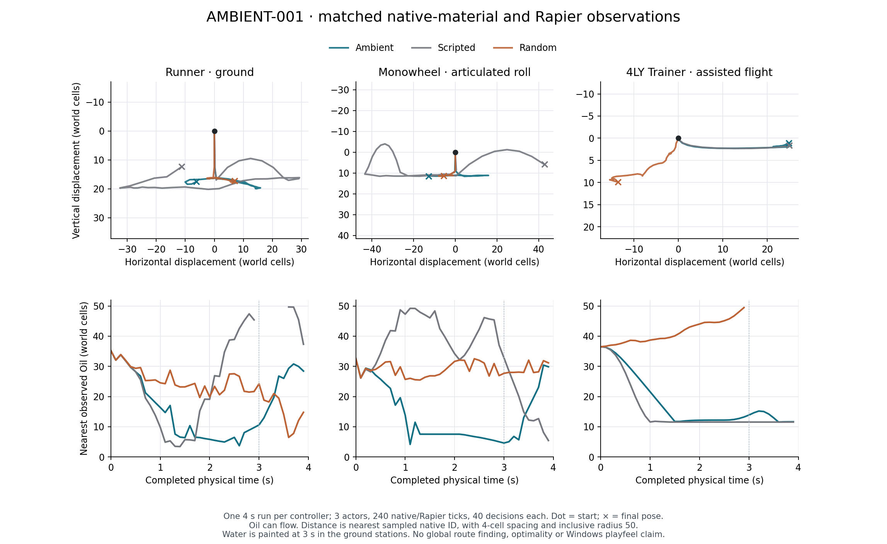

# AMBIENT-001 perception and physical qualification

This record covers specialist B's implementation and evidence. The feature remains
an opt-in Draft/HOLD candidate. The [ambient controller contract](../../systems/ambient-actors.md)
describes ordinary use and module authoring; the [mission ledger](mission-ledger.md)
owns the overall disposition, host qualification and evaluator delivery.

## Source custody and boundaries

The implementation starts from accepted main
`00cdb02f103265b6dc5224c68283e9a0c8cb449f`. Draft Actor Compose #762 was not imported.
The accepted host admits eight actors, eight parts per actor and 64 native proxies
and response bodies. No larger draft capacity is used in this evidence.

The final matched campaign began **2026-11-24 18:50:38 UTC**, using Godot
`4.7.stable.official.5b4e0cb0f`, Linux x86_64, headless, and the retained source-matched
native/Rapier artifacts. Runtime identities are:

| Artifact | SHA-256 |
|---|---|
| Godot executable | `f85bbc6b15e22416c7d797cd60b63286dd67b9cb13498847056c18520ae55a75` |
| Native Linux extension | `a15fc422313eb01e79bc904f44cc8879816484ae4fc98c63ac4b815afdb6a5e7` |
| Rapier Linux extension | `566e68ae53bfb2eb7018c8e7d0dd3727121bf696462039b780a33d6b8369c66a` |

The native runtime retains build/source commit
`c53fd6f9d3d0f2b3f39396c7e605654f65c17299`; its source-input ledger matches the native
source used here. The Rapier addon is v0.35.2 with the accepted cooperative BVH
backport. No native source, material law, Rapier bridge or motor tuning changed.
The [custody record](evidence/qualification-custody.json) retains actual selected
runtime hashes, test-start source hashes, input-report hashes and reduced-output
hashes. The final integration commit is recorded by the lead; these results are
bound to source hashes rather than an uncommitted branch name alone.

B owns new `ambient_perception.gd`, `ambient_actuator.gd`, five focused fixtures,
this ledger and the reduced evidence. The lead owns production host/session hooks.
The lead expressly delegated one narrow repair inside
`physical_actor_rig.gd::ambient_ledge_observation`: distinguish a probe beginning
inside a higher block from an empty downward ray. Existing motor rays remain
unchanged.

## Copied observation contract

`ambient_perception.gd` accepts immutable `CyberSimulationSnapshot` values from
the main-thread owner. Its core never receives a World, live node, RID, physics
object or a callable that can mutate them. The owner supplies run, epoch, physical
slot, authored instance, control generation and sampling tick with each copied
actor view. The controller still obtains an issued v2 observation before its
normalized action is submitted through the existing sequence/lease owner.

The material source is the native R8/RG8 publication's **numeric material-ID
channel**, copied before renderer acknowledgement. Native C++ publishes stored
cells plus its ballistic projection. The CPU `Image` is a byte-preserving backing
store for bounded patch copies; no display framebuffer, palette classification,
GPU filtering or screen coordinate supplies material identity. The green RG8
visual-condition byte is ignored.

The query contract is explicit:

- Radius is an integer from 1 through 96 world cells. The default examples use 50.
  Distance is inclusive Euclidean distance from the current actor center to cell
  centers `(x + 0.5, y + 0.5)`, clipped to the native canvas.
- Sampling uses a globally anchored four-cell lattice. A query examines at most
  2,401 candidate sites; a radius-50 circle normally contains about 490 sites.
  The returned point is the **nearest observed** matching sample. An isolated
  off-grid cell can be missed. Unsampled cells remain unknown.
- At most eight distinct material IDs are queried together. Accepted IDs are
  1–131 excluding reserved ID 10; Empty is not an attraction target. Profile
  validation and the sensor boundary both refuse unknown IDs and bad numbers.
- Each target reports availability, admitted radius, sample spacing, coverage
  count, presence, count, source tick/revision, and nearest point/distance/direction
  only when present. A clipped or tiny circle containing no lattice sites is
  unavailable, rather than an observed absence.
- The cache is shared across the session, allocated only for opt-in ambient use.
  It is at most 8 MiB for a 2048² RG8 canvas. Full refresh establishes a baseline;
  subsequently validated bounded native patches update it. Queries run at policy
  cadence, with no per-actor complete 100×100 scan every render frame.
- Equal material/current revisions prove retained bytes remain current even when
  the world is static for many ticks. If revisions differ, coverage becomes
  unavailable after twelve native ticks. Both revisions, render sampling tick,
  current native tick, generation and publication serial are exposed.
- Owner envelope serials are monotonic independently of render serials. A later
  renderer callback cannot roll back metadata already observed by the physics
  callback. Invalid owner identity, backend, generation or malformed patch data
  fails closed; omitted/truncated material coverage requires a new full baseline.

The existing physical owner supplies grounded state, wall distances and own energy.
Thirty cells is the wall-ray no-hit sentinel, not a collision. The extra ledge
probes use each module's exact lookahead and drop tolerance; identical pairs are
deduplicated by the session. Sixteen distinct module pairs cost at most 32 separate
rays per decision, outside the motor's own ray allowance. Probe positions use the
axis-aligned hull of attached parts, including equipment. This is a local support
approximation, not a footstep planner.

A support hit before a clipped canvas end is valid. A clipped ray without support
is unavailable boundary coverage. A starting point inside a taller block, or a
non-support collision normal, is unavailable occlusion. A clear interior ray
without support supplies only the admitted searched-depth lower bound. Walls,
canvas boundaries and physical drops remain separate observations.

Neighbors are at most seven same-run, same-epoch, same-tick copied positions within
96 cells. Compatibility means the same vertical movement affordance: ground and
wheeled rigs can be compatible; a flight rig belongs to the flight group. No
global spatial index or future population capacity is assumed.

## Capability adapters

Eligible ordinary ground/walk/roll rigs use accepted horizontal feedback and
ordinary jump semantics. Rigs with separate player-controller mappings are
explicitly unsupported by this first ambient adapter. Passive barrels do not
acquire locomotion. Ground intent is projected onto the horizontal axis; the
adapter never invents a vertical motor, teleports a body or changes its velocity.
The physical rig still owns force, contact, energy, braking and equipment.

Accepted 4LY rigs use the existing world-frame desired-velocity controller. Their
strict action contains **only `move`**. Pace affects that vector; a separate Effort
action is unavailable and the editor now explains/disables that parameter for
flight. A live zero vector requests braking and hover. Lease loss or passive mode
has its existing different physical meaning. Ground idle emits zero movement and
zero effort; a primary jump requires the real grounded flag and supported action.

## Qualification results

All commands used the exact pinned Godot above with `--headless --path godot
--script res://tests/<case>.gd`. Reports are reduced from completed exit-zero runs;
completion guards prevent an aborted helper from silently counting as success.

| Fixture | Passing checks | What was exercised |
|---|---:|---|
| `test_ambient_perception.gd` | 130 | Circular coordinate/radius boundaries, sparse coverage, malformed patches, epoch/generation/freshness, capability normalizers, actual native painting/erasure and composed decisions, 1/4/8-query population costs |
| `test_ambient_native_motion.gd` | 306 | Production session scheduler and issued v2 commands, actual native/Rapier motion in three families, equal independent observer for three controllers, native Water edit, pause and clock/lease behavior, runtime custody |
| `test_ambient_independent.gd` | 214 | B's independent review of A's engine through the real value adapters: source availability, material priority, safe neutral, copy isolation, module stream independence and contact/grounded action gates |
| `test_ambient_ledge_geometry.gd` | 15 | Real Rapier support rays, empty drop, inside-block occlusion, canvas clipping and invalid-query budget |
| `test_ambient_personalities_native.gd` | 2,877 | Three fresh native/Rapier worlds with the same Runner, initial material bytes/part poses, seed and 30-second budget; actual rest expiry/resumption, independently observed materials/resources and physical progression |

C independently read and reran the 130-check perception fixture and the 305-check
motion fixture before its final metadata-only platform custody repair. The final
motion fixture adds one platform/runtime identity assertion; gameplay and budgets
are unchanged. A independently reviewed the sensor freshness and artifact identity
boundaries. B reviewed A's core and the lead's physical ledge method. Implementers
therefore did not exclusively certify their own lane.

The actual native material-to-decision sequence is retained in
[perception measurements](evidence/perception-summary.json). With an explicitly
fixed copied actor pose at `(500.5, 200.5)`, Oil at +40 cells selected positive
movement. Native erasure and repainting at −28 selected negative movement, with
normalized ground action changing from +0.694 to −0.694. Subsequent real Water
edits measured 24, 44, 48, 44 and 36 cells: enter, hold in the exit band, release,
remain released, and reacquire at the inclusive entry threshold. Erasure then
released the override. Each decision used a fresh native publication at completed
native ticks 1–8, revisions 3–22, epoch 7 and world generation 3. This phase proves
actual native identity affects the core and normalized action, while the separate
motion campaign proves physical travel.

## Matched physical comparisons

Three controllers use identical initial native geometry and actor poses: the
ambient profile, accepted scripted feedback, and seeded random valid commands.
Each campaign contains Runner, Monowheel and 4LY Trainer, ten physical parts/native
masks, one native worker, a 512×256 canvas, 240 native and Rapier ticks, and exactly
40 decisions per actor. Every actor accepted 40 commands and rejected zero.
Water is painted at the same fixed ground-station coordinates at tick 180.

The ambient authored seed is 1701, mixed by the engine with actor/module identity.
Random control uses declared independent streams 1801–1803. These are different
generators, not a claim of identical random actions. The same separate numeric-ID
observer measures every campaign and never supplies controls to the baselines.

| Controller / rig | Horizontal range, cells | Minimum observed Oil distance | Minimum distance to first Oil point | Neutral move decisions / 40 | X command sign changes |
|---|---:|---:|---:|---:|---:|
| Ambient / Runner | 25.97 | 3.72 | 17.72 | 10 | 2 |
| Ambient / Monowheel | 28.75 | 4.16 | 18.30 | 10 | 1 |
| Ambient / 4LY Trainer | 25.00 | 11.55 | 11.55 | 14 | 2 |
| Scripted / Runner | 62.23 | 3.44 | 4.12 | 0 | 2 |
| Scripted / Monowheel | 86.05 | 5.45 | 4.33 | 0 | 2 |
| Scripted / 4LY Trainer | 25.00 | 11.55 | 11.55 | 0 | 0 |
| Random / Runner | 10.10 | 6.48 | 25.74 | 12 | 14 |
| Random / Monowheel | 8.11 | 25.48 | 32.51 | 10 | 17 |
| Random / 4LY Trainer | 15.54 | 36.50 | 36.50 | 4 | 13 |

Ambient zero movement intentions include material dwell and wandering idle. Random
zero vectors have no authored rest intention. For flight, neutral movement still
requests active hover. Actual material flow can reduce the nearest Oil distance
without equivalent actor travel; the fixed initial-point column makes that
distinction visible. The scripted ground actors reached closer to that initial
point and traveled farther. This is preserved as a result, not hidden behind an
optimality claim.

The ground ambient actors selected Water retreat on six and ten decisions. Their
intent pointed away from the actual observed Water. The flyer did not encounter
in-range Water in this layout, so this campaign claims no flyer Water avoidance.
All three ambient actors moved physically, and the two ground families recorded
214 and 223 grounded samples. No campaign's actor center left the canvas.

An active interval is six ticks after a command whose movement magnitude exceeds
0.05. The fixture calls it stalled when displacement is below 0.25 cells. Ambient
counts were 0/29, 1/29 and 3/26 intervals for the three rigs. Scripted flight had
28/39: its patrol requested movement toward the physical Oil-cup barrier. This
metric includes intended braking and contact; it is not a causal classification
of pathfinding failure. Ground standoff can be crossed by inertia or flowing Oil;
it is a decision preference, not an impermeable distance constraint.

The [trajectory CSV](evidence/native-motion-trajectories.csv) contains 360 decision
samples plus nine terminal poses. The [compact report](evidence/native-motion-summary.json)
preserves every actor's measurements, exact budget, cost counters, seed declaration
and metric definitions. This is one four-second comparison per controller,
with no confidence interval, broad pathfinding claim or human believability score.

## Thirty-second personality observation

The additional [compact personality report](evidence/personality-summary.json)
records a longer comparison of **Oil Moth, Shy Crawler and Idle Mechanic on the
same Runner rig**. Profile names grant no biological or physical capability. Each
arm uses a fresh native owner and its own Rapier `World2D`, a 512×256 canvas, six
actual actor parts/native masks, one native worker, the same floor and shallow
material cups, the same authored actor instance 100 and the same start at
`(220, 175)`. The profiles retain their authored modules and `shared_seed=false`;
only their seed is set to the common comparison value 1701. Native preparation
explicitly uses seed zero. Initial full native publication bytes and complete
copied part poses, velocities and resource state compare exactly across arms.

The run began **2026-11-24 19:18:20 UTC** on source commit
`c63cea9ef10d21f264c9a235437f7fd40acb1072` plus the explicitly recorded new,
then-untracked fixture. Its SHA-256 is
`ff3095cd90955ccc87b0cd398e086c9ca63eeabf8b7c4176860ec56a1ce82f2e`.
The production source hashes are retained individually and remained unchanged
through execution. This is a source-hashed local fixture run, distinct from the
lead's later complete committed-source qualification.

Every arm completed **1,800 actual native steps and 1,800 Rapier steps**, accepted
exactly 300 issued-observation commands at six-tick cadence and rejected none.
Terminal completed physical time is 30 seconds. Its last pre-step decision uses
29.9 seconds; requesting another delta is not counted as completed time. An
independent numeric-ID observer queries both Oil and Water within 50 cells for
all three profiles, including profiles that do not seek Oil. Its results never
feed commands. All 1,800 material queries have admitted nonempty coverage.

| Profile on Runner | Actual center path, cells | X range, cells | Idle intentions / 300 | Selected rest / 300 | X command sign changes | Stalled active intervals |
|---|---:|---:|---:|---:|---:|---:|
| Oil Moth | 443.93 | 35.50 | 0 | 0 | 11 | 64 / 299 |
| Shy Crawler | 271.05 | 34.44 | 22 | 0 | 18 | 21 / 277 |
| Idle Mechanic | 201.15 | 49.32 | 130 | 129 | 7 | 12 / 169 |

Idle Mechanic selects its scheduled rest on 129 decisions, **43%** of the observed
decision intervals. Two selected episodes last five completed seconds each:
7.6–12.6 seconds and 17.2–22.2 seconds. Both expire naturally and are followed by
a nonzero procedural intention and normalized movement command. A third rest
starts at 27.1 seconds and is honestly marked incomplete when the observation
ends at 30 seconds. Candidate rest activity and the selected override are recorded
separately; losing to a higher-priority override does not count as timer completion.

Physical state does not freeze during a neutral intention. The mechanic's center
travels **37.23 cells while selected rest remains neutral**, from genuine inertia,
gravity and articulated physical response. This drift is reported separately
from active resumption. The path column sums center displacement every physical
step and includes gait/vertical motion; it is not net travel, useful exploration
or a subjective activity score.

The Oil cup is physically obstructed. Oil Moth repeatedly approaches its observed
target and selects obstruction escape on 83 decisions; its 64 stalled intervals
are a preserved limitation. Shy Crawler selects Water avoidance on 32 decisions,
and Idle Mechanic on 15. No actor center leaves the canvas and no supported-to-
airborne transition occurs after initial settling. All three receive 300 own
resource observations with energy remaining 1.0; this is coverage evidence and
does not demonstrate energy depletion or resource-driven rest.

Nearest material distances remain **nearest observed native samples**, not global
nearest cells or proof that a target is physically reachable. Dynamic materials
can change that distance independently of actor approach. In this controlled cup
run the material revision remains unchanged, so the retained publication is fresh
through revision equality even though its sampling tick is zero. The fixture
does not award aesthetic, navigation or optimality passes to any personality.

The single process completed in 15.45 wall-clock seconds with a recorded peak RSS
of approximately 248 MiB. These are shared-host Linux observations, not Windows
playfeel or real-time performance acceptance. A independently verified report,
console and source hashes, all 900 decision times and 1,800 material measurements,
profile/initial-state equality, and each of the 129 neutral selected-rest commands.
The [independent review](evidence/personality-independent-review.json) retains that
review separately from the implementer's assertions.

## Cost and capacity observations

The separate 1024² native-material fixture retains one 2 MiB cache. One hundred
radius-50 decisions per actor took 56.8 ms for one actor, 207.4 ms for four and
416.8 ms for eight: approximately 0.52–0.57 ms per complete copied observation.
These measurements include the value wrapper and query, but no Rapier motion.
The largest recorded cache ingestion in that run was 1.878 ms. It is a finite
shared publication copy, rather than a new full-world copy per actor.

In the final actual-motion run, the shared 512×256 production cache was 256 KiB.
Its 120 queries totaled 55.0 ms; maximum ingestion was 0.137 ms. Average decision
core/actuator cost was 0.299, 0.294 and 0.180 ms for Runner, Monowheel and Trainer.
Maximum complete per-actor sensor observations were 4.441, 2.866 and 3.070 ms on
this shared hosted machine, including local ledge queries where configured.
These are observed costs, not a guaranteed frame budget. The qualification-only
independent observer has its own separately reported cost and cache.

Production ambient cache allocation stayed **zero** in both the scripted and
random campaigns. The lead's ordinary Workbench fixture separately completed
the actual eight-actor accepted population. This lane's 1/4/8 sensor benchmark
does not substitute for that host test or advertise an unsupported larger host.

## Review findings and repairs

- Initial stale/foreign-epoch refusal could leave old cache authority apparently
  available. It now blocks availability until a matching publication is admitted.
- A sparse circle containing no sampled sites originally looked like material
  absence. Each target now reports its own coverage count and unavailable state.
- Older renderer metadata could make a stale cache appear current after a newer
  physics snapshot. Independent owner serial/tick/revision checks prevent rollback.
- Escape thresholds could exceed the accepted 30-cell no-hit wall range. A capped
  the authored threshold at 29 and excluded the no-hit sentinel; B independently
  tested the composed sensor-to-core behavior.
- A ledge ray beginning inside a higher block could return an empty hit and imply
  a drop. The optional ray now detects its interior collision and reports unknown
  support. The real Rapier regression covers both this case and real empty drops.
- Generic Effort appeared applicable to strict 4LY controls. Explicit capability
  metadata and editor explanation now state that only Pace affects that channel.
- A report originally described random-action seeds without distinguishing the
  ambient seed mixer. Reports now retain both declarations. A also caught the
  Linux-only runtime artifact paths; final custody selects the actual platform.

An early perception helper used a nonexistent native erasure method and aborted;
it was corrected to the supported native Empty paint operation, and explicit
phase-completion checks were added. One enhanced motion attempt was killed with
exit 137 during shared memory pressure before any result. It is not counted as a
pass. After moving only this mission's checkout out of tmpfs and staggering native
tests, the complete comparison passed. No other mission directory was modified.

A subsequent executor memory failure ended an initial personality check-only
attempt with exit 137 and cleared its temporary shared-memory volume. That attempt
produced no successful result. The original four-second raw process reports on
that volume are no longer retained there; their already committed reduced JSON,
trajectory CSV, figure and source-custody records survived and were rechecked.
Git's text normalization exposed a CRLF/LF mismatch in the trajectory output hash.
The reducer now emits explicit LF and the custody record matches the committed
CSV bytes; original source and run identities were preserved. The successful
longer run and its complete raw report, console and execution receipt were saved
to on-disk mission evidence, outside the cleared temporary volume.

## Reproduction and limits

Run each named fixture with the pinned Godot and source-matched native libraries.
Set `CYBERSAND_AMBIENT_PERCEPTION_REPORT`, `CYBERSAND_AMBIENT_MOTION_REPORT` and
`CYBERSAND_AMBIENT_PERSONALITIES_REPORT` for their respective fixtures to capture
machine-readable results. The [reducer](evidence/reduce_evidence.py) checks
the motion report's source hashes before producing the retained JSON, CSV, plot
and custody record. Its `--help` lists the report and supporting console inputs.

Sensor sampling is approximate; local rules do not find global routes. A material
target is not proof of terrain passability. Supported adapter eligibility is
broader than the three physically exercised rigs in this matched fixture.
The lead/C ordinary example campaigns provide separate broader-host evidence.
Only the pure decision stream is claimed reproducible for identical admitted
inputs. Cross-platform Rapier bit determinism, Windows/NVIDIA playfeel and human
judgment of ambient believability are not established by these Linux fixtures.
