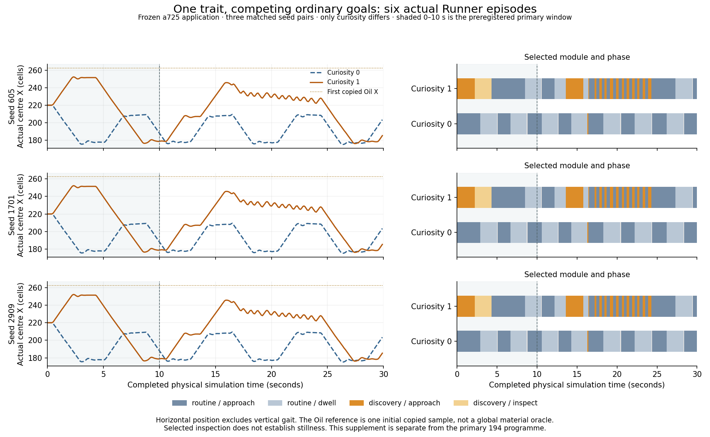

# A curiosity setting changed an actual physical choice

The [preregistered contrast](curiosity-preregistration.md) supports a narrow,
useful result: in one ordinary editable profile, high curiosity made a Runner
leave its routine, approach a newly observed Oil patch, inspect briefly and then
resume its patrol. The corresponding low-curiosity actor followed the routine
throughout the primary ten-second window. This changed real horizontal movement
through the existing actuators, not just a diagnostic label.

All six planned episodes completed at application source
`a7250e15495667b2fcf564cbed1eaa8dea217c45`, with the external diagnostic frozen
before physical execution at `31f8ecf8b6d8821740b545e046501f90c86e06f3`.
The application project was unchanged. One externally killed attempt at the
sixth case was preserved and only that exact missing case was retried. These
six completed conditions remain outside the primary 194-episode registry.

## Primary results

The ordinary profile contains two equal-priority goals: investigate Oil to the
right, and patrol between two home-relative waypoints to the left. Only
`personality.curiosity` differs within a matched pair. Both actors receive the
same initial actual Oil observation at `(262.5,190.5)`; the policy admits 1,025
samples and the independent outcome observer 710 samples under their respective
fixed scopes. Other profile settings, native material bytes, complete initial
pose identity, geometry, model and seed match exactly.

| Seed | Low-curiosity investigation, first 10 s | High-curiosity investigation, first 10 s | Low horizontal approach gain | High horizontal approach gain |
| --- | ---: | ---: | ---: | ---: |
| 605 | 0.0 s | 4.3 s | 0.00 cells | 32.25 cells |
| 1701 | 0.0 s | 4.3 s | 0.00 cells | 32.25 cells |
| 2909 | 0.0 s | 4.3 s | 0.00 cells | 32.25 cells |

Approach gain is the preregistered reduction in minimum horizontal distance to
the first copied Oil location during `[0,10)` seconds. It does not use vertical
gait as progress or treat later absence outside sensory range as arrival.
The high actor had already returned toward the patrol by the end of that window;
its net X displacement was **−41.30 cells**, versus **−30.19** for low curiosity.
The time series is therefore essential: an endpoint alone would hide the earlier
successful material approach and return to routine.

The initial copied candidate scores confirm the mechanism. Investigation scored
**1.4** for high curiosity and **0.1** for low curiosity; patrol scored **0.45**
for both. Equal priorities did not mask the utility competition. The high actor
selected investigation immediately, reached its twelve-cell horizontal standoff
at **2.2 seconds**, spent **2.1 sampled seconds** in selected inspection and
resumed the routine at **4.3 seconds**. Both preregistered directional outcomes
were supported in all three pairs.

## Secondary negatives and a bounded novelty limitation

Inspection did not make the body still. Across its selected inspection samples,
the high actor occupied a **2.31-cell horizontal range** and accumulated **5.73
cells of centre path**, including gait and settling. Low curiosity also selected
investigation for **0.1 seconds** at a later patrol handoff. The supported claim
is a difference in the preregistered initial competition, not that a low setting
permanently prohibits investigation.

The later high-curiosity trajectory has a real rough edge. After another
investigation became eligible, the actor repeatedly switched between the same
discovery and patrol goals, producing small reversals around 17–24 seconds.
The additional copied `goal_key` confirms that these are repeated selections of
discovery goal **2** and patrol goal **3**, not a succession of new discoveries.
The finite investigation deadline eventually releases the competition.

| Time | Actual copied nearest Oil cell centre | Discovery score | Patrol score | Selected goal |
| --- | --- | ---: | ---: | --- |
| 17.1 s | `(262.5,192.5)` | 0.1167 | 0.45 | Patrol 3 |
| 17.2 s | `(262.5,191.5)` | 1.2250 | 0.45 | Discovery 2 |
| 17.4 s | `(262.5,192.5)` | 0.1120 | 0.45 | Patrol 3 |

The final bounded memory contains adjacent material-interest entries
`16:10:7` and `16:10:8`, with **5.5** and **15.7 seconds** of observed exposure.
The one-cell vertical sample change crosses the default 24-cell memory grid's
Y boundary at 192. The source mechanism and copied scores support a concrete
interpretation: local grid quantization can make adjacent observations of the
same contiguous patch appear differently habituated, and embodied gait can
amplify the ensuing utility changes. This limitation is retained; no parameters
or production logic were retuned after seeing it.

There was **no explicit habituated-patch completion reason** in the recorded
high-curiosity candidates. The observed releases were inspection completion,
cooldown and a later approach deadline. These episodes therefore establish a
curiosity choice and physical inspection, not successful patch-level novelty
recognition in every phase or generally smooth long-horizon attention.

## Qualification and original evidence

Each episode completed **1,800 native ticks, 1,800 Rapier steps and 300 accepted
commands**, with no rejected commands. The six original successful reports
contain **45,078 apparatus checks**. Full source/runtime custody before and after
execution agreed, including all **855 loaded-project inputs**, the official
Godot 4.7 executable and the retained native/Rapier binaries. The external script
only specializes ordinary authored inputs and copies diagnostics; it does not
provide a new controller, actuator, physics law or global material oracle.

A separate [post-run reader](../../../tools/ambient/diagnostics/review_curiosity_contrast.py)
recomputed **48 numeric values** directly from original positions, selection
samples and candidate scores. All agreed with the registered comparison. The
[readback JSON](evidence/curiosity-31f/independent-readback.json) preserves the
late score transitions, actual goal identities and final interest entries.
The [matched-pair CSV](evidence/curiosity-31f/primary-pairs.csv), exact alternative
[low](evidence/curiosity-31f/profiles/low_curiosity.json) and
[high](evidence/curiosity-31f/profiles/high_curiosity.json) authored profiles, and
[receipt](evidence/curiosity-31f/receipt.json) make the result independently
inspectable. The alternatives intentionally share a profile ID because curiosity
is their only changed authored field.

The [complete original archive](evidence/curiosity-31f-complete.zip) retains all
six successful report/console/execution chains, the failed process, complete
custody, registration, both driver logs, plots, protocol sources and an exact
Git bundle of diagnostic source 31f. The earlier
[before-retry archive](evidence/curiosity-31f-before-retry.zip) was durably
checkpointed before the missing case was rerun. Its failed process returned
**−9 after 1.12 seconds**, with normal engine startup output and no report or
completion marker. Actual physical progress in that failed attempt is
unestablished. Low available memory was observed, but no kernel OOM receipt was
captured, so the precise external-kill cause is not asserted.

## Interpretation boundary

All three declared seeds produced identical position sequences within each arm.
These two competing goal modules do not require stochastic target selection in
this scene. The evidence is three fresh-World repetitions of one controlled
competition, not three different stochastic behaviours, statistical population
significance or an assertion of cross-platform Rapier determinism.

The primary programme's `no_traits` arm still disables traits and drives
together, and cannot isolate curiosity. This supplement answers that narrower
causal question without relabelling the original ablation. It does not establish
that every personality slider is independently qualified, that high curiosity
always improves exploration, or that the later repeated selections are desirable
gameplay. Elapsed timings are not interpreted because local resource contention
occurred. The contrast ran on Linux; it adds no Windows/NVIDIA playfeel claim.
