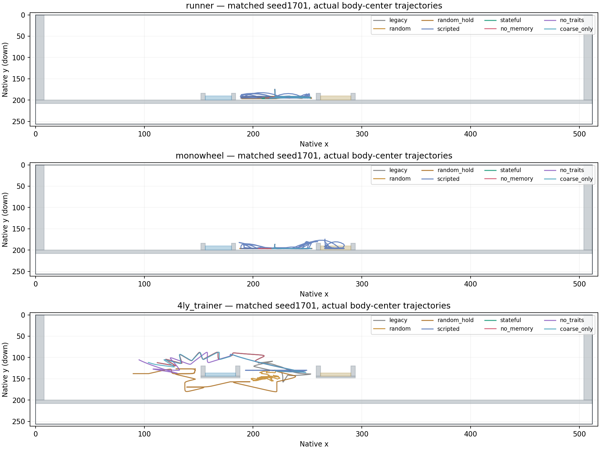
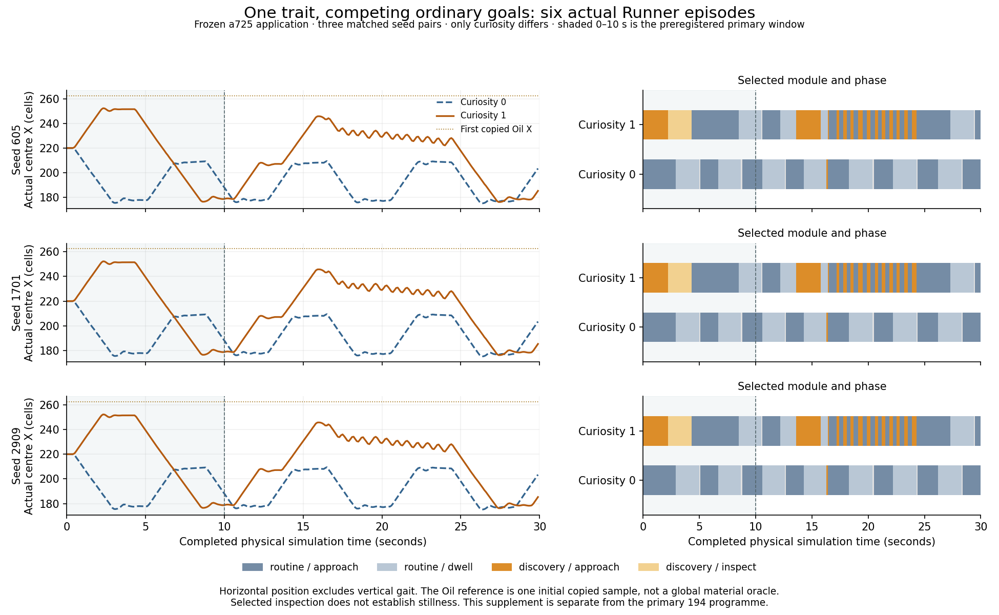
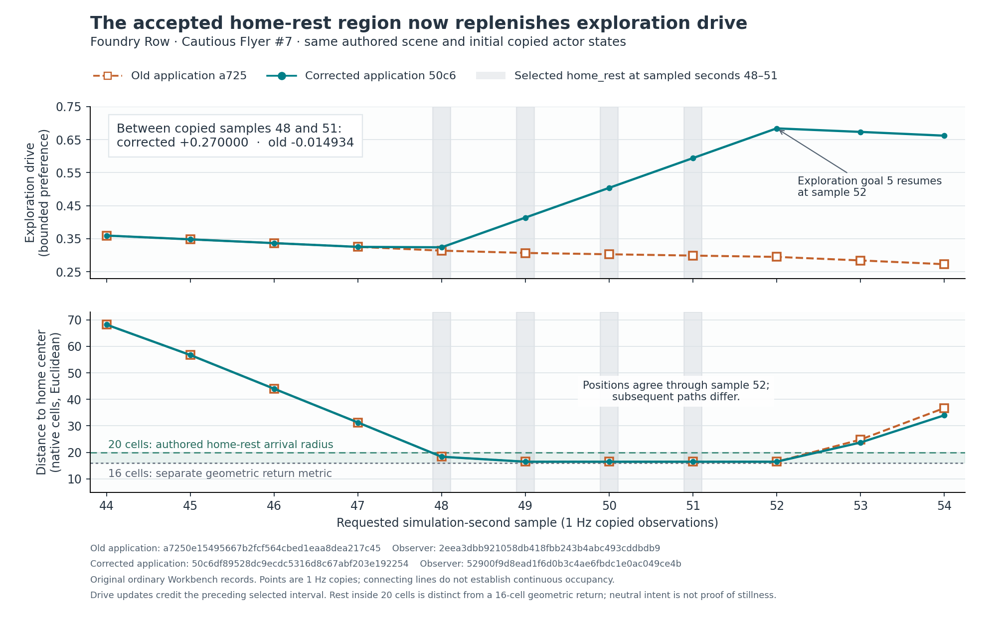

# AMBIENT-002 — living inhabitants, with measured limits

**Disposition: deliver the qualified opt-in evaluator and keep
[PR #779](https://github.com/techrote/cybersand/pull/779) Draft/HOLD for owner
review.** The ordinary Workbench now supports editable inhabitants that combine
temporary goals, personality, drives, bounded memory, local obstacle steering
and copied peer observations. This is a substantial extension of AMBIENT-001,
with 29 reusable modules, 16 ordinary profiles, six new native environments and
transactional individual/group authoring. The strongest physical results are
more stable ground steering, useful withdrawal from some unproductive approaches
and a controlled curiosity-driven interruption and return to routine. Exploration,
social cohesion and long-horizon navigation have significant counterexamples.

The application is frozen at **`50c6df89528dc9ecdc5316d8c67abf203e192254`**, tree
**`d9740be7cafb8ac7b7d6eee4a16219989745fd95`**. Later commits contain evidence,
external observation tools and documentation; they do not change its loaded
`godot/` application. The [full Linux/Windows campaign](https://github.com/techrote/cybersand/actions/runs/45552786466)
passed. The ordinary Windows launcher and freshly extracted shipped project
were actually executed, separately from the source checkout.

## Contents

- [Owner delivery](#owner-delivery) — exact portable ZIP, source identities and the first playable steps.
- [Composition and ownership](#composition-and-ownership) — reusable mechanisms, finite memory, social scope and preserved authority.
- [Authoring and environments](#authoring-and-environments) — editable profiles, group application and six native places to observe.
- [Experimental design](#experimental-design) — the physical registry, controls, horizons and interpretation rules.
- [Physical findings](#physical-findings) — recovery improvements, limited exploration gains, curiosity and social counterexamples.
- [Perception and cost](#perception-and-cost) — actual thin-patch detection, incomplete coverage and measured overhead.
- [Platform and authoring qualification](#platform-and-authoring-qualification) — actual Linux/Windows execution, extraction and UI/save gates.
- [Sustained graphical observation](#sustained-graphical-observation) — separately identified native Workbench observation and qualitative review.
- [Retained failures and corrections](#retained-failures-and-corrections) — original failures, repaired causes and evidence that remains negative.
- [Owner decision and remaining work](#owner-decision-and-remaining-work) — the supported claim and explicit reasons to retain HOLD.
- [Evidence index](#evidence-index) — original artifacts, immutable archives, figures and specialist ledgers.

## Owner delivery

Download the [portable Windows artifact](https://github.com/techrote/cybersand/actions/runs/45552786466/artifacts/14995966187).
The Actions download is an outer envelope containing this one portable ZIP:

```text
CyberSand-AMBIENT-002-Windows-50c6df89528d.zip
259,734,965 bytes
SHA-256 54a4dc71c10a6ca77dcc8ba48a1fb5be39cc0e63ae33099b3dd0d452e9c71a5a
```

Extract the complete inner ZIP into a writable folder and run **Open Workbench.cmd**.
Allow the first local import to complete. Open **Actor Composition…**, choose
**Foundry Row** or **Common Ground**, select **Load scene**, then press **Play**.
Use **Inspect**, **Follow selected**, focus, pan and zoom to watch an inhabitant
closely; the larger scenes deliberately extend beyond a close camera view.

The package contains the ordinary Workbench, official Godot 4.7, source-matched
retained native and Rapier runtimes, required Windows dependencies and notices,
all eleven native examples, the sixteen-profile catalogue, authoring tools,
guides, original qualification records and the payload manifest. It keeps saves
under its own `userdata` folder. Nothing needs to call a model or train a policy.

| Identity | Exact value or evidence |
| --- | --- |
| Qualified application | `50c6df89528dc9ecdc5316d8c67abf203e192254` |
| Qualified source tree | `d9740be7cafb8ac7b7d6eee4a16219989745fd95` |
| Retained native build source | `c53fd6f9d3d0f2b3f39396c7e605654f65c17299` |
| Official engine version | `4.7.stable.official.5b4e0cb0f` |
| Full qualification | [45552786466](https://github.com/techrote/cybersand/actions/runs/45552786466), Linux and Windows successful |
| Windows original/extracted review | [Exact source, payload and process readback](evidence/windows-50c6df89-review.json) |
| Principal predecessor | [#775](https://github.com/techrote/cybersand/pull/775), preserved application `f4f94631d61d492554627949497e727b26043ccb` |
| Preserved predecessor evaluator | [45475439737 / 14959278583](https://github.com/techrote/cybersand/actions/runs/45475439737/artifacts/14959278583), unchanged |

At the final 05:49 UTC repository refresh, predecessor #775 was open and
non-draft at `d0af9b6015c27417fddd67f79afdcf656a609571`. Its original qualified
application and closing documentation `22902a155fd8e32a84b89f25bfa45bdfefd1f211`
remain in the successor's ancestry. Capacity candidate [#762](https://github.com/techrote/cybersand/pull/762)
was still open, Draft and explicitly unaccepted at
`47e87cb84cf302b4e283cfc7e8f884e01b7b4c73`. It was not imported. The supported
ordinary host limit remains **eight actual logical actors**.

## Composition and ownership

### Reusable decisions

A profile remains a collection of enabled, weighted, prioritized module
instances, with at most sixteen instances chosen from twenty-nine types.
Continuous preferences combine; reflex overrides can interrupt; temporary goals
compete by utility and retain a finite commitment; approach, inspect, dwell,
retreat and cooldown phases retain their own bounded state. Goals do not receive
secret access to the native World or direct control of bodies. See the
[complete contract](../../systems/ambient-living-inhabitants.md) for admission,
arbitration formulas and every configurable parameter.

The original eleven remain: wander, seek material, avoid material, avoid ledge,
avoid boundary, escape obstruction, return home, rest, follow actor, avoid
crowding and maintain altitude. The eighteen additions are meaningfully different
mechanisms:

| Family | New shared modules |
| --- | --- |
| Attention and local exploration | Investigate material; explore unfamiliar territory; revisit interest; search last seen material; temporary exploration destination |
| Authored routine and places | Patrol route; prefer region; avoid region |
| Embodied recovery and needs | Withdraw after repeated obstruction; actual-resource rest; seek home as exploration drive declines; obstacle-aware steering |
| Local social activity | Observe actor; regroup; align with copied peer movement; disperse; avoid disliked peer |
| Material geometry | Follow a sampled material boundary |

All sixteen inhabitants use these shared primitives. No preset has a unique
controller. The six predecessor profile objects retain their original parsed
configuration and version-1 semantics; upgrading one to living settings is an
explicit staged edit.

### Personality, time and memory

The eight traits have stated effects: curiosity raises novel-interest utility;
persistence affects commitment/deadlines; caution changes avoidance distance and
required clearance; sociability changes social utility and drive; activity
changes legal pace and exploration depletion; territoriality changes region
utility and homeward threshold; preferred distance controls spacing; failed-attempt
tolerance controls when remembered obstruction warrants withdrawal. These are
procedural preferences, distinct from actual rig energy used by resource rest.
The curiosity supplement below establishes one isolated physical effect. The
programme does not independently identify every slider's causal effect.

Exploration and social drives stay in `[0,1]` and accumulate/dissipate using
completed physical simulation time. Pausing and repeated inspector reads do not
advance them. A selected dwell interval receives credit only when the preceding
selection names that same module, goal and phase and the observation gap is no
more than 0.25 seconds. Suppressed or unsupported time contributes nothing;
already accumulated partial dwell can resume before the finite opportunity
deadline. A candidate cannot complete its inspection or rest merely by waiting
while unselected. Camera visibility does not control policy progression.

Selected home-rest recharge uses the arrival radius of that exact enabled,
positive-weight `seek_home_drive` instance, with the current copied position
still required to satisfy the ordinary ground-horizontal or flying-Euclidean
containment check. Other opportunistic neutral/rest behavior keeps the existing
sixteen-cell radius. This aligns acceptance and recharge without changing drive
rates, actuators or physics rules. Drive integration combines the prior admitted
intent with the current copied position; it is not proof of uninterrupted home
occupancy across an arbitrarily long observation gap. Equal seeds produce the
same procedural choices for equal validated profiles and copied inputs; physics
is not claimed bit-deterministic across platforms or execution hosts.

Per-actor spatial memory bounds visited cells to 8–128 entries, material interests
to 1–32 and failed approaches to 1–32. Grid width is 8–96 native cells; ordinary
observation lifetime is 5–600 simulation seconds; obstruction records expire no
later than 30 seconds. Stable least-recently-seen eviction resolves capacity.
The memory identity includes actor/run/epoch and World generation. A replacement
World, reset, profile handoff or reopened scene does not inherit invalid
knowledge. Historical material observations are not proof that a moving patch
still occupies a remembered point.

Failed approaches require actual requested movement, insufficient observed
progress and nearby copied physical contact sustained for the declared interval.
They are not inferred from gait distance or a neutral command. Disabling spatial
memory removes visited/interest/obstruction learning and use; finite module
latches, patrol phases, cooldowns and last-seen search state remain.

### Physical and social authority

The existing actor session owns command admission, leases, body lifetimes and
physical progression. AMBIENT-002 adds copied observations and transactional
handoff through that boundary. Native material laws, the Rapier bridge, real
movement motors and equipment behavior are retained. Human, scripted, reactive,
external-policy and passive control retain their paths and regression coverage.
There is no teleportation, direct position/velocity mutation, production-default
activation, uncontrolled model call or training.

The owner copies nearby eligible poses, velocities, locomotion compatibility and
authored affinity tags once per physical tick. Preferred tags favor compatible
peers, neutral peers remain a fallback, and disliked tags take precedence.
Actors cannot inspect another actor's private intentions, drives or memory.
Groups can arise from local attraction, observation, alignment, spacing and
finite dispersal. A pure-adapter seam can accept at most thirty-two supplied
candidates and retain the nearest seven; this does not instantiate more bodies
or authorize a larger host. Ground/wheel and flight compatibility remains explicit.

## Authoring and environments

The [owner guide](../../operations/ambient-living-workbench.md) describes the
actual controls. Inspect an actor, open **Behaviour profile**, then use
**Duplicate to customize**. The four tabs expose searchable module descriptions,
semantic parameters, independent personality settings, memory/perception budgets,
home/interest/avoidance rectangles, patrol waypoints, peer tags and profile reuse.
Live inspection explains selected and losing proposals; optional overlays show
copied intent, perception, authored regions and bounded memory.

**Apply profile to this actor** performs an acknowledged handoff. **Revert staged
edits** rereads the admitted configuration. Changing the Workbench selection does
not silently retarget an unfinished draft. A replaced World/actor or newer
external control edit refuses stale Apply. Play-time audition uses the same
admission path as normal editing.

The scene library holds up to thirty-two shared authored profiles. Selecting an
entry stages a copy. Ctrl/Shift multiselection and **Apply draft to selected
group** preflight every actor and prepare every replacement adapter before any
control producer is revoked. A missing, stale or incompatible member refuses the
whole operation. Successful application keeps bodies, poses and resources,
creates individual editable copies and resets private policy state. Later library
edits do not silently mutate existing assignments.

Normal **Save/Reopen** preserves profiles, module order, seeds, regions, tags,
assignments and library contents. It deliberately omits current goals, drive
accumulators, memory, observation caches, RNG continuation and command leases.
An authored start is not a physical replay checkpoint.

### Six new ordinary native environments

All construction uses editable native materials in side elevation. Scene recipes
build terrain and place ordinary physical rigs; they do not script an outcome or
run a separate demonstration engine. All five AMBIENT-001 examples remain.

| Scene | Canvas / actors | Intended owner experiment |
| --- | --- | --- |
| **Foundry Row** | 1280 × 640 / 8 | A service street with homes, activity areas, patrol, territorial, social and scavenging inhabitants. Edit a home and observe competing regional interests. |
| **Pipe Orchard** | 1280 × 640 / 6 | Oil/Water pockets, low barriers and a sealed Oil cabinet. Compare fascination, repeated obstruction and withdrawal near a physically unreachable attraction. |
| **Echo Galleries** | 1280 × 768 / 6 | Rock chambers, dead ends and alternative aerial access. Compare actual ground and flying routes; local intent does not guarantee an exit. |
| **Common Ground** | 1024 × 640 / 8 | Two affinity groups and a common square. Inspect congregation, personal space, separation and copied peer loss. |
| **Rain Exchange** | 1280 × 640 / 6 | An overhead Water tank drains into an industrial yard. Change a real gate or paint material and inspect the resulting observation/decision changes. |
| **Lantern Hangar** | 1536 × 768 / 6 | Suspended gardens, open flight bays and home docks. Follow independent 4LY personalities and compare exploration/homeward intervals. |

The new environments contain forty placed actors across six distinct scenes,
with at most eight in one running World. They contain 201–389 native construction
rectangles each. Overview makes their spatial organization legible; individual
actors can be too small to judge there. Use Follow/zoom for behavior.

### Sixteen editable inhabitants

The catalogue trials below are descriptive thirty-second observations in one
matched environment per locomotion family, with an actual passive companion.
They demonstrate compositional differences, not sixteen replicated statistical
personality classes. The [catalogue traces and timelines](evidence/hosted-50c6-independent/scientific-findings.md#social-activity-and-catalogue-interpretation)
retain all of them, including small ground ranges and frequent selection changes.

| Profile | Configured tendency / concrete observed behavior |
| --- | --- |
| Oil Moth · original | Seeks observed Oil; 21.3 seconds selected material seeking interrupted by physical escape. |
| Shy Crawler · original | Slow, cautious local wandering, material avoidance and a committed ledge retreat. |
| Curious Surveyor · original | Wandering, material seeking and timed rest; retained predecessor comparison. |
| Idle Mechanic · original | Short activity periods and longer rests; 12.7 seconds selected rest in the catalogue fixture. |
| Drifting Flyer · original | Seeded two-axis wandering with altitude and boundary corrections. |
| Social Roamer · original | Simple following and wandering; 128 selection-label changes show retained arbitration churn. |
| Restless Explorer | Novel local destinations and failure-driven withdrawal; 14.8 seconds unfamiliar exploration and 9.1 seconds withdrawal. |
| Territorial Watcher | Strong region/home preference and finite peer attention; 13.6 seconds observing the companion. |
| Social Drifter | Observation, regrouping, alignment and dispersal; 11.7 seconds selected regrouping and 8.3 seconds selected peer observation, including approach, with 76 label changes. |
| Timid Follower | Cautious peer attention and wider spacing; 14.1 seconds selected peer observation, including approach, 3.3 following and substantial neutral-intention time. |
| Persistent Scavenger | Oil inspection, remembered-interest revisits and search; 7.9 seconds investigating and 3.7 revisiting. |
| Routine Patrol | Editable finite route legs/dwells; 19.0 seconds on route, interrupted by avoidance/rest. |
| Independent Wanderer | Finite seeded destination commitments; 18.0 seconds pursuing exploration destinations. |
| Cautious Flyer | Slower clearance-aware exploration, material inspection and homeward cycles; 147.72-cell horizontal range in this fixture. |
| Boundary Grazer | Tangential sampled-edge following and remembered patches; 7.1 seconds selected boundary following. |
| Homebody Keeper | Short excursions and low-activity homeward periods; 7.3 seconds selected home seeking. |

## Experimental design

The final primary Linux programme contains **194 identified actual physical
actor episodes in 122 fresh-World campaigns**: 178 subject episodes and sixteen
passive physical companions. It covers **4,560 World-simulation seconds and 6,720
actor-simulation seconds**, or 76 World-minutes and 112 actor-minutes. All 122
original report/console/process chains are retained. The independent readback
checked 2,910 metrics, 67,200 copied-peer samples and forty exact ablation groups.
[Source, custody and full quantitative report](evidence/hosted-50c6-independent/scientific-findings.md).

| Registered family | Worlds / actual actor episodes | Question |
| --- | ---: | --- |
| Main comparison, 30 seconds | 72 / 72 | Eight policies × three rigs × three matched seeds (605, 1701, 2909). |
| Social courtyard, 30 seconds | 8 / 32 | Four policies × two seeds × four physical actors. |
| Sealed goal, moving material, blocked route | 12 / 12 | Three adverse conditions × two seeds × stateful/memory-off. |
| Departing peer | 4 / 8 | Two seeds × social stateful/social-off, with actual legal motion of the departing actor. |
| Supported capacity | 4 / 32 | Eight actual actors × two seeds × legacy/stateful. |
| Sustained behavior | 6 / 6 | Four two-minute and two five-minute subject episodes. |
| Profile catalogue | 16 / 32 | One subject per profile plus one passive physical companion. |

The main controls include AMBIENT-001, legal seeded-random steering changing
every 0.1 seconds, a stronger random control holding each heading for one second,
an ordinary deterministic scripted policy, the new stateful profile, spatial
memory disabled, traits and drives disabled together, and coarse-only perception.
Paired cases start with exact matched native material bytes, full actor poses,
geometry and authored seeds, and use the same independent outcome-observer scope.
The broad legacy/new comparison retains each profile's authored composition and
requested policy sensing; it compares complete configurations, not architecture
under identical policy observations. Within the named ablations, all authored
fields outside the declared memory/traits/module-disable/perception changes
match. Disabling optional modules can itself remove their observation requests;
coarse-only deliberately changes material sampling. The registry and exact
profile hashes make these distinctions inspectable.

Six additional preregistered thirty-second curiosity-only episodes answer a
narrower mechanism question. They remain separate from the primary 194. The
nine repair reruns reuse primary case identities and are not nine additional
independent experimental subjects. The one-step thin-material probe adds zero
behavioral episodes. Re-executions on another platform or at a previous source
are not silently counted as new conditions.

The whole primary run completed 273,600 native ticks and 273,600 Rapier steps,
with 62,400 accepted and zero rejected actuator commands and no recorded
actor-center canvas incident. Actors sharing one World are one experimental
cluster. Three main seeds and two social/adverse seeds provide modest replication;
the episode total is not a statistical claim of 194 independent treatment trials.

### Measurement discipline

Ground exploration uses stable sixteen-cell horizontal bins and horizontal
range, excluding vertical gait. Flight uses sixteen-by-sixteen-cell bins. A bin
requires at least 0.5 seconds of cumulative occupancy; the starting bin is
eligible under that same rule.
Grid occupancy is a nominal measure; slight movement across a boundary can add
a bin. Body-center path, displacement, occupied bins and arrival are different
quantities.

Active stalls use less than 0.25 cells of supported progress per 0.1-second
sample. A wall-proximity entry is distinct from an internal contact-supported
failure event, and neither is a count of unique failed destinations. An eight-cell
recovery within five seconds counts displacement from the recorded obstruction-entry
position, measured horizontally on ground and by Euclidean distance in flight.
It does not explicitly test direction away from the wall or establish global
reachability. Its obstruction-entry proxy uses horizontal wall rays and does not
classify vertical flight obstruction. Home departure/return geometry (40/16 cells) is reported separately
from selected homeward intent. Neutral input can permit gait, settling, drift or
active flight hover. The primary traces record selection labels, not distinct
goal-instance counts; the curiosity supplement additionally copies `goal_key`.

These definitions and the raw post-reader are preserved. The team deliberately
retained controls that perform well, unhelpful social grouping, stalled actors,
unreached goals, host variation and diagnostic failures.

Matched seeds and source do not establish exact physical replay. In the retained
same-source 83a local-versus-hosted comparison, only **23,252 of 67,200 copied
positions** were bit-equal, **44 of 194 complete actor traces** matched, and the
largest corresponding-position difference was **118.99 cells**, despite matching
initial materials, full poses, authored profiles, engine and native identities.
This is a measured execution/host variability limit. The final numerical results
below belong to hosted 50c6; they are not pooled with those older local outcomes.
The [a725-to-50c6 comparison](evidence/hosted-50c6-independent/old-to-new-comparison.md)
retains the matching starts, unchanged main/adverse/social/catalogue summaries,
and changed long-flight outcomes. Repeating the registry at a later source adds
no independent treatment registrations.

## Physical findings

### A real ground-steering defect was found and corrected

The earlier fully qualified `83a3db6f…` application could alternate left and right
without going anywhere useful. In a two-second Runner/wheel window, 21 observations
contained twenty heading reversals while X spanned only 0.087875/0.089798 cells.
The selected exploration module label and phase did not change. A copied-value probe
showed that a nominal finite avoidance heading was being released on the very
next decision because the previous final direction now looked clear.

The bounded correction retains that heading until its original deadline while a
fresh, capability-appropriate copied ray still establishes clearance. Unknown
coverage, new blockage, neutral motion and expiry release it. A clear retreat
does not perpetually renew the deadline. Memory and actuators are unchanged.

In the separate nine-case matched same-host repair probe, Runner seed605 active
stalls fell from 45.1% to 9.0%, with horizontal range 32.26 → 44.82 cells. Wheel
seed605 stalls fell from 40.1% to 8.1%, with range 38.16 → 49.51. The original
two-second windows dropped from twenty to two reversals. The flyer and blocked-route
controls were unchanged. All original baseline/candidate traces, exact source
bundle and independent readback remain in the [negative and correction record](recovery-negative-review.md).

The final full programme then produced median stateful active stalls of **8.37%
for Runner and 8.05% for Monowheel**. This is a useful local-control improvement,
with a specific physical defect, bounded repair and fresh complete qualification.

### Richer control does not always explore farther

Median horizontal range in the three-seed main comparison:

| Policy | Runner | Monowheel | 4LY Trainer |
| --- | ---: | ---: | ---: |
| AMBIENT-001 | 35.60 | 34.36 | 52.22 |
| Seeded random, 0.1-second change | 44.62 | 19.07 | 41.63 |
| Seeded random, one-second hold | 65.18 | 63.05 | 84.54 |
| Deterministic scripted | 63.73 | 96.79 | 56.38 |
| New stateful | 47.60 | 49.51 | 114.93 |
| Spatial memory off | 47.29 | 49.44 | 85.51 |
| Traits and drives off | 47.37 | 33.65 | 114.31 |
| Coarse-only perception | 46.41 | 45.47 | 74.09 |

Values are native cells in one fixture family, not a general intelligence score.
Held random and scripted control cover more ground than the new ground profiles.
The stateful flyer has the widest cohort median here, but ablation effects must
use matched pairs: the median within-seed stateful-minus-memory-off range is
only **+0.313 Runner, +0.074 wheel and 0.000 flyer**. Subtracting the flyer cohort
medians would misleadingly imply a typical 29.42-cell memory benefit.



Memory's clearer benefit appears in adverse approaches. With a sealed attractive
goal, the stateful actor records seven internal failures, 6.2 seconds of selected
withdrawal and **40.58% active stalls**, versus no withdrawal and **80.27%** with
memory off. In the blocked-route condition, stateful records five failures,
9.1 seconds of withdrawal and **24.81%** stalls, versus **92.98%/93.98%** for the
two memory-off seeds. Range is about 65.6 versus 33.2 cells; three eight-cell
recovery windows occur in stateful and none in memory-off. This is physical
withdrawal evidence, not proof that an unreachable goal became reachable. All
five recorded failures in each blocked-route seed precede the wall introduced
at fifteen seconds; the last is at 12.6 seconds. Later withdrawal reuses that
earlier record. It does not establish learning that particular new obstruction.

Longer episodes remain mixed. The five-minute stateful wheel covers only 51.74
horizontal cells and four stable bins, with **36.66% active stalls**. Memory-off
has 52.20 cells, four bins and 45.58% stalls. The corrected two-minute stateful
flyer covers **193.01 horizontal cells and 38 stable bins**, versus 168.66 cells
and 36 bins with memory off. Stateful selects home seeking for 22.6 seconds,
including 8.2 seconds of selected home-rest; memory-off selects it for 24.0
seconds, also including 8.2 seconds of home-rest. Each shows two separated
home-rest windows, with a copied drive gain of 0.36 over four sampled seconds
in each. Primary traces lack unique goal keys, so these are observed windows,
not a count of distinct goal instances.

The fixed sixteen-cell geometric return metric records **one stateful return
and two memory-off returns**. The older a725 result was two versus one; this
change is retained. All three new sixteen-cell crossings occur after rest,
under unfamiliar exploration or material investigation rather than selected
homeward intent. The twenty-cell authored home-rest arrival and the separate
sixteen-cell geometry metric answer different questions. The observed recharge
and resumed activity are real, while these crossing counts do not establish a
general gain in intentional home-return success. The ground scavenger lacks a
home module, so zero home returns there are not failed home attempts.

### Curiosity changes an actual choice, with a retained rough edge

The [supplementary preregistered contrast](curiosity-results.md), executed at
application `a7250e15495667b2fcf564cbed1eaa8dea217c45` using independently frozen
external apparatus `31f8ecf8b6d8821740b545e046501f90c86e06f3`, changes only
curiosity between zero and one in the same ordinary profile. Equal-priority Oil
investigation competes with a two-waypoint patrol. Initial investigation utility
is 0.1 versus 1.4; routine utility remains 0.45. Both actors see the same copied
Oil cell and begin with matching physical/material state.

In the first ten seconds, high curiosity selects investigation for **4.3 seconds**
and reduces closest horizontal distance to the initial Oil observation by
**32.252 cells**. Low curiosity records zero for both. High curiosity reaches its
configured standoff at 2.2 seconds, spends 2.1 sampled seconds in selected
inspection and resumes patrol at 4.3 seconds. Its net X by ten seconds is already
negative because it has returned toward the routine; closest approach must not
be relabelled net progress. Selected inspection still includes 2.31 cells of
horizontal range and 5.73 cells of center path.

All three declared seed pairs repeat the same trajectories because these fixed
goal modules do not draw different random destinations in this fixture. They
are fresh-World repetitions of one controlled competition, not three distinct
stochastic behaviors or a population-significance claim.

The later high-curiosity episode repeatedly switches between the same two goal
identities near 17–24 seconds. A one-cell change in nearest observed Oil crosses
a memory-grid boundary; adjacent entries have different exposure, so discovery
utility jumps from about 0.1167 to 1.225 while routine stays 0.45. Gait and grid
quantization can therefore amplify attention switching. The finite deadline
eventually releases it. There is no recorded explicit habituated-patch completion
reason. This supports the initial curiosity effect while exposing incomplete
patch-level novelty coherence. The later home-rest correction does not retune
novelty or this profile: the fixture has no `seek_home_drive` module or
`home_rest` phase, so it retains the unchanged ordinary radius path. These
results keep their original a725 execution identity; they are not relabelled
as a new-source rerun.



### Social behavior is visible, but grouping is not cooperation

Four-actor social profiles spend **94.67%/94.42%** of actor-time in proximity
groups, versus **44.33%/44.17%** with social modules off. The physical traces show
the latter separating toward opposite sides. Yet jitter-random actors are grouped
for **90.17%/100%** because they travel little. At eight actors, stateful grouping
is **85.63%/69.88%**, below the predecessor social-roamer comparison's
**91.54%/85.17%**. When a peer legally moves away, stateful grouping also falls
below social-off. The system does not universally maintain groups or recover
departing leaders.

Grouping here is a forty-cell connected-component threshold. Initial components
are separated from later exact membership-set changes. Those changes do not
demonstrate friendship, stable leadership, intentional community formation or
central coordination. The [social trajectory map](evidence/hosted-50c6-independent/social-trajectories.png)
shows both tight low-movement random groups and the wider stateful/social-off
motion, so the scalar percentage cannot hide the mechanism difference.

## Perception and cost

Material identity comes from the owner's copied native values, including its
ballistic projection, never rendered colors. Version 1 keeps the four-cell
lattice. Version 2 can request spacing 1–4, an exact near-field disk of radius
0–16, and bounded local refinement. The hard limits are **4,096 unique material
reads, eight requested IDs and radius 96**. Effective spacing and incomplete
coverage are reported when a request cannot fit. Absent, unavailable, stale and
unobserved-in-incomplete-coverage states remain distinct.

Ground/wheel navigation uses two horizontal terrain rays; flight uses eight
radial rays, each bounded to thirty-two cells beyond the actual hull. These
center-line samples are local evidence, not swept-volume collision guarantees
or a global route planner. A clipped unknown direction is not silently clear.

The [actual native thin-patch probe](evidence/native-thin-a725/README.md) admitted
a real Trainer and completed native/Rapier progression before sampling. One Oil
cell lay 2.5213 cells clear of its copied hull. Coarse sensing read 489 sites and
missed it; near-eight sampling/refinement read 677 and observed it. A separate
one-cell Water patch 41.44 cells away remained unobserved under both, with
explicit incomplete coverage. This is a positive near-field improvement and a
real far-field limitation. It is not a behavioral episode or a promise to find
every thin patch.

This diagnostic ran at the preserved a725 application. Its sensing implementation
is unchanged in 50c6, but the earlier execution retains its original identity.

The final main profiles' median production sensor costs per decision are
**1.496 ms Runner, 1.434 ms wheel and 1.323 ms flyer**, versus coarse-only
**1.223, 1.154 and 1.067 ms**. Their core policy/adapter timers are about
0.357, 0.355 and 0.334 ms. Sensor and decision timers cover disjoint work and
both sit inside production advance; adding them again to advance would double
count.

| Eight actual Runner inhabitants | Existing profiles | New stateful profiles |
| --- | ---: | ---: |
| Sensor work / simulated second | 45.478 ms | 116.613 ms |
| Core policy/adapter work / simulated second | 18.160 ms | 30.797 ms |
| Complete production advance / simulated second | 192.545 ms | 285.319 ms |
| Native progression / tick | 0.167 ms | 0.181 ms |
| Rapier progression / tick | 1.481 ms | 1.476 ms |

The new sensor subtotal is about 2.56 times the old subtotal, and production
advance about 1.48 times. The source records also cover one and four actual
actors; their different profile/geometry families do not constitute a clean
asymptotic scaling experiment. These are elapsed call times in hosted Linux
512 × 256 fixtures, not OS CPU utilization, Workbench FPS or hardware-independent
guarantees. The copied-publication microbenchmark and repeated native thin-patch
query have separately stated scopes; neither substitutes for production cost.

## Platform and authoring qualification

The final [source-bound campaign](https://github.com/techrote/cybersand/actions/runs/45552786466)
completed on both Linux and Windows. Linux also completed the full primary
physical programme. Native libraries remain those of the retained qualified
native build; this mission did not change physics laws or publish new native
binaries. Complete custody binds 1,143 committed inputs and 855 loaded project
inputs, engine and both runtime libraries.

| Gate | Actual result |
| --- | --- |
| Linux final source suite | 24 cases, 15,349 assertions passed; original process/report/console custody retained. |
| Linux graphics | 29 actual rendered captures passed, using llvmpipe. |
| Windows final source suite | 24 cases, 15,349 assertions passed. |
| Freshly extracted Windows suite | Eight cases, 9,300 assertions passed. |
| Windows original + extracted graphics | 29 + 29 actual PNG captures, all independently visually reviewed and identity/hash checked. |
| Original + extracted mounted editor | 96 assertions per execution; control generations 4 → 5 → 5 → 6; unapplied draft remains unapplied. |
| Portable inventory | Every one of 1,473 original payload files independently hashed; exact member inventory and ZIP CRC passed. |
| Ordinary launcher | Pristine extraction, real `Open Workbench.cmd` execution and post-launch original-input checks passed. |

Coverage includes legacy controllers and lifecycle, actual material sensing,
supported motion, original/new profiles and scenes, group transaction refusal and
success, authored Save/Reopen in fresh processes, staged UI ownership, World
replacement and source/runtime identity. The full living core has 648 checks and
the preserved predecessor core 895. Pure tests support mechanism correctness;
the separately retained actual native/physical episodes support behavior claims.

The Windows hosted renderer is **ANGLE / Microsoft Basic Render Driver D3D11**.
Actual captures are **1028 × 578**, despite the requested 1600 × 1000 window.
The six new scenes take roughly **22.29–25.48 wall seconds for two simulated
seconds** in source execution, and about 20.99–25.35 seconds after extraction.
Those slow software-rendered receipts establish actual Windows operation,
native/Rapier progression and packaging, not physical NVIDIA playfeel acceptance.
The editor controls fit, but the UI is dense; Overview actors are small and some
labels/overlays overlap. These visible limits are preserved in the review.

The corresponding final Linux graphical scenes use **llvmpipe (LLVM 20.1.2)**
and actual 1920 × 1080 captures. The different capture sizes and hosts prevent
using these runs as a clean operating-system or GPU performance comparison.
Each of the six new-scene phases advances 120 physical ticks and 119 recorded
native ticks in **17.96–21.49 wall seconds**, about two physical-simulation
seconds. Median intervals between actual `frame_post_draw` callbacks range from
146.67 to 177.64 ms across those scenes; these are software-rendered callback
intervals, not monitor latency. The original Linux capture report is bound by
SHA-256 `3a017ebc2aa54f9db8be16ba4e5f37806362d3ea20dbfc16e49583170478a42b`.

## Sustained graphical observation

A separately identified external observer at
`2eea3dbb921058db418fbb243b4abc493cddbdb9` ran the frozen a725 application in
[workflow 45544614719](https://github.com/techrote/cybersand/actions/runs/45544614719).
It opened three ordinary native Workbench processes for sixty simulated seconds
each: Common Ground, Pipe Orchard and Foundry Row. Each completed 60.0166667
simulation seconds and 3,601 native/physical ticks. The original 435-member
artifact retains 183 actual 1920 × 1080 frames, all three process/report chains,
source/runtime custody, contact sheets and sampled videos. The observations begin
with Overview, then use normal Follow selected and briefly enable copied
diagnostic overlays. The apparatus issues no actor commands, profile edits, takeover,
teleportation or direct native advancement.

The [sustained observation review](graphical-watch-review.md),
[independent physical readback](evidence/graphical-watch-independent/physical-readback.json)
and [selected-phase readback](evidence/sustained-watch-a725/independent-readback.json)
bind these findings to actual copied traces and rendered scenes:

| Ordinary scene and followed actor | What happened, and what remains limited |
| --- | --- |
| Common Ground · Social Drifter | The actor covered a 145.82-cell horizontal range and made visible social excursions. Copied decisions included approach, watch, regroup and disperse; its observed peer set expanded from actor 2 to actors 2/3/4. This is local social activity, not a stable friendship or leader relationship. |
| Pipe Orchard · Persistent Scavenger | The actor covered a 45.25-cell horizontal range, repeatedly investigated/revisited and withdrew, and recorded fourteen internal failure events. It inspected a separate accessible Oil patch near x892.5 at sampled seconds 37–39. It did not enter the sealed Oil cabinet. The repetition remains a gameplay limitation. |
| Foundry Row · Cautious Flyer | The actor spanned 115.42 horizontal and 38.74 vertical cells, selected home approach at samples 44–47, home-rest at 48–51, and resumed exploration at52. It also spent a long interval constrained near a beam. Its old home-rest depleted exploration drive, exposing the acceptance/recharge defect described below. |

The lead and two specialists reviewed the contact sheets and original close
frames. The construction reads clearly as inhabited industrial space, and the
ordinary Follow camera makes bodies and local reactions legible. Overview
actors are small, some labels overlap, and large empty spans can make individual
activity easy to miss. Social encounters and switches to a separate accessible
material patch are more varied to watch than a uniform random walk. Repeated
goals at the cabinet and beam are less compelling. This is an evidence-based
qualitative judgment of these episodes, not owner acceptance of every profile
or a claim that the settlement already sustains convincing life indefinitely.

Hosted process wall times were 673.720, 662.036 and 677.494 seconds respectively.
The source/runtime, image dimensions and all image hashes were checked. Current
copied poses and the last displayed publication remain separately identified;
the displayed frame can trail the copied observation by a tick. The runs recorded
stable actor authority and zero rejected commands.

### A home-rest defect discovered by watching

In the original Foundry episode, the home module's authored arrival radius was
twenty cells, while exploration recharge required sixteen. The flyer settled
16.4895 cells from its home center, inside the accepted region but outside the
recharge region. Exploration drive fell from 0.313915 to 0.298981 during sampled
home-rest. Movement from samples 49 through 52 totaled about 0.004209 cells; that
small sampled displacement is not a guarantee of perfect physical stillness.
There was no successful recharge or strict sixteen-cell geometric home return
in this old sequence.

The corrected shared rule and thirty additional meaningful living-core checks
are frozen at `50c6df89528dc9ecdc5316d8c67abf203e192254`. The original engine
fails exactly five of the new checks; the candidate passes 648 living and 895
predecessor checks using the pinned official 4.7 executable. Independent review
verifies all eighteen receipt-listed original files plus the receipt itself.
The fix changes
the selected rest radius, not rates, goals, scenes, presets, physics or motors.

The new Foundry-only confirmation uses observer
`52900f9d8ead1f6d0b3c4ae6fbdc1e0ac049ce4b`, exact application 50c6 and
[run45552888360](https://github.com/techrote/cybersand/actions/runs/45552888360).
It completed successfully, again with 60.0166667 simulation seconds, 3,601
native/physical ticks and 61 actual rendered frames. In the same sampled
home-rest interval at seconds 48–51, copied home distance fell from 18.3671 to
16.4895 cells: every sample was inside the authored twenty-cell radius and
outside sixteen. Exploration drive now rose **0.324055 → 0.414055 → 0.504055 →
0.594055**, a gain of 0.27 over three one-second sampled intervals. The original
drive fell over the corresponding interval. At sample 52 the actor resumed its
existing exploration goal with drive 0.684055, after credit for the preceding
rest interval. This directly exercises the repaired band; it is not inferred
from a neutral command or from a successful process exit.

The comparison verifies unchanged authored scene, all eight initial copied
actor states, official engine, native/Rapier bytes and observer GDScript. Exactly
the three approved loaded project files differ. The focus actor's sampled
positions match at all seconds 0–52, then diverge; the later motion is retained
and no whole-episode or cross-platform physical determinism is claimed. The
watcher did not record an initial native material-byte hash, so these matching
authored recipes and copied actor states are not upgraded to an exact initial
native-byte match. The independent sixteen-cell geometric return metric remains
distinct from success within the configured twenty-cell home area.

See the [source-bound corrected observation](home-recharge-observation.md).
The complete new artifact is 25,590,794 bytes, SHA-256
`0c13de36d1d60935a6d1e4b20ce764da670851f7199d402caf5059d493bd9447`.
The completed three-scene a725 observations remain the original negative
baseline; no frame or copied trace is overwritten.



The new flyer also physically leaves after rest: its sampled net displacement
from seconds 52 to 60 is 60.03634 cells, with 70.82395 cells of sampled center path.
The actual hosted process takes 436.229 wall seconds for the sixty-second
simulation observation. Mean actual draw-callback spacing is 114.848 ms and
p95 is 133.517 ms, including observation/capture work. Different wall times from
the earlier hosted process do not demonstrate a speed improvement from the
home-rest correction.

The observer samples approximately one actual rendered PNG per simulated second
and records copied poses, intentions, drives, memory and decision explanations.
Source-frame and copied-pose tick identities remain separate. Its MP4 presents
six recorded samples per playback second and is labelled a **sampled timelapse**;
it is not continuous video, a six-FPS performance measurement or a physical
display recording. Scientific trajectory plots similarly depict copied data,
not graphical captures.

## Retained failures and corrections

The mission ledger and specialist ledgers are incremental records, not a rewrite
of the history into a single successful run. Material examples include:

- An early environment restart erased transient local work. Published source and
  retained patches supported reconstruction under new identities. Lost reported
  pre-restart outputs receive no original-evidence credit.
- An early profile upgrade failed because of a String/StringName key distinction.
  The corrected schema path and fresh qualification are separately recorded.
- Application `9278de57…` completed fourteen earlier cases, then failed an editor
  assertion that incorrectly assumed Pause → Play preserved the command lease.
  Resume legitimately revokes it. A test-only repair took the baseline after
  Resume; the actual generation sequence 4 → 5 → 5 → 6 and both failed platform
  artifacts remain retained. Production was not weakened to satisfy the test.
- Application `83a3db6f…` passed full platforms and extraction, yet its ground
  steering still physically oscillated at an obstacle. The original successful
  qualifier and the unfavorable physical traces remain intact. The bounded
  steering correction received a new source identity, matched probes and the
  final full campaign.
- One local external-observer import and the sixth curiosity attempt were
  externally killed with exit −9. Their originals remain. The curiosity attempt
  had no completion report and earns no episode credit; only that exact missing
  case was retried. Low memory was observed, but a kernel OOM cause was not
  independently captured and is not asserted.
- An independent final-science audit initially misspelled the expected pure-test
  filename. Correcting that audit expectation retained the same two-file source
  difference requirement; the first failure and successful second audit remain.
- Documentation consistency at observation head `2eea3dbb…` failed on four
  evidence pages absent from the explicit retrieval exclusions. The correction
  adds those evidence routes and the new result pages. The original failed run
  [45544622566](https://github.com/techrote/cybersand/actions/runs/45544622566) is
  preserved. The corrected full consistency
  [run45546559519](https://github.com/techrote/cybersand/actions/runs/45546559519)
  passed at `a26cb9ca0521198c8ed1bb4c374be7523c021ce5`, including documentation,
  source-derived material/LCB contracts, retrieval and LFS/whitespace checks.
  Its conditional dependency/provenance step remained skipped; that step is not
  claimed as a new runtime receipt. Actual runtime provenance belongs to the
  explicit a725 qualification and extracted-package records.
- The completed three-scene a725 watch exposed the twenty-cell accepted-home
  versus sixteen-cell recharge mismatch. That negative observation prompted one
  minimal shared-rule correction and a new full source identity. Its original
  successful platform qualification is retained alongside the later negative
  footage; a platform pass was never treated as proof of correct home behavior.

Local desktop controls were unavailable, and an isolated local graphical server
could not establish listening sockets. No successful manual desktop session is
claimed. Actual graphical execution comes from the hosted platform and sustained
observation receipts. The team did not bypass that local limitation.

## Owner decision and remaining work

The evaluator is ready for owner inspection of **configurable, embodied
procedural inhabitants with richer temporary behavior**. The implementation and
evidence exceed a collection of stateless reflexes: actors can select unfamiliar
destinations, remember interests, interrupt and resume routines, withdraw after
supported repeated obstruction, attend to copied peers and attempt homeward
cycles. These mechanisms are editable and reusable through the ordinary UI.

The present evidence does not establish that every profile is entertaining in
every scene, that local steering is a reliable global navigator, or that memory
always increases exploration. Five-minute stalls, attention switching across
adjacent material-memory cells, social arbitration churn and variable group
cohesion remain substantive limitations. Larger scenes also require close camera
inspection and the actual owner hardware performance decision.

Keep **Draft/HOLD**. There is no merge, Ready transition, default activation,
capacity promotion or physical Windows/NVIDIA acceptance. The most useful next
owner review is to enter Common Ground, follow an individual for a while, edit
its curiosity/spacing and group assignment, then compare Pipe Orchard's sealed
attraction and Lantern Hangar's flight behavior. Save a customized start and
reopen it: authored configuration should persist while live memory restarts.

Future engineering priorities follow the retained evidence: coherent novelty
across a contiguous material patch; smoother repeated goal arbitration; more
reliable local escape and route alternatives in long ground episodes; clearer
close-view labels; and actual hardware profiling before expanding population.
These are explicit follow-on questions, not hidden qualifications of an untested
runtime branch.

## Evidence index

### Final source and platform originals

| Artifact | Size / SHA-256 |
| --- | --- |
| [Final Linux original](https://github.com/techrote/cybersand/actions/runs/45552786466/artifacts/14995028842) | 42,796,506 bytes · `e96d284ac7e44eea93ff9269461166a09cc40b8a352893cb43dc9975c24bf9ac` |
| [Final Windows original](https://github.com/techrote/cybersand/actions/runs/45552786466/artifacts/14995491989) | 28,268,700 bytes · `5d12ce325cc0c3024a7c60e4e303e8fed8ef55a437596def809624c561c1101d` |
| [Portable Actions envelope](https://github.com/techrote/cybersand/actions/runs/45552786466/artifacts/14995966187) | 259,389,255 bytes · `8be206e40ad48f467d16b8f618a415169f5c80f2456f56b9caca06cf3d472608` |
| Actual inner owner ZIP | 259,734,965 bytes · `54a4dc71c10a6ca77dcc8ba48a1fb5be39cc0e63ae33099b3dd0d452e9c71a5a` |
| [Corrected Foundry original](https://github.com/techrote/cybersand/actions/runs/45552888360/artifacts/14994329664) | 25,590,794 bytes · `0c13de36d1d60935a6d1e4b20ce764da670851f7199d402caf5059d493bd9447` |

The final Linux artifact contains the 119,622,604-byte raw aggregate and all
122 original shard chains. Its raw SHA-256 is
`1cfb085b65c9fbf295294fbf5360d7d8f0ac78f9b95039c384fe416bdc889137`;
the frozen summary is
`298cc3977a5c318ab8530e983a05ce9c298f17a105a5690fd4bb3018b1938a91`.
A [durable byte-part copy](evidence/hosted-50c6-complete/README.md)
retains the exact artifact independently of Actions retention. The complete
[Windows original archive](evidence/windows-50c6-complete/archive-manifest.json)
and [Foundry original archive](evidence/home-recharge-50c6/archive-manifest.json)
are likewise retained as verified byte parts. The
[compact final audit archive](evidence/hosted-50c6-independent/original-custody-and-analysis.zip)
retains 49 original custody, reducer, independent-readback and figure members.
It is 1,875,766 bytes, SHA-256
`3e7c4004182fc539259b9b575527eb0b5490bde651a1ad82fa11b262eb8fe606`;
its exact inventory accompanies the archive.

The earlier a725 application and evaluator remain intact in
[run45540569052](https://github.com/techrote/cybersand/actions/runs/45540569052).
Its inner ZIP remains 109,251,295 bytes, SHA-256
`51efb2851ebe5a56cddd6345187fc6cad9248bc6744ac807a3445627ced15eb9`.
The [complete earlier Linux artifact](evidence/hosted-a725-complete/README.md),
[earlier findings](evidence/hosted-a725-independent/scientific-findings.md) and
[original three-scene watch](evidence/sustained-2eea3dbb/README.md) preserve the
pre-correction evidence. The corrected evaluator is the recommended owner
download; preserving the earlier artifact does not relabel it as repaired.

### Mechanisms, comparisons and figures

- [Full final scientific findings](evidence/hosted-50c6-independent/scientific-findings.md), [receipt-chain audit](evidence/hosted-50c6-independent/receipt-chain-and-science.json) and [artifact verification](evidence/hosted-50c6-independent/artifact-verification.json).
- [Exact old-to-new comparison](evidence/hosted-50c6-independent/old-to-new-comparison.md) retains the reversed geometric home-return counts, unchanged main/adverse/social summaries and execution-dependent cost differences.
- [Selected behavior timelines](evidence/hosted-50c6-independent/behaviour-timelines.png), [catalogue trajectories](evidence/hosted-50c6-independent/catalogue-trajectories.png), [catalogue timelines](evidence/hosted-50c6-independent/catalogue-timelines.png) and [social trajectories](evidence/hosted-50c6-independent/social-trajectories.png).
- [Curiosity preregistration](curiosity-preregistration.md), [result and negatives](curiosity-results.md) and [complete original archive](evidence/curiosity-31f-complete.zip): 2,228,174 bytes, SHA-256 `b096cdbd0d69942065f973d860d041b49cda65ac5d511feccc2091afd8aa4ae9`.
- [Actual-native thin-patch proof](evidence/native-thin-a725/README.md), including the original process, source/runtime custody, observed Oil and missed far Water.
- [Independent thin-patch readback](evidence/native-thin-independent/independent-readback.json) reconstructs the actual material cells, hull separation and unique sampling sets without executing another simulation.
- [Earlier scoped quantitative packet review](evidence/b-final-packet-review.json) binds the reviewed a725 claim groups and their exact pre-graphics packet identity; it does not certify later wording or owner playfeel.
- [Original steering negative and correction](recovery-negative-review.md), [exact historical source bundle](evidence/probe-941b-source.bundle) and [original matched repair archive](evidence/recovery-probe-941b.zip).
- [Retained hosted baseline science](evidence/hosted-83a-independent/scientific-findings.md) and [complete local baseline reconstruction](evidence/local-83a-complete/README.md).
- [Windows source/extraction review](evidence/windows-50c6df89-review.json), [original sustained graphical review](graphical-watch-review.md) and [corrected home-rest confirmation](home-recharge-observation.md).
- [Independent corrected-rest readback and figure](evidence/sustained-watch-50c6/independent-readback.json), [independent physical comparison](evidence/graphical-watch-50c6-independent/physical-readback.json) and [lead visual review](evidence/lead-visual-review-50c6.json).

### Mission and specialist records

- [Lead mission ledger](mission-ledger.md) — source freezes, integration choices, repairs and delivery identity.
- [Behavioral intelligence ledger](behaviour-ledger.md) — compositional mechanisms, bounded state and independent scientific challenge.
- [Embodied perception ledger](perception-ledger.md) — actual sensing, physical apparatus, social observations and cost.
- [Authoring and Windows ledger](authoring-ledger.md) — UI, scenes, extraction, graphical checks and package integrity.
- [Independent apparatus review](independent-science-review.md) — measurement corrections and original evidence boundaries.

The closing packet reports source-bound results. It does not retroactively
qualify earlier failed executions, relabel recreated data as original, or confer
owner acceptance on a hosted rendering campaign.
