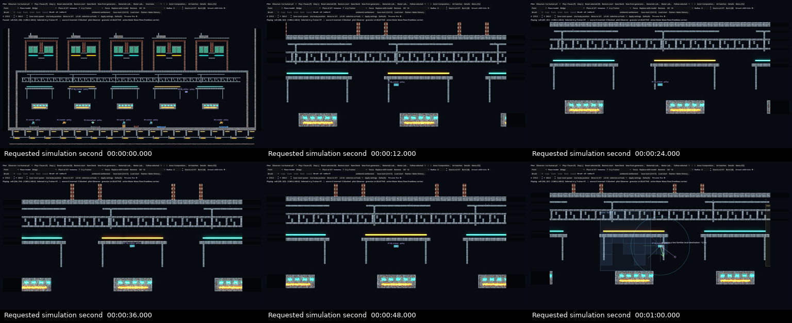

# AMBIENT-002 — home arrival and recharge, actual Foundry confirmation

**Disposition: the observed home-rest mismatch is repaired in application
`50c6df89528dc9ecdc5316d8c67abf203e192254`.** In a fresh ordinary Workbench
process, the Cautious Flyer reaches the same accepted home position as the
preserved a725 run, rests there, gains exploration drive and resumes exploring.
The result exercises the exact band that previously failed: its settled
position is about 16.49 cells from home, outside the ordinary sixteen-cell
recharge radius and inside this module's authored twenty-cell arrival radius.
This is a source-specific confirmation of one shared rule, not a claim that the
rest of the settlement now navigates better or that every personality is
compelling. The previous negative sequence remains unchanged in the
[three-scene review](graphical-watch-review.md).

## What the original copied records show

The scene is **Foundry Row** (`ambient2-settlement`), with eight physical actors.
The followed inhabitant is instance **7**, native actor **6**, the ordinary
`cautious_flyer` profile on **4LY Trainer**. Its home center is `(365, 355)`.
The [read-only comparison](evidence/home-recharge-50c6/comparison.json) verifies
each original report, process receipt, log and all 61 original PNG hashes. It
also compares the unchanged authored scene and all eight initial copied actor
observations. The selected actor's sampled positions remain exactly equal to
the old a725 observation through requested second 52; later motion diverges.
This is observed agreement between these two hosted runs, not a general claim
of physics determinism.

| Requested simulation second | Distance from home, cells | Selected phase | a725 exploration drive | 50c6 exploration drive |
| ---: | ---: | --- | ---: | ---: |
| 44 | 68.141772 | Home approach | 0.359515 | 0.359515 |
| 45 | 56.690647 | Home approach | 0.348115 | 0.348115 |
| 46 | 43.981669 | Home approach | 0.336715 | 0.336715 |
| 47 | 31.276838 | Home approach | 0.325315 | 0.325315 |
| 48 | 18.367108 | Home rest | 0.313915 | 0.324055 |
| 49 | 16.492072 | Home rest | 0.306961 | 0.414055 |
| 50 | 16.489544 | Home rest | 0.302971 | 0.504055 |
| 51 | 16.489544 | Home rest | 0.298981 | 0.594055 |
| 52 | 16.489578 | Unfamiliar exploration resumes | 0.294991 | 0.684055 |

The actual copied times are approximately each requested second plus
0.016667 seconds. During the three intervals from sample 48 to sample 51,
the repaired drive increases by **0.270000**, at **0.09 per simulation second**.
The earlier drive decreases by **0.014934** over the same sampled interval.
All four home-rest samples are outside sixteen cells. This directly confirms
the shared rule now honors the selected home module's accepted radius while
continuing to check current physical position.

The goal retains home key `1`; accumulated selected home-rest time advances
from about 0.1 to 3.1 seconds across samples 48–51. Sample 52 has resumed the
previous unfamiliar destination, key `5`; it is not recorded as still resting.
The drive at that sample includes recharge from the preceding interval. These
coarse samples do not supply a complete decision-rate transition history.

Rest is not inferred from a zero actuator command. The flyer actually coasts
about **1.8866 cells** from samples 48 to 51. From samples 49 through 52 its
total sampled path is **0.00420945 cells**, with a net displacement of about
0.00277777 cells. This small residual supports observed settling; it is not a
guarantee of perfect physical stillness. From samples 52 through 60 the flyer
travels **70.82395 sampled cells**, ending **60.03634 cells** from its sample-52
position. The copied movement therefore supports a visible departure after
rest, beyond a change of intention text.

## Exact source and execution identity

| Item | Identity |
| --- | --- |
| Frozen application | `50c6df89528dc9ecdc5316d8c67abf203e192254` |
| Application tree | `d9740be7cafb8ac7b7d6eee4a16219989745fd95` |
| External observer | `52900f9d8ead1f6d0b3c4ae6fbdc1e0ac049ce4b` |
| Actual hosted run | [45552888360](https://github.com/techrote/cybersand/actions/runs/45552888360), job `138997939605`, success |
| Original artifact | [14994329664](https://github.com/techrote/cybersand/actions/runs/45552888360/artifacts/14994329664), 25,590,794 bytes |
| Original artifact SHA-256 | `0c13de36d1d60935a6d1e4b20ce764da670851f7199d402caf5059d493bd9447` |
| Original watch report SHA-256 | `8099576e84f310ae99a0bc5e0390eed20c3606a7007bc27a8b60281692bf8c47` |
| Unchanged observer GDScript SHA-256 | `aac731d1d44fcc46beca22ea6b0ee84e1acfe4c09ad51cc47bd52abb8c922379` |

The external runner admits the application only when its actual Git revision
equals the requested full SHA. Its original compile and graphical campaigns
agree on all **855 loaded project input hashes**, source identity, engine,
retained native/Rapier bytes and external observer files. The observer remained
outside the application project. It used ordinary Load, Play, selection,
Follow selected and overlay controls, with production native and physical
owners; it did not inject actor commands, teleport actors or directly advance
the simulation.

Relative to a725, exactly three loaded project files change: the shared engine,
its living-core regression fixture, and a one-word editor help correction
(`rest drives` to `social drives`). No scene, profile, observation scope,
actuator, runtime or physical law was retuned for this confirmation. The
engine repair uses the arrival radius of the exact selected, enabled,
positive-weight home module only during its admitted `home_rest` phase;
ordinary neutral rest retains sixteen cells. Current-position containment
still applies, and reconfiguration resets the prior intent.

The actual episode completes **60.016667 simulation seconds**, **3,601 native
ticks** and **3,601 physical ticks**. All 61 frames are **1920 × 1080**. Their
displayed actor publications match their own displayed material generation and
revision; the reader independently joins **488 current copied actor positions**
to their capture entries. The post-Play roster and authority remain stable,
with no actor command rejections or errors. These eight actor observations are
outside the registered 194-episode scientific programme.

## What is visible and interesting

The original close frames show the selected flyer under a beam, returning
toward its home area and settling before leaving again. At sample 51 the
overlay explicitly reports resting at home; by sample 60 it reports an
unfamiliar local destination and shows the authored home, visited regions,
navigation rays and goal. The recharge conclusion comes from copied numeric
records, not from the sprite's color or the overlay label alone. Specialist C
viewed the contact sheet and original frames 48, 51 and 60; Specialists A and B
independently viewed neighboring originals and read the mechanism and motion
records.

This episode now has a coherent explore–return–rest–depart cycle. Its visible
limits remain: the flyer spends a long interval constrained near a beam, and
the home-rest repair does not add global navigation or make that obstruction
more entertaining. At Overview scale, inhabitants are small. Follow selected
makes the behavior legible, while the optional overlay adds useful explanations
at the cost of dense labels. The unchanged Common Ground episode remains the
stronger social demonstration; the sealed Oil cabinet in Pipe Orchard remains
a useful but repetitive recovery counterexample.

The [sampled movie](evidence/home-recharge-50c6/media/ambient2-settlement-sampled-timelapse.mp4)
contains the actual **61 sampled PNGs**, played at **six samples per second**,
lasting about **10.166667 seconds**. Its extra caption area explicitly says
**SAMPLED TIMELAPSE**. It is accelerated presentation of approximately one sample
per simulation second, not continuous video and not measured hardware FPS.
The original PNGs and their actual copied tick/time stamps remain authoritative.

## Cost and remaining limits

This is actual hosted Linux X11/OpenGL compatibility rendering using
**llvmpipe (LLVM 20.1.2, 256 bits)**. The game process takes **436.229 wall
seconds** and the complete observation campaign takes **443.924 seconds**.
Actual `frame_post_draw` intervals during Play have mean **114.848 ms** and
p95 **133.517 ms**; the bounded receipt retains all 3,601 intervals. The
measurement includes observation/capture work. Different hosted wall times
from the older run are not evidence of a performance improvement from the
repair. No physical NVIDIA, monitor latency or owner playfeel acceptance is
claimed.

The original watcher did not hash initial native material bytes. The comparison
therefore establishes identical authored scene and initial copied actor states,
same application inputs except the declared three-file change, and identical
selected actor positions through second 52. It does not claim an independently
measured equality of every initial native material cell. One selected home cycle
is a meaningful direct regression for the discovered mismatch; it does not
establish a population-wide rate of successful home return or long-term
behavioral diversity. The twenty-cell authored arrival remains distinct from
the primary scientific programme's separately defined sixteen-cell home metric.

## Durable originals and reproduction of this readback

The [archive manifest](evidence/home-recharge-50c6/archive-manifest.json) retains
the exact full Actions artifact in three ordered byte parts, including all 61
original frames, reports, process logs and source/runtime receipts. Selected
frames and the original derived media are also directly available alongside the
[read-only comparison script](evidence/home-recharge-50c6/read_home_recharge.py).
The gzip report is a lossless convenience copy; the uncompressed original stays
inside the exact artifact.

To reconstruct the archive, concatenate `archive/original.zip.part-000` through
`part-002` in manifest order, first verifying each part's byte count and SHA-256.
Verify the resulting 25,590,794-byte archive against the full SHA-256 above before
extracting. The comparison consumes the extracted old and new `graphical-watch`
directories and their sibling `observer-compile` directories. It never launches
Godot or changes either application. Original source identities and the unfavorable
a725 receipt remain separately available; no historical result was relabeled as
this repaired-source execution.
